# 全球暴跌的1929-09-01

作者：刘勇
2020年08月29日 22:10

周一全球股市大跌，引发了对“暴跌”的担忧。投资者开始担心：2020年是否会再次发生历史性的崩盘？如果这种趋势持续下去，股市将面临怎样的后果？

## （一）1929年的大崩盘
1929年10月，美国股市发生了著名的“黑色星期四”和“黑色星期二”。股市暴跌引发了全球性的经济危机，并开启了长达十年的“大萧条”。

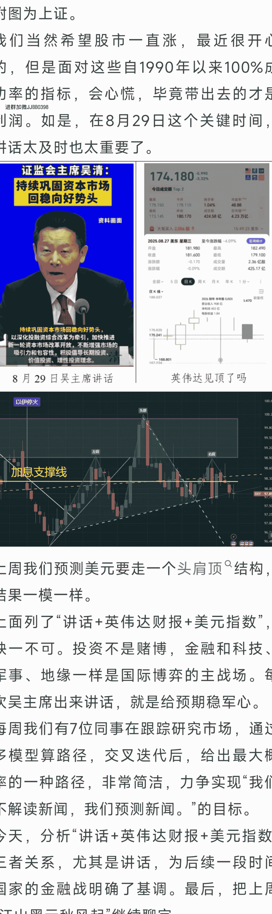

事实上，1929年的崩盘并不是从10月开始的。早在1929年初，美国股市就开始出现动荡。9月，道琼斯指数一度下跌了15%。11月，再次下跌了20%。12月，股市已经暴跌了近25%。

那么，2020年的股市暴跌与1929年相似吗？我们需要从两个方面来对比。

## （二）2020年的股市暴跌
2020年3月，新冠疫情引发了全球股市的暴跌。

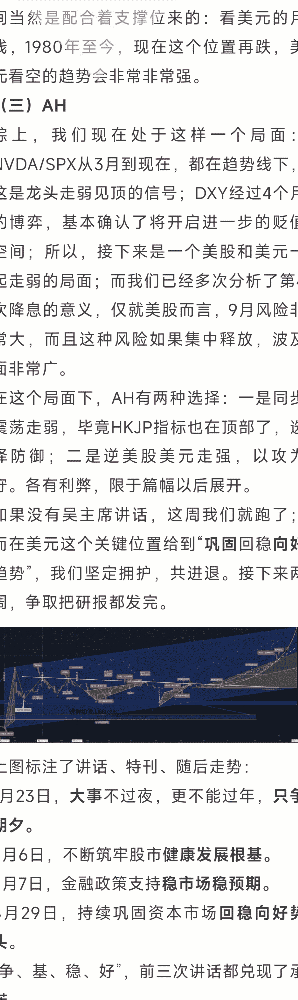

从3月中旬开始，美股开始暴跌。到3月23日，道琼斯指数跌幅超过30%，创下当时以来最大跌幅。

在短短一个多月的时间内，标普500指数的跌幅超过了30%。

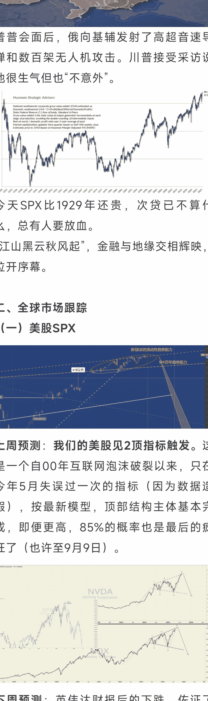

2020年的股市暴跌与1929年的不同之处在于：

### (BTC)

我最近建立了一个非常看好的走势结构，这种回调会持续多久？

这样的我期待一个回调：如果BTC继续回调，但幅度太大，我担心这个结构就坏了。

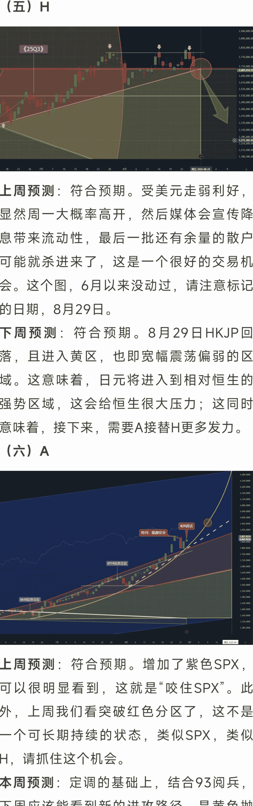

我们，不要太乐观，BTC这种结构我建立后我会盯着它的破位，特别防漏。

（图）

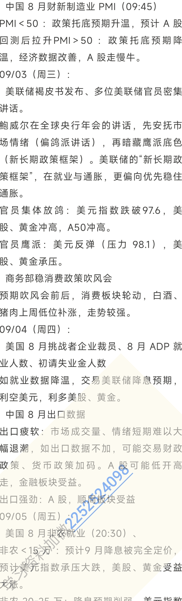

上周：震荡，高点走低，低点走高，回落一周，下周是否开始反弹？

下周：震荡，高点走低，低点走高。

（图二）

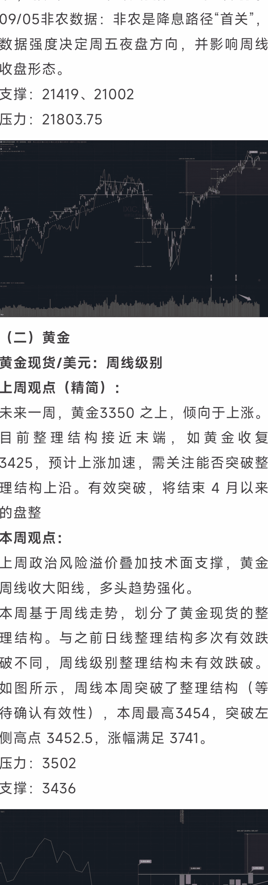

（图三）

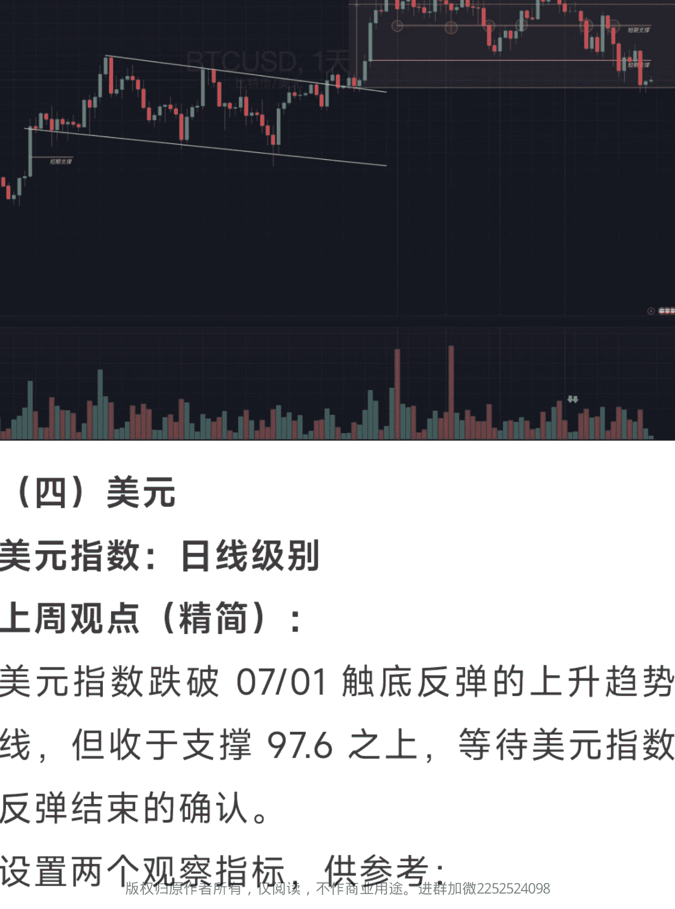

## 美股

- 道斯300指数：周一冲高后收跌
- 纳斯达克指数：周一冲高后收跌，跌幅0.26%。
- 标普500指数：周一收跌，跌幅0.27%。

本周展望：美股将维持震荡行情，跌幅预计在0.5%-2%之间。

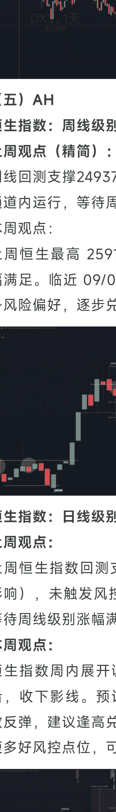

![道斯300指数走势]
道斯300指数：周一冲高后收跌

本周展望：美股将维持震荡行情，跌幅预计在0.5%-2%之间。

## 欧股

- 富指斯指数：周一冲高后收跌
- 德国DA克斯指数：周一冲高后收跌，跌幅0.26%。
- 法国CAC40指数：周一冲高后收跌，跌幅0.27%。

本周展望：欧股将维持震荡行情，跌幅预计在0.5%-2%之间。

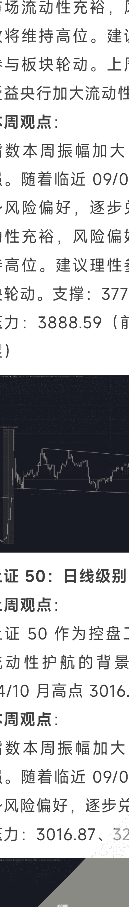

![欧股走势]
富指斯指数：周一冲高后收跌

本周展望：欧股将维持震荡行情，跌幅预计在0.5%-2%之间。

## 日股

- 日股：日经225指数：周一冲高后收跌

本周展望：日股将维持震荡行情，跌幅预计在0.5%-2%之间。

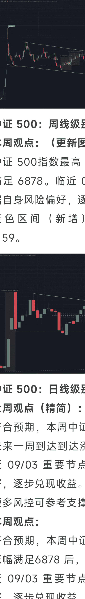

![日经225指数走势]
日经225指数：周一冲高后收跌

本周展望：日股将维持震荡行情，跌幅预计在0.5%-2%之间。

## 中股

- 中股：上深300指数：周一冲高后收跌

本周展望：中股将维持震荡行情，跌幅预计在0.5%-2%之间。

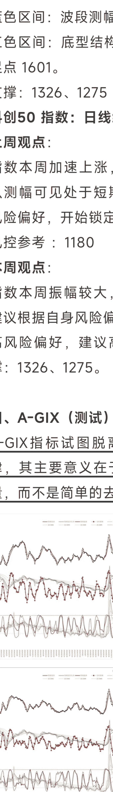

![上深300指数走势]
上深300指数：周一冲高后收跌

本周展望：中股将维持震荡行情，跌幅预计在0.5%-2%之间。

# 四、A-GIX测试

A-GIX指标图脱离K线观察市场纪律，其主要意义在于对整合仓大小的考虑，而不是简单的去测涨跌。

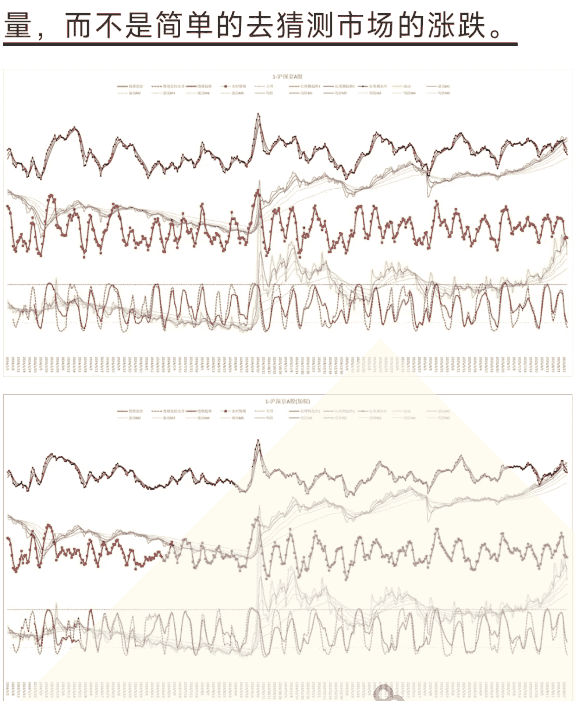

上为本周收盘数据图（图），指标上为价格均线及情绪趋势，情绪趋势的监控指标和波动均线指数。加权8月25日“情绪趋势”见转折，等图“情绪趋势”8月20日开始逐步走平、向下。

建立，“指数如加速，A-GIX指标将出现未充分下行的基础上发生两次触顶，建议观察，实际盘面指数运行行情后发生剧烈波动，周四、五指数复合较强，市场重心集中在权重上，以深300成分股为主。

本周收盘，市场成交量维持2.8万以上，A-GIX中两个监控指标再次下行到低位，情绪趋势下行趋势有所缓解，长周期趋势进入空头状态。

下周建议积极试错；周初若继续震荡范围，成交量接近2.5万附近，应视为不错的机会。具体操作仍以“情绪趋势”转为主，并持续观察长期短期趋势是否跟随趋势。
