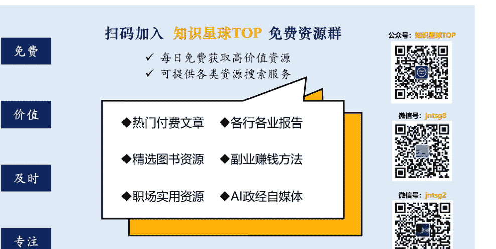

# 单身快速脱单的攻略！

# 20241230 剑客 | 斗魂之星

## 前言

读者问：男，31岁，程序员，资深社恐，之前在社交软件上交往过一个，感觉不接地气，很短暂就分手了。提问您有没有什么好的算法可以帮助我半年内快速脱单的（就长相有点小要求）？

剑客在后台会时不收到一些男读者的来信，讲什么呢？抱怨抱怨自己是正经要寻找未婚妻的，结果找的女友怎么不靠谱。

我往往看了开头就简单回了一个笑脸，也没有回复文字，为什么呢？因为他们大部分的开场白就决定了我不用继续下看了。

开头说了什么呢？

渠道。很多时候，男生认识女生的渠道，就决定了很多都是不靠谱的，反之亦然（女生在这些渠道认识的男生多半是不不靠谱的）。

下面咱们一起来来看：

## 渠道1：社交软件

微微信jntg2免费资料群

读者们，你现在仔细想一下，假如你现在还没有女朋友，你想脱单，你首先会想到什么途径？

很多人首先会想到去社交软件上一看，毕竟就是下个app，成本低，又能直达对象本人。

但现实情况是什么？社交软件上是彻底的女方市场（和相亲网站完全相反）。女生往往会先化精致的妆容再用美颜软件润色一下，然后把照片传到社交软件上，就能获得男人们海量的私信。

大概的情况是什么呢？她在现实中可能无人问津，但是在社交软件上，每天都有30个，50个，甚至上百个男生去私信她。

为什么反差这么大？因为她无意中集齐了高效社交的“三”高（颜值/流量/可得）要素。

So，你男生去找的竞争压力就会特别大。你有钱的，比你帅的，比你有钱的帅且会说话的，非常非常多。这会怎么样？让她看不清自己，以为自己的市场价值很高。那你和社交软件上的女生，一旦转为现实里交往，就会非常非常的难受（感觉她不接地气）。

类似的情况，各位有娃或者身边从事班主任工作的朋友会感受比较深刻。

很多小学老师工作的日常是什么？你有多大的领导，有多钱的老板，只要她一声令下，立马就得颠尾尾笑着脸到学校报道。

试问，有几个人能做到如此？而一个小学老师却可以轻而易举做到。她说往东，相信任何一个家长在家里都不敢往西，毕竟自己的孩子遭遇我家欺负大家都怕自己的孩子遭欺负。而且不管她做什么，大家都会赞她辛苦，教导有方。

发现了没？她们在校园（类似上面的那个社交平台）这个平台上一定会得到很多超出自己能力范围之外的情绪价值，然后慢慢自我麻，这是她们的宿命（性格由环境塑造，然后性格决定命运）。

之所以如此，这里也形成了一个强烈的反差：

由于家长们做得“太到位”（类比上面的线上感受），自然会显得家中的另一半做得“不到位”（类比上面的线上感受）。

而且家里人数（平台各类帅富公子）众多，讨好老师的招数花繁多样。线下见网友）孤独一人在家，很难做到比几十家长还贴心。这就是从小老师（沉浸在上线软件交友的热烈氛围中）婚姻超经营的内在理由。如果家长讨好老师（线上社交软件讨好女生），就好比一场百米短跑比赛，跑慢了后面有狗（其他优秀男生竞争）追着，跑赢了巨额奖金（赢得短程的机会）。路程短，动力自然足，所以大家都跑得快也很正常。

（线下见网友）对待当老师的妻子，就好比马拉松比赛（冲着长方向的），即便跑完全程，也只能得奖牌（结婚/好人卡）。路程很长，动力不足显而易见的，所以绝无可能用短跑比赛的速度跑完全程。毕竟感情对方对彼此的好都是相互的，没人会一直尽力地。

这是今天各位避的第一坑，下面继续大家解析其它渠道的坑，最后最重要的，会明确指出脱单的靠渠道和方法。

## 渠道2:娱乐场所

一句话就是：你看到的都是让你看到的。
剑客是做投资的，举个例子，记得之前有读者咨询过我，说那些网上公布的龙虎榜对指导个人投资有没有用。

他反问他，这些是证监要求披露的吗？显然不是。既然证监没有要求他披露，他披露这些干什么？如果这些信息对你有用，那他为什么要披露一些对你有好处的没有好处的东西供你研究。

我们阅读财报，是因为这是证监要求强制披露的，公司不得不披露，即便如此，很多公司都要粉饰，二手消息更是报喜不报忧。对于那些证监要求披露的信息，比如龙虎榜等，你想想为什么他要披露这个给你看。

所以在这个处都隐藏着镰刀的社会，散户们多寡少，也不奇怪了。我们一定要睁亮眼睛，明白信息发布背后的立场。你要知道任何观点，任何信息离不开立场。理解任何信息发布深层的原因，极为重要。

所有段子都叫什么？男人的钱是给你看的，而不是给你花的。同理，小姐们在抖音上跳，也是给你看的，不是给你用的。我们经常听到一句话，女人之所以漂亮是为了取悦自己。

很多女生总会说，漂亮是为了取悦。其实并非如此，女人之所以把自己打得很漂亮，穿着丝袜，瑜伽裤，大V领，终究还是取悦男人。

真相就是：女人取悦的是那些有价值、有能力、有地位的男人。

以上是现象背后的逻辑。

## 总结：女性发布逻辑（逻辑逻辑逻辑逻辑逻辑逻辑逻辑）

| 行为/现象 | 核心逻辑/目的 |
| :--- | :--- |
| 颜值/流量/可得 | 高效社交“三高”要素 |
| 精致妆容/美颜 | 获得男性海量私信 |
| 情绪价值 | 获得超出能力范围的补偿 |
| 这种悦自己 | 基因的本能 |
| 变漂亮 | 为了获得高价 |
| 投入钱 | 为了获得认可 |
| 变美 | 为了获得高价 |
| 漂亮衣服 | 为了吸引男性 |
| 丝袜/瑜伽裤 | 吸引原始欲望 |
| 臀股/大腿 | 诱惑男性，获得搭讪和追求 |

## 渠道3:相亲或者朋友介绍

大家要明白一个道理，漂亮的女人是很难找到的。

第一个渠道（社交软件）：
很多人首先会想到去社交软件上一看，毕竟就是下个app，成本低，又能直达对象本人。但现实情况是什么？社交软件上是彻底的女方市场（和相亲网站完全相反）。女生往往会先化精致的妆容再用美颜软件润色一下，然后把照片传到社交软件上，就能获得男人们海量的私信。

大概的情况是什么呢？她在现实中可能无人问津，但是在社交软件上，每天都有30个，50个，甚至上百个男生去私信她。

为什么反差这么大？因为她无意中集齐了高效社交的“三”高（颜值/流量/可得）要素。

So，你男生去找的竞争压力就会特别大。你有钱的，比你帅的，比你有钱的帅且会说话的，非常非常多。这会怎么样？让她看不清自己，以为自己的市场价值很高。那你和社交软件上的女生，一旦转为现实里交往，就会非常非常的难受（感觉她不接地气）。

第二个渠道（相亲/朋友介绍）：
相亲大概遇不到你想要的菜。好的感情需要时间和耐心，慢慢形成绊，才会珍惜。一旦出了校园，现在的男女很少有自然相处，就是一两次约会，没有什么特别的散了。很多人的表达和勾搭能力都是有限的。自然相处全靠特意安排的约会来相互吸引，难度增大。同理，如果是朋友介绍给你的，那概率也是过滤过的，找到好菜的难度很大。综上，通过以上渠道，你只能认识到一些不你需求的。

## 渠道4:三大渠道

一般而言，男生想要正常的一段恋爱，就是现实里面去搭讪，鼓起勇气，走到女人面前，告诉她们我想认识你。有哪些靠谱的渠道呢？

- 如果喜欢爱学习的女生，你就多去图书馆看书；
- 如果喜欢艺术气息的女生，你就多去画展，看歌剧，听音乐；
- 如果喜欢顾家会做饭的女生，你就多去逛超市菜市场，参加一些厨艺比赛；

总之，你心里要有一个明确的择偶标准、择偶方向，然后思考一下，你心里这样的女人她们大概会出现在什么样的场所。男生也一样。然后你再去这些场所的时候，就已经做好了深度的思想建设，再鼓起勇气去搭讪，这才是靠谱的途径。

如果按照“效率优先”的味道来选的话，最高的找对象途径有以下三个，咱们一一来看：

### 1、公益志愿者他们的特性一般有以下四点：

- 行动力强：一个人肯诸行动去当公益志愿者，至少在行动上是过过的，这一点非常重要。更多的人是口嗨型的键盘侠，真到了要付出的时候往往会得得失。
- 动力向善：无论你怎么坏，这种向善的动力是内在的，是一个巨大的加分项。
- 经济宽裕：大部分人还在忙着工作，没有时间、精力去当志愿者，这属于一种富余。
- 毅力强势：你可以关注那些坚持了一段时间的人，他们有了基本的回报。

### 2、学习同学

此外类型的读书会、兴趣小组、学术交流、演讲培训、烹饪学习等等，这些地方你会很容易观察到别人的智慧。参与这些活动的人，至少是以知识为乐的人。

### 3、单位同事

这个渠道对于普通人而言是最靠谱的方法：上个大学，找个靠谱的工作，然后头几年在单位不要到处交际，在有限的被动接触中把善良、懂事、可靠的性格展现出来，这种方式最为高效。

举几个例子：
- 帮打伞：下雨天你带伞，看见外面淋雨的同事，抓紧跑过去一起遮雨。
- 捡东西：同事文件不小心落了，只要不是涉密，路过就帮人家一下。
- 搭便车：你有时间又顺路，这种能顺就带一下。

如果你做了一段时间以后，背后有一个办公室同事对你评价“不错”，这就算达到的效果了。大家一起进入一个组织，本身就是一种审核。特别是体制内，一个人能通过笔试（智商没问题），通过面试（情商没问题），通过正审（家庭没问题），通过体检（身体没问题）。

为什么我们的老人喜欢自己的子女进入体制？他们未必都通透了，但是那么大，被社会打磨了。无论你爸还是你妈，都很清楚大多数人都得找错辙。至于那些指望自己成明星、指望自己成神协，那些都肯了。每一个年轻人都会做梦，老了都会醒梦，你爸妈又没有做过梦，只是蹉跎半生，醒了又哭了。年轻人唯一的区别在于还年轻，被生活打磨的还不够，还心存幻想，所以厌倦一眼看得到头的生活。其实你爸妈这辈子最向往的就是一眼望得到头，他们简直直求不得。所以他们催学，因为他们知道，你只有学好，才能上岸，才能有一个相对稳定的工作。其实年头也没有铁饭碗了，但陶瓷的总比泥巴的强些。

你只要能进去，闯一个月千块，你实际上就已经在一个相对优质的环境里了。你去找银行贷款都会被高看一眼。话说你病了，请个长假，也不会像私企那样被开掉的。

，好像是一拨人，其实不是的。游戏重来一次，幸存者就会另一拨了。话说没有人太闲日子过，会让自己的孩子那么忙，因为他们清楚，自己当年的幸存率是万分之一，现在哪怕有老子罩着，自己孩子学自己，幸运率也不过百分之一。

百分之一依然远低于九生死，谁会让自己孩子冒这个险？说穿了就这么点事，天下父母都是不求有功，但求……

所以，很多很牛的投资人，最后他们自己的孩子也不是做富翁的，根本没人去接班，巴菲特那种传统的线性投资模型，他的儿子都不接班。你想想为啥？其实在投资回报率的角度，做富翁根本就不打算。问题是，简单呀，收租总会吧。

你想想，为啥他们的孩子不是做富翁的，就是出门矿山、森林的？因为不挑人嘛，只有避免幸存者偏差，才能做到换谁来都一样。

一样的道理，不是你妈妈真觉得考试有啥好，婚姻有啥好，而是个凑合。那种上岸的破功夫也有很多辈，但好赖赖不死，大多数婚姻的就是哼着鼻子，忍对着对方凑合过，大多数女儿也不孝顺，但好赖不会像周海娜那样，去世时身边一个人都没有，以至于今天都疑点重重，查清楚。

所以，普通人，还是在靠谱的渠道里找个靠谱的人比较实在。全文完！
