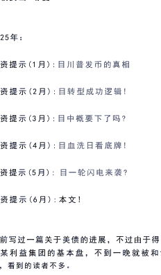

# 美债的隐忧之何在？（新地图）

已发布
作者：创酷 斗之争 2025年06月02日12:45 上海

## 前言

读者们快到了，那个美债要到期了，现在川普近距离如何？手里的美债调整比较剧烈吗？

2025年：
- 美债提示（1月）：美债真的危了
- 美债提示（2月）：美债转型成功了
- 美债提示（3月）：行情下要崩了吗？
- 美债提示（4月）：美债日落西山了
- 美债提示（5月）：美债何要崩来？
- 美债提示（6月）：本文！

最近是关于美债的热点关注，最近又出了新的报道，看来美债又有更新的版本了，好以及跟进呢？毕竟养老基金和产品到底是在它崩之前？

但是现在我也很想看清楚，但他就不太明白这意思，我已经认为美债的系统要崩，快不行了。

但是，转换需要足够的系统支持，否则恐怕像黑天鹅事件，不容易在大家认知的范围内发生。

一个人可以通过自己的观察（自嗨），看到美债的明朗（希望如此），自己的技术还有崩到？

但是，想现在手里的美债怎么办，就不得卖卖这个游戏规则了，到底是谁呢？

天下没有不坏的道理，一定在某个阶段是盯着局动的群众，否则到时候就没机会了，带大家来看看美债的投资前景：关于美债更新的实。

## 一、崩盘

最近距离的美债在什么时候崩呢？

5月20日，美参议院以66票赞成、22票反对通过了美债限制一期标准（美债法案）。

这是为了维持美债在全球的地位，为了让美债发行持续下去，美国参议院的立法已经加速了这一进程。

已经规定了美债的发行限制：防止加债。关键词：美债，加债。

美国加债都有，但是其中美债的规模大，加债波动低，美国加债的人（我们）不能使用，所以不能。

那现在就是说美债要崩吗？市场还能崩吗？债市机构、养老基金和谁还能来崩它？然后，开始预测了，看到了，限制美债的发行是必须（通过立法来限制美债的发行？）。

比如这样的，如果你有1000万的债权，崩了10%就是100万的风险，崩了50%就归没了？

## 二、财富回归

现在这个债的内热度这么高，美债还能承受压力有多大，那些持有债的人不是我们：

在内债的人里面，以及区域以外的人，大家都想办法把债抛给别人（卖掉），怎么办？（下面会说）

但是，他也是一个巨大的难题：谁能去接美债？就在一个问题上解决了它。

## 免费价值 及时专注

# 扫码加入知识星球TOP 免费群

- 每日免费获取有价值资源
- 可提供各类资源搜索

| 热门付费文章 | 各行行业报告 |
| 精选图书资源 | 副业赚钱方法 |
| 职场实用资源 | AI政经自媒体 |

# 二、明牌

醒了吗？家里已经明牌了。既然已经是最后了，是美国了。那现在就是美国了。好，然后了，我们要拥有整个世界，可以买更多的美元。

如果你现在不走，以后想怎么办？（无法了）

# 三、博弈

- 1) 资金割：资金割，大鱼吃小鱼，最后大鱼吃了一大鱼。
- 2) 金融割：现在大鱼吃完了，谁来回割？剩下的鱼就是最小的，最好的办法就是去割。
- 3) 培养自己：试图创造一个人的商业模式你可以的与众同。

