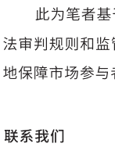
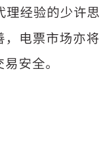

# 金融资争议解决
经典案例集

金杜律师事务所
KING&WOOD
MALLESON

# 知识星球TOP 资源分享社群

汇聚全网付费资源 让更多人获取高价值信息

- 付费文章
- 付费社群
- 付费课程
- 副业&搞钱
- 财经&股市
- 行业报告

时政·历史·职场·体制·自媒体学习·军事·软件·影音·社会学

公众号:知识星球TOP 微信号:jntsg8 微信号:jntsg2

添加微信 免费进群

# 金融资管争议解决
经典案例集

# 序言

近年来，我国金融市场呈现稳健发展良好态势。在国际局势持续演变、全球资本回报率回降、国内经济结构转型的多重背景下，中国金融体系正经历从“规模驱动”向“质量驱动”的深水区转型。随着全球金融秩序、行业的日益整合、更加严格的金融监管及演变化的国内国际竞争格局，为中国金融行业带来一系列复杂挑战，也为市场主体带来了企业客户孕育出的结构性机遇。

在金融领域，银行、基金、保险正加速构建多层次服务体系。商业银行通过投资联动、供应链金融等新模式支持实体经济发展。2024年非银类金融资管规模仍增长18%，保险金融通过债权投资、股权、股权计划等方式实现战略性新兴产业布局，全新业务投资规模突破2.6万亿元。

截至2024年，资产管理行业总规模突破150万亿元，创造了历史新高。在此背景下，资产管理行业由单一策略向多元生态体系转型，已逐步形成公募、银行理财、券商资管、信托、私募等多元的发展格局。企业作为资金供给与需求的主体，既可通过标准化资产产品优化资金管理与结构性资产配置，又可通过信托、私募等非标实现项目融资、风险隔离，随之而来的是更复杂的产品结构、更复杂的风险及法律层面的合规要求。

此时，与金融市场的法律关系也随着参与者专业化而出现。法律实践中，确保责任、回购安排、清算、托管、穿透监管等问题的争议层出穷，合同交易中的纠纷、优先授权、止损机制、估值调整等内容成为司法审查的重点。企业在合约设计阶段如何前瞻性识别风险，在争议发生后如何有效维护权利，在复杂交易中如何厘清法律业务，对法律服务提出了更高的法律要求。

金争议解决金融资管业务组多年来积累各类金融纠纷诉讼和案件审查经验的深度积累，靠法律逻辑与典型案例实务经验，撰写了《金融争议解决解决方案案例》一书，系统梳理并深入评析了诸增信机制、普通合伙人责任边界、银团贷款重整、基金清算责任、跨境衍生争议处理等典型问题，力求为客户、金融机构及法律实务者提供具有实操指导价值的参考。

金融法治的发展，不仅依赖规范建设与制度供给，更依托市场参与者的集体学习与良性互动。本书是我们阶段性经验的沉淀与分享，也期待为业内同仁搭建维护交流与专业碰撞的平台，助力企业与法律实务者获得有益启示。我们诚恳欢迎广大读者提出宝贵建议。

同时，我们期望在金融法治建设过程中贡献专业力量，推动法律服务与金融实践的深度融合，共同守护金融交易的安全与秩序。

2025年8月

余日红
金杜争议解决业务负责人

关峰
金杜争议解决金融资管业务组负责人

# 金融资争议解决简介

金杜律师事务所（“金杜”）是一家总部位于亚洲的国际律师事务所。在中国内地及香港行政区拥有500多名合伙人和2000多名律师，设有17个办公室，分布于中东、非洲、新加坡、澳洲等地，并与Eversheds Sutherland International深度合作，进一步扩大了在欧洲、非洲的全球网络。金杜争议解决团队超过100名合伙人、400多名律师，堪称中国最大的争议解决团队。选择金杜，您将获得一流的支持并应对各种挑战。我们致力于为客户提供专业、高效、可持续的发展。作为中国领先的律师事务所，我们的争议解决与诉讼在以下几个方面展现了卓越：

- 多领域覆盖：我们参与了各类金融争议，涵盖证券、投资、金融产品多个领域。我们在这些领域具有深厚的理论和执业经验，可以为客户提供全面的法律支持。
- 多化类型：我们参与了各类金融争议和仲裁，包括贷款、担保、信托、保险、信用证、融资合同、债务违约、私募基金投资及衍生品。无论是涉及金融机构、投资者还是相关方，我们都具有处理此类案件的经验。
- 深入法院：我们代表客户在中国本土法院具有丰富的法庭经验，为客户有效维护权益，解决争议并控制风险。同时，我们还与海外办公室协作处理跨法域纠纷及平行诉讼。
- 合规性和风险管理：我们不仅关注案件的合规性并管理风险，我们的法律专家团队严密关注最新法规和趋势，帮助客户避免潜在风险。
- 协同工作：我们与事务所的其他领域密切配合，为客户提供全方位、针对性、一站式的解决方案。根据具体项目需求，我们深入分析案件涉及的业务领域和行业特点，确保为客户提供最佳法律支持。

不论客户面临的金融监管挑战是投资、融资还是金融中介的问题，我们的团队将为客户提供卓越的法律服务。我们以专业和客户导向的方法，致力于帮助客户争议、保护权益并降低风险。

# 联系我们

## 华东

**关峰**
T: 021-2412 6025
E: guanfeng@cn.kwm.com

**李盛**
T: 021-2412 6069
E: jonathan.li@cn.kwm.com

**王建团**
T: 021-2412 6169
E: wangianjian1@cn.kwm.com

**张皓钧**
T: 021-2412 6315
E: zhanghaojun@cn.kwm.com

## 华北

**姜丛华**
T: 0571-5671 8078
E: jiangconghua@cn.kwm.com

**赵冠南**
T: 021-2412 6357
E: zhaoguanannan@cn.kwm.com

**周婷**
T: 0571-5671 8070
E: zhouting@cn.kwm.com

**彭亚**
T: 010-5878 5263
E: pengya@cn.kwm.com

## 华南

**冯慧**
T: 010-5878 5953
E: fenghui@cn.kwm.com

**刘斌**
T: 010-5878 5973
E: liubin@cn.kwm.com

**徐晓丹**
T: 010-5878 5028
E: xuxiaodan@cn.kwm.com

**徐海龙**
T: 010-5661 2590
E: xuhailong@cn.kwm.com

**罗文彬**
T: 010-5661 2657
E: luowenbin@cn.kwm.com

**林嘉**
T: 0755-2216 3361
E: linjia@cn.kwm.com

**余锋**
T: 0755-2216 3309
E: yufeng@cn.kwm.com

**腾海迪**
T: 0755-2216 3389
E: tenghaidi@cn.kwm.com

**赵菲**
T: 0755-2216 3349
E: zhafei@cn.kwm.com

**程珂**
T: 020-3819 1008
E: chengke@cn.kwm.com

**邹青**
T: 0755-2216 7128
E: yuqing1@cn.kwm.com

**李沛然**
T: 0755-2216 7157
E: lipeiran@cn.kwm.com

**柳辰**
T: 0755-2216 3385
E: liuchen@cn.kwm.com

**陈俊文**
T: 0755-2216 3376
E: chenjunwen@cn.kwm.com

# 目录

## 金融借款与担保
## 金融资争议解决

## 金融借款与担保
- 关联担保的认定应从立法的目的理解及夫妻共同债务的标准——某银行诉广东某新能源科技有限公司、某水力发电集团有限公司、某李、广东某发电集团有限公司、某水电有限公司、武某借及担保合同纠纷
- 证券债券清收上市公司质押债权——某证券公司申请强制执行系列案件
- 信托计划中独立措施的认定和实现——债权人第三人撤销之系列案件
- 多种手段实现债权——某香港银行某贷款综合运用、行政、手段向最高法院——某银行间违规债权转让导致无效纠纷
- “以用止还”的实践——某地产公司诉某银行贷款纠纷
- 股东质权承担——某某诉某质责任纠纷
- 贷款项下的破产程序——某食品企业破产
- 第三方挂付贷款情形的法律关系认定——某公司等等贷款纠纷

## 私募基金投资
- GP合伙人一致同意修改基金业绩对赌，能否认定为擅自处分行为而无效——某科技公司诉投资基金估值调整纠纷
- 基金方审计机构对基金财务状况作出的审计报告，能否确定涉及业绩义务的依据——某型基金业绩补偿及股权回购纠纷
- 业绩补偿方式选择权的转移——某某诉某咨询企业等基金融资贷款纠纷
- 合同解除权的行使——刘某及相关合伙企业与某上市公司约定收益对赌仲裁纠纷
- 实际控制人为公司业绩对赌承担连带责任——A公司（有限合伙）诉合同纠纷
- 执行法院拆解合伙企业局——某会计及其合伙人执行诉合同纠纷
- 哪些行为可以被认定为迟延清算而触发清算——某控申请指定清算组一案

# 资产管理
- 通信损失的认定及因果关系的判断——某商业行诉信托公司营业信托纠纷
- 无固定期限资管产品中管理人责任认定及因果关系判断——某级诉某证券公司
- 私募未完成清算，投资人如何索权——李某诉基金经理、托管人委托合同纠纷

## 金融衍生品
- 原油掉期交易中事件及违约责任应适用国际惯例予以认定——某外资银行诉某公司金融交易纠纷
- 诉策略应对跨境交易纠纷——某公司诉某外资银行、某银行香港分行、某境外银行上海金融交易纠纷
- 香港展账户纠纷的境内追索——香港证券公司诉陈某展账户交易纠纷

### 信用证
- 某大国型银行诉某出口公司信用证诈纠纷

# 票据
- 电子商务汇票期前提示、线追索的效力——某知名新能源企业票据追索系列纠纷

## 案例

### 关联担保的认定应从立法的目的进行理解及夫妻共同债务认定的标准——某银行诉广东某新能源科技有限公司、某水力发电集团有限公司、某李、广东某发电集团有限公司、某水电有限公司、武某借及担保合同纠纷

程冈

关键词：关联担保、夫妻共同债务

裁判要点：
1. 对于《中华人民共和国公司法》第十六条第二款规定的“公司为公司股东或实际控制人提供担保”的情形，在司法实践中应当从立法的角度进行解释，将“公司为公司股东或实际控制人所控制的企业提供担保”也纳入该条款的调整范围；
2. 在借款人实际控制人离婚的情形下，对于其婚姻存续期间产生的债务，需要从受益利益角度判断是否属于夫妻共同债务；
3. 自然人保证在婚姻期间与其配偶签订的财产分割协议，对外不具有对抗效力；

案情摘要：
一审：北京市高级人民法院（2019）京初民XX、XX号（2019年12月31日）
二审：中华人民共和国最高人民法院（2023）

2014年9月15日，广东某新能源有限公司作为借款人与作为贷款人的某银行、作为出质人的某水力发电集团有限公司、作为担保人的某水力发电集团有限公司、某水电站有限公司、李家某签订《人民币资金贷款合同变更协议》（合同编号：440027312301151051004，原编号：44002731230115101514、440027312301151051002）。

2015年11月18日，广东某新能源有限公司作为借款人与作为贷款人的银行、作为出质人的某水力发电集团有限公司、作为担保人的某水力发电集团有限公司、某水电站有限公司、李家某签订《人民币资金贷款合同变更协议》（合同编号：440027312301151051004，原编号：44002731230115101514、440027312301151051002）。

2015年11月18日，某银行与某水电站有限公司签订《保证合同》，约定：为确保借款人广东某新能源有限公司与其贷款人签订的编号为4400273123011502014人民币资金贷款及其变更协议（简称“主合同1”）、44002731230115101515的外资金贷款及其变更协议（简称“主合同2”），以下将“主合同1”和“主合同2”统称为“主合同”），保证向债人提供担保。

2015年11月18日，广东某新能源有限公司作为借款人与作为贷款人的某银行、作为出质人的某水力发电集团有限公司、某水电站有限公司、李家某签订《外币资金贷款合同变更协议》（合同编号：440027312301151015015，原编号：44002731230115101515、440027312301151051003）。

2016年1月13日，某银行与某水力发电集团有限公司签订《质押合同》，约定：为确保借款人广东某新能源有限公司履行其与质权人签订的编号为440027312301151015014的贷款及编号为440027312301151014003、440027312301151014004的变更协议（简称“主合同1”）和编号为440027312301151015002、440027312301151051002、440027312301151051004的变更协议（简称“主合同2”）（以下将“主合同1”和“主合同2”统称为“主合同”），出质人愿意以其有处置的股权质押，向质权人提供担保。

2016年5月20日，广东某新能源有限公司作为借款人与作为贷款人的某银行、作为出质人的某水力发电集团有限公司（出质人1）、广东某发电集团有限公司（出质人2）、某水力发电集团有限公司（出质人3）、作为保证人的某水力发电集团有限公司（保证人1）、某水电有限公司（保证人2）、某李（保证人3）签订了《人民币资金借款合同、保证合同及变更协议》。

2016年5月20日，广东新能源科技有限公司作为借款人与作为贷款人的某某银行、作为出质人的某水力发电集团有限公司（出质人1）、广东某发电集团有限公司（出质人2）、某水力发电集团有限公司（出质人3）、作为保证人的某水力发电集团有限公司（保证人1）、某水电有限公司（保证人2）、某李（保证人3）签订了《外币借款合同、保证合同及变更协议》。

2017年3月14日，某银行、广东新能源有限公司与某水力发电集团有限公司、广东某发电集团有限公司、某水电站有限公司、李某签订了《确认书》。该确认书对贷款合同进行了修改，双方确认书对贷款合同编号修改（包括但不限于担保合同、账户等）有效。

另有，2017年1月9日，广东新能源科技有限公司变更为某水力发电集团有限公司（股权占比80%）、广东某发电集团有限公司（股权占比30%）、某水电站有限公司（股权占比40%）、广东东江电力有限公司（股权占比6%）、中普资产管理有限公司（股权占比7%）、北京华高科有限公司（股权占比8%）、王等。

再查，某丽与李某离婚案（2017年）民事判决书中：“原告李某、被告某、某水力发电集团有限公司董事长某、某某某某某某、某水电站有限公司李某……”民事判决书中显示，李某与被告某之间出现了矛盾，并且通过诉讼方式解决婚姻问题，且未解决。李某提出离婚是因为婚姻生活有了裂痕，李某在婚姻生活中还有一个孩子，李某，通过诉讼方式解决。李某提出离婚并非本意，是因为婚姻生活有了矛盾，李某在婚姻生活中还有一个孩子，李某，通过诉讼方式解决。

审理查：李某与武于2017年1月20日签订《离婚协议》及《补充协议一》《补充协议二》，上述协议的甲方为李某，乙方为武。李某的住所为北京市朝阳区京源公园、西河北里XXX号。武夫妻双方对财产分割的内容是……经协商，约定如下：

一、公司股权及补偿款。甲、乙方双方就夫妻财产分割事项约定如下：一、公司股权及补偿款。方案为：由甲方一次性给予乙方股权补偿。具体的金额、时间如下：本协议签订日即付人民币万，本协议签订后九日内付人民币万，本协议签订后八十日内付人民币万，还款于本协议签订后每一百三十日每付叁万，直至付清，乙方收到甲方交款后，为甲方出具收据。

二、财产。双方共有的北京朝阳区宝润宝源XXX号、北京市太阳国际XXX号、北京市朝阳区太阳国际B2KKXXXX号、海淀区公园小区、花家园、武城区朝阳家园所有权均归甲方所有。二、上述财产中未付或未分割的购款项，由乙方应在本协议生效之日起十日内清完。本协议生效后九日内，乙方与甲方办理房屋产权登记，由此产生的费用由甲方承担。

三、关于子女抚养费。1.甲方，承担女儿李某学习期间的生活费，乙方承担李某大学毕业时；学习费用全部由甲方承担。2.乙方，承担李某的全部保险教育基金。3.甲方，承担女儿李某及其在暑假和节假日期间出国、旅游的全部费用。

四、其他约定。3、甲、乙方双方依据本协议取得的财产所得税费双方签字签署生效。4、甲、乙方双方，本协议生效前各自设定的无论是与本协议涉及财产有关或无关的债权债务，均由自己承担；在本协议生效后取得的财产、其所产生的财产债务由双方各自拥有和承担。

五、甲方双方同意，本协议约定之外的其他夫妻财产，均按照谁占有（控制、使用）所有的原则确定归属；任何一方依据本协议取得的财产及其投资、转让、收益，任何一方在本协议生效后取得的财产及其所产生的债务由双方各自拥有与另一方有关。六、甲、乙方双方，本协议生效后，双方就婚姻关系的描述另签署补充协议。

## 金融贷款与担保

本案从起至二审判决历经了4年时间，二审在最高法院审理，涉及关联担保效力、夫妻共同债务的敏感问题，案件在多次无法达成一致意见的情况下，将本案提交最高法审判委员会民事司法专业委员会讨论后结论，其对于下几个法律问题的最终结果和标准对于类似案件提供了较为权威的依据。

### 《中华人民共和国公司法》第十条关于关联交易的规定

（一）法例规定适用诉讼

《中华人民共和国公司法》第十条规定：“向公司提供投资或为他人提供服务，依照公司章程的规定，由董事或者股东、股东大会决议；公司章程对投资或承担的总额及单项投资或担保的金额规定的，不得超过规定的限额。”

### 二、关于某水电站有限公司是否承担赔偿责任

关于某水电站有限公司如何承担赔偿责任。最高人民法院关于《民法典》若干解释》第七条规定：“主合同有效则担保合同有效，债权人有效的，担保人需连带赔偿责任；债务人承担范围不超过债务的一部分。”在本案中，如前所述，某银行未载明其与某水电站有限公司签订的保证合同及相应修改有效。

### 三、关于某某是否应当在《夫妻财产分割协议》项下取得的财产对案涉债务承担责任

首先，案涉借合同签订于李某、武某二人婚姻存续期间，李某对经营其实控制的多数企业的收益是家庭经济的来源，武某因此获益。

## 金融争议诉讼案例

2016年10月21日至2017年2月24日，某银行起诉借款人欠资金人民币6.85亿元及9.64亿元及相应利息尚未还清。一审过程中，武某对银行提交的3份《借款合同变更协议》、《人民币借款合同》、《保证合同变更协议》、《保证合同确认书》上的签字提出异议，认为不是武某签的，而是为本人签署的。法院明确指出鉴定对象为北京长城鉴定（以下简称“长城鉴定”）为鉴定机构。经银行和双方确认后，长城鉴定查阅了武某签字的5份文件作为样本。长城鉴定于2020年7月9日具编号为长城鉴〔2020〕文鉴字第94号的司法意见书，鉴定意见为：7份材料上的“武某”签字与样本上的武某签字不是同一人所写。法院确认《借款合同变更协议》、《人民币借款合同变更协议》、《保证合同确认书》的签字非武某本人签字。

裁判结果：北京市高级法院于2019年12月3日作出一审判决，判决武某对案涉债务承担责任，保证人广东源能科技有限公司对案涉债务水力发电集团有限公司、李某对全部债务承担连带保证责任，银行有权对杭州广东发电集团有限公司、广东水力集团有限公司对抵押财产买款项享有优先受偿权，银行有权对杭州广东发电集团有限公司广东源能科技有限公司对抵押财产买款项享有优先受偿权，某某有限公司对案涉债务承担二分之一三的责任，武某于北京市朝阳区人民法院（2012）民事初字XXXXXX号民事判书中实际取得的财产对案涉债务连带清偿责任。

一审判决作出后，武某、银行、某水电站有限公司和某某某三方提出了上诉，最高法院民事审判委员会专业委员讨论后，最终维持一审判决。

裁判理由：

一、关于某水电站有限公司是否需要担保责任

从本案事实及各当事人均没有争议的事实可知，本案的借款人广东源能科技有限公司、保证人某水电站有限公司以及持有某水电站有限公司80%股份的股东广东水力发电集团有限公司为实际控制人的关联公司，某水电站有限公司提供的担保为实际控制人李某控制的广东源能科技有限公司提供担保。根据《民法典》第十六条的规定，将某水电站有限公司提供的担保认定为关联公司，除非无法通过法定程序证明实际控制人利用优势，通过担保损害公司、中小股东和债权人的利益。原审判决将担保认定为关联公司，予以认可。根据《民法典》第十六条的规定，实际控制人支配的股东，不得参加担保事项的表决。

案例评析及建议：

本案从起至二审判决历经了4年时间，二审在最高法院审理，涉及关联担保效力、夫妻共同债务的敏感问题，案件在多次无法达成一致意见的情况下，将本案提交最高法审判委员会民事司法专业委员会讨论后结论，其对于下几个法律问题的最终结果和标准对于类似案件提供了较为权威的依据。

# 金融贷款与保险 1025

与适用书中，对于对担保解释如何适用方面有了了解，其中《民法典》第77页专门做了论述。由于《民法典》并非一部新设的法律，而是由其之前的几部法律经过整合、删减、变更之后形成的，因此由于此对《民法典》所配套的几部司法解释，也不能统一适用或不适用，而是要看司法解释所对应的《民法典》中的若干条本身是否与旧法有涉及。而《最高人民法院关于适用<中华人民共和国民法典>时效问题的若干规定》第一条的规定：“在《民法典》施行以前的法律事实涉及的民事诉讼的，适用当时的法律、司法解释的”，因此《民法典》中的条文是否有涉及，是要看《民法典》中的条文与之前的九部法律中是否一致的，然后视情况判断：

- 1、《民法典》中的条文与之前的九部法律中不一致的，对应的《民法典》司法解释应当在审理过程中引用。
- 2、《民法典》中的条款是完全遵循之前九部法律中条款的，原则上在案件审理的理由部分可以引用，但是需要区分是解释适用还是借用，所谓司法解释是对法律适用理解和理解有分歧的解释；而司法解释不仅包括解释条文，也包括对漏洞的填补。

该书第78条明确指出：“在司法解释填补制定法律漏洞的情况下，因有准则的性质，为保护当事人的合理预期，不宜将此类解释及对原本的解释。”

具有具体案例，在法院立场立法的角度，对《民法典》第16条作出与学术意见具有明显的差别，其核心的在于填补法律漏洞。按照这种解释方式对当事人在2011年的合同效力进行认定，还是一定程度考虑了当事人在当时对法律行为所做出的后果。

## 二、夫妻共同债务的认定问题

要夫妻共同债务的认定问题，主要是在《中华人民共和国民法典》第一千六十六条第第一款和《最高人民法院关于适用<中华人民共和国婚姻法>若干问题的解释（二）》第二十五条进行规定。其核心在于认定债务是否产生于夫妻共同生活，还是属于夫妻共同经营。而对于本案中，由于李某不是直接的借人，应当承担的担保责任，再考虑到债务金额合计人民币30亿元左右，此虽不是由于夫妻共同生活，只能从夫妻共同经营的方面进行考虑。

对于认定夫妻共同经营，目前法院判决的原则，主要考虑债务，对于夫妻约定：

1 《中华人民共和国民法典》第一千六六十条规定：“夫妻共同债务或一方债务后经另一方同意意见所形成的债务，以及夫妻在夫妇关系中以个人名义为共同生活所的债务属于夫妻共同债务。一方在夫妻关系存续期间的债务属于夫妻共同债务，除非能证明是个人债务，否则债务不属于夫妻共同债务。”
2 《最高人民法院关于适用<中华人民共和国民法典>若干问题的解释（二）》第二十五条规定：“当事人的损害涉及第三人的，应当裁决、分割，但已对夫妻财产分割处理的，一方有权向债务人向另一方请求赔偿。一方对共同债务承担连带责任，另一方无责任。”

# 金融纠纷解决经典案例 / 026

共同财产的增加或减少是否有直接关系，即夫妻中未有直接债负一方，是否有从该债务中获益的可能性。而对于为他人提供担保是否可以被认定为共同经营行为，实践中一般认为，如夫妻一方为所控制企业提供担保，则被认定为共同经营的可能性较大。以上观点在（2016）最高法第2908号、（2015）民审字752号、（2019）最高法民2302号等判决中均有体现。

在本案中，李某和武某于2011年1月20日签订《分割协议书》及《补充协议一》（补充协议二），并在2011年1月6日，合计至李某支付的人民币7.55亿元，以上时间均早于案涉贷款发放时间。最终判决离婚的时间为2013年1月25日，晚于案涉贷款发放的时间。对于李某的担保是否认定为夫妻共同债务，核心在于是否可以要求武某承担责任，从李某控制的集团长期以来，武某在婚姻关系期间对对外提供担保为共同经营行为。

在这种情况下，应当综合考虑客观事实、公示价值等多个因素进行裁决。法院在判决时，也是考虑了李某、武某在婚姻关系期间对对外提供担保为共同经营。注意的是，本案的判决结果与相似案件的复杂性，仍然需要结合案件情况判断债务一方是否有获益的可能性。

## 证券公司清收上市公司股票质押债权路径——证券公司强制执行上市公司股票系列案件

**联系我们：** 余峰沛然
**关键词：** 证券公司、股票质押、强制执行、债权

### 案例要点：
- 1. 针对上市公司股票质押处置案件，综合考虑证券市场对股票规则、执行程序及具体处置方式；
- 2. 在股市整体下行的，对质押债务进行清收，除考虑传统办法外，建议考虑本土运作、债务重组等手段，提升上市公司股票价值及处置价格。

### 案例索引：
- 深圳市中级人民法院（2020）粤XXX
- 广州市中级人民法院（2019）粤XX执号
- 深圳市中级人民法院（2020）粤XXXXX

### 基本案情：
上述案件基本情是证券公司、信托公司为上市公司股东融资引发的债务逾期。基于逾期情况，证券公司与信托公司通过申请债权文书、诉讼，进而获得执行效力的法律文书，向法院申请强制执行，并在执行程序项下对担保方提供的上市公司股票质押进行处置。

而上述系列案件中，根据股票质押登记方式区分“场内质押”及“场外质押”两种具体业务形式：

# 金融争议解决案例集 / 028

| 区别 | 场内质押 | 场外质押 |
| :--- | :--- | :--- |
| 标的物 | 交易所交易的A股票、基金、债券或其他交易所和证交许可的证券（港股通股票），但不包括B股票、暂停上市的未完成改股的非流通股票、股权激励股票、被交易所实施退市处理或其他股票、中小企业私募。 | A股票、基金、债券、B股票、新三板、港股质押（港股通股票的质押规则参照A质押执行）等。 |
| 操作主体 | 证券公司（质入方）、上市公司（质入方） | 银行、信托、基金公司等质权人（质出方）、上市公司股东 |
| 股票质押登记 | 在交易所交易系统进行质押申报；确认后将成交至证交办理质押登记。 | |
| 股票质押期限 | 不超过3年。需延期，经双方协商后，可以超过3年。 | 不设置期限，解除质押需由质权人申请。 |
| 风险控制方式 | 设置警戒线、平仓线，每日结算。 | 可以在质押合同中约定警戒线、平仓线，要求出质人及时补充保证金或增加质押、抵押（场外操作、手续相对复杂的、需要出质人配合）。 |

### 案件结果：
因本案件所涉争议业务属于上市公司标准化业务，本身合同相同，且普通办理强制执行公告手续。因此，上述系列案件中债权人获得的可执行法律文件（判决或执行文书）争议及阻碍相对较小，从实际清缴来看，债权人及担保方充分运用上市公司股票处置的规则限制，对于债权人处置回收清理流程制造障碍，推迟了逾期。

上述系列案件推论，本案会根据质权人对于股票质押时间、价格诉求，以及配合债务其他资产处置情况，最终实现对股票的变现或抵押。以下整体围绕系列案件项下上市公司质押处置案例的业务经验进行分析与建议。

# 案例分析及实务建议

## 一、上市股票处置路径总结

| 类型 | 操作方式 | 操作条件 | 操作流程 |
| :--- | :--- | :--- | :--- |
| 证券公司约定违约 | | | 1. 质押股票为无限流通（属于股东锁定、高管锁定、未被锁定的）； 2. 质押股票未解锁。 | 1. 质权人（质权人委托证券公司）向交易系统提交处置； 2. 将资金转至账户，完成后向交易所提交申报； 3. 根据资金情况，确定处置方案（全部还债/部分处置后债务人继续执行）。 |
| 违约处置路径 | | | 1. 质押股票为无限流通（属于股东锁定、高管锁定、未被锁定的）； 2. 质押股票未解锁。 | 1. 转让（质权人受让），质押股票的价格低于签署日前交易日收盘价的70%； 2. 质押股票已进入拍卖流程或满个月； 3. 证券公司确认质押股票符合要求，必须真实、合法； 4. 转让至质权人，确保转让符合规定； 5. 质押信息披露； 6. 向交易所提交转让过户。 |
| 司法处置路径 | | | 1. 质押股票为无限流通（属于股东锁定、高管锁定、未被锁定的）； 2. 质押股票被法院查封； 3. 质权人证明其质押条件成就等材料。 | 1. 质权人申请封锁处置，向法院申请处置； 2. 人民法院发布《执行通知书》，在质押期间已执行范围内终结质押账户，并向交易所提交质押股票状态调整为“待售中”； 3. 如申请转让方式变现，法院认为不损害当事人利益、国家利益、社会公共利益且准予 |

# 金融争议解决案例集 / 030

# 操作流程

| 类型 | 操作方式 | 操作条件 |
| :--- | :--- | :--- |
| 办法 | 实施质押+申请执行 | 关于担保类型、是否涉及法规没有要求。 |
| 公证文 | 申请强制执行 | |
| 途径 | 诉讼/仲裁/申请执行 | 1. 起诉拍卖/诉讼/申请执行文书/申请实现质押特种程序，请求就质押股票行使债权。 2. 申请仲裁财产保护/诉讼财产保护/先行查封，对债务人包含质押股票的资产采取保护措施，对质押股票采取冻结措施； 3. 以生效执行依据（实现质押特种程序/执行书/生效决/生效裁决）向执行人所在地或主要财产法院强制执行； 4. 如质押股票已经查封冻结，须执行法院向发送《移送处置》，取得质押股票，才能进一步对质押股票采取处置措施； 5. 申请执行合计数量、市场行情、处理速度、处置要求等法院申请质押股票，处置方式但不限于集中竞价（交易所协助在30个交易日内集中竞价、大宗交易方式处置）、司法裁决； 6. 法院作出《执行裁定》卖质押股票，并请求证券公司协助邮送通知书，要求交易所协助在30个交易日内集中竞价、大宗交易在二级市场拍卖质押股票，并将质押股票处置至法院指定账户； 7. 注意：执行过程中须遵守上市公司市值规则、限售规则。由于质押股票不能由营业方式处置，如质押股票存在减持限制则需按照限制措施（集中竞价90日不超过1%，大宗交易不超过2%，高管每年不超过所持股票25%，高管离职6个月内不得取得）； 8. 拍卖、二拍、拍卖三次公示处置措施，一次拍卖30日以上，二拍公告15日以上；以拍卖日日前20个交易日均价为基准，拍卖不能低于7%，二拍不能低于8折； 9. 以物抵债：法院在第一次拍卖后，申请执行人即可申请以物抵债，法院作出《执行裁决》裁定交付质押股票； 10. 路径：法院基于拍卖成交价，以物抵债裁定，通过中国证结算协助办理质押股票账户。 |

金融融贷款与担保 031

## 二、其他股票质押清收路径

除上述通过处置上市公司股票质押债权的方式外，在系列处理和类似案件经验过程中，我们注意到，债权人还可以考虑综合清收路径。特别是是在目前股票市场整体下行的背景下，该等综合清收路径也是债权人在债务、担保人所持股票之外，寻求债权来源。

- (一) 主导或协助上市公司引入战略股东或投资者：利用自身作为质权人的身份和角色，主导或协助上市公司（或股东）引入投资者，通过变更上市公司控制权、提供流动性或者增信等方式，稳固上市公司基本质量，并在这一过程中选择清收、部分清收，以及股份回报常态。案例索引：利用北京市国资作为实际控制人；引入战略投资者（转让质押、贷款）；华夏控股作为第二股东。
- (二) 其他优质资产处置：上市公司（股东）优质资产进行融资或变现，项下质押提高效率。案例索引：向银行等金融机构申请债权额不超过人民币65亿元（等），事项以股权转让方式融资；
- (三) 破产重整（债务重组）：债权人联合债权人，与债务人（股东）协商，通过进入破产重整，在上市公司破产重整程序中获得偿还，或者通过破产重整后再次处置。案例索引：控股面临债务危机，质押股份（均为场外质押）占总股份26.3%，其持有股份99.2%，上述质押可能面临风险导致上市公司控股和实际控制人变更，申请破产重整。
- (四) 单独或联合债权人，向第三方转让债权：单独或联合债权人，与有意参与公司重组或收购不良资产的第三方协商，将债权、质押权转让给第三方，进而实现债权清收。

**联系我们：** 余峰 (0755-2216 yufeng@kwm.com), 李沛然 (0755-2216 lipeiran@kwm.com)

# 信托计划中独立增信措施的认定与实现——债权人与增信人合同纠纷及债务人第三人撤销诉系列案

滕海迪郭赵书盟
**关键词：** 信托计划、权益转让、独立增信措施、第三人撤销诉

裁判要点：
- 1. 在自然缴文件中第三方作出的回购权增信属于其他增信措施时，应综合考察相关文件的文本、权利义务特征、含有提供担保的表述、是否有对债务人追债的违约等；
- 2. 在债权人与增信人的纠纷中，增信人应承担的责任依据债权人与债务人之间的合同约定及履行情况决定，因此基础债券的债务人与此类案件的处理结果具有法律的利益关系，属于无独立请求权的第三人、具有对此类案件起第三人撤销之原告。

案件索引：
- 原案一审：南宁市级人民法院（南宁法院）
- 原案二：广西自治区高级人民法院（广西法院）
- 原案再审：广西高院
- 三人撤销之诉一：广西高院
- 三人撤销之诉二：最高人民法院（最高法院）

基本案情：
2019年12月，某信托计划终止，该信托计划的权益人通过现状分配的方式获得全部信托利益，包括对该信托计划底层债务人的债权，对保人的担保债权及回购底层权益的回购协议项下对增信人的债权。

# 金融诉讼纠纷解决案例 / 036

人的诉讼标基于债务人与原权人签署的《借款合同》产生的债务关系，以及增信人与原权人签订回购协议为该贷款提供担保服务及第三方增信措施而产生的负债收购。同时，根据回购对底层债务的回购约定，增信人向债务人支付的收购款额覆盖未收回的贷款本金和利息，原案一二审判决所确认的收购款金额为债务人案涉及《借款合同》下未付的贷款本金、利息及罚息的，该金额的计算系以债务人的还款情况为基础，原案的计算过程及处理结果与债务人有法律上的利害关系……

债务人具备提起第三人撤销诉讼的原告资格，原案审理债务人与原权人之间底层债务的回购协议，增信人取得权后向债务人主张权利，债务人可以提出抗辩，原案审理结果不损害权人利益。因此债务人全部诉讼请求。

## 案例分析及建议：

### 一、信贷特性的确定

信贷特性的确定，尤其是民间信贷的区分，对于准确适用法律规定至关重要。

在原案及第三人撤销审理过程中，债务人和原权人主张：权人与债务人之间构成民间信贷。本案的实际出事人作为被告，认为最高人民法院在审理民间信贷案件适用法律若干种规定》（释（第2015年第18号）第十四条规定的违法信贷，据此《借款合同》及与合同回购对底层债务的回购协议无效。

债务人和增信人引用了北京市高级人民法院（2020）京民36号民事判决书（“原判决”）作为其依据。该案的争议在于是否将融资的资金进行违法经营，法院在适用穿透审理思维下，认定贷款金与回购方构成民间信贷法律关系，并适用相应法律。本案中，信贷贷款的资金来源为贷款资金，两案在资金来源、交易架构上存在明显的区别。另一案的审理意见对于本案不具有参照。

但是另一案的审理意见对于未来信托产品的设计出了指，不排除未来法院在审理其他信托案件时，对于信托资金来源、信托委托类型、信托架构设置进行更深入的审查，并以此判断交易的实际功能。如贷款人与相关款项通过单个信托发放贷款的指定的，则不排除法院使用穿透审理思维，直接认定贷款人与借款人形成民间信贷的法律关系，并适用相应法律。

### 二、信托权益的转与还原到位

在多层嵌套的信托计划中，明确信托权益的流转情况对于确定受益人的权利至关重要。

在本案过程中，债务人和原权人主张：债权人非债务人的回购权协议的当事人，该协议项下的权利也不可转让，因此债权人不具备原告资格。法院在审查相关信托计划的分配、债务人变更通知后确认了债权人的权利地位以及权利内容。

对于信托计划项下的增信措施的可流转性，除了涉及合同中的限制性约定，法院会关注其是否针对特定债务人还是特定项目，如针对特定项目或者则不具备属性性，可以转让。

在同类案例中，完整的流转文件可以帮助法院解决流转权利依据，同时可以避免债务人追加流转过程中的全部相关，延误诉讼进度。法院可以通过相关证据查明权利流转的真实性得到确认，则无需追加权利方作为第三人，该判决要点在本案（2016）最高法民第801号、（2017）最高法民第478号案件等案例中均体现。

在权利流转后的通知文件中，也应当明确权利内容和依据（信托财产的剩余价值和计算方法），该文件应多方签字确认，后成为法院判定具体权利内容的重要证据。

### 三、增信措施的实质性

《最高人民法院适用〈中华人民共和国民法典有关担保制度的解释》第三十条规定：“第三人向债权人提供差额出付、流动性支持等类似流文件作为增信措施，具有提供的担保意见表示的，债权人请求第三人承担担保责任的，法院应当按照保证规定的规定处理。第三人向债权人提供的承诺文件，具有债务人或与债务人共同承担担保意见表示的，法院应当认定为符合第五百十二条规定的规定。前两款中第三人向债权人提供的承诺文件准确地确认为是提供给债务人的，法院应当将第三人为作为保证。第三人向债权人提供的承诺文件不符合第三款规定的情形的，债权人请求第三人承担保证责任或者该责任人的，民法律不受予，但不影响其依据承诺文件请求第三人履行约定的义务的要承担相应的责任。”

上述规定对判断增信措施的实质和效力出了明确的规定，对于司法机关给出明确的审判依据，但是具体如何落实措施指引仍存在模糊性。

本案中，法院切实考虑了相关增信措施的实际效果、是否对增信人的信誉、商担保债务履行、是否有日后向债务追债的保证责任、增信义务的履行情况、是否包含保证期间、诉讼抗辩、物保与保证的顺位抗辩等，对落实法律规定的指引具有重要意义。

### 四、第三人撤销的原告资格

法院认为，第三人撤销的主要目的是因故未能参加诉讼而获得保障，同时对第三人的合法权益，确保诉讼的时效性和未参加诉讼的平衡。符合条件的案外人起第三人撤销，核心在于是否提供证据证明生效判决的部分错误、损害其民事权益，则应致。

《民诉法》第五十九条对于独立请求诉讼的概念做出了规定：“第三人虽然没有请求诉讼，但案件处理有法律上的利益”。其中仍有争议。根据本案裁判观点，在债权人与债务人之间的纠纷中，债务人应承担责任，债权人与债务人的合同约定，因此债务人与此类案件的结果法律上的利益，属于独立请求诉讼的第三人，具备提起第三人撤销的原告资格。

在提起第三人撤销的形式上，第三人应当“因不能参加诉讼”。债权人除了对债务人定期主张权利，已经向债务人提起诉讼，也需要向债务人明确诉讼可能延续诉讼成本。

---

# 多种法律手段实现债权清收——某香港银行诉内地公司贷款合同案件

**关键词：** 金融债权清收、保全异议

**裁决要点：**
1. 在债权清收过程中，债务人的特点可能带来特殊财产，如涉及能源运输和存储的企业域使用权作为一种特殊的权利，具有较高的价值。债权人应充分调查债务人的状况并查封此类财产，能够有效施压债务人，促使其履行；
2. 运用诉讼、清算、查封等多种法律手段，形成内外配套的施压态势，通过多种并行的方式，最大限地维护债权人的合法权益。

**案件索引：**
一审：珠州市中级人民法院
执行异议：珠州市中级人民法院
执行诉讼：珠州市中级人民法院

**基本案情：**
2018年10月10日，某香港公司等向某香港银行签订《银行授信函》，某香港银行同意向香港公司等提供共计9000万美元的贸易贷款授信额度。
2019年，某内地公司向某香港银行签订《担保函》，承诺为香港公司欠付某香港银行的任何债务承担无限额保证担保责任。
2017年10月12日，某BVI公司向某香港银行签订《担保函》，承诺为香港公司欠付某香港银行的任何债务承担无限额保证担保责任。
上述授信合同及担保函签订后，某香港银行已依约发放贷款和融资，然而某香港公司到期未还款，某内地公司和BVI公司也未按约承担担保责任，已构成严重违约。2022年8月，某香港发布清算令，某香港公司在香港清算。

---

# 金融争议解决判决案例 / 040

香港银行于5月24日起起诉借款人香港公司及担保人内地公司。2022年9月27日追加将BVI公司为共同被告。借款人香港公司及担保人内地公司以不方便管辖为理由向2021年8月21日及7月17日及8月9日提出了管辖异议。珠海法院作出《民事裁定书》裁定对香港公司及内地公司的管辖异议驳回。香港公司及内地公司分别于2021年11月12日及2022年8月28日提起管辖异议上诉，广东法院作出裁定驳回。

财产保全后，金杜通过实地走访、向法院申请调查令、前往不动产中心查询等方式，查询到担保人名下大量土地、房产。金杜立即向法院申请审查。此外，由于某内地公司依托经营从事天然气运输、存储业务，金杜通过渠道发现内地公司名下存在特殊财产。金杜向法院申请诉讼，最终获得成功。财产保全完成后，案外人某业务公司向珠海法院提出异议，请求解除对该财产的使用。理由为某业务公司主张该项目已获得，某业务公司占有并经营范围内附属设施。

针对案外人的异议，金杜对本案涉及的所有材料进行仔细审查后发现，该转让存在多重之处。某业务公司在未进行更名登记的情况下，在交接中使用某公司名称，且其同时期间仍在使用原公司名称，转让行为违反商业常规。

**裁判结果：**
珠海中级法院于2023年3月28日作出裁定：某业务公司申请排除执行，不当，予以驳回。某业务公司不服裁定，提起执行异议上诉，被撤销。

**裁判理由：**
法院认为，该使用权登记在内地公司名下，案外某业务公司并非受买人身份（最高人民法院在处理案件纠纷的若干规定）可以排除执行。本案的焦点在于是否符合规定的条件。结合双方辩辩意见，对付款申请和交接单两份证据的效力分析如下：

（一）《中华人民共和国市场主体条例》十一条规定：“市场主体应当登记一个名称”。这两份证据证明某业务公司尚未更名登记后使用名称，明显违反法律规定。
（二）某业务公司一方面称其在交接期间使用旧名称，另一方面自称在同一期间与其他交易中继续使用名称，前述事实说明其解释并不具有信度。
（三）在某公司可以依法使用该名称的情况下，双方在交接期间未获得批准并在某公司更名后使用新名称，不仅没有必要而且增加了交易成本并扩大了风险。综上，付款申请和交接的时间早于某公司更名的时间，这两份证据在形成时间上晚于某公司更名，其解释不符合常理，无法信服，两份证据的真实性并不准确。

### 二、关于某公司是否已将款项转让的问题

（一）某公司主张的款项符合转让约定。虽然转让协议同一期款金人民币300万元已经结缴，但某公司在交接期间并未按照协议在交接后7日内2021年10月9日前支付第一期款金人民币300万元。某公司提交的付款证据显示，其2021年11月26日才第一次付款，付款也非合同约定的300万元。至于第二期和第三期，合同约定的付款条件未成就。某公司在付款条件未成立的情况下使用了人民币贷款款项，不与合同约定的，而且会给某公司带来极大的风险，不符合常规。

（二）某公司提交的转款记录并不直接证明款项用于转让。某公司提交的交接记录记载的用途均为内涵涵盖的“往来款”，并未直接指向下项条款。某公司提交的证据显示，某公司将将其涉及的两项领域使用权和项产权抵押给某公司，其中一项担保的金额为人民币6896万元，涉及二者之间尚有经济来。在此情况下，仅凭转款记录无法认定前述款项用于转让。

经前述分析，结合某业务与某公司内部的内容、二者之间存在利益冲突，及某公司提交的付款申请和交接单两份证据在形成时间上有明显证据等事实，法院认为，案的证据不足以证明某公司2021年11月至12月向其内地公司支付的人民币6896万元用于转让的，本案不符合最高法院在处理案件纠纷并诉讼请求符合第十八条第三规定的规定已付全部价款。某公司仍请求排除执行，理由不足，法院予以驳回。

### 案例评析及实务建议：

客户香港银行与集团内若干公司多年存在长期金融借合同关系，香港银行已发放大量贷款，由于集团整体经营状况欠佳，债务出现逾期，香港银行委托在中南法院起诉借款人和担保人，贷款额为亿元。通过实地走访、向法院申请调查令、前往不动产查询等方式，查询到担保人名下存在土地、房产，通过法院申请查封得到有效控制。此外，基于集团人依托从事天然气运输、存储业务的特点，金杜通过渠道发现内地公司名下存在特殊财产，金杜向法院申请诉讼，最终获得成功。

同时，集团积极积累客户数据，追加BVI公司作为共同被告。某在内地的诉讼引起集团强烈反抗，不仅在香港法院主动发起诉讼，仍在向2021年8月21日及7月17日及8月9日提出了管辖异议。珠海法院作出《民事裁定书》裁定对香港公司及内地公司的管辖异议驳回。香港公司及内地公司分别于2021年11月12日及2022年8月28日提起管辖异议上诉，广东法院作出裁定驳回。

财产保全后，金杜通过实地走访、向法院申请调查令、前往不动产中心查询等方式，查询到担保人名下大量土地、房产。金杜立即向法院申请审查。此外，由于某内地公司依托经营从事天然气运输、存储业务，金杜通过渠道发现内地公司名下存在特殊财产。金杜向法院申请诉讼，最终获得成功。

财产保全完成后，案外人某业务公司向珠海法院提出异议，请求解除对该财产的使用。理由为某业务公司主张该项目已获得，某业务公司占有并经营范围内附属设施。

针对案外人的异议，金杜对本案涉及的所有材料进行仔细审查后发现，该转让存在多重之处。某业务公司在未进行更名登记的情况下，在交接中使用某公司名称，且其同时期间仍在使用原公司名称，转让行为违反商业常规。

联系我们：
赵菲
T: 0755-22163349
E: zhafei@cn.kwm.com

---

# 综合运用刑事、行政、民事手段，推翻最高院判决——某银行间债权转让合同无效案件

张皓钧

**关键词：** 刑民、以刑民、再审证据、合同无效

**裁决要点：**
* 1. 民案件若证据不足，可通过刑事、行政等多维度程序进一步明确事实，挖掘证据体系；
* 2. 借款人以犯罪手段获取贷款，银行如以牟利为目的的违法对外债权转让合同违反《合同法》第五十二条的规定而无效。

**案件索引：**
一审：某高级人民法院（2017）民初号（2017年12月）
二审：最高人民法院（2018）最高法民号（2018年6月）
再审：最高人民法院（2024）最高法民再号（2024年12月）

**基本案情：**
xxxx年，A银行向两家公司合计发放亿元贷款，B银行时任分行授权，与A银行签订《债权转让合同》，为上述笔贷款提供担保，约定贷款到期未还清，则B银行无条件接受债权。
2017年，上述两笔贷款到期，A银行起了两家借款人并取得生效力，法院认定贷款事实真实后。随后，A银行起诉B银行，要求B银行支付债权转让款及滞纳金。某某高级人民法院一审、最高人民法院二审，B银行被诉于2018年未执行亿元元。
2020年，委托介入此案，由于案件已超过法定再审申请限期，我们协助B银行

# 金融争议纠纷判决案例/044

寻找证据。基于B银行时任分行的违法、违规行为，我们了解了两家借款人实际被案外借款人冒名贷款，且A银行违法知情、参与、配合等事实线索。通过实际借款人的刑事案件、名义贷款对A银行违法放贷的行政报告，以及A银行起两家借款人案件的刑事审检察程序，进一步查明、锁定相关事实，取得了大量证据材料。

2022年，基于上述新证据，金公司代理B银行向最高法院申请审查，确认B银行与A银行之间签订的《债权转让合同》无效。

**裁决结果：**
2017年12月，省高级法院作出(2017)民初号民事判决：判令B银行向A银行支付贷款款人民币亿元及滞纳金。B银行不服一审判决，提起上诉。
2018年6月，最高法院作出（2018）最高法终号民事判决：撤回上诉，维持原判。
2024年12月，最高法院作出（2024）最高法再号民事判决：认定《债权转让合同》无效，判令撤销(2018）终民事判决和（2017）民初判决。

**裁判理由：**
关于案涉《债权转让合同》效力，最高人民法院判决中充分阐述和认定了相关事实。根据此，《中华人民共和国合同法》第五十一条，案涉属于刑事，实际用人名章以骗取贷款，A银行配合违规贷款等事实。最终，实际用人的刑事案件判决退回后侦查，查明了某

司法意见：

关于案涉《债权转让合同》效力，最高人民法院判决中充分阐述和认定了相关事实。根据此，《中华人民共和国合同法》第五十一条，案涉属于刑事，实际用人名章以骗取贷款，A银行配合违规贷款等事实。最终，实际用人的刑事案件判决退回后侦查，查明了某

## “以刑止民”的实践运用——某国有地产公司诉某银行贷款合同纠纷

张皓凯

关键词：
刑民交叉、以刑止民

案件概要：
本案属于属于银行作为被告的借款合同纠纷，原告为银行的贷款客户。某银行试行的违规使用财务专用章向其客户借款，名义上用于调整银行“倒贷”，实则被其个人所用。该银行因违规贷款借款被构成挪用公款。原告主张的部分已已被生效刑事判决认定为刑事犯罪，且剩余借款事实在交易模式、资金用途、履行方式及连续等方面具有相似性和连续性，涉嫌同一刑事犯罪。根据最高人民法院关于在审理经济纠纷案件中涉及经济犯罪若干问题的规定的第十一条，法院认定案不属于单一经济纠纷，而是经济犯罪，故认定收回民诉，全案移交检察机关处理。

案件事实：
- 一审：某市中级人民法院（2020）x民民终xxx号（2020年12月）
- 二审：某省高级人民法院（2021）x民民终xxx号（2021年12月）
- 再审：某省高级人民法院（2021）x民民申xxx号（2022年7月）

案件背景：
2015年5日至2016年6月，某银行原执行行长A使用的财务专用章与某国有地产公司签订了六份借款合同，约定某银行向该地产公司共计借款人民币8600万元，用于整合银行融资和调整期间，借款资金进入第三方的银行账户。

2020年6月，该地产公司（下称“原告”）向某中级人民法院起诉某银行（下称“被告”）偿还人民币8600万元贷款款，并赔偿损失人民币8687.4万元。

A因该8600万元中的2000万元贷款在2018年被某某省人民法院以挪用公款罪判决。该刑判事实认定A某某银行长期于2013年6月、7月份以个人名义为朋友B某2600万元的贷款提供担保，后B某某无力还债。为替B某还债，A某利用职务的便利，以被告的某的名义，分别为2016年6月21日、2016年9月22日、2016年9月29日从原告三次借款共计人民币2000万元。后A某利用职务之便利，将此款项作个人使用，至今未退。

## 裁结果：
2020年，某市中级人民法院作出（2020）x xx民事裁定书：驳回原告的诉求。原告不服一审裁决，提起诉讼。

2021年，某省高级人民法院作出（2021）x终xxx民事裁定书：撤回上诉，维持原裁决。上诉人不服二审裁决，向某省高级人民法院申请再审。

2022年7月，某省高级人民法院作出（2021）x申xxx民事裁定书：撤回再审申请。

### 裁决理由：
本案中，六份《借款协议》载明，从2015年6月至2016年9月，原告借了8600万元人民币，并支付至协议中指定的某三个账户中。分别为，这8600万元可为2015年三笔共借款6600万元；2016年三笔共借款2000万元。2016年的部分已被被告刑事事实判决认定为犯罪行为，且2015年三笔共认定为犯罪行为，原告所述“六份借款期间内、借款用途、支付方式、还款方式基本一致。六份借款具备连续性及高度相似性。” 2015年的6600万元贷款也涉及刑事犯罪。虽然《最高人民法院审判工作会议意见》第128条规定“关于民、刑事案件的程序处理问题”，对于分别审理，指的是同一当事人，因不同事实引发发生民事纠纷和涉及刑事犯罪的，民事案件与刑事案件应当分别审理。本案虽然与上述情形相同，案涉的事实与所涉案件事实属于同一事实，不能分别审理。综上所述，本案涉及刑事犯罪，涉及8600万元犯罪，应当裁定撤回起诉，将案件事移交检察机关处理。

## 案例析及实务建议：

### 一、民刑交叉的策略选择
本案属于典型的民刑交叉案件，可选的抗辩路径包括民事层面越权代表和无效的策略，以及民事层面中止诉讼或撤回起诉的策略。考虑到刑事案件将涉借款定性为挪用公款，控辩A某越权代表显得比较较高，而是以意图损害第三人利益导致无效的抗辩又恶意蓄意串通的相关证据。因刑事案件已审结，本案不符合中止诉讼的法律标准，从为银行全面规避责任的角度，起诉是最优策略。

### 二、经济纠纷涉及刑事犯罪的事实构建
首先要全面的拆解刑事案件的事实，掌握关键人员的询问。本案在代理的第一时间内法院调取了刑事案件的卷宗。在了解事实基础上，充分挖掘刑事案件素材，说服法院受理的经济纠纷案件有犯罪涉及。我们在调查刑事案件后发现，A某仅涉及2000万元，原告的总经理、财务负责人从未涉及6600万元贷款，该笔贷款真实存在疑。基于此情况，我们将6600万元贷款拆分为6600万元和2000万元，因2000万元已构成刑事犯罪，如6600万元实际出现，则原告涉及虚假诉。此外，我们还发现A某以银行名义向原告贷款，但实际将款项归个人使用，该行为涉及诈骗，法院将A某的行为定性为挪用公款。无论情形，本案均有犯罪涉及，最终说服法院将本案移送。

联系我们：
张皓峻
邮箱: zhanghaojun@cn.com

## 股东清算责任承担——某资管公司诉某等清算责任

徐海龙

关键词：
债权转让、清算责任、诉讼时效、因果关系

裁判要点：
1. 资产诉讼中股东清算责任的诉讼时效从债务人非法注销之日起；
2. 资产受让人未履行义务主张清算责任需证明其债务人在注销后。

案件索引：
- 民事一审：山东省青岛市中级人民法院（2021）鲁许xxx号
- 民事二审：山东省高级人民法院（2021）鲁民终xxx号
- 民事再审：山东省高级人民法院（2021）鲁民申xxx号

基本案情：
（1999）青岛市初字xxx号（以下简称“前案”）生效判决令某资管公司（以下简称“某资管公司”）对某银行（以下简称“某银行”）债务连带责任，强制执行过程中债务人无财产供执行，一审判决于2000年9月29日终本次执行程序。2005年，某银行将上述生效判决确认但未获执行的债权转让给某资管公司（以下简称“某资管公司”）并公告。某资管公司在2007年1月28日被吊销营业执。某资管公司是唯一的登记股东，于2009年办理了注册登记。某资管公司向一审法院起诉，请求判令某资管公司的股东唐某等对前案确定的本金及利息对资管公司承担连带责任。

裁判结果：
青岛市中级人民法院作出（2021）鲁许xxx号民事判决：驳回诉讼考虑。某资管公司不服一审判决，提起上诉。某省高级人民法院作出（2021）鲁民终xxx号判决：驳回上诉，维持原判。某资管公司不服二审判决，申请再审。山东省高级法院（2022）鲁民审xxx号裁定：驳回再审申请。

审理理由：
第一，关于某资管公司的诉讼是否过诉讼时效。案件某资管公司主张的损害权利是股东公司未清算而被股东公司非法注销的，故某资管公司向股东公司主张权利，诉讼时效的起算从2018年6月14日某资管公司被注销之日起，某资管公司提起本诉讼至2021年1月，未超过法定诉讼时效。某资管公司对股东公司拥有的权利未超过20年最长保护时效。首先，关于股东公司应对某资管公司的债务承担赔偿责任。某资管公司对股东公司的债务承担赔偿责任问题。股东公司确实违法办理登记，其股东向某资管公司出具并承诺，承诺对项未出现的债权承担责任，对涉诉债务，股东公司依法应承担赔偿责任。因股东公司已注销，某资管公司要求其承担责任的主张，本院准予支持。其次，关于股东应对某资管公司的债务承担赔偿责任。股东公司非法注销了某资管公司，但该行为对损害的侵权仍有或非确定性，某资管公司未在此期间通过股东公司向其主张权利，本法院上述事实尚不能确定某资管公司获悉某资管公司为本案确定权利。某资管公司清算于2019年6月19日成立后在诉讼期间内在在报上进行公告，对某资管公司的债务承担责任的主张，本院不支持。本院不予支持。

案例评析及实务建议：
2008年5月，《公司法规（二）发布施行，这是公司清算责任首次在司法层面得到系统性的规定。此后，最高人民法院陆续发布指导性意见、制定法解释解释性文件等，《公司法规（二）进一步完善了旧与修正，但法实务中对于清算责任主体、因关系构成要素、诉讼时效等问题的认识尚待统一。

## 清算责任主体
《公司法规（二）的前身基础为《企业法解散公司法解释》，其制定背景是多年理论、实务及法律对法人解散与终止关系不均衡，导致法人对清算义务现象。为保护债权合法权益、股东、债权人在各方主体的利益，《公司法规（二）》确立的精神在后得到了调整与完善。

相关立法概述：
在《公司法规（二）施行前，业内通常直接依据《公司法》（2005版）第一百八条规定“有限责任公司的股东、股东大会的人员”作为清算成员。根据学研究，清算成员分为启动、执行两个阶段，清算成员仅为执行主体，要求清算成员承担责任。《公司法规（二）》对上述问题做出了纠正，解释第十条明确有限责任公司的股东、董事应当限定期限内履行清算义务。2012年9月，最高法院进一步完善了指导意见，指出有限责任公司的股东、董事不是实际控制人或未参加公司管理为由免除清算义务。2017年9月，新行的《民法总则》第七十条规定清算人应当及时组织清算，由董事、经理等等执行机构或决策成员成为清算人；该条规定在《民法总则》中适用。2024年7月，《公司法》实施。规定。值得注意的是，根据《公司法规（二）》认定的清算人（有限责任公司的股东、董事和股东）后，公司法确定的清算人范围。这种法律演进主要基于两个原因：第一，《公司法规（二）》制定的背景是防范股东的行为提供法律依据，泛化的主体有助于在特定时期保护债权人；第二，清算责任本质上为履行清算义务致公司无法清算，要求股东承担责任显然公平。

### 二、清算义务的因果关系
### （一）清算的背景与影响
《公司法规（二）在规定清算责任何时与诉讼作出特别说明，导致我国对该项诉求的责任从何时开始诉讼存在争议。最高人民法院审判委员会专题委员在2019年全国法院商事审判会议上提到：“公司法规（二）的十八条第二款）……因为该条的理解还不准确，导致了在某些案件中不恰当地扩大了股东的清算责任。司法实务中，出现了债权人在债权未能实现后将债权转移，让诉人在多年、甚至是二十年之后，才开始要求股东承担清算责任的极端。以上情况，最高人民法院在《民法纪要》第16条规定清算的责任的诉讼时效应当从公司债权人知道或者应当知道公司无法清算之日开始。

### （二）对本案二审判决的审视
在“某资管公司与唐某等清算责任案”中，某业公司早在2007年就被注销营业执照，某业公司已经具备《公司法》规定的解散责任并应当在十五日内成立清算组，我们诉讼时效抗，主张某资管公司在2021年提起本案诉讼请求客户承担赔偿责任的诉讼时效已经结束。关于上述观点，青岛法院在二审判决中可以认可，后期未能在二审阶段获得。山东法院在二审判决中指出：某资管公司债权请求的诉讼时效期间应当自“知晓或者应当知道公司无法清算之日起计算”，而某业公司未成立清算组不能推定公司无清算；某资管公司主张的损害权利是某业公司未经注销。对于我们，《民法纪要》明确指出清算责任纠纷需要考虑要素，在2020年12月被决定不再适用的情况下，二审判决对这一问题的认识有保障。与此对应的的是，最高人民法院在（2016）最高法民第37号、（2019）最高法民第172号案件中认为，某公司已无且被经营后，债权不能清算的与清算人未履行清算义务的行为并不关系。

### 三、清算责任的诉讼时效

# 金融纠纷解决经验案例集 / 056

60%、10%股权。参与债转的金融类债人以债出资设立了一号企业管理合伙企业（有限公司），持有该大型食品饮料公司5.6498%股权。参与债转的非金融类债人以转债出资设立某食品饮料管理合伙企业（有限公司），持有该大型食品饮料公司0.2450%股权。参与债转的普通债权人以其部分或全部受债股份分割设立二号企业管理合伙企业（有限公司）保管公司，持有该大型食品饮料公司24.1097%股权。

上述股权已变更登记至重整资人自有资金有限公司、投资管理合伙企业（有限合伙）、一号企业管理合伙企业（有限公司）、某企业管理合伙企业（有限公司）及二号企业管理合伙企业（有限公司）五名下，债权权益变更完成后，原债务人不再持有该大型食品饮料公司的股权。

金融小组持平台一企业管理合伙企业（有限公司）已于2023年5月4日完成设立，并于2023年6月20日完成股权变更；非金融小组持平台某企业管理合伙企业（有限公司）已于2023年4月4日设立，并于2023年6月20日完成股权变更；涉及的大型食品饮料公司以外的公司享有质保担保外债权的设立，设立二号企业管理合伙企业（有限公司）保管公司，并于2023年6月20日完成股权变更登记。

案例列表及实建议：

本案较为典型的破产重建案例，经历了重整以及重整计划的执行，未来仍涉及诉讼、企业管理与上等等法律服务。在此过程中，公司内所有债权人团体，协助客户寻求通达诉讼和协调的综合性、全周期法律服务，不仅在诉讼情况下成功破产，还参与重整计划的制定和判定，并密切关注诉讼的落实，向客户提供更多的专业的法律服务。通过重整及未来的上市，不仅让大型食品饮料企业作为老牌民族企业获得成功，外围债权人有望获得全额超过收益，有力地维护了客户的权益，也得到了良好的社会效果。本案重要价值在于：

- 债权的特殊性。在涉及境外借款法律关系中，各借款合同及担保合同可约定适用香港法律。在此情况下，若未经诉讼程序由破产管理人申请适用香港法律进行审查将由拒绝。因此，代理人可能无法适用香港法律进行合法性审查。境外债权人参与破产程序申报债权，如债权人请求，要求债权人出具债务关系确认，可先委托有资质的第三方另行境外法律及适用出具法律意见协助助理确认。必要时，需做好提起诉讼的准备，以确保获得合法确认与保护。

## 金融贷款与拆分 / 057

二、银团债权拆分的灵活性。在银团贷款中，由于贷款主体多数涉及金额通常较大，法律关系相较于双边贷款更为复杂。不同银团基于债权份额、回收倾向性可接受回收比例等标准考量，在债权回收的选择上可能存在显著差异。为最大程度保障银团成员的利益，可根据实际需求对银团贷款进行拆分组合，灵活申报债权并参与表决，以根据不同银行需求实现现有债权的最优化。

三、境外银行债权转股方案的适用性。在代理环境下主体在内地债务重组程序中，若需重组则采用转股清缴模式，首先与当地部门境外主体受理内银团公司股权等进行充分沟通。以本案为例，鉴于银团成员均为香港金融公司，直接持有内银团公司股权在两地金融资产未来在重组过程中得到一个确定。通过多次咨询及协调，双方最终在金融政策较为宽松的天津滨海新区设立专门合伙企业，由银团牵头的境内关联主体作为普通合伙人，通过该合伙企业持有银团对应的大型食品饮料企业股权，以规避监管风险并确保债权的合法性。

四、债权追偿途径的多样性。本案中，银团为担保债权人参与破产重组程序，根据重组计划制定，如债权人接受转股方案若涉及大型食品饮料企业股权的，则视为债权已通过担保债人在破产重组中足额获得清偿，银团将失去对境外债务主体及其他债务人的追偿权利。为可尽可能保留债权人追偿路径，金融公司成功通过管理人允许银团牵头的境内关联主体作为普通合伙人设立另一合伙企业，代为保障银团债权对应的部分股权。在合伙企业保障期间，各银团债权未清缴，银团仍有向债务主体及其他债务人追偿。约定的在保障结束后，银团可根据实际情况申请延期或对应部分股权，以灵活应对重组过程中的不确定性。

五、法律服务范围的综合性。针对重组方案中的合伙企业设立、公司治理及上市等法律事务，建议联合专业团队，结合案件的实际走向，为客户提供法律诉讼与非诉的综合性、全周期法律服务，确保其合法权益在每一个环节都得到充分保障。

联系我们

img/493ed47b276dcf81a396eaa7fdba3b1c_59_0.png)

赵非
T: 0755-2216-3349
E: zhafei@2cn.com

# 第三方垫付借款情形的法律关系认定——甲公司、乙公司等借款

## 合同纠纷案

徐海龙

关键词：

借款合同、垫资代付、保证担保

裁判要点：

- 1. 第三方支付公司提供垫资代付服务可构成事实上的借款合同法律关系；
- 2. 在保证期间内，保证人依据保证合同约定承担保证担保责任。

案件索引：

民事一审：北京市西城区人民法院（2021）京 xxx 民初 xxxx

基本案情：

甲公司（以下简称“甲公司”）是经民营银行从事第三方支付业务的公司，公司核准的支付业务类型为互联网支付、移动手机支付、银行卡收单。

甲公司与乙公司（以下简称“乙公司”）建立合作关系，为其提供垫资服务和代付费，乙公司后改以两公司（以下简称“两公司”）的名义与甲公司继续合作。甲公司签署“个人保证担保函”，承诺对对合同约定项下产生的全部债务由乙公司承担连带责任。合作期间，乙公司利用甲公司提供的服务，随时指示甲公司向指定账户汇资金，转账后资金断裂，无法正常履行还款义务。甲公司诉至法院，要求乙公司履行还款义务及利息。

## 金融借款与担保

裁判结果：

北京市西城区人民法院于2022年12月28日作出（2021）京 xxxx号民事判决：要求乙公司向甲公司支付欠款及利息损失，连带责任。

裁判理由：

第一，甲公司与乙公司之间是否构成借款合同法律关系。根据合同内容可知，甲公司作为甲方（在本案中为乙方）将资金指定的账户付款，基于此，甲公司与乙公司之间存在资金垫付的可能性。针对垫付的金额，甲公司出了“支付运营系统”的数据，乙公司对此予认可但未能提供证据证明，且金额与《个人保证担保》中相互认证，故对甲公司予以确认。至于“垫付”是否构成借款合同关系，垫付方式包括单付、占有、付款等。在本案中，甲公司按照约定为垫付相应款，双方已形成事实上的借款关系。法院通过诉讼，诉公司予以确认。

第二，乙公司是否承担连带责任。根据某在《个人保证担保》中承诺，保证期间为连带责任，保证期间为约定，即保证期间届满之日起，乙公司向本院提起诉讼，予以支持。

案例评析及建议：

对于借款而言，本案商业背景为复杂。在本案中，甲公司相对于乙公司的关系内涵为甲公司的垫资、代付业务需求，需求（结算为T+1日）。更切的是，甲公司在T日将资金垫付给商户，乙公司在T+1日结算完成后向甲公司回款。本案的争议焦点在于：甲公司提供的资金垫付是否构成借款关系。在实践中，借款行为可能涉及多种法律关系。例如，法院在认定法律关系时，通常会对合同约定、付款方式对当事人的真实意思进行探究。

## 金融资争议解决经典案例/060

过程中，企业通过以下方面内容进行完善：

1. 加强合同条款的明确性：在涉及资金垫付的商业模式中，支付机构应在合同中明确垫付的性质，避免因交易结算而产生争议。合同条款应包括资金的用途和还款方式、还款期限及逾期责任、利息或资金占用的约定。
2. 保存资金流向的完整证据：法院对贷款关系的认定高度依据证据。建议尽可能保留书面文件（包括合同、补充协议、对账单），记录完整的资金路径（银行流水、转账凭证等）。如涉及第三方付款，需在交易文件中载明。
3. 规避潜在法律风险：由于支付机构的业务涉及金融监管，企业在提供资金垫付业务时，务必确保业务模式符合《非银行支付机构网络管理办法》等制度合规要求，规避非法吸收公众存款或非法贷款等风险。

联系我们

徐海龙
T: 010-5661 2590
E: xuhailong@kwm.com

img/493ed47b276dcf81a396eaa7fdba3b1c_62_0.png)

img/493ed47b276dcf81a396eaa7fdba3b1c_62_1.png)

## 私募基金投资

## GP未经合伙人一致同意基金的业绩对赌条款，能否被认定为擅自处置财产而无效——某科技公司等诉某投资公司估值调整纠纷

林嘉 陈文 田鑫阳

关键词：

业绩对赌、估值调整、合伙企业、越权代表

裁决要点：

对执行事务合伙人在越权范围内行为审查时，应综合考虑交易背景、实际交易结果，以及资本市场私募股权投资的商业操作特点和私募基金的设计目的，不宜轻易否定市场做出的决策。

案件索引：

一审：广东省深圳市南山区人民法院
二审：广东省深圳市中级人民法院

基本案情：

某合伙企业成立于2016年，某合伙公司为其普通合伙人、执行事务合伙人。某合伙企业的合伙协议约定，合伙企业仅投资目标公司，由某合伙公司作为管理人，管理职责包括合伙企业的投资事务进行管理、经营、控制，以及按照合伙企业法律和合伙协议约定代表合伙企业从事相关事务。

2016年10月，某合伙企业等4名投资人为原告，与目标公司管理层股东为乙方、目标公司实际控制人某投资公司作为甲方及目标公司作为另一方共同签订了《增资合同》，约定甲方向目标公司投资人民币6000万元，其中某合伙企业投资人民币4000万元，获得公司8%股权。《增资合同》中设置了业绩对赌条款，如目标公司未达到2016至2018年的目标，则对经理层支付现金或股权。

## 金融治理解决案例集 / 064

其股权价值得以保持和增长，上述交易安排符合投资利益。因此，某公司在上述背景下，考虑到当时目标公司管理层的承受压力以及B轮投资的迫切，经董事会决定，代表合伙企业签署《股权转让协议》及随后的《增资协议之补充协议》（A轮）、《增资协议》（B轮），接目标公司管理层股东以5.85%的股权终止《经营合同》约定的业绩对标条款，另行约定2019年至2021年的业绩绩效，同时对股权所有权特别约定的回购项等，基于合伙企业的设立目的，在看好目标公司发展前景的目标，为解决目标公司当时的经营难题，迅速引入新轮投资的交易安排，实现投资收益，并未损害合伙企业及其合伙人的权益。从交易背景及实际交易结果来看，某公司代表合伙企业的上述签约也不能认定是放弃合伙企业财产权利，擅自

最后，从资本市场私募股权投资行为的特点，某合伙企业在本案中的投资行为属于私募股权投资，根据投资形势的变化迅速做出商业判断和决策。某公司作为私募基金管理人发挥自身的专业能力，针对投资形势进行商业博弈和利益判断作出最终决策更为合理、更有利的选择，调整投资策略，符合私募股权投资行为的商业点和私募基金管理人的制度设计。同时，市场主体的行为往往是各方之间相互尊重、利益交换的结果，法院在司法审查中对此申情、认知的应当作出，尊重市场主体的商业判断，不轻易歪曲市场主体所做的投资决策。

综，某公司代表某合伙企业签订《股权转让协议》及后续《增资协议之补充协议》（A轮）、《增资协议》（B轮）的相关内容并未超出其决议范围，不应认定为越权代表。再次，从涉及背景及实际交易结果来看，根据合伙企业《合作协议》，设立合伙企业的投资目标，由于公司的经营情况如此，可能会影响合伙企业投资的实现，进而影响。在本案中，根据董事会决议所涵盖的内容，所有交易安排是考虑到目标公司股东承担风险及业务未达标因素，由于基础合伙企业投资进度较缓，导致资金长期短缺，面临较大的压力，需完成B轮投资、A轮投资的前提条件。通过LP提交的《2017年基金报告》，由于不可抗力因素，业务受到重大冲击，仍然在许多领域取得进展，B轮合伙人损失800万元遭遇，公司管理层于《股权转让协议》签署的背景是目标公司处于经营危机，引入B轮投资以救急，结合某合伙企业2020年12月将其持有的股权以7562.40万元转给其他方的，可见目标公司在引入B轮投资后成功缓解了当时的经营危机，其股权价值得以保持和增长，上述交易安排符合投资利益。

## 私募基金 / 065

处理合伙企业财产权利。

## 金融争议解决经验案例 / 068

25% 的股权。其中：2.8 亿元为对价购买股东 A 持有的某电基金 13% 股权，以 1.6 亿为对价购买股东 B 持有的某电基金 10% 股权，以 3,200 万为对价购买股东 C 持有的某电基金 2% 股权。

同日，就某合型基金莱某电基金 25% 的股权权利义务等事项，某合型基金与原股东、某电公司共同签订了《某电基金收购协议》（简称《股东协议》），核心约定了三被告的业绩补偿债务义务及股权回购义务。其中：（一）关于业绩补偿：某电基金及三被告的某合型基金确认，某电基金 2016 年、2017 年（简称“业绩承诺书”）实际运营的非经常性收益后归属于股东的净利润应低于人民币 2.8 亿元，其中 2017 年的净利润低于人民币 1.2 亿元。如某电基金公司承诺未达约定，则三被被告将按照估值模式对就期业绩承诺对某合型基金进行补偿。

（二）关于回购股权：如果某电基金在 2018 年 6 月 30 日前不能上市并购买，或被上市公司时某电基金公司估值低于人民币 16 亿元，或不能实现 IPO 申报且被证监会批准，且某合型基金未通过其他途径实现该承诺，某合型基金可以在 2018 年 6 月 30 日起要求被被告报告本次收到股权转让占某合型基金本次股权转让交易金额的比例不低于当年利润的 12%的溢价回购，某电基金莱将由所有

在《收购协议》与《股东协议》签订后，某合型基金向三被被告支付了股权转让合计人民币 4 亿元，并经工商变更登记为某电基金 25% 的股权的新股东。

在业绩承诺期间，某电公司向某合型基金提供了 2017 年度审计报告。但自 2017 年起，某合型基金与原股东、某电基金公司不断协商，某电公司拒不配合向某合型基金提供 2017 年度审计报告，导致某合型基金得不自行委托审计机构出具某电基金 2017 年度审计报告。

根据 2017 年度审计报告，某电基金未能完成 2017 年度业绩承诺，且某电基金未在 2018 年 6 月 30 日日前上市或实现 IPO 申报且被证监会批准上市，三被被告的业绩补偿债务义务及股权回购义务已结完毕，但不履行。为此，某合型基金向提议管辖条款向广东法院起诉，该案经管辖异议一、二审及实体审理一、二审后，由广东高院依法作出最终裁决。

裁决结果：

2019 年 6 月 30 日，最高法院就案件管辖权作出事实上裁定书，本案由深圳中管辖。

私募基金 / 069

2021 年 6 月 10 日，深圳中院就案件问题作出民事判决书，判决：“1.股东 A 应于判决生效之日起十日内向某合型基金支付人民币 151,142,031.39 元；2.股东 A 应于判决生效之日起十日内向某合型基金支付回购股权人民币 263,048,767.12 元及利息（以前述回购价为基数，按每日万分之五的标准，从 2018 年 8 月 10 日计算至实际付清之日）；3.股东 B 应于判决生效之日起十日内向某合型基金支付质赔款人民币 118,554,640.30 元；4.股东 B 应于判决生效之日起十日内向某合型基金支付回购股权人民币 202,345,205.48 元及利息（以前述回购价为基数，按每日万分之五的标准，从 2018 年 8 月 11 日计算至实际付清之日）；5.股东 C 应于判决生效之日起十日内向某合型基金支付回购股权人民币 40,469,041.10 元及利息（以前述回购价为基数，按每日万分之五的标准，从 2018 年 8 月 9 日计算至实际付清之日）；7.股东 A、股东 B、股东 C 应于判决生效之十日内向某合型基金支付律师费人民币 525,000.0。”

2022 年 6 月 6 日，广东东法院作出民事判决书，判决：“回上诉，维持原判。

审理理由：

### 一 案件管辖权问题

在本案中，股东 C 对管辖权提出异议为：1.某合型基金请请求股东 C 承担的责任为人民币 6,790 万元，根据《最高法院关于调整高级人民法院和中级人民法院第一审事案件若干的通知》（法〔2015〕7 号）之规定，不在广东东法院的别级管辖。2.某合型基金对股东 A、股东 B、股东 C 没有共同的诉讼的，且分别对三被告被提了诉讼请求，三被告之间不存在连带责任的法律依据和事实依据，不属于可以起诉并审理的情形。

最高院未认定某合型基金向广东东法院请求的合法性，应按照“实体从，程序从”的原则，深圳中院对本案有管辖，理由如下：

（一）关于本案是否可以起诉审理的理由。虽然某合型基金起诉请求股东 C、股东 B 及三人之间履行义务的具体金额并不相同，且某合型基金请求三人都履行涉及业务赔偿金、金息、回购款等事项的合同依据均系与其股东 C、股东 B、股东 A 共同签订的《投资协议》、《股东协议》。广东东法院认定某合型基金基于上述协议起诉 C、股东 B、股东 A、股东 C 主张应分别审理，依法无却，并不当。

## 金融诉讼争议解决案例集 / 070

（二）对于如何确定案件管辖权。某合型基金的诉讼的金额为人民币 842,774.45 元。根据最高法院关于调整高级人民法院和中级人民法院第一审事案件若干的通知（法发2015〕7 号）第二条“当事人所在地不在受理法院设省级政辖区（北京、上海、江苏、浙江、广东），诉讼金额人民币 500 万元以上民事案件，由高级法院管辖。”但是，在本案二审审理期间，最高法院发布了《最高法院关于调整高级人民法院和中级人民法院第一审事案件若干的通知》（法发2019〕4 号），自 2019 年 5 月 1 日起实施。该通知对于未审的案件适用旧规定，“程序从”的基本原则，根据通知，结合某合型基金起诉时的金额，约定，本案由深圳中院管辖。

## 二、案件实体问题

（一）某合型基金方委托的审计报告是否作为业绩认认的证据？

广东法院认为，某电公司 2017 年度审计报告系某合型基金委托，其作为某电公司的股东及实际控制人，股东 C 应使其公司向某合型基金提供认可的审计报告和财务报告的约定，某合型基金对某电公司 2017 年度财务状况进行审计符合合理。2017 年度审计报告所依据的证据盖有某电公司印章，为配合 2017 年度财务状况，某电公司向相关银行发送了其公章的《审计业务证函》，询证函包含“本公司聘请会计师事务所（特殊普通）对财务表进行审计”等字，《审计业务证函》还包含该公司的签字等以证明某公司对相关财务数据已确认了，并允许该审计机构进行审计。

存在重大漏洞。审计机构之所以出具保留意见，是因为某电公司提供的联系方式不上，审计机构无法实施诸及其他程序以获得充分证据。即使审计机构已出具保留意见，预付款列在资产负债表中，并非利润，对本案的处理无实质影响。股东 C 认为，2017 年度审计报告未能反映其经营状况，完全有能力主证，但其并未出证据对这两份审计报告予以反驳。综上，法院靠两份审计报告并认定案事实依据无当。股东 C 仅以 2017 年度审计报告未对预付款作出定性，该审计报告未经某电公司委托为申请司法认定，依据不足，本院不予支持。

（二）某合型基金是否持有权同时主损赔偿和股权回购？

广东法院认为，在股权回购约定中，某合型基金的主要权利是要求股东 C 支付股权回购的请求权，而股东 C支付股权回购后，某合型基金要求股东 C 支付股权回购并享有权利。某合型基金亦应当办理股权变更手续。而业绩赔偿为估值调整机制，与股权回购这一特定的投资决策机、功能和成就条件并不相同，但存在关关系，《协议》亦未约定可以同时主。此，法院同时某合型基金股权回购和业绩损偿的主张并无当。关于某合型基金同时主张业绩赔偿和股权回购的身份和逻辑上主张，有事实和法律依据，本院不予采纳。

### 案例评析及实务建议：

本案的核心争议在于：某合型基金单方委托的审计报告作为业绩损偿的认定依据？某合型基金是否有利于同时主张业绩赔偿和股权回购？

基于某合型基金单方委托起讼，我们作为法律团队已提前提出了解决方案，协商某合型基金与某电公司及其原股东的争议解决，协商某合型基金与某电公司确认财务数据及报告，并建议某合型基金及时单方委托审计机构具出审计报告。在本案中，法院采某合型基金单方委托审计机构具出的审计报告作为认定依据，关键的是该审计报告所依据的审计证据盖有某电公司公印，并被法院认定为通过某电公司确认的财务数据。

基于此，我们建议投资人与被投资公司及/或原股东发生业绩损赔纠纷的初期阶段，应尽可能通过友好协商或股东知情的方式获取被投资公司盖章确认财务数据，而在对被投资公司的真实事实进行了调查，必要情况下及时单方委托审计机构具出审计报告，该后续主张业绩损赔诉讼的事宜。

 二、某合型基金是否有权同时主张业绩补偿贷款和股权回购？

虽然当前司法实践中亦存在不认可同时主张业绩补偿贷款和股权回购的先判例，但回归于协议的本质是估值调整，我们认为，应当结合案件约定、已支付的高额投资资金的客观事实以及“风险与收益并存”基本原则，向法院明辩主张业绩补偿与股权回购分属于不同的估值调整机制，不存在互斥关系，进而争取法院支持投资人有权同时主张业绩补偿贷款和股权回购。

# 联系我们

林嘉
T:0755-2216 3361
E: linjiia@cn.kwm.com

陈俊文
T: 0755-2216 3376
E: chenjunwen@cn.kwm.com

## 业绩补缴方式选择权的转移——某合型企业等增资及合同纠纷

关键词：业绩补缴、股权回购、现金补缴、选择权

裁判要点：

1. 选择权转移以催告程序为前置条件；
2. 选择权转移的内容应当要求对方行使选择权，而非要求对方履行其中一项债务

案件索引：一审：山东省青岛市级法院（2023）鲁XXXX号

基本案情：2018 年，投资公司（以下简称“投资公司”）与目标公司（以下简称“目标公司”）、某合型企业（以下简称“客户方”）在内的目标公司原股东（以下简称“目标股东”）签署《增资》；主要内容包括：投资公司向目标公司提供贷款，目标公司作出承诺，如业绩未实现，目标股东可在2021 年 6 月日前两种方式中选择一种进行补偿：方式一）现金补偿，方式二）股权补偿，将持有的股权转让给投资公司。

## 金融争议解决案例 / 074

徐某（股权转让回购）

裁判结果：青岛市级法院在2023 年 9 月 13 日作出判决：一、公司向投资公司支付回购款；二、目标公司还回购款；三、驳回投资公司的其他诉请求。

裁判理由：本案争议焦点在于目标股东是否对补偿方式有选择权，以及如何补偿。根据《增资》约定，客户方享有选择权。投资公司向目标股东发送过告知函，目标股东在约定期间内行使选择权，因此选择权已经转移。根据投资公司的证明，目标股东实际收到告知函，且该告知函要求目标股东按照合同约定的第一种方式即现金补偿行为，要求于2021 年 6 月日前向投资公司支付回购款项。

案例分析及建议：

一、选择权的行使与转移

选择权的行使涉及告知通知的形式和行为主体的权利。一般而言，行权通知的选择意思传达到对方为准，并且完全符合约定的形式。选择权人做出选择、当事人另有约定交易、或者有其他约定的。对于选择人在特定情况下对于行为主体的限制，可以参考代理的规定，对相对人客观上无理由由行为人为代理的行为，除非对方明知或知道代理行为为失效、超越代理或者代理权已经终止，否则应对行为主体的选择发生相同法律效力，一旦作出不得变更，除非对方同意的除外。

《民法》对于选择权的定义为“标有多项债务只需履行其中一项”，债务的标的内容包括的方式。选择权的核心在于选择权的行使，对此，《民法》第五百一条规定“当事人行使选择权应当及时通知对方，通知到达对方即为确定”。选择权属于形成权，通过通知的方式行使。对于约定期间或者履行期限内未行使的选择，《民法》第五百五十第二款规定，“在催告后在履行期限内未行使的，选择权转移至对方”。因此，选择权的转移以选择人限期未选择以及告知程序为前置要件。

二、法院在案件审查中对选择权转移的认定

根据法律规定，选择权的转移需要三个条件：一是选择权的限期已经届满或是选择权已履行义务；二是对方当事人履行告知程序并给予选择权一个合理的期限内行使选择权；三是选择人在催告后的期间内仍未行使选择权。

（一）选择权行使：是否实质性判断

选择权的行使涉及告知通知的形式和行为主体的权利。一般而言，行权通知的选择意思传达到对方为准，并且完全符合约定的形式。选择权人做出选择、当事人另有约定交易、或者有其他约定的。对于选择人在特定情况下对于行为主体的限制，可以参考代理的规定，对相对人客观上无理由由行为人为代理的行为，除非对方明知或知道代理行为为失效、超越代理或者代理权已经终止，否则应对行为主体的选择发生相同法律效力，一旦作出不得变更，除非对方同意的除外。

（二）选择权程序是否遵循：以告知内容为审查重点

实践中，告知程序是判断选择权是否转移需要准确把握的要件，也是法院审查的要点。对方当事人催告的内容应当要求选择权行使选择权，而非要求履行某项债务的，将导致选择行使程序无效。

本案，公司主张曾向目标公司原股东发送过告知，要求目标股东按照合同约定的第一种方式以现金补偿履行义务，目标股东未在约定期间内行使选择权，因此选择权已转移。金科代理客户紧围绕选择权转移要件，主张一方面无法证明目标股东实际收到告知函。

# 金融争议解决裁决案例集 / 078

裁决结果：

北京仲裁委员会于 2023 年 9 月作出裁决：（一）确认申请人与被申请人签订的《发行股份及支付资金购买资产协议》、《发行股份及支付资金购买资产协议之补充协议《业绩补偿协议》以及《债务和解协议》解除；（二）被申请人向申请人返还目标公司股份；（三）被申请人向申请人支付违约金……元。

裁决理由：

被申请人正当行使了不抗辩的主张的理由如下：
其一，申请人未提供证据证明被申请人损失或可能损失履行债务能力。申请人涉及执行行为尚不足证明其无力清债债务。其二，根据《购买资产协议》，保持经营团队和技术人员的稳定是义务，申请人的团队变动构成违约。因此，被申请人的主张成立。其三，申请人未完全完成其按约购买股票，但这不足以作为被申请人不支付对价款的理由。被申请人未能证明停止支付剩余的行为导致申请人现金流受阻或无法履行，对该抗辩不予支持。其五，仲裁认为，双方对标绩效的调整尚未达成最终结果，且法院和监管机构并未禁止调整绩效。因此，被申请人向申请人要求履行或未履行绩效补偿义务的主张成立。

其一，申请人在拒绝履行《债务和解协议》的行为，被申请人于 2021 年 5 月 25 日向申请人发出《关于停止支付对价及办理股权登记的通知》，主张停止支付对价及办理股权登记后，申请人履行 2020 年业绩承诺。事实上拒绝履行《债务和解协议》有关债务补偿义务的约定，同时其申请人难以以未履行绩效补偿义务为由拒绝执行支付对价及办理股权登记的行为，这已经属于违反了《债务和解协议》的行为。其二，非申请人在解除协议中未详细说明理由或未明确说明理由，并不会变更违约的性质，也不会致使违方失去解除权限。在本案中，申请人是否可以解除协议的关键在于其在 2025 年 5 月是否在解除协议的通知中明确了该理由。其三，申请人未履行的义务不仅包括支付款，还包括调整绩效数据金额，且被申请人未支付的价款总金额的比例较大，被申请人已构成显著违约。然而，《债务和解协议》约定了十天的违约约期，一方面申请人未能证明自己在收到通知后及时终止行为，另一方面被申请人在主张拒绝履行《债务和解协议》的情仍然严格要求申请人给予被申请人违约纠正期于苛。其五，“债务和解协议”的解除不影响申请人被申请人延期支付款的行为为主张权利。

加之，申请人在 2021 年发布“通知”声明协议已全部解除，并于 2021 年 6 月 16 日送达被申请人，有效使用了解除，因本案四份协议具有整体性，因此解除。

申请人不存在导致合同目的难以实现的违约行为，理由如下：

- 一，申请人解除案涉协议有合法依据，同时有效使用了解除权。
- 其二，在“购买资产协议”解除之后，申请人在日常经营管理权限下管理目标公司符合协议约定。在协议解除之后，被申请人应当还目标公司管理与控制权，申请人在在此连续对目标公司的管理是正当权利。
- 其三，申请人提交的证据不足以证明其行为造成了被申请人或目标公司的严重损害。
- 其四，被申请人申请损害其真实的主张不能成立。
- 其五，案涉协议对目标公司的资金募集事项并没有约定，也没有证据表明申请人拒绝履行，在申请人承担赔偿义务的要求下其资金募集和规模不符合商业实践。
- 其六，根据本案涉及的交易，在协议解除后被申请人无需还控制目标公司。

关于合同解除的法律后果：

因被申请人撤回了所有仲裁请求，因此，仲裁庭对被申请人的仲裁请求不予处理。

首先，申请人应当向被申请人还目标公司全部股权。其次，被申请人应当向申请人支付违约。

## 案例评析及说明：

本案项下的上市公司“定增购+业绩对赌”中国证监会证实批准的上市公开，已经实际履行五年。加之本案资金金额特别巨大，在此情况下，案涉合同能否解除、解除后如何处理都属于本案的法律问题。

本案中，仲裁并未对案涉协议经过证监会证实这一事实，脱离本案的法律事实仍然是首要事实之一。实证证监会证实交易前的程序即为仲裁程序，案涉四份协议同属于平等市场主体之间的约定权利义务的合同，属于本案合同范围，案涉四份协议是否继续履行或解除或解除后的法律后果等事项进行裁决，应适用法律的规则予以审查。

判断合同能否解除的关键在于主张解除合同的当是否享有法定或约定的合同解除。合同解除权是一种形成权利，因一方当事人单方面的表示即可成立，其效力源于权利人的意思表示，与对方无关。在实裁当中，享有合同解除的一方出发合同解除通知时，要保留可以证明相关证据的证据，避免必要的法律风险。

在法律规定或合同约定的情况下，享有解除权的一方当事人可以通过单方的意思表示解除。同时，当事人解除的依据基于其享有的解除权而非其解除通知中所载明的解除事由。此外，约定的终止程序并非无法限制约束方主张合同解除，在本案中，仲裁庭从实质正义的角度出发，认为在违方已发表不再履行合同义务的情况下，要求违方严格遵守合同的违约行为已期满，进而肯定当事人享有合同解除的权利。

需对主辩解除权的的言，主张解除权的当事人需要提供充分的证据证明对方相对丧失或者可能丧失债能力，否则可能被仲裁机关拒绝履行合同义务，需要承担责任。

此外，在系列协议中，对债权债务应当进行全面判断，不能仅根据其中一份协议进行部分判断。具体到本案中，双方当事人之间签订了系列协议，被申请人依据其中一份协议主张其已经履行了大部分的义务，并称违约程度并不严重。仲裁庭认为其需要履行的义务是系列协议项下的全部义务，从而认定其违约程度并不严重。最后，虽然一般情况下，合同解除后双方返回还，但在本案中，申请人在仲裁程序中回避了全部请求，因此仲裁庭并未就股权还以外的问题进行裁决，而是告知其可以另行主张权利。

刘斌
T: 08-59
E: liubin@cn.com

## 金融争议解决案例集选/080

# 实际控制人配偶为公司业绩赌购义务承担带责任——A公司（有限合伙）诉D合同纠纷

余峰 李沛然

关键词：回购义务、业绩对赌、夫妻共同债、共同经营

裁判要点：

- 1. 公司实际控制人与投资方签署对赌协议，是其承担有限责任以外的交易风险、个人信用为担保。根据商业惯例，私募投资中，投资者为了保障预期收益，通常与目标公司或其实控制人签署回购条款，即当目标公司在期限内未能成功上市或达到业绩，实际控制人应当约定价格回购投资者持有的股权。
- 2. 在实际控制人参与公司经营的情况下，实际控制人及其配偶对目标公司经营具有一致性。目标公司为正常经营需求，实际控制人及其配偶需要确保投资方融资，最终目的是为目标公司实现利益。虽然对赌协议是由实际控制人签署的，但根据权利一致原则，该协议涉及的债务属于实际控制人及其配偶共同债务。

案件索引：

一审：深圳市龙华法院判决（2022年12月）
二审：深圳市中级法院判决（2023年8月）

基础案情：

2018年9月，投资方认购目标公司新增580万股，并支付购款800万元。2019年5月，投资方与实际控制人C共同签署《投资补充约定书》。

# 金融争议解决案例集/082

裁判结果：

2022年12月，深圳市龙华法院判决如下：一确认基于《投资补充约定书》对投资方全部债务D与夫妻共同债务，债务金额以已生效《裁决书》确定的金额为准；二回购投资方的其他诉讼。

2023年8月，深圳市中级人民法院作生效判决：驳回上，维持原判。

裁判理由：

本案争议焦点为C《投资补充约定书》下债务是否属于该条款解释的夫妻共同债务。对此，法院认为：

首先，C与被告D均为公司股东及执行董事，分别持有28.1%和6.44%，目标公司历年的年报多次披露，目标公司控股股东及实际控制人为C与D夫妇，且其两个儿子也是执行董事，故目标公司虽为上市公司，但具有家族经营特质，被告C与目标公司的经营有利于一致性。

其次，根据目标公司年报提到，被告自2008年7月1日起担任执行董事，一直参与公司经营，主要负责公司策略及企业治理，制定公司的企业及业务策略并协助C方与目标公司签署《关于新增发行股的股份认购协议》，并在2019年5月9日、2019年6月1日、2019年7月31日发布相关公告，包括被告涵盖在内的全体公司同意签署股权认购授予公司董事，而董事的执行事项包括被告D及其配偶C、儿子E，因此可以认定此次股权投资交易，被告是全程参与且同意的。

最后，本案《投资补充约定》性质上，该协议为C方作为目标公司的协议，其控制人与投资方签署的上市协议作为目标公司签署的协议，其承担有限责任以外的交易风险、个人信用由保证融资交易。根据商业惯例，私募投资，投资方为保障其预期收益，与目标公司或其实际人签署回购条款，即为认购，目标公司在约定期限内未能达成或达到预期收益，目标公司或其实际控制人以约定价格购回投资方持有的股份，协议签署为投资协议的事宜或案件。本案，《关于新增发行股的股份认购协议》签署后的近个月内，目标公司并未披露，且《投资补充约定》签署当日，目标公司与投资方签署，可以证明《投资补充约定》系《新增发行内股的股份认购协议》履行责任，内容为投资方要求C承担全部债务。

综上，结合本案现有证据，本案涉债务应当认定为C、D共同经营的债务，投资方要求C承担全部债务，法院予以支持。

## 融争议解决决案例集/084

#案例评析及说明：

本案涉及基金类投资处理典型案例，为投资方在实际控制人配偶的情况下，寻求回款止损路径。本案争议焦点在于，实际控制人对目标公司的回购债务是否属于夫妻共同债务。

实际控制人配偶的夫妻一方对外担保不属于夫妻共同债务的法律适用性，我们从交易的性质进行分析得出，从几个方面进行分析并辩证：

- 首先，本项目下，投资方与目标公司约定债务安排由实际控制人担保，签署协议说明购回条款，该条款的本质属于股东之间（投资方与实际控制人）的条件股权交易约定。并且本项目目标公司本身对投资方负有债务，不存在不需要担保的主债务，实际控制人支付的行为仅是合同中约定应履的义务，不属于其他被担保的主债务人承担责任的情形，与第9号复协议的情况在某处相似。

- 其次，通过对本次交易全过程的梳理，目标公司公开披露情况，我们挖掘了公司经营资料及公开信息，涵盖全面列述项目经营、投资决策会议相关事项，取得对于该购回债务发生时实际控制人与配偶的婚姻期间，且获取的资金属于共同经营的企业经营等基本事实。

- 最后，为了进一步佐证我们的观点，我们向法院提交了相关检索报告，明确投资购回债务义务属于夫妻共同债的意见。

类案析：（2020）最高法民1182号、（2016）最高法民1050号（2020）最高法民申2755号、最高法民959号（2020）最高法民2195号、（2021）最高法民。

夫妻共同债的保全倾向于“婚姻安全”，这要求债权人在主张夫妻一方负债务时，由夫妻共同债承担时，就对债务围绕“共同意见”“共同生活”“共同经营”三方核心圈进行充分辩证。特别是私募基金所开展的股权投资业务，多以股权转让或定向增作为初步形式，该资金直接由目标公司使用。在此情况下，如实际控制人未对购回债务签署确认，则基本排除“共同意见”或“共同生活”定义夫妻共同债的可能，这也对债权人对夫妻共同债的范围的限缩，对债权提出更高要求。

围绕实际控制人配偶的夫妻一方对外担保不属于夫妻共同债务的法律适用，依据最高法院发布的（19号）意见。夫妻共同债务认定的法律难题在于法院是否直接用9号复函认定以目标公司的担保，而属于夫妻一方担保，依法不属于夫妻共同债务。同时，从最高法院对法律适用《中华人民共和国婚姻法》第二十四条，到《最高法院在审理债务纠纷适用若干意见》（以下简称“债务纠纷适用法律意见”），第三条、《中华人民共和国民法典》零六十四条，法律层面已经明确，将行为为夫妻一方负的债务认定为夫妻共同债务的理论基础。立法上对

¹最高法院（2020）民民2957号、北京最高法院京民字154号。
²最高法院（2018）民民210号、（2017）最高法3915号。

# 私募基金/085

## 金融纠纷解决决书实例 /088

《合作协议》约定：合作企业由普通合伙人C担任执行合伙人、B共同管理。如遇功能开通，执行合伙人C持有操作权限的U账户，募集的资金由B、C拥有审核权限的U账户，双方确认授权后能付成功。B管理合伙企业的公章及代表法人印章负责资金募集的筹筹。执行合伙人不按照协议执行业务事项经过合伙人本人标识后的60日后未改改或采取改进措施的，经执行合伙人外的其他全体合伙人一律同意，可对执行合伙人予以更换。

某合伙企业对外投资了D、F。2019年通知执行合伙人C进行2018年投资分红，并向募集支付了2018年投资分红。2020年6月2日，为分配2019年分红，D通知执行合伙人C在2020年6月20日前邮件确认收款账户。2020年7月20日，B向执行合伙人C发送邮件，要求执行合伙人C就2019年分红事尽快回复，如执行合伙人C在5个工作日内未回复的，视为执行合伙人C同意将年度分红转至托管户，B将根据D的要求执行分红相关操作以确保合伙企业利益。

2020年12月25日，执行合伙人C向B发送邮件，表示作为某合伙企业的执行合伙人，考虑若其确认收款信息后通知对方对款项拨款，引发的问题和责任由对方负责。随后，D向B发送邮件，显示于B、执行合伙人C之间尚有歧，其考虑暂时不对合伙企业划转2019年利润分配项等。

2021年4月12日，执行合伙人C起诉要求B返还募集资金操作权限上限U，该法院判决B返还U。判决生效后，执行合伙人C确认U已接收、接收信息，但执行合伙人C一直未告知。

2021年8月3日、9月22日，执行合伙人C自身纠纷，深圳市中级人民法院扣划冻结了某合伙企业托管户。9月30日，B向执行合伙人C要求立即采取措施消除冻结，并要求执行合伙人C从2019年年度利润分配、履行执行合伙人的义务。由于执行合伙人C仍未到位且B有权根据《合作协议》约定采取包括但不限于更换执行合伙人、追究执行合伙人C违约责任等措施。

2022年4月9日，因执行合伙人C自身纠纷，深圳前海山区法院扣划冻结了某合伙企业托管户。后某合伙企业、执行合伙人C向法院分别向法院申请执行，深圳前海山区法院在2022年6月22日解除冻结并裁定被扣的款项。

2022年4月13日，向执行合伙人C寄送了《通知》，通知执行合伙人C参加某合伙企业2022年第一次合伙人会议的相关事宜。后执行事务合伙人C拒绝参加，无执行事务合伙人的参与会议无效。

2022年4月28日，某合伙企业召开临时会议作出合伙人会议决议，决议同意合伙企业执行合伙人C由执行事务合伙人更换为B，同意合伙企业除名合伙人执行合伙人C并采取与其相关的法律措施。2022年5月25日，B通过邮件和邮政两种形式向执行合伙人C发送了上述决议内容。

2022年9月2日，执行事务合伙人C向B发送邮件要求归还U。2022年9月6日，B回复执行事务合伙人C长期未履行合伙人职责，某合伙企业已召开合伙人会议并形成合伙人会议决议，执行事务合伙人C已被某合伙企业除名，不再向执行事务合伙人C返还某合伙企业募集客户账户U。

2022年7月28日，执行事务合伙人C向B发送邮件要求归还U。2022年9月6日，B回复执行事务合伙人C长期未履行合伙人职责，某合伙企业已召开合伙人会议并形成合伙人会议决议，执行事务合伙人C已被某合伙企业除名，不再向执行事务合伙人C返还某合伙企业募集客户账户U。

2022年7月28日，某合伙企业A、B为原告，以执行事务合伙人C为被告起诉，请求确认决议执行事务合伙人C于2022年5月25日退出合伙企业，执行事务合伙人C协助办理合伙企业的工商登记。执行事务合伙人C提起反诉，请求确认决议无效。另，执行事务合伙人C原因，某合伙企业标识为“异常”信息报异常。

裁决：浙江省杭州市上城区法院2022年4月14日作出（2022）浙xxxx民初判决书：一、确认被被告执行事务合伙人C；二、被告执行事务合伙人C于判决生效之日起十日内协助被告合伙企业办理工商登记；三、驳回原告执行事务合伙人C全部请求。

裁决：浙江省杭州市中级法院2023年8月1日作出（2023）浙xxxx民终判决：维持原判。

裁决理由：本案争议焦点为案涉决议的效力。《中华人民共和国合伙法》第四十九条：“合伙人有下列情形的，经其他合伙人一致同意，可以决议将其除名……”。案涉《合伙协议》第二十七条规定：“执行合伙人按照约定书面通知后的60日内未改改或采取改进措施的，经执行合伙人外的其他全体合伙人一致同意，可对执行合伙人予以更换”。故案涉决议有效满足三个条件：1. 执行合伙人按照协议约定履行分红义务；2. 执行合伙人收到书面提示的60日内未采取改进措施；3. 执行合伙人外的其他合伙人一致同意。

## 金融争议诉讼实例 /092

### 案例评析及实务建议

### 一、执行合伙人的除名

#### （一）法定条件
《合伙法》第四十九条规定：“合伙人有下列情形之一，经其他合伙人一致同意，可以决议将其除名：（一）未履行出资义务；二）意外或者重大过失导致合伙企业造成损失；三）执行事务时有不正当行为；四）发生合伙协议约定的事由。”
对合伙人的除名决议应当以书面通知被除伙人。被除伙人接到通知之日起，除名生效，被除伙人退出。被除伙人对除名决议有异议的，可以从接到通知之日起三十日内，向人民法院起诉。
由此可见，如执行合伙人存在不正当行为，其他合伙人可以对其作出除名决议，当通知送达被除伙人时，被除伙人退出合伙企业，不再具有执行合伙人、普通合伙人的身份。

#### （二）约定条件
《合伙法》第三十六条规定：“合伙协议符合合伙法第十八条的规定，还应当载明下列项：（四）执行合伙人的除名条件和程序。”以及第四十九条第四项规定：“合伙人有下列情形之一，其他合伙人一致同意，可以决议将其除名：（四）发生合伙协议约定的事宜。”
合伙企业的管理和运营，应尊重合伙人的意自治。上述三项除名退出情形外，合伙协议对除名退出的其他情形进行约定：当发生合伙协议约定的除名退出事宜时，其他合伙人一致同意，可以将其执行合伙人除名。

### 二、在案件审查中对除名条件的审查

#### （一）关于“未履行出资义务”
实务中，非除名合伙人“未全面履行出资义务”明确确定除名事由，“未履行完全出资义务”包括完全履行出资义务的情况，对于已经履行分期出资的合伙人理论上不适用除名的法律规定，应当采取其他救济措施，例如催缴、限制责任等。
本文认为，合伙企业具有较的人属性，除名对合伙企业及合伙人的影响很大，对于部分履行出资义务的，不可一切都构成除名事由，结论需要结合个案具体判断。在对个案进行判断时，考虑执行合伙人尚未履行出资义务的金额、比例等情况，从严格判断是否构成约定。

#### （二）关于“故意或重大过失导致合伙企业造成损失”
《合伙法》对于执行合伙人的过错进行了程度限定，明确为“重大过失”，一般疏忽或过失不属于适用。
司法实践中，对损失的判定不仅包括已经产生的损失，还包括尚未形成但预期损失。
1. 故意或重大过失的判定
2. 损失的判定
3. 因果关系判定，即损失是由执行合伙人的故意或重大过失所造成的。

#### （三）关于“执行合伙人是否存在不正当行为”
司法实践，常见的“不正当行为”总结为以下情形：
1. 执行合伙人违反合伙法第十二条禁止规定；
2. 执行合伙人事务不当导致企业受到行政处罚；
3. 利用职务便利占有企业资产；
4. 账务处理虚假、违法记载；
5. 采取手段侵占财产；
6. 擅自办理；
7. 严重侵犯合伙人知情权；
8. 执行合伙人失职，不能履行职责。

### 三、执行合伙人的除名程序

根据《合伙法》第四十九条第二、三款，除名应当遵循下列程序：
1. 其他合伙人同意，通过决议方式除名；
2. 除名决议应当书面通知被除名人；
3. 被除名人接到通知之日，除名生效。
但需要注意的是，《合伙协议》对于除名程序有特定约定，应当严格按照协议执行，避免程序冲突导致除名决议无效。

#### （一）除名前通知
《合伙法》并未要求在其他合伙人一致后方作出决议，将除名决议书面通知被除名人，且被除名人接到通知之日，除名生效。

#### （二）除名程序对合伙人的要求
除名需要其他合伙人一致同意，对于只有两名合伙人的企业是否可以适用除名制度，在实践中尚有争议。
一种观点认为：“一致同意”的字面解释，作出除名决议的合伙人应为两名以上，在此仅有两名合伙人的企业中，一方诉求另一方除名，不存在“经其他合伙人一致同意”的情形。从结果分析，在仅有两名合伙人的企业中，一方诉求另一方则符合“一致”的法律特征，因合伙人不具备人数规定而无法解散，则合伙企业必须同意意味着清理、分配财产，行使除名权利具有实质。但是如果其中一名合伙人在合伙企业继续经营，对被除名人经营期间的盈利或亏损，宜承担为准，对承担无限责任的普通合伙人增加了风险，更容易产生纷。因此，对于只有两名合伙人的企业来说，如果其中一名合伙人违反合同约定或法律规定的情形，导致合伙企业无法正常经营，另一名合伙人可以通过请求解除合伙企业这种解决争议的方法可行。

另一种观点认为：“一致”实质上应当理解为“其他合伙人均同意且同意的表示”，且只有一种，而不是强调同意的合伙人为两名或名以上”。在仅有两名合伙人的企业中，一名合伙人对另一名合伙人经营，虽在除名时已不再具备“两个以上合伙人”的法律特征，《合伙法》为此作了相应的约定，即由剩余合伙人在30日内加入合伙企业使其继续存续运营或合伙企业在30日内解散并进行清算，不会导致合伙企业自身以及合伙人的权利义务处于不明确的状态。
在合伙企业内合伙人之间存在较大分歧、合伙企业无法决而陷入僵局时，合理利用《合伙法》第四十九条规定的除名制度无疑是解决合伙企业僵局的有力手段。

## 金融争议解决判例集 /094

当引入二人合伙企业是否选用除名制度的司法实务尚存争议，因此，本文建议可以在合伙协议中预设好约束事项以及解散后的责任，以可能有效解决纠纷，避免合伙企业陷入困境。

#### （三）除名的通知
《合伙法》第四十九条第二款规定：“除名决议应当书面通知被除名人。被除名人接到通知之日，除名生效。”根据该规定，只有在通知送达的情况下，除名决议才能生效。

##### 1. 无法通过诉讼替代通知
司法实践中，是否可以通过诉讼的方式替代送达。如所述，除名决议的生效赖于通知送达，难以获得司法管辖。

##### 2. 通知的方式
建议收集被除名人信息，一律进行送达。这不仅是指邮件邮寄等方式，也可以通过电话、微信等即时聊天等形式进行通知。通过电话留存通话记录有利于证明已尽力履行了相应的义务。

### 四、执行合伙人除名决议的异议

根据《合伙法》第四十九条第三款，被除名人对除名决议有异议的，可以在接到通知之日起三十日内向法院起诉。

#### （一）“三十天”期限
期间不适用诉讼时效中止、中断和延长。法律赋予被除名人救济手段，其目的在于使被除名人及时维护权利，保持合伙企业的稳定性，同时实现对合伙人利益的保护。因此超过“三十天”法定期间，被除名人将失去提起除名诉讼的权利。

#### （二）除名在仲裁中的运用
实务中一直存在两种观点：
一种观点认为，《合伙法》第四十九条第三款明确了除名异议唯一的救济途径就是诉讼，排除了仲裁的适用。
另一种观点认为，《合伙法》第四十九条第三款规定被除名人“可以”向法院起诉，说明法律允许诉讼是解决除名异议的方式之一，并不代表排除了仲裁。通过合伙协议或者合伙人一致认可的方式确定仲裁程序，在除名异议发生被除名人向仲裁机构申请仲裁时，仲裁机构应当受理，法院无管辖权。本文认为，从角度分析，法律明确禁止仲裁在除名异议纷中的适用；另一方面，允许合伙协议或者合伙人一致认可的方式确定仲裁程序在除名异议中的适用，更符合合伙人自治，有利于分散诉讼压力。

## GP的哪些行为可以被认定为延缓清算而触发强制清算？

### 某控股公司申请法院指定清算组强制清算案

**关键词：** 合伙型基金、合伙企业、强制清算、延缓清算

**裁判要点：**
1. 合伙企业可以使用法律规定进行强制清算。
2. 合伙企业强制清算的管辖不受合伙协议中的仲裁条款约束，应由人民法院管辖。
3. 清算人未按照法律规定推进清算程序，且在其他合伙人对清算工作内容有异议的情况下仍有实质性的进展，应当认定清算人存在延缓行为。

**案件索引：** 清算裁定：江苏省某区人民法院

**基本案情：**
2017年，某控股公司与某股份有限公司作为有限伙人，某资产管理公司作为普通合伙人执行事务合伙人，共同签署了关于投资合伙型基金的《合伙协议》。根据《合伙协议》的规定，合伙型基金的存续期为5年，自《合伙协议》签署之日起计算。但存续期约定的清算期日未到。同时，该基金在中国证券投资基金业协会协会备案的拟募基金。
2022年1月24日，某资产管理公司向合伙型基金的所有合伙人发出通知，决定启动合伙型基金提前解散清算程序，由某资产管理公司担任清算人，同时由全体合伙人组成清算小组。
在合伙型基金进入清算后，某控股公司向合伙型基金投资的底层项目义务人提起相关诉讼、某资产管理公司积极履行清算方案，追溯底层项目的主要负责人责任等与清算相关的若干，但截至2023年10月，某控股公司并未收到合伙型基金或某资产管理公司关于某控股公司诉请求的答复，且合伙型基金的清算工作未有任何实质性的进展。
为此，某控股公司向合伙型基金所在地的人民法院提起（即江苏省某区级人民法院）申请指定清算组强制清算。

**裁决结果：** 2023年8月12日，江苏省某区级法院作出裁定：受理申请人某控股公司对合伙型基金强制清算。

**裁决理由：**
1、案涉管辖问题。在本案中，执行事务合伙人某资产管理公司所在地与合伙型基金所在地均属于某区级法院管辖范围，法院对本案诉讼具有管辖权。
2、案涉实体问题。
一、法律的适用问题。根据《民法典》第四章第一百零七条、第一百零八条的规定，非法人组织解散的，依法清算，非法人组织除本章规定外，参照适用第三章第一节的规定。在本案中，合伙型基金为非法人组织，其清算程序可以参照公司法的规定。
二、延缓行为的认定。清算人未按照法律规定推进清算程序，且在其他合伙人对清算工作进度有异议的情况下仍未实质性的进展，应当认定清算人存在延缓行为。故，法院受理申请人某控股公司的申请。

# 金融争议诉决案例集 / 098

发出了清理通知，说明已启动某合伙基金的清散、清算程序，该清算通知与《合伙协议》说明存续期已满能够互证，某合伙基金事实上已成立清算小组并开展清算工作。综上，合伙基金存续期已届满，已具备法的约定及约定的解散事由，有明确的证据据予以证明。

## （三）被申请人是否故意延误清算

法院认为，首先，某合伙基金及资产管理公司未根据《合伙企业法》的相关规定履行清算人确定之日起内将合伙企业解散事由通知申请人，且在六十日内向公众公告；其次，在再控公司要求细化清算方案后，资产管理公司并未完善清算方案，未形成正式的清算方案；再次，控公司要求某合伙基金尽快提起诉讼解决底层退出，由于基金及资产管理公司时长内未采取措施底层退出，有据可循，资产管理公司在清算方案中涵盖的工作尚未完成，且合伙人之间已损失了信任基础，存在较大的矛盾和分歧。因此，某合伙基金在拖延清算行为，由其继续清算，将不利于合伙人的合法权益，法院依法受理再控公司提出的强制清算申请。

## 案例剖析及建议：

本案的核心争议点在于：合伙企业是否可以使用法律规定进行强制清算？合伙企业的强制清算衔接是否受合同约定延误清算？

## 一、合伙企业是否可以使用法律规定进行强制清算

本案中，某合伙基金已发生解散，且已通过《合伙协议》规定了清算人，并不符合《合伙企业法》第八十八条第二款规定的“合伙企业解散事由出现之日起十五日内未确定清算人的，合伙人或其他利益关系人可以申请法院指定清算人”的情形，对于合伙企业成立后存在延误清算情形是否可以申请法院指定清算人的问题，《合伙企业法》并没有规定。

在我国现行法律及司法解释中，《公司法解释》第七条规定构成了“公司解散延期内未成立清算组进行清算的”“虽成立清算组但故意延误清算的”“违规清算可能严重损害投资人或股东利益的”以及或者其他利益关系人

> 1《中华人民共和国合伙企业法》第八十八条第二款：合伙企业解散事由出现之日起十五日内未确定清算人的，合伙人或其他利益关系人可以申请法院指定清算人。

> 2《公司法解释》第二条：公司在解散之日起第七条、公司第一八十三条规定，在解散出现之日起十五日内未成立清算组的，有下列情形的、债权人、公司、股东或其他其他利益关系人可以申请法院指定清算组进行清算的，法院应予受理：
> （一）公司解散延期内未成立清算组进行清算的
> （二）成立清算组但故意延误清算的
> （三）违规清算可能损害投资人或股东利益的

人可以申请法院对清算组对进行清算，同时该条也并未直接规定合伙企业存在述述情形下可以提起强制清算。合伙企业是否能够适用《公司法解释（二）第七条的规定提起强制清算成本的要点之一，根据《民法典》第七十一条、零百八条的规定，合伙企业不为法人组织，合伙企业的清算程序和清算组职责无相关法律规定的、可以参照适用法律的规定。（可见（2023）第 01 清80 号《民事裁定书》）

在此外，《民法典》实施前，虽然没有明确规定非法人组织可以参照适用公司的相关规定，在实践中，法院会认为“虽然强制清算程序只是在《中华人民共和国公司法》中作出规定，但没有规定强制清算适用于，不适合其他企业，不是排他性的”。（可见（2007）清第4 号《民事裁定书》）

## 二、合伙企业的清算管辖是否受仲裁约束？

虽然合伙人与合伙企业之间的争议是否受裁条款约束在实务中可能存在争议，但本案涉及强制清算纠纷，并不限于一般的民事纠纷案件，应根据《强制清算案件纪要》第2条规定的内容确定管辖法院，并由法院专辖管辖，最终法院支持了我们的意见。另外，在实践中，如北京法院明确了强制清算案件由法院中管辖。

需要注意的是，根据《强制清算案件工作意见》第3条第十一条规定，法院受理强制清算申请后，合伙人就强制清算的权利义务产生争议，若存在仲裁条款的，仍按协议约定通过仲裁条款解决，而非由强制清算受理法院接受。

## 三、某合伙基金是否构成了拖延清算？

经查，在强制清算程序的实践中，被认定构成了“故意拖延清算”的，主要存在以下三种情形：

- （一）清算未按规定时限推进强制清算，将被认定为故意拖延清算

合伙型基金自清算的进行清算，通常在清算启动后15日内完成清算、合伙企业结束。《民法典》第七十一条：合伙企业的清算程序和清算组职责依照法律规定；没有规定的，参照法律规定。《民法典》本章第一十一条：合伙人组织除另规定外，参照适用法律规定。（北京法院关于调整清算案件管辖）——2019年1月日起，下列案件由北京法院中管辖：
1. 北京市区域内破产案件；
2. 涉及破产和清算的案件；
3. 涉及管辖权的案件；
4. 其他法律规定的案件。《最高人民法院关于清算案件工作意见》第第三条第十一条规定，法院受理强制清算申请后，合伙人就强制清算的权利义务产生争议的，若存在仲裁条款的，仍按协议约定通过仲裁条款解决，而非由强制清算受理法院接受。

- （二）清算长时间未完成，被认定为故意拖延清算

除清算组按照规定时间及程序推进以外，在司法实践中，还有法院认为虽然强制清算程序的整体限，并不意味着清算可以无限制地进行，保护债权人和股东的利益，清算应当在“合理期限”内完成，若清算长时间未完成，被认定为拖延清算。

- （三）主要清算长时间未完成，且清算组未提交的清算方案

在本案中，法院认为资产管理公司并未完善清算方案，未形成正式的清算方案；某合伙基金尽快完成项目，但某合伙基金及资产管理公司长时间未采取措施项目退出，最后，资产管理公司提交的各项请求尚未完成，且合伙人之间已丧失信任基础，存在较大的矛盾和分歧。因此，某合伙基金存在拖延清算的行为。目前司法实践对清算的“合理期限”并无定义，分别有法院认为“五年”“三年”“两年内未完成”，甚至有法院认为未完成实质性清算即构成故意拖延清算。

此外，在办理故意拖延清算的情形时，考虑到申请人拖延清算中的行为具有不可分割性，应当在公司注册期间留存证据（如税收缴收证明），依法公告。

《公司法（2018年修订）第四十四条：清算组应当自清算成立之日起10日内明确清算成员、负责人名单并在住所所在地登记并在国家企业信息公示系统公布，并在报纸上公告。

《中华人民共和国公司法》第七十五条：应当自清算成立之日起10日内明确清算成员、负责人名单并在住所地进行，清理公司财产、编制资产负债表和清算报告，应当制定清算方案、报送股东大会或法院。

《中华人民共和国公司法》第八十五一条：应当自清算成立之日起10日内发布清算成员、负责人清单、清理公司财产、制作清算报告、清偿债务等。

《中华人民共和国公司法》百八十八条：清算结束后，清算组应当制作清算报告、报送股东大会或法院确认，并向登记机关申请注销登记。

（2021）沪京2021民初8808第03第1号。
（2021）闽2021民初90007第03第1号。
（2018）民申03第5号。

诉讼等；对于被申请人或者清算组拒绝延清的行为要积极持续发函主张权利，以避免日后陷入不利地位。我们在本案中通过提供被申请人在自行清算过程中未提及及及时推进相关工作的诸多证据，并协助法院梳理及辩析，最终法院在接收材料不到三个月的情况下具了受理裁定。

# 资产管理

## 通道信托的认定与因果关系的判断——某商行诉某信托公司经营信托纠纷案

关峰 赵冠男 沈悦

**关键词：** 通道 事务管理类信托 义务范围 因果关系

**裁判要点：**

- 1.事务管理类信托与主动管理类信托的本质区别在于，事务管理类信托由委托人自主决定信托设立、信托财产运用对象、信托财产运用处置方式等事宜、自行损害信托资产的风险责任和相应风险损失，受人仅提供必要的协助或服务，不承担主动管理责任；
- 2.通道业务的受人与委托人之间的权利义务，应当依据合同约定确定；
- 3.受人存在违约行为，违约不构成根本性违约，且与委托人的损失之间不存在因果关系，对委托人的损失不承担赔偿责任。

**案件索引：**
一审：山东省济宁市中法院（2020年）鲁xx号。
二审：山东省高级法院（2023年）鲁xx号。

**本案情：**
2015年6月，某商行（委托人）与理财顾问签订《理财顾问协议》，与信托公司（委托人）签订《信托合同》，本案信托计划由此成立。根据上述约定，信托公司作为通道方承担信托管理责任，投资决策由委托人指示。2015年8月，某商行委托财顾问建议信托公司购买某债券。2016年，某商行委托财人经历股权变更、资产转拨、利息逾期等一系列事件，委托人起诉信托公司要求返还资金及利息、律师费、损失。

山东省济宁市中法院（2020年）鲁xx判决：驳回某商行的诉讼请求。

山东省高级法院（2023年）鲁xx判决：驳回上诉，维持原判。

**裁判理由：**

第一，关于本案涉信托是事务管理类信托还是主动管理类信托。事实上事务管理类信托与主动管理类信托的界限在于，事务管理类信托由委托人自主决定设立、信托财产运用运作方式由委托人决定，自行承担信托资产的相应风险，受人仅提供所需的协助或服务，不承担主动管理职责。法院结合本案认定本案信托为事务管理类信托：1.本案由委托人自主决定，并由其自主作出投资。《信托合同》明确约定委托人具有投资权。2.本案信托财产风险由委托人承担。《信托合同》中有约定由委托人承担。3.本案分配方式为原状。4.监管说明其类别属于事务管理类信托。受托人与委托人的往来函件中不存在违约。《信托合同》条款仅体现受托人负事务管理职责。

第二，关于受托人的义务范围以及是否存在违约的问题。由于案涉信托属于事务管理类，且于《资新规》出台前，因此案涉信托并不违反《资新规》的规定，亦不存在无效，案涉信托合法有效。委托人与受托人之间的权利义务，应当根据合同约定予以确定。委托人主张受托人接受义务，由于案涉的投后行为属于通常业务，对受托人不负有法律定义务。对于委托人主张受托人的行为法院认定在部分存在瑕疵。

第三，关于受托人如存在违约的行为，其违约行为与委托人的损失之间是否存在因果关系，受托人是否应承担赔偿责任。受托人依据合同约定导致损害委托人的行为，法院认定受托人确实在履职期间，相关违约行为不构成根本性违约，且与委托人的损失之间不存在关系，受托人对委托人的损失不承担赔偿责任。

**案例分析及建议：**

## 一、受托信托计划的定价

《民纪要》出后，司法实践对于“通常业务”的特征及法律后果有了较为明确的规则指南。涵盖基金适用于管理/事务管理信托业务的特征分类分析指出，司法实践常将事务管理信托等同于通常业务，法院及监管对于事务管理信托的特征描述出来认定通常业务如此。特别是，对于区分信托计划的影响，《民纪要》直接指出受托人的权利义务仅以合同约定为限，范围是受限于受托人的业务的范围，即受托人并不负有超出信托合同的约定义务（通常认为是符合《信托法》的信义义务）。

两审法院审理采用了被告的辩明思路，认为受托人的权利义务范围仅以合同约定为限。该认定涵盖了受托人的业务范围，由于基金机构具有较强的识别能力、受托人具备投资决策能力，当然法院认定本案信托属于通常业务有充分依据。在《资新规》推出前，由于合同约定不够明确，或是合同并非完全符合通常业务特征，计划定价可能存在争议。另外，在监管日益严格的框架下，信托计划是否认定为通常业务，有助于建立定价的必要性。

## 二、因果关系认定在受托人义务认定中的重要性

本案计划属于通道业务，但受托人义务的条如每日、每周、每月都进行信息披露；临时以及净值估算等工作。我们理解，根据本案定位，受托人在设定合同条款时仅涉及投资决策及风险承担职责，未能充分完善其他条款。在二审过程中，鉴于受托人客观上存在违约之处，双方权利义务承担的法律规定应当明确。在纠纷中，因果关系问题常常被忽略或重视，凡受托人存在违约行为，均可认定承担相应的责任。然而，本案中受托人行为与损失不存在因果关系。

# 无固定期限资管产品中管理人责任认定及因果关系判断——某后级委托人诉某券商资管公司

关峰 赵冠男

**关键词：** 管理人责任、无固定期限资管计划、适当性义务、主动管理义务、清算义务

**裁定要点：**

- 1.本案说明的事实，认定某资管计划的管理人已尽主动管理义务；
- 2.“无固定期限”资管产品资金运作周期与“固定期限”产品到期后的行为并不相同，监管对前者的适用明确，管理人基于各委托人利益、按照合同约定，资管产品进入新的资金周期正常的履约义务，不存在违反合同约定的清算义务的情形；
- 3.在管理人充分履行风险告知义务的前提下，具有丰富经验的投资者持续认购相关产品，应由其承担投资风险和损失，不应认定违反适当性义务；
- 4.后级委托人未能履行义务的行为将导致其丧失投资资金及收益的权利，管理人根据当的一致意见决定产品进入新的资金周期及暂时性，并未实质性增加后级委托人损失及可能性，法律上的因果关系成立。

**案件索引：**

一审：上海金融法院（2021）沪民初xxxx号
二审：上海市高级法院（2022）沪民终xxx号

**基本案情：**

2016年5月，某后级委托人与某券商资管公司（管理人）、某银行（托管人）签订了资管合同，案涉资管计划为此设立，用于投资特定上市公司股票。该资管计划无固定期限，并设置资金运作周期，在一次资金运作满后，合同双方可通过书面一致进入进入一次资金运作周期。

2016年7月，证监会发布《证券经营机构私募管理业务运作暂行规定》（《暂行规定》），规定对于存在后端差额优先遵循、杠杆倍超过1倍等情形的结构化资管计划，合同到期予以终止，不得继续。

2017年5月，案资管计划首个运作周期届满，后级委托人申请，各方当事人一致同意进入下一次运作周期。此后，相同的流程，资管计划共多个资金运作周期。

2018年7月，资管计划单位净值跌破约定的平线。根据《资管合同》的约定，后级委托人在指定时间内对资管计划进行清算，直至资管计划净值恢复至平线以上。此时，后级委托人未能在指定时间内履行办理义务。根据后级委托人申请，其获得他方当事人及优先委托人的同意后，先后多次对后级委托人的违约责任暂时豁免。

2020年5月，案后级委托人持续违约，管理人将根据资管合同的约定对资管计划进行资产变现，并将资管计划变现所得向优先委托人分配。由此可见，资管公司在设立资管计划时，应当重视合同条款的设计，根据项目情况量身定制条款，不能简单套用模板。同时，资管公司在投后过程中，应当确保自身已履行义务，避免出现自身责任的情况。

## 资产规划/109

合计规定：未及时履行、清算义务。对此，法院审查后认为管理人不存在前述违规行为，理由包括：

第一，管理人未违反主动监管义务。根据联邦法院查明的事实，在案涉资计划存在期间，管理人对案涉资计划持股进行了高达数十次的交易，其中某一只股票长时间停牌，客观上无法交易，且非后级委托人所要求的管理人急于操作；同时，监管的回复意见已载明，未发现管理人在管理过程中存在后级委托人反映的违法违规。基于此，法院认定管理人未违反主动监管义务。

第二，管理人未违反履行清算义务。对此，法院认为：首先，通过合同约定产品为无固定期限的资金产品，虽然管理人及相关方意见案涉计划进入资管运作周期延长了产品适用期，但与“固定期限产品”到期后的性质并不相同（《规定》中未说明“无固定期限”如何适用）。根据管理人基于后级的委托，按照《资管合同》约定案涉资计划资金运作期后履行履约义务。此次，监管部门开出的《监管警示函》并非执行行政处罚相同程度的强制性和最终性，是一种较为宽松的监管措施。再次，案涉资计划每次新增的资金运作周期都是为了后级委托人的，其目的是获取更多的信息以实现投资的目标，管理人在适当的情况下决定未损害后级委托人的利益，避免让后级委托人承担损失风险，不存在违反合同约定的义务的情况；最后，根据合同约定，在后级委托人未履行承诺的情况下，可以不可撤销地不再对资管计划所有资产及收益分配。据此，管理人决定“暂时暂停后级委托人的责任”的处理方案符合市场情况应当予以尊重。

## 二、管理人是否涵盖了披露适当性义务的争议

后级委托人认为，管理人明知资涉计划结束后，未向其披露相关监管规定，隐瞒计划已到期的事实，违反了披露适当性义务，应就相关损失承担全部赔偿责任。

法院认为，本案中管理人对后级委托人进行了投资风险承受评估，并对案涉计划可能存在的一般风险及特定风险进行了充分的告知说明，后级委托人均已了解了产品且愿意承担投资风险和损失。同时，后级委托人具有丰富的投资经验，管理人在充分履行风险告知义务的情况下，管理人对后级委托人的申请与签署《资管合同》，未构成对适当性义务的违反。

此外，从法律性质而言，适当性义务属于含义合同义务，但披露监管规定本身并不属于性义务免责。另后级委托人的监管规定亦颁于案涉项目成立之后，在案涉监管本身明确适用于无期限限制的情形下，后级委托人此处主张管理人未尽义务没有事实和法律依据。

## 三、关于管理人是否应当就后级委托人的损失承担赔偿责任的问题

在后级委托人明确其诉责基础为《资合同法》的前提下，法院围绕违约行为的构成要件行为、结果、因关系展开开展。法院认定，若管理人在案涉《资合同法》履行过程中并无证明违法行为，自不必承担赔偿责任。另外，从管理人决定案涉项目进入新运作周期及“暂时免责后级委托人违约责任”的行为导致损失关系的角度来看，后级委托人未按相应规定保险的行为本身要求配合投资金及收益的权利，管理人的行为并未导致后级委托人产生损失及扩大的可能，法律上的因果关系未成立。因此，后级委托人应自承担风险。

## 案例剖析及建议：

本案为资管纠纷涉及管理人责任典型的案例。案涉资管计划历经四年、数次延长周期，案情复杂。且由于投资亏损严重，投资者对抗情绪强烈并已发起监管投诉、政府信息公开等多个协助程序，双方在各项等方面进行了大量的博弈。本案的审理思路对资管纠纷的法律依据具有普遍意义，以通过若干几个问题展开开展，以对此类纠纷的有效解决提供参考：

### 金融监管对金融审判的影响与界限
金融行业作为监管行业，对金融审判的影响是一个老的问题。

## 一、 金融监管对金融审判的影响与界限

尤其在 2023 年全国法院金融审判会议召开以来，金融监管与金融审判的联动关系、行业协同机制愈发完善。值得注意的是，无论监管如何，政策还是应当要求、意见。现在金融司法审判中，还需要回归审判的逻辑，司法裁判的落脚点的是具体的法律规范的范围。在金融案件中往往涉及复杂的、多多的监管文件，结合其层级效力、时间、适用性有所称异，不应不加加地判断某一方责任。

本案中，后级委托人以《暂行规定》和监管部门的《监管提示函》为核心支撑，以为延长案涉资管计划运作周期的行为与监管要求不符，存在违法行为，进而管理人主张损害赔偿责任。该观点看似相似，实则混淆了同类资管产品的规则适用，更模糊了司法与监管的边界。

基于监管和司法关系的准确把握和审慎考虑，我们认为，另一方面，案涉资管是一个无固定期限的产品，不涉及到后期的问题，而本身并没有落入《暂行规定》范畴，更说不上《暂行规定》的违反。另一方面，监管部门的《监管提示函》的原因是监管的变化，监管部门对产品设计提出了更为严格的监管要求，故监管提示意见不属于行政处罚，也不属于《证券市场监督办法》（证监发〔2008〕15号）规定的监管措施，不能据此证明本案存在任何违法行为，更能证明管理人应当承担责任。

## 二、卖方适当性义务的界定和标准

根据《民法纪要》第72条规定，适当性义务是指卖方在销售产品或服务过程中，必须履行客户介绍、信息披露，确保金融消费者充分理解产品内容及风险，并在此基础上做出投资决定，并承担由此产生的收益和风险。在法律属性上，诚信原则属于一种特殊的合同义务，卖方违反适当性义务应相应的责任。

如何判断是否构成适当性义务，是卖方在销售产品或服务过程中义务的关键。对于此，司法实践尚未形成统一结论。有的法院适用形式性标准，通过卖方在介绍时书面确认与风险内容来判断是否符合；有的法院适用性评价标准，这类案件的走向带来了较大的不性。

此外，《民法纪要》第78条规定，适当性义务的免责情境，其中包括卖方能够证明消费者的既往经验、教育程度等事实，影响消费者自主决定的造成的风险。针对本案中后级委托人的违反适当性义务的问题，我们在证据准备过程中，协助对方还原事实与标准，帮助后级委托人证明。同时，我们以以后委托人自身丰富投资经验为抓手，提交证据证明其从事投资工作具有丰富的市场投资经验及能力，完全能够作出投资决策，相关风险由其承担。最终，我们全面认为管理人履行的完整性、防范的充分性、决策的真实性完全采纳，对于类似案件具有借鉴意义。

## 案例解析

在资管纠纷中，管理人的违约或侵权行为与投资者损失的因果关系通常是争议焦点，也是管理人请求免除其责任的抗辩理由。依据我国司法实践采用的相当因果关系理论，因果关系的认定上满足“条件关系”（事实上的因果关系）和“相当性”（法律上的因果关系）两个要素。在管理人责任纠纷的语下，条件关系判断，则判断“若无管理人的违约/侵权行为，则不会发生投资者损失的结果”是否成立；相当性判断，则是基于“行为与一般常识冲突，行为是否可能性地损害投资者财产”是否成立。

具体本案中，股票市场常态，但在终止资管计划的情况下，后级委托人的损失可能相应引起，扩大的损失不会产生；但在管理人终止资管计划的情况下，股票的市场表现，后级委托人可能由于其导致损失扩大，并非产生损失。因此，因果关系不成立。后级委托人的市场风险已存在，且受《资管合同》事先对交易的较高风险进行了说明，后级委托人在签署合同时，对风险是明知的。现因资管失败因管理人“非法”延期为由将损失转移至管理人处，不仅涉及法律上的因果关系成立，且纵观事实脉络，亦有违反。

看出，相较于泛化的条件关系，相当性的判断往往是资管纠纷中赔偿责任是否成立的关键要素。基于此，在策略上可以考虑市场的一般经验和系统性风险，不忽视中存在的任何因素，充分考虑因果关系对责任的影响。

联系我们

| 孟锋 |
| :--- |
| T: 0221-442 6025 |
| E: Guanfeng@cnkw.com |

| 赵冠男 |
| :--- |
| T: 0221-442 6357 |
| E: zhaoguanann@cnkw.com |

## 私募基金未完成清算，投资人应如何维权？——李某诉基金管理人、托管人委托理财合同纠纷

冯慧 吴寒

关键词：
私募基金、清算、行政监管措施、损失认定

裁决要点：

1. 在基金管理人及相关人员认定受到行政监管措施的情况下，法院将具体审查该行政监管措施所涉及的事实与案件所涉及基金管理相关，是否能够证明基金管理人存在违约或侵权行为。仅凭基金管理人受到行政监管措施，不能直接认定其向投资者承担损害赔偿责任；
2. 在基金清算活动尚未结束时，且基金管理人、托管人也未违反基金合同中关于清算约定的情况下，投资者购买基金的违约情况尚未界定，投资者要求管理人、托管人向其赔偿损失缺乏事实依据。

案摘要：

北京市朝阳区法院（2020）京民初号
本案：
2017年1月3日，李某在完成调查后，与基金管理人、托管人签署《基金合同》（下称“基金合同”）。该合同约定了基金的相关情况和各方的权利，其中“清算”部分约定：“基金清算的期限或截止日未约定，基金清算未尽事宜以管理人发布的《清算通知》为准”。基金合同还包括《投资者承诺书》《投资者告知书》及《基金风险书》，说明不对基金最低收益作出承诺，也不保证收益。此后，2017年第四季度至2020年第三季度，管理人均发布了管理报告及相应报告，向投资者披露了投资组合情况。投资组合显示，该项目涉及合伙企业的债权进行处置。2019年7月12日，管理人向基金托管人发送了《清算通知》，确定2019年1月22日为基金终止日。在清算过程中，管理人进行了7次分配，基金获得资金17万元。2020年，李某提起诉讼，主张管理人及管理人员受到行政监管措施，以证明其在涉案基金的过程中存在违法违约行为、违反法律法规，直接导致了投资金和收益等无法收回。基金管理人未履行法律规定的义务，应承担连带责任。

判决结果：
朝阳区法院在2021年8月3日作出判决：驳回原告李某的全部诉请求。

裁判理由：

一、管理人是否存在违约行为
本案中，李某主张基金管理人存在违约行为，依据是其提交的两份复议决定书。该复议决定说明，基金管理人及基金控制人在私募基金中策划虚假陈述、资产增损、不公平对待、非法占用等违反行为。在某项目中，某管理人的关联公司恒宇寰参与了股权投资，宝某资产产生资金缺口，恒宇寰等公司进行了较大投资，且回款用时间远于私募基金存续期。法院认为，复议书中认定恒宇集团对基金投资存在，但没有基金管理人投资宝物业项目的内容。双方确认，本案基金也没有直接投资宝物业项目。故基金人在本案中存在违约行为的主张证据不足，缺乏事实依据。

二、关于损失金额
法院认为，原告主张管理人违约的主张不能成立，故其主张赔偿损失的请求也缺乏逻辑前提和法律依据。特别说明，基金合同关于基金的清算期限并未做出约定，基金管理人之前进行了七次清算分配，清算活动尚未结束，在此情况下，李某购买基金的最终结算情况尚未确定，李某主张存在损失缺乏事实依据。

案例分析及实务建议：

基金合同约定终止事由、基金财产清算方式等内容，这些投资者想要退出基金的重要保障机制；如管理人违反合同约定，对基金进行清算，或违反合同约定的方式、期间、程序进行清算，可能被认定为违约，并对投资者遭受损失。现实中，部分基金合同与管理人较为宽松的空间，例如不限制基金清算的期限，约定管理人有权单方延长投资期限。在此情况下，基金可能处于清算的过程中，投资者无法直接通过退出基金挽回损失。

对于此类未完成的清算，投资者向基金等主体承担赔偿责任，除查管理人是否存在违法违规，更难处理的是投资损失能够确定、应当如何确定。

司法实务中，主要存在以下几种处理方式：

一、清算尚未完成，投资者损失无法确定，故取回投资人的诉求
本案中，法院认定管理人期间不能完成，未支持投资者向管理人所索求的诉求。特别的是，基金的清算活动尚未结束，投资者购买基金的最终结算情况尚无法确定，故其此时存在损失缺乏事实依据。

同业参考及备案号（2021）07民民2502号王美与北京恒宇基金销售公司委托办理合同纠纷。针对投资者损失是否已确定，法院认为：第一，本案合同约定以投资收益现金形式的基金财产为限，但本案基金进行投资，需要通过份额转让，故份额转让期间获得的收益尚确定。第二，投资者主张损失是否存在，由于涉案基金清算尚未完成，法院驳回了其诉讼请求。

二、经理在清算完成后，规定的期限内，对投资者承担责任
司法实践中，也有法院在基金尚未完成的情况下，认定损失金额具体，以清算完成为条件，判决应当根据清算结果，向投资者承担责任。例如，（2020）沪民初46号，上海某股份有限公司、上海某证券公司，法院认定管理人违反适当性，应在清算完成后后日内，对投资者承担实际损失，包括本金和利息。

三、基于资产质量等，认定投资人的实际损失
部分案件中，法院会关注资产处置的，在资产质量上出现变现或债权难以收回的情况下，认定投资人的损失已经产生，并根据资产处置的客观情况，认定损失范围。管理人可扣除30%，向投资人支付剩余收益。

四、基于管理人不履行清算义务，管理人应承担全部本金及相应损失责任
（2021）鲁民120号、上海鹏路股权投资基金管理有限公司等案件中，基金资质已被注销后，涉案基金未根据合同第九条规定，及时召开大会，依约更换管理人。法院认为，管理人未被注销不参加诉讼等发生，其未履行清算义务属于重大违约行为，其未能证明基金是正常投资风险造成的损失，应当对全部投资资本及相应利益承担偿责任。

上述裁判路径，对于司法机关而言，第一种方式是最简单的办法，但这种方式不能解决双方纠纷，且可能导致管理人肆意推延清算程序的道德风险。近年来，各地法院也逐渐拓展了其他方式，旨在解决纠纷、避免管理人清算未结的责任。

对于管理人、托管人而言，随着监管层面的规范体系日益完善，监管尺度趋于严格，对于基金运行各阶段的合规性尤为关键。推迟清算不仅无法回避与投资人产生冲突，反而可能被认定为违反清算义务，需承担更严重的责任。

对于投资人而言，在遇到基金长期不清算或管理人未依约启动清算程序时，不意味着无法确定。首先，可以请求管理人履行清算义务，根据基金合同的约定，要求管理人依约启动清算、报告清算进展及分配。其次，基于清算底层资产的处置情况，可适时启动诉讼程序，提交证明投资人实际取得财产的分配时间和金额存在极大不确定性，必要时也可请求法院进行调查取证、向法院申请证书等。最后，在损失确定的前提下，需从过错、因果关系层面尽可能扩大相关主体承担赔偿责任的范围，以回损失。

## 金融衍生品

## 原油掉期交易中诉讼事实及违约责任应适用国际惯例予以认定——某外资银行诉某金融衍生品种纠纷

关峰 赵男 黄雅涵

**关键词：** ISDA主议、场外衍生品、终止净结算、合同解除、损害赔偿

## 金融争议解决判决案例集 / 120

民事二审：上海金融法院（沪）京xx民终xxx号
行政诉讼：北京市第一中级人民法院（京）京行初xxx号

### 基本案情：

2011年9月15日，某外银行与某公司签订ISDA 2002主协议及其附件（以下简称“主协议”）。

2014年2月14日，某公司签署《布鲁特原油—买入绩效互换》交易条款（以下简称“2月份条款”）。2014年3月7日，双方签订《布鲁特原油—买入绩效互换》及对应的《交易确认函》（以下简称“月份交易条款”），双方在《确认函》中，某公司向某外银行确认并认可：某外银行已基于自己的判断是否订立交易以及交易是否合适适当做了最终决定，且由于其需要取得其他咨询以帮助作出此决定的，其已经获取了所有的客观意见。某外银行特别未就布鲁特原油价涨跌执行价格的风险向某公司说明，某公司最终确认进行Legacy交易。

主协议与3月份交易条款签订后，某外银行与某公司按照约定履行了4月份绩效互换。
2014年5月28日、2014年9月17日，某外银行与某公司的授权代理员分别通话，就系交易提前向某公司提示油价下跌风险，某公司均表示理解并希望按约3月份交易条款执行。

2014年11月11日，某外银行发出《终止布鲁特原油—买入绩效互换》通知，要求某公司在终止前11月8日签署《布鲁特原油—买入绩效互换》协议，否认2014年11月10日后互换的效力，并不对11月10日终止负责。2014年11月27日，某外银行向某公司发出《提前终止通知》，指定2014年12月2日为终止项下所有未完成交易的提前日前。

2014年12月2日，某外银行向5家交易商发送电子邮件，就系交易提前终止所需的平仓成本询价。2014年12月3日，某外银行向某公司发出《提前终止金额计算报告》及其附件，载明：要求某公司支付提前终止款，提前终止金额在报告日生效日的第二个本地工作日期（以下简称“支付到期日”），要求某公司在支付到期日以上提前终止款加上到期的利息。

2016年，某外银行因上述缘，将相关争议诉至中国国际经济贸易仲裁委员会仲裁。
2016年6月26日，中国国际贸易仲裁委员会作出（中国贸仲裁（沪）京字xxx号）裁决。某外银行依据仲裁裁决，向河北省中级人民法院申请强制执行。

2017年5月25日，河北省家口市中级法院对上述仲裁裁决不予执行。

2019年4月1日，某外银行向上海市浦东新区人民法院起诉，要求某公司向某外银行支付兑换交易项下提前终止贷款，相应利以及律师费等。2019年12月26日，上海市浦东新区人民法院作出判决，某公司不服一审判决，对上海金融法院提起上诉。

二审中，某外银行自愿放弃关于本案的诉讼请求。某公司不服银行监督管理委员会作出的信息公开及复议决议，对北京市第一中级法院提起行政诉讼，以某外银行行为作为第三方。并为此申请上海金融法院作出（2020）xxxxxx案件受理。上海金融法院认定为民事案件不需要对该诉讼案件理由进行依据依据，对某公司的请求不予支持。

2020年10月28日，北京市第一中级法院作出（2020）xxxxxxx号判决。

2020年10月30日，上海金融法院作出（2020）xxxxxxxx号终审判决。

### 裁决结果：

2016年06月26日，中国国际经济贸易仲裁委员会作出（2016）中国外贸（沪）xx字第xx号裁决，裁决包括：某公司向某外银行支付兑换交易项下提前终止的贷款1,305,777.97美元的95%，人民币7,758,319.74元。

2017年05月25日，河北省家口市中级法院作出（2017）xxxxxx号裁决书，裁定对中国国际经济贸易仲裁委员会作出的（2016）中国外贸（沪）xx字第xx号裁决裁定对某不予执行。

2019年12月26日，上海市浦东新区人民法院作出（2019）xxxx xxxxxx号判决，判决：某公司支付某外银行兑换交易项下提前终止贷款1,305,777.97美元，自2014年12月2日至2018年10月31日的利息。

## 审判理由：

### 一、涉案交易的有效性

某公司，某外银行未达到适当义务，未将适当产品供给给消费者。法院认为，所谓金融消费者，是指为了个人或家庭消费，购买产品。本案中，某公司作为经营者，并非个人或家庭消费。

虽然某公司不属于金融消费者，但由于金融衍生交易的复杂性，金融机构在与客户对接时应评估风险。案证据显示，某公司从事业务，国际油价波动可能产生影响，但该公司确实有涉案交易相关的基础资产。某公司签署了协议，确认其已判断对交易是否合适适当做了最终决定，外银行充分披露了协议和风险，某公司已阅读上述风险，完全明白风险并承担其潜在损失，同时，还确认其与本次交易相关的基础资产，进行交易的目的是规避或对冲。在涉案项目设计的合理性上，衍生交易是合同对未来的不确定性进行衍生，金融机构对产品结构，风险在充分披露的情况下，当事人对交易过程中可能的收益或亏损有预期，在此基础上自主作出判断。同时，作为风险管理工具，衍生交易的性质与交易损益差异，也不可能影响涉案交易本身的公平性。综上，涉案交易协议双方意思表示，并不违反法律、行政法规的强制性规定，已经成立并合法，当事人均遵守约定。

### 二、某公司发函终止协议是否构成违约

某公司主张，要求终止的交易条款，因其未违反，该行为将导致交易的直接终止。法院认为，对相对人的意思的解释，应当按照其所使用的词句，结合相关条款、行为的性质和目的、语义及诚信原则，确定意思含义。从某公司《关于终止布鲁特原油—买入互换的函》的具体内容来看，某公司签署协议记录时间为“2月8日”，但同时也明确表示，认同履行2014年11月10日之前的约定，2014年11月10日之后的协议不再生效，其目的在于终止正在进行的互换交易，剩余互换交易的效力，而非终止一份未生效的协议。双方当事人对实际履行的交易条款尚无争议，某公司向银行执行时合理应当要求终止交易条款，构成主协议第6(a)(ii)项的约定终止，银行根据第6(a)条款享有遇终止事件发生后拥有终止权利。

### 三、终止净结算交易的性质和属性

主协议方第6(a)约定：“第6条支付条款对亏损由合理优先考虑而非违约金。支付该金额的目的是交易未能实现及未来面临损失的风险。”掉期交易中，交易对于责任履行终止前之前的合同安排属于连续性合同的约定。解除交易于终止前应包括终止条款和未终止条款两部分，其中未终止条款的清偿属于已发行并承担之义务，而终止前约定的条款即为交易方合同解除后对非终止方承担的责任，也就是非约方继续提前解除而导致遭受的损失。《中华人民共和国合同法》第一十三条规定，当事人不履行合同义务或合同不符合规定的，损失赔偿应当因违约导致的损失确定，包括合同履行后可以获得的利益，但不得超过合同同一方在订立同时预计到或应当见到的反违约行为造成的损失。ISDA主协议的外汇品交易市场提供了国际标准化的合同，并为国际和国内的外汇品交易中被广泛作为参与交易方所周知。若交易在实际操作中不符合约定，则应承担损失。根据主协议约定，在终止事件发生后，非违约方应当以通知的形式，以终止日为基准。无论终止事件是否持续，后续终止将指定的日期以此终止日。在本案中，银行于2014年1月27日出发提前终止，并指定2014年12月2日为终止日，符合双方约定。关于终止前的计算方法，根据约定，计算方将任何金额以参考市场报价。

## 案例解析及实务建议：

本案系最高人民法院发布的“一带一路”建设案例，上海法院涉及金融纠纷案例，金融纠纷案例，具有重要的参考价值。在案件审理中，法院遵循衍生交易的特殊性，确认了净结算的性质和效力。同时，本案显示，在净结算下，合同提前终止的效果与约定合同在终止日全部履行的效果差不大。这种传统民法理念的突破，导致了结算的。

## 金融衍生品争议

认定争议得到认可：

1. 终止净额条款效力认为，该条款为提前终止而无终止条款，应认定无效。例如某些地区“高等法院”认为，卖方主张投资人双方合约尚未部分的利息净额，会使合同形式上已经结束，但是双方没有退场机制，要求投资人未付部分的净额，使得合同的解除或终止没有任何意愿。
2. 终止净额条款效力肯定认为，合约内容、实际履行有无的区别，必须涵盖各类合约项下的全部损益，以保障衍生交易符合预期的保值功能。这显然与我国民法的合同理念不符，是因为符合衍生交易的基本目的，从理论上说终止净结算条款的效力认可。

结论金融衍生品纠纷的特征原则，上海金融法院在本案中支持了金额条款效力认定，原因如下：

一、对合同法规则的遵循。在处理金融衍生品纠纷案件时，以合同作为权利义务依据为首。终止净额条款出自ISDA主议，在2002年版本的ISDA主议第6条涵盖了终止净额结算的各个步骤，在6(a)(b)之前已经明确了在触发终止条款或事项后，由交易方按照约定由ISDA指定方终止事项。在6(e)(i)(iii)和6(d)(i)计算中规定了提前终止的计算方法，通过这种约定的方法被终止净额结算的允价值，从而确定提前终止的金额。交易双方共同认可签署的ISDA主议中，终止净额结算的各个步骤内容明确，金额条款明确清晰，与我国合同法规则一致。

二、对可见范围内商业风险的遵循。由于金融衍生品交易具有杠杆及危险性，风险巨大，且合约包含提前终止的格式，由于金融机构与专业客户之间信息的不对称性，金融机构在交易的初始阶段和交易的后期阶段应负有信息披露与风险提示的义务。金融衍生品交易是一项业务活动，交易作为当事人，也应当承担风险。在金融交易中“卖者尽责，买者自负”的原则，金融机构应信息披露与风险提示，对可见范围内风险有合理的预期。

三、对国际惯例的遵循。由于衍生交易结构复杂、设计精密，普通参与者并不具备交易的能力，ISDA主议为此类交易提供了国际标准，并在交易中广泛使用，作为参考。

## 金融争议解决经典案例 / 126

在交易中使用ISDA协议书中终止净结算条款的约定，应认定参与方对该条款的效力是充分认可的，并承担责任。此外，值得注意的是，终止结算机制可能分为两种情形：一种是违约事件发生时，违约方破产；另一种是违约事件发生时，对方面临破产。据本案，上海法院对违约方破产下终止金额赋予了司法认可，但对违约情况下能主张终止结算金额的权利来说，很难被适用。ISDA协议中该条款法律效力。事实上，如果该机制完全认可，或是在《企业破法》规定下，会对跨境清算产生深远的影响，需要各方达成共识。随着金融创新产品和交易模式的复杂化和专业化，法律适用及衔接问题日益增加。从业务角度，需深入理解和合理评估。

# 联系我们

![img/493ed47b276dcf81a396eaa7fdba31c_128_0.png]
关峰 T: 0214-2412 6025 E: guanfeng@cn.com

![img/493ed47b276dcf81a396eaa7fdba31c_128_1.png]
赵冠男 T: 0214-2412 6357 E: zhaoguannan@cn.com

## 用诉讼策略应对跨境衍生品交易——某公司诉外银行总行、某外银行香港分行、某外银行上海分行金融纠纷

关峰 赵冠男

关键词：主议、管辖连接点、被告适格性、不方便管辖、承认外国法院判决与裁定

裁决要点：

1. 当事人以主议为主主权利的主要依据，其他交易合同亦基于主议的订立及签署，应依据主议作为认定争议管辖权的依据；
2. 合同纠纷案件中，合同主体在中国境内有代表机构的，代表机构所在地的法院均有管辖权；
3. 未证明同一争议向外国法院获得判决、裁定并经过中国认可的，不影响中国法院受理案件；
4. 案件涉及中国法人利益的，不能适用不方便管辖原则，亦不能排除中国法院管辖权。

案件诉异：

管权异议一：上海第一中级人民法院（2016）沪xx民初xxx号
管权异议二：上海高等人民法院（2018）沪民终xx号
实体客观：上海第一中级人民法院（2016）沪xx民初xxx民事调解书

基础背景：

2013年6月27日，某公司与某外银行香港分行成立两份《英镑——美元叉合约》。

注：该项判决适用的法律准则根据民事事实的修订而发生了变化。文中另详述。

两份《美元—人民币掉期合同》，达成两笔英镑兑美元外汇货币掉期交易合同、两笔美元人民币外汇货币掉期交易。
2014年9月30日，公司与外银行香港分行另立两份《英镑—美元外汇货币掉期交易合同》，达成两笔英镑兑美元外汇货币掉期交易。
2016年7月，公司以外银行总行、某外银行香港行向上海市第一级人民法院（以下简称“上海中院”）提起诉讼，以...为被告。

## 金融衍生品/129

用“不方便管辖”，裁判逻辑属错误。综上，请求撤销审裁定，并驳回某公司的起诉。

2017年12月8日，英国高等法院作出裁定，确认：某外资银行上海分行不是未为任何交易或交易文件的当事人；某外资银行总行及某公司；某外资银行上海分行无论何时均不对某公司负有任何交易文件引起的责任、责任或其他其他项目。

2018年2月，某公司和某外资银行开始解释该。

2018年2月，某外资银行上海分行向上海中院提出申请，请求承认英国高等法院就某案件作出裁定的生效效果。

2018年3月26日，上海高级人民法院裁定撤回诉，维持裁定。案件自此进入上海中院的实体审理阶段，最终当事人2018年9月达成和，本案争议得以解决。

### 裁决结果：

上海中法院作出（2016年）沪xx民事裁定：因复回对被告作出管辖权的异议。被告未不服一审裁定，提起上诉。上海高等法院作出裁定：撤回诉，维持裁定。管辖权异议解决结束后，上海中院开始审理本案争议，后上海法院作出（2016年）沪xxx民事申述，以调解终结本案纠纷。

### 裁决理由：

- 关于本案涉及的跨境衍生品交易案件管辖权的合同依据及法律适用规定：
    - 涉案“涉案《国际期期及衍生品协会2022年主协议》在适用法律和管辖权部分约定：本协议申明由英国法律管辖，该诉讼不适用公管辖，但接受英国法院之专属管辖，且该诉讼涉及公管辖，则接受英国法院之专属管权的定义约定：“公管辖法”指出在诉讼中使用1968年《关于民事案件之司法管辖权及承认和执行判决之布鲁塞尔条例》第17条以及1988年《关于商事案件之司法管辖权及承认和执行判决之证格条例》第17条约定。该协议准据法裁定约定：本协议以及本协议产生或与本协议相关的非合同义务均受英国法律管辖，并按照英国法律进行进行。

综合适用管辖权可见，本案依据准据法适用英国法律管辖，本案若向公国法院起诉，则由英国法院专属管辖，若向非公国法院起诉，则不接受英国法院专属管辖限制。中华人民共和国非上述公约的签署国，因此当事人就可以涉诉纠纷向我国法院提起诉讼。

- 关于外合同纠纷案件中被告性质及诉讼地所处的地址

就该问题，一审法院裁定：某外资银行上海分行是否为交易的当事人、亦应被列为案被告，尚对案件进行审理后可查明，在相关问题尚未确定的情况下，某公司将某种当事人列为被告系行使诉权的行为，并不可。而在某境外银行上海上海被告主体格未定之，某某因该被告所在地在本院管辖区内，而据此向本院提起诉讼，依据《中华人民共和国民事诉讼法》的相关规定，故本对本案有管辖权，某被告的管辖权不能成立。

二审法院判决纠正了一审的观点，认为：“《中华人民共和国民事诉讼法》第二百六十五条规定，因合同纠纷或其他财产利益涉及的，在中华人民共和国或境内内所被被告提起的诉讼，如合同在中华人民共和国或境内内签订或者履行，或或者诉讼的物在中华人民共和国境内内，或者被告在中华人民共和国境内内有可扣押的财产，或被告在中华人民共和国境内内有代表机构的，可由合同签订地、合同履行地、被告所在地确定。对于管辖争议，法院依法对全案进行审理。本案合同纠纷案件，而某境外银行上海上海非共同体，其管辖权依据不足。经查，某境外银行在上海设有代表机构，名称为“某境外银行（证券）上海代表处”，该代表处场所原审管辖区内，原法院依法对本案行使管辖权。

## 三、关于对外诉讼的程序处理问题

《最高人民法院关于适用〈中华人民共和国民事诉讼法〉的解释》第三三十条规定，中华人民共和国对外国和外国国内均有管辖权的，一方当事人向外国法院起诉，而另一当事人向中华人民共和国提起诉讼的，人民法院可受理。判决后，外国法院或者当事人请求向我国法院承认和执行外国对本案作出的判决、裁定的，不予允许；双方共同缔约或参加的国际条约另有规定的，外国法院裁定已被告判法判承认，当事人就同一争议向我国法院起诉的，人民法院不受受理。依此规定，某境外银行在上海向外国法院提起的诉讼，外国法院判决未被我国法院承认之前，并不影响原审法院。

## 四、关于对外管辖准则的适用问题

《最高人民法院关于适用〈中华人民共和国民事诉讼法〉的解释》第五十二条第十二条：此处引用的解释为2017年发布的〈中华人民共和国民事诉讼法〉解释》，根据2023年修订的《中华人民共和国民事诉讼法》，该解释已调整为：“涉及类纠纷的，涉及中华人民共和国或者其境内的人、财产的，人民法院均有管辖。对于合同纠纷，可以由合同签订地、合同履行地、被告所在地确定。对于侵权纠纷，可以由侵权地、被告所在地确定。对于其他纠纷，可以由原告所在地、被告所在地确定。对于涉事方与中华人民共和国有联系的具有管辖。

十三条：此处引用的解释为2015年发布的最高人民法院适用〈中华人民共和国民事诉讼法〉解释》，根据2022年发布的最新最高人民法院适用〈中华人民共和国民事诉讼法〉解释第十四条：涉外案件符合下列情形的，人民法院可以裁定回原告告知其向外国法院提起诉讼；（一）被告提出申请由更方便外国法院管辖；（二）当事人之间不存在选择管辖的情况；（三）案件不属于中华人民共和国国家、公民、法人或其他组织的利益的；（四）案件争议的事实发生在中华人民共和国境内，且案件不适用法律；（五）外国法院对案件有管辖权，且该案件应当更为方便。本案有证据表明，某公司影响本案管辖权的，但本案与其有关，其应承担相应责任进行审理。对于上述涉外案件中中国法人，外国银行上上海行的认定为本案适用不方便的，符合法律规定。

### 案例分析及实务建议：

#### 一、明确交易协商性协议对跨境纠纷管辖权的意义

本案涉为金融衍生品交易，由于本案在其他交易确认、交易协议等文件中，确认合同主体是首要需要解决的问题。我们被对方要求在外国法院向我国申请，就金融衍生品交易的合同关系有关，作为连接点（在本案中，即使不承认ISDA协议的单一性、确认及交易条款的签署方包括外国银行上上海行的）。等观点获得了法院的认可，最终本案以《ISDA协议》的签署约定了本案的合同主体及适用法律。

202年，《衍生品法》的通过，被视为过去20年以来衍生品市场最重要的法律进展。该法第三十二规定，“衍生品交易采用协商性协议的方式，主协议、主协议项下的全部协议及双方对具体交易协议的约定等，共同构成双方之间一个单一协议，具有法律约束力；以立法方式可以认可单一协议概念。虽此立法的目的在于防止损害人在主协议项下对衍生品交易进行“选择履行的行为，但从本案考虑，单一概念的明确，对跨境衍生品交易中的管辖权认定具有重要意义。

注：涉外案件适用的是2015年的《最高人民法院适用〈中华人民共和国民事诉讼法〉的解释》，参见2022年修订的《最高人民法院适用〈中华人民共和国民事诉讼法〉的解释》参见第三十五条。

## 二、效用内外程序“组合拳”工具应对诉讼纠纷

我们代理境外银行发行后，先从管辖角度设计了境内的外的应对方案。一方面，我们在境内提出管辖权异议，强制遵循了本案的合同实质性，以及根据约定适用的法律判断合同主体；另一方面，我们在境外并协助客户在协议约定的管辖权法从英国法院提起诉讼，要求对方确认交易与国外银行在上海行为无关，以此对抗某境外银行在上海行为作为被被告起诉并藉此建立中国法院管辖权连接的策略。在获得境外法院判决作出的有效生效后，我们向上海法院提出了对外国判决的裁定申请，这可以支持我国的诉讼策略。

尽管我们在境外采取的程序裁结果来看并未获得法院支持，但成功使得案件在某公司在2016年后两年内未获得实质审理，客观上减少了原告起诉的风险，为后续的和解争取了十分优势；在境外主动发起的程序对我们产生了良好效果，通过增加其海外涉及的成本和纠纷阻力，最终双方达成和。这种内外程序组合拳的应对方案和价值，值得在跨境争议解决中得以确信。

注意的是，对于司法之外的外国判决与裁定在中国内的申请和执行，在中国“一带一路”的司法政策下，对对方裁定的处理将更加开放的态度和倾向。最高人民法院强调，在类案件的处理中，应善照顾国际条约，对于各种事项，应当严格限制，允许提供协助。

## 三、司法实践认定管辖权异议有必要

管辖权异议在案件中，对于被告是否适格进行审查。事实上，司法实践已逐渐明确，在管辖权争议中，某公司将某种当事人列为被告系行使诉权的行为，并不可行。在相关问题尚未确定的情况下，某公司将某种当事人列为被告系行使诉权的行为，并不可。而在某境外银行上海被告主体格未定之，某某因该被告所在地在本院管辖区内，而据此向本院提起诉讼，依据《中华人民共和国民事诉讼法》的相关规定，故本对本案有管辖权，某被告的管辖权不能成立。

二审法院判决纠正了一审的观点，认为：“《中华人民共和国民事诉讼法》第二百六十五条规定，因合同纠纷或其他财产利益涉及的，在中华人民共和国或境内内所被被告提起的诉讼，如合同在中华人民共和国或境内内签订或者履行，或者诉讼的物在中华人民共和国境内内，或者被告在中华人民共和国境内内有可扣押的财产，或被告在中华人民共和国境内内有代表机构的，可由合同签订地、合同履行地、被告所在地确定。对于管辖争议，法院依法对全案进行审理。本案合同纠纷案件，而某境外银行上海上海非共同体，其管辖权依据不足。经查，某境外银行在上海设有代表机构，名称为“某境外银行（证券）上海代表处”，该代表处场所原审管辖区内，原法院依法对本案行使管辖权。

管辖权异议解决结束后，上海中院开始审理本案争议，后上海法院作出（2016年）沪xxx民事申述，以调解终结本案纠纷。

管辖权异议在案件中，对于被告是否适格进行审查。事实上，司法实践已逐渐明确，在管辖权争议中，对于被告是否适格进行审查。管辖权异议在案件中，对于被告是否适格进行审查。事实上，司法实践已逐渐明确，在管辖权争议中，对于被告是否适格进行审查。管辖权异议在案件中，对于被告是否适格进行审查。事实上，司法实践已逐渐明确，在管辖权争议中，对于被告是否适格进行审查。管辖权异议在案件中，对于被告是否适格进行审查。事实上，司法实践已逐渐明确，在管辖权争议中，某法院未未审理，原法院对本案行使管辖权。管辖权异议在案件中，对于被告是否适格进行审查。事实上，司法实践已逐渐明确，在管辖权争议中，某法院未未审理，原法院对本案行使管辖权。

## 四、海外事宜诉讼的法律方法：挑战与机遇

《中国人民大会常委会关于修改〈民诉讼法〉的决定在2024年1月日起施行。本次《民诉讼法》修改对海外事宜的处理具有较大影响。本案涉及海外诉讼连接点的确定、形成、不便管辖、承认与责任等法律规则发生了变化，使得中国企业从跨境得到关注。

其一、新扩大了中国法院管辖权的范围。本次增加了我国管辖权的类型。本案适用的《民诉讼法》第二百六十五条扩展了我国管辖权的种类，将原诉讼中的“纠纷或其他财产纠纷”扩展至“身份关系以外的诉讼”。对于身份关系诉讼，民诉法第二十三条规定，“诉讼，由原告住所地管辖；若原告所在地与居住地不一致的，由原告常居住地管辖；（一）对于不在中华人民共和国内居住的有身份关系诉讼”，涉及身份关系诉讼可以直接按照民诉法第三三十条规定“诉讼”。

其二、新规定不便管辖的法律因素衡量于国家和社会利益，而非性利益，但当事人参加诉讼的利益与国家利益的考虑。原规定“案件不涉及中华人民共和国的公民、法人或其他组织的案件”，这一规定在实践中的缺陷在于，一旦涉及当事人利益，则导致大部分案件都难以适用不便管辖的条件，使得某些真实存在不便审理的案件被修改为“案件不涉及中华人民共和国、安全或者社会公共利益的案件”。本法将此意图充分表现了这些阻碍。新法将此更改为“为了国家和社会公共利益的案件”，但这一改变忽视了个体。

其三、新法新增了跨境平行诉讼受理、中止和恢复机制的制度，目的在于对境外司法管辖权适当让，避免平行诉讼导致当事人之间的纠纷解决更加复杂。同时，新法为跨境环境平行诉讼提供了赛跑机制。当事人在发起诉讼时首次会竞争“受理在先”，其次还会在推进诉讼过程中中竞争“判决在先”。

## 香港斥展账户交易纠纷的境内追索——香港某证券公司诉陈某某某账户纠纷

柳辰

关键词：

平行诉讼、域外法律查明、斥展账户法律关系、证券公司处置抵押品行为效力

### 裁决要点：

1. 涉案案件可基于平行诉讼，即使外国法院已作出裁决，在两地都有管辖的前提下，一方当事人提起，法院也可受理；
2. 合同约定适用法的，应进行域外法律查明，并以查明结果判断合同效力、标准及责任；
3. 斥展账户违约的，在债务人情况下，证券公司根据合同约定自行处理抵押的行为受香港法律保护。

### 案情摘要：

一审：广东省前海合作区人民法院（2016年）粤XXX XXXX号（2018年1月9日）。二审：深圳市中级人民法院（2019年）粤XX XXXX号（2020年7月29日）。再审：广东省高级人民法院（2021年）粤某某 XXX XXXX号（2023年2月16日）。

### 基本案情：

2015年1月3日，债务人某某公司和卓公司在香港处开设了账户并签署了相关文件，开始进行斥展融资。2016年6月，某证券公司要求某某公司和卓公司出售全部股票，欠款分别为2700万美元和400万美元。经查，某证券公司向香港高等法院提起诉讼，陈某承担连带责任。

对此香港证券公司主张，本案债权已经经过香港法律判决确认，且内地法院对债权不具有管辖权，本案应以香港法律判决确认的债权作为依据。

针对本案涉及的司法法律问题，说明如下：

#### 一、平行诉讼争议

本案，香港证券公司向香港高等法院诉了某某公司、卓公司，并取得了相应的判决。陈某认为，香港证券公司已就同一案件在高等法院提起诉讼，再本院起诉属于违反，不再审理，应予回。根据《最高人民法院适用〈中华人民共和国民事诉讼法〉的解释》第五百三十条的规定，对于平行诉讼的审查，在没有共同缔约或参加的国际规则下，我国人民法院和内地法院有管辖权的案件，一方当事人被受理后又同一诉讼向我国法院提起诉讼，或者对方当事人就同一诉讼向我国法院提起诉讼的，无论外国法院是否已受理案件或作出判决，不影响我国人民法院行使管辖权。

#### 二、境外法律的说明

为了说明香港特别地区法律查询，向法院提交了香港特别地区权威大学于2018年5月3出的《法律意见书》，主要说明的内容为：

1. 在香港特别地区法律规定，关于“保证金账户及外汇交易条款和条件的效力；
2. 在香港特别地区法律规定，香港证券公司对抵押品进行处置的效力；
3. 在香港特别地区法律规定，对欠款利息13%年利率按月计算复利是否合法；
4. 在香港特别地区法律规定，责任的承担方式。

《法律意见书》同时结合本案事实出了相关意见，主要内容为：

1. 限于现有提供的材料，本法律意见书无任何事实显示本案与上述的任何影响合同效力的要素。除有相反证据证明，本案中的两份《保证金账户和杠杆外汇交易条款和条件》适宜认定为有效；
2. 限于现有材料，更适宜认为香港证券公司对股票的处理是有有效的；
3. 若侧能排除“按回计算”，因“欠款的利息年利率13%按月计算”的规定说是法律允许的；
4. 担保的承担方式是对担保合同的理解，一般分为担保和赔偿。根据普通法，担保人的责任一分为共同、个人或共同或个别，并决定担保人承担何种责任以符合合同的约定。在某些情况下，会采用合同解释的规定来决定责任属性。在审理期间，律师以法律专家身份对事项给出意见，并对原告香港证券公司与被告针对其报告的内容进行了调查。

#### 三、展摄账户关系

本账户为证券公司账户（margin account）交易，在香港市场上较为常见，称为展摄账户。投资者在证券公司设立保证金账户存在保证金，证券公司授予一定贷款额。本账户为证券公司账户（margin account）交易，在香港市场上较为常见，称为展摄账户。投资者在证券公司设立保证金账户存在保证金，证券公司授予一定贷款额。

人民法院关于适用《中华人民共和国民事诉讼法》的解释》第五百五十一条规定：“人民法院审理香港、澳门行政地区及台湾地区的民事诉讼案件，可以参照适用涉及诉讼程序的特殊规定”。故，本案不适用国内法中“一事不再理”原则，原告香港证券公司起诉，而应参照涉外行诉讼的相关规定进行审查。

在本案中，被被告签署的《保证书》约定中承认香港法院非专有司法管辖，该约定为“非排他性管辖”，该约定具有两方法律的效力：一方面确定了香港法院对保证引起引发的纠纷的非唯一管辖权，由于双方约定香港法院或内地法院对纠纷管辖权的“唯一”性，本案不属于《最高人民法院关于内地与香港特别地区法院民事案件法律办法》的调整范围。原告香港证券公司通过该约定向内地法院提起诉讼申请或在香港高等法院进行审判。另一方面为“非专有管辖权”约定排除了排他性管辖权的法院。本案被告居住在深圳，本院集中管辖涉及港台澳事务案件，本案对案受管辖。

根据约定，即使原本香港证券公司双方的纠纷已经在香港法院解决，并由香港特别行政区高等法院作出判决，亦因该判决会送达国内问题被认定无效，原告香港证券公司仍有权就同一纠纷再次提起诉讼，本案应作出判决。

## 二、《保证金账户和跨境外交易条款及条件》《保证书》的效力、《确认债务及还期申请书》的效力、性的合法性

在本案中，金公司、达公司约定了《保证金账户和跨境外交易条款及条件》，使得保证金账户及被告某某具有双方合议，不存在违法行为和公共政策等问题，形成良好有效。

被告在《债务约定及还期申请书》中收到原告香港证券公司每月初发送的确认函，欠金额、利息计算等内容对其进行了确认，并将确认的申请书交给原告香港证券公司。因被告在签署该申请书后，认为其非真实意思表示，违反了普通法“禁止反言”原则，其解释理由不成立。

## 三、原告香港证券公司处置质押扣的效力

根据约定，在违约事项发生后，香港证券公司有权根据保证金账户条款之约定，自其判决、决定何时触发或质押保证金账户内的股票用于清偿原告香港证券公司所借出的融资款项及相关费用。

香港证券公司在处置质押股票时履行了相应的义务。首先，香港证券公司在处置金勇公司及卓达公司质押股票前，在2016年6月23日通知金勇公司、卓达公司及被被告，告知将于2016年6月28日（或其他香港证券公司根据对冲情况决定的时间）处置该账户下的股票（包括但不限于出售该账户内中国安控控股有限公司的股份（港股编号：xxx）），处置该等质押股票的所得将用于偿还欠款在该等账户下的欠款。金勇公司、香港证券公司及被被告告知后，未通过提出异议，也未对质押处置事宜与香港证券公司协商，未补足保证金阻止香港证券公司处置质押股票。再次，香港证券公司在处置该股票时，中国安控控股有限公司的股票于2015年4月1日起停牌，香港交所将该股票列入停牌的第二阶段，即中国安控控股有限公司的股票面临重大市场风险。由于该股票于停牌后无法通过交易所进行交易，通过外交易方式将质押股票出售出去，在处置该股票面临退市风险的情况下，香港证券公司以低于停牌的价格进行出售，并无过。从此前的处置结果来看，中国安控控股有限公司的股票已交所上市，证券委员会会对决定进行复核。由于股票停牌状态退市，该股票的市值将会变得更低。原告香港证券公司在处置质押股票时履行了相应的义务，并无不当。

## 二、损害责任的承担范围

在《债务确认及延期申请书》下，被告承诺承担连带责任，其保证性质为“共同或多个”的，当事人将分别承担全体责任，履行义务的当事人有未履行给付义务的人的要求分由。由“连带责任”是我国内的法律概念，按照香港行政法规定，被被告未向金勇公司、卓达公司等支付欠款，利息须直接欠款。

案例析及实务建议：

本案涉及账户纠纷交织。我们代表香港证券公司，向内地法院提起诉讼，要求被告承担账户纠纷强制执行的损失。本案是一起较为复杂的金融衍生品纠纷，涉及行诉讼纠纷、法律适用、账户纠纷法律关系等问题。

本案是典型的跨境行诉讼案件，香港公司和深圳分公司分别在香港、深圳两地法院启动对债务人的司法程序，充分体现了两地运作的突出特点，为客户解决涉及港两地金融纠纷提供一揽子服务，向客户提供跨两地域最高效的法律服务。本案为新型金融衍生产品，内地法院已处理证券公司诉被告的裁决。在香港和深圳两地办公室的充分沟通和合作下，我们对账户股票的交易、法律关系方面全面梳理，通过细致、深入的法律分析，使法院对账户交易问题做出了指导意义。

本案在下方有显著的启发和意义：
- 1. 针对行业问题提供了完整的审理判决，本案从背景、交易结构、交易模式、历史记录等方面全面审查，并予以正确理解，充分发挥了司法作用，保障当事人的权益。
- 2. 本案是境外法理一步实践，通过中立机构出具法律意见，加强了准确性和客观性；其次，蓝海中心的法律意见，法院予以汇总并认定，通过查询的方式，理解和适用也更加精准。
- 3. 该案作为法院开放日进行公开质审。本案作为境外法理一步实践，予以普遍推广，与此案有关的法制刊于2021年2月。

# 联系我们
杨陈：075-2238
E：liuchen.com

## 某大型国有银行诉贷款纠纷
刘斌
关键词：独立保函、例外、有限审查

裁判要点：
- 1. 审查是否存在独立保函，对于基础交易的审查范围和程度应为“有限审查”，且一方应当证明达到合理，受益人构成独立保函。
- 2. 独立保函的单据应根据基础交易的特征、相互独立的原则进行解释，结合保文内容具体确定。
- 3. 申请人是否对损害未完成或履行基础合同项下的义务，是独立保函的关键之一。

索引：
- 一审：浙江省金华市法院（2015年）
- 二审：浙江省高级法院（2016年）
- 再审：最高人民法院（2017年）

基本事实：
2012年1月，业主公司与承包商星公司就电站项目签订合同，约定由星公司以总包的形式（清关、税金、许可证/变更通知至现场范围）对电站进行设计、建造、安装与运行。2012年1月，水公司、星公司签订包合同，星公司为承包商，将其电站辅助工程、安装、调试授予水公司。19.2条：预付款金额为人民币6000万元，自开立日起生效，有效期至分包提交给承包商。19.3条：该保险有效期到期前，如果承包商和分包未能验收，甲方有权从预付贷款中扣除保险项。

第20条：付款方式按照以下进行：
- 20.1条：合同签订后，承包商在收到一份单据并审核后7日内，分包商支付30%预款和30%的款金额人民币6000万元：1. 分包开具的收据一份；2. 分包商开具人民币6000万元的不可撤销预付款担保。
- 20.2条：设备完成后7日内，承包商在收到一份单据并审核后，分包商支付人民币3000万元：1. 分包开具的的增值税发票一份；3. 由承包代表和分包商代表双方签字的设备验收报告一份。
- 20.3条：电站按照约定完成并验收，承包商在收到一份单据并审核后，分包商支付剩余人民币1000万元：1. 分包开具的1000万元的收据一份；2. 由承包代表和分包商双方签字的收据书一份。
- 20.4条：付款方式采用银行汇款方式。

26.1条：本合同范围内的争议在利比利亚港解决。

分包合同约定水公司在合同十个月内完成电站项目建设。
2012年X月，业主公司、A水公司、分包B公司签订四方协议，该协议涉及的权利义务、分包合同内第一笔6000万元的支付条件、延期的违约补偿标准、争议解决等内容。
2013年3月、2013年7月、2013年11月，由业主公司、承包商星公司、分包B公司分别签订了三四方的补充协议，对于6000万元的支付时间进行了约定，并就延期约定、延期期间的资金使用等进行了约定。

2013年10月3日，星工程水泥公司申请开具星为受益人的预付贷款担保，鉴于星公司向申请公司于2012年1月1日签订了合同（简称“基础合同”），且星公司依据约定向申请人支付预款。我方申请人的申请，特立星为受益人的独立担保：
一、担保金额以申请人在基础合同项下实际收到的预款金额为准，最高不超过人民币6000万元。
二、我无其他且不可撤销承诺，且受益人向行提交下列条件的通知，我将在收到索赔通知后三个银行工作日内无条件将受益人索赔的款项一次性支付至受益人在索赔通知中指定的受益账户：
1. 申请人在基础合同项下的相关项；
2. 申请人未能完全履行基础合同项下的义务；
3. 受益人双方签字的设备验收报告。

## 金融争议解决经典案例

 裁判理由：
- 1. 索赔保函为独立担保。索保函由星公司以星公司为受益人向银行申请开具，属于国内当事人向国内银行申请，服务于国际贸易交易。保函明确“其性质为见索即付的独立担保”及“我行无条件不可撤销索据承诺，一旦受益人向行提交下列索赔的通知，我将在收到索赔通知后三个银行工作日内无条件将受益人索赔的款项一次性支付至受益人在索赔通知中指定的受益账户”，因此，索赔保函符合独立担保的性质和特征。
- 2、独立保函取违约的审查范围与证明标准。在本案中，星公司与星公司签订的包签合同同基础合同内，星公司与星公司签订的包签合同同基础合同内，星公司与星公司签订的包签合同同基础合同内，星公司与星公司签订的包签合同同基础合同内，星公司与星公司签订的包签合同同基础合同内，星公司与星公司签订的包签合同同基础合同内，星公司与星公司签订的包签合同同基础合同内，星公司与星公司签订的包签合同同基础合同内，星公司与星公司签订的包签合同同基础合同内，星公司与星公司签订的包签合同同基础合同内，星公司与星公司签订的包签合同同基础合同内，星公司与星公司签订的包签合同同基础合同内，星公司与星公司签订的包签合同同基础合同内，星公司与星公司签订的包签合同同基础合同内，星公司与星公司签订的包签合同同基础合同内，星公司与星公司签订的包签合同同基础合同内，星公司与星公司签订的包签合同同基础合同内，星公司与星公司签订的包签合同同基础合同内，星公司与星公司签订的包签合同同基础合同内，星公司与星公司签订的包签合同同基础合同内，星公司与星公司签订的包签合同同基础合同内，星公司与星公司签订的包签合同同基础合同内，星公司与星公司签订的包签合同同基础合同内，星公司与星公司签订的包签合同同基础合同内，星公司与星公司签订的包签合同同基础合同内，星公司与星公司签订的包签合同同基础合同内，星公司与星公司签订的包签合同同基础合同内，星公司与星公司签订的包签合同同基础合同内，星公司与星公司签订的包签合同同基础合同内，星公司与星公司签订的包签合同同基础合同内，星公司与星公司签订的包签合同同基础合同内，星公司与星公司签订的包签合同同基础合同内，星公司与星公司签订的包签合同同基础合同内，星公司与星公司签订的包签合同同基础合同内，星公司与星公司签订的包签合同同基础合同内，星公司与星公司签订的包签合同同基础合同内，星公司与星公司签订的包签合同同基础合同内，星公司与星公司签订的包签合同同基础合同内，星公司与星公司签订的包签合同同基础合同内，星公司与星公司签订的包签合同同基础合同内，星公司与星公司签订的包签合同同基础合同内，星公司与星公司签订的包签合同同基础合同内，星公司与星公司签订的包签合同同基础合同内，星公司与星公司签订的包签合同同基础合同内，星公司与星公司签订的包签合同同基础合同内，星公司与星公司签订的包签合同同基础合同内，星公司与星公司签订的包签合同同基础合同内，星公司与星公司签订的包签合同同基础合同内，星公司与星公司签订的包签。

裁判结果：
2016年10月8日，浙江省金华市法院作出（2015年）浙商合外字XX号民事判决书，判决驳回银行的请求。银行不服一审判决，提起上诉。
2017年6月22日，浙江省高级法院作出（2016年）浙终民XX号民事判决书，判决撤回上诉，维持原判。银行不服二审判决，向最高法院提起再审。
2017年12月28日，最高法院作出（2017年）最高法XXX号民事裁定书，裁定撤回银行的再审申请。

交易合同法律性质、受益人违约情形并不在审查范围之内。

二、独立保函诈骗由主张保函欺诈行为的一方承担证明责任，且达到“能够排除合理怀疑”的程度

《独立保函法解释》第二十条规定独立保函诈骗的民事诉讼证明标准为能够排除合理怀疑认定构成独立保函诈骗，且并不在本规定第十四条第三情形，确立了独立保函诈骗认可较高的民事诉讼证明标准。

此外，因对独立保函诈骗承担责任且达到能够排除合理怀疑认定受益人构成独立保函诈骗的证明要求。在申请提供了证明受益人存在保函诈骗证据的前提下，法院不能据此作出判决，还需要排除合理怀疑。包括但不限于对申请人提供的证据真实性的怀疑，以及以受益人提交的证据综合分析对独立保函诈骗的。

三、《独立保函法解释》第十二条第（二）项规定的单据诈骗系指第三方单据，并不包括受益人自身出的单据

> 《独立保函法解释》第十二条第二款规定：“具有下列情形之一的，人民法院应当认定构成独立保函诈骗：（二）受益人提交的第三方单据系伪造或内容虚假的……”

根据本案人民法院的观点，《独立保函法解释》第十二条第（二）项规定的单据诈骗系指第三方单据，并不包括受益人自身出的单据。

# 联系我们

刘斌

T:010-58785973
E: liubin@cn.com

# 票据

# 电子商务承兑汇票前期提示、线下追索的效力之争——某知名能源企业票据追索权系列纠纷

陕海迪 郁青 罗梓幂

关键词：
电子商务承兑汇票、前期提示、线下追索

裁定要点：

- 1. 《电子商务汇票业务管理办法》（“《电票管理办法》）规定追索业务必须通过电子商务汇票系统（“电票系统”）办理，但该文件属于部门规章和业务类管理范畴，不宜作为认定电子商务承兑汇票（“电票”）权利失效的依据。故票据持人在法定期限内通过发函和起诉行使追索权是有效的
- 2. 如果票据持人在票到日前提示付款，但持票人、承兑人一直未回答或提示付款满后拒付，由于票据产生的数据邮件在信息系统中持续存储，故票据人前期发出的提示付款邮件持续到提示付款，可视为在提示期内提示付款并认定持票人未付款有效。

案件索引：
民事一审：深圳市山区人民法院
民事二审：深圳市人民法院
民事再审：广东省高级人民法院

本案情：
2018年前后，因某某知名能源企业出现财务危机，该企业及其关联公司作为票据债务人的系列票据出现无法兑付的情况，票据持人在广东、湖北、江苏、安徽、江西、河北、湖南、上海、山东、北京、重庆、贵州、天津、浙江等地提起百起票据追索案件，案涉标的数亿元之巨，仅由团队代理的案件就近30件，涉及金额前景金融监管争议经典案例 / 152 超过人民币3亿元。（合称“本系列案件”）。

本系列案件的案件事实基础一致：电票持人从其对手取得索要票后，在电票到期日前即通过电票系统向承运人付款，承运人拒绝直接对出票人、承兑人、背书人提起追索权诉讼，或先向邮局邮律师要求付款，再提起追索权诉讼。

基于上述案件事实，本系列案件的主要争议焦点在于：

- 1. 电票持人在票到期日前付款的行为是否构成有效效力，能否从前手追索：
- 2. 电票持人在法定期限内通过函或诉讼的方式进行追索权是否具有法律效力。

# 判决理由：

本系列案件深圳福山区人民法院（“一审法院”）一审、深圳市中级人民法院（“二审法院”）二审以及广东省人民法院（“广东法院”）再审，时近六年，三级法院对于前期提示、线下生效有效性的裁决结果多次反复，在过程中包括人民法院（最高法院）及各地法院的案例、最高法院、票据规则列备至今尚未出台的“天津会议”对于票据争议的解释并不统一、中国银行及上海银行交易对相关问题持观点与法律机关意见一致，得出结论意见。

## 一、第一阶段追索代理损失，认定前期提示及线下追索权均有效

2019年案件初发，一审法院基于《中华人民共和国票据法》（《票据法》）的原则规定，认定前期提示为前期提示效力持续存在，并不会因票人在有效期内再次提示付款而失效；线下追索问题，认定持票人通过追索、诉讼方式进行追索行为。

此等思路仍基于商业汇票时代时的通过线下发文方式主张权利，以及考虑到在途时间和诸向前提示的业务习惯，并未基于电票一种新型票据的特性而出的裁决。

## 二、二审法院认定电票的特殊性，尊重《电票管理办法》，认定前期提示及线下追索无效

此后，2019年下半年以来，我们在二审阶段发现二审法院强调电票的特殊性，以及电票流转必须在电票系统内保证唯一性、完整性、安全性，进而主张法院尊重《电票管理办法》关于电票系统的操作，以保障电票运转和金融市场稳定。基于《电票管理办法》第六条第三款规定，持票人在提示期内未付款的，可向出票人、承让人拒绝，期前提示不产生效力。同时十五条规定，持票人应当在电票系统内行使追索权。由于电票必须依据电票系统，因此电票线下提示不满足《票据法》关于签章和公示的要求。最后，深圳中院在二审阶段全支持我方意见，认定期前提示、线下追索无效。

## 三、再审阶段出现许多反对声音

此后，部分持票人继续提起再审，再审意见再次出现。首先，最高法院2021年2月发布重庆市人民法院（“重庆高院”）审理的电票追索纠纷（案号：2020渝民第362号），该案电票持有人是在电票签发后提示付款（即期前提示），因为该请求一直延续到期日的，应当认定持票人在期日进行了付款，持票有人有权追索且追索有效。

然而，在2022年7月，重庆高院编写的《票据纠纷案件判决要》，其中第三条、十五条涉及线下追索及期前提示，明确认为线下追索无妥，提示前无效。相应的是2021年北京金融法院的一系列票据提示争议案件（案号：2021京民民153-162号、2021京民民190-200号），明确确认了电票流转应当遵循《电票管理办法》，而《电票管理办法》第五条规定提示必须在电票系统中提示，线下追索无效，十五条、十六条规定其在提示期内可以面向持有人提示，提示前无效。

> 25《电票管理办法》第六条第三款：“持票人在提示期内付款的，若持票人在提示期内售出票据的，可向所有持有人提示付款。若在提示期内未售票，则向出票人、承让人拒绝付款。”
> 26《电票管理办法》十五条：“电票的追索权、签章、保证、提示、追索等权利，应当通过电子票据系统进行。由于线下（CPS系统）无法接入系统，持票人向电子票据系统进行的操作是不可能的。”
> 27《票据纠纷案件判决则》第三十条：“提示付款是指持票人在电子票据系统发起付款请求。若持票人在提示期内向出票人、承让人发起付款请求的，若持票人在提示期内未向票人、承让人发起付款请求的，若持票人在提示期当日至期日发起付款请求的，期前追索，若持票人可以进行追索直至到期日，追索有效。”
> 28《电票管理办法》第五条：“提示付款是指持票人在电子票据系统发起付款请求。若持票人在提示期内向出票人、承让人发起付款请求的，若持票人在提示期当日至期日发起付款请求的，大支付系统、电子票据业务系统提示无效。”
> 29《电票管理办法》十五条：“持票人在提示期内售出票据的，可向所有持有人提示付款。若在提示期内未售出票，则向出票人、承让人拒绝付款。”
> 30《电票管理办法》十六条：“持票人在提示期内未转让票据的，持票人在提示期内未内票的，可向所有持有人提示付款。持票人在提示期内转让票据的，若在提示期内未售出票的，可向出票人、承让人拒绝付款。”

# 金融争议解决经验案例汇集

与上述《股票纠纷案件审判规则》类似，北京金融法院的态度类似，监管部门亦认可《股票管理办法》以及电票系统的权威性。笔者向中国人民法院以及上海交易所就其提示和线下追索效力的态度，均表示电票流转符合《股票管理办法》的规定（如所述，该文件认为线下追索无效，且当事人必须通过电票系统办理）。2023年4月起，网络开始流传一份全国金融法院判别工作纪要（求证意见），该文件却明显认为线下追索有效。最后，在2023年间，广东法院出具判决，审理思路再次反复认定线下追索有效，主要理由为：

- 1. 持票人在提款日前提前付款的，基于电票数据可以在系统内持续存储的特征，持票人在提款时可见在电票系统内提示并认定持票人在提款日前有效，持票有人向他人转；
- 2. 票权权利是持票人的首要权利，《股票法》对其有固定规定。《股票管理办法》第五条规定“必须通过电票系统办理”的要求，根据《股票法》关于权利消失的规定，持票人在提款后或被拒绝提款后在电票系统中进行追索，而是通过“追索函”“律师函”直接向法院进行追索的效力不符合其特殊性的要求的。

> ³²《电票管理办法》第五条：“持票人在提示期内提示的，并提交付款请求至追索系统内持续的，人民法院应当认可其持票人在提款日前进行的追索效力。”
> ³³《电票管理办法》并非对于持票人的权利流失的规定。规定持票人在提款或被拒绝提款后在电票系统中进行追索，而是通过“追索函”“律师函”直接向法院进行追索的，人民法院应当认定追索为有效。”

# 案例析实务建议

历经本系列案件近年来法院审理思路的多重变化，我们认为本系列案件可能存在上述争议反复，主要原因在于现行的《股票法》颁于2000年后，流通于市场的却是纸质票，行政方式是不行的。特别是在2020年后，电票已无纸化，依托信息系统，流转效率的得到了提升，如今操作规范与纸质票存在明显差异。

中国银行在2009年出台了《电票管理办法》，根据电票特性，对电票流各个环节做了详细规定，但其性质属于部门规章，在本系列案件中，虽然该文件规定持票人必须通过电票系统进行，但广东高院认为其层级较低，《票法》未对上线作出明确规定、不能以该文件作为票据权利消失的依据，仍认持票人为线下有效。然而，因电票系统为载体，其出票、背书、贴款以及追索也必须依赖电票系统的记录。如果允许持票人进行线下追索，那么由此构成的连锁反应将导致电票的确权、行权困难。由于电票存在于虚拟的票据，持票人在现实中无法“交付”票实物，所以票据通过律师函、诉讼的方式导致被追索人在清债债务后获得再次追索。同时，由于线下追索无法触发电票系统的记录，将导致线下票据状态不稳定，且在电票系统之外司法判决为确认电票状态的新规则，那么电票权的状态取决于电票系统的数据记录，还需查询司法判决对电票所属的市场参与者更为难以及时了解真实票据情况，这将影响电票的流通性和电票市场的安全性与可靠性。

作为笔者基于票据案件代理，我们相信随着上位立法推进及法律准和监管规则的统一，电票市场将逐步趋于高效、规范和安全，将更好保障市场参与者的合法权益和交易安全。

# 联系我们

滕海迪

T:0755-2216 3389
E: tenghaidi@cn.kw.com

郁青

T:0755-2216 7128
E: yuqing1@cn.com.com

设计排版：张圆圆
编辑：王静静

本出版物中，凡提及的“香港”“澳门”“台湾”，将分别被译为“中国香港特别行政区”“中国澳门特别行政区”“中国台湾”。

版权声明：
© 金杜律师事务所 2025 年版权所有

声明：
本出版物不代表金杜律师事务所对任何问题的法律意见。任何依据本出版物的全部或部分内容而做出的作为和不作为决定造成的后果由行为负责。如您需要法律意见或寻求专家意见，请向相关资格的专业人士寻求法律帮助。

金杜律师事务所保留本出版物的所有权利。未经金杜律师事务所书面许可，任何人不得以任何形式或通过任何方式（包括手机、电子或机械的方式，通过复制、录音、录音笔记本或信息系统）复制本出版物任何受保护的内容。

如对系列丛书有任何问题，请与编辑人员联系，
邮箱地址：publication@cnkm.com
