# 金政通鉴：《新货币战争》系列 黄金

## 风险提示

我们已经讨论过，自1971年以来，黄金总体的涨幅现在是优于美股的，平均年化收益高达8%，而且，黄金和美股基本上是负相关，此消彼长。因此，

对于投资领域局限于AH的朋友，非常有必要研究黄金，在AH不好的时候，黄金 ETF就是一个很好的防御反击。

对于投资经验丰富的朋友，通过研究黄金的规律，可以结合金融工具，实现黄金的风险对冲和显著增效。

结合《总论》以及《Q2》，可以确定，黄金正在进入一个5年左右的大牛市。因此，长期持有是不错的选择。

但是，黄金的波动性也会逐渐增大，我们会见到更为猛烈的涨幅，不可思的新高；也会见到更猛烈的回调然后再创高。这显然增加了关注黄金波段难度和风险。

报告详细研究了自美元与黄金脱钩以来（1971—2024）的历史表现，建立了拟合模型，总结规律并基于此进行了预测和校核，尽管如此，这是能做到最好的预测，但未来必然不会重复历史，因此，尽管趋势确立，但波动不能刻舟求剑。

这是研究笔记，而不是投资建议。

# 概述

《新货币战争—总论》深入讨论了“百年未有之大变局”，阐述了美元秩序的演变；黄金美元、石油美元、贸易美元、股票美元和中国美元。

历史不会重复，这一次的“新货币战争”中，加密首次登场，还有金币，这些都会带来影响，但历史有规律和所有货币一样，美元超发导致的信用问题，终归要表达。进一步，货币背后的权力和实力结构变化，终归回归到全球秩序再平衡。

“金银天然不是货币，但货币天然是金银”——马克思。

《新货币战争—总论》阐述了“无论哪个文明，黄金都是财富本身，这似乎成了人类文明的基因。”在本次争取，全球主要国家货币都将进入基于实力“群雄逐鹿”的“后美元”时代。而天下共识的最大公数，是黄金。

接下来的，我们将金价的巨幅波动中看到一次惊心动魄的战役：我们会看到每次黄金被掏空的回撤越来越多，从百百到千美金，我们也会看到黄金一次一次的攻上高，从3000甚至突破10000美元。

另一方面，黄金具有“人类文明基因属性”和“经济金融天然属性”，这两个历史和结构维度的根本属性，决定了全球秩序的博弈更多的是围绕金金属属性的波动，而难以改变其趋势。因此，针对黄金的分析，首先是对黄金属性的研究，然后再去考虑加密货币、汇率因为博弈而表达出来的波动影响。

川音站加密

金币站黄金

金币 VS 加密

# 一、基本原理

美元秩序从“黄金美元、石油美元、贸易美元、股票美元和中国美元”的演变，意味着今天美元秩序最大的变量在于美股和中国。

在“美股变量”和“中国变量”之间，中国变量又是决定性的：美股的估值在于科技的PE和对中国的PUA，以中国制造的低利润低估值支撑美股科技的高利润估值。

当C抵抗了U—一的高压围，当俄乌战场逼退了U—一的敲山震雷，当启动“科技自立自强”的“大时代”，当C以DeepSeek实证粉碎了U—一的PUA，作为核心变量，正在“质变”，资本市场的PE权也正在路上。当然，这条路充满阻。《新货币战争》完成了“核心资产”组合的发布，作为核心力量，它们将对中国的影响，科技推动了中国美元的估值重塑。正如《2025QI》论述的98%概率美股见顶已经发生，现在，第二根骨牌“美股”也摇欲坠。美元秩序正在退化，从中国美元转向石油（退出巴黎协定并拉拢俄罗斯储备），黄金的价格将表征美元秩序的崩溃，最终，黄金会飞冲天。

# 二、黄金上涨的确定性

### （一）美元QE驱动全球贬值

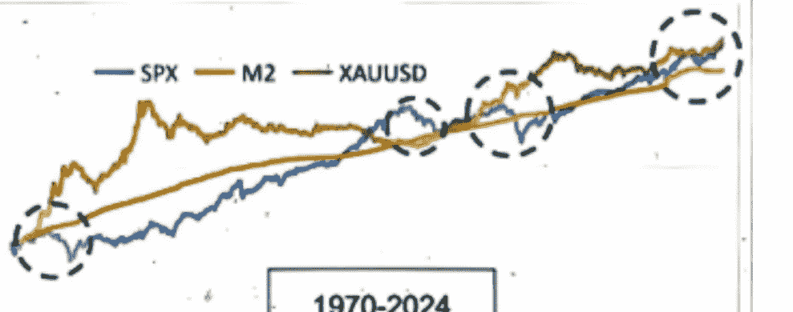

我们的黄金模型之一：1971年黄金脱钩以后，用M2代表美国印的美元，把1970年M2、金价、美股归一。数据显示过去55年的规律：

- 新冠以后，美元M2有一个突然的“超发”
- 70-80年代有一个“突变”，但是更平缓，当时黄金脱钩，金价一飞冲天
- 新冠“爆发式”与70年代“温和突变”相比，金价涨幅并没有得到充分体现
- 美股SPX基本上是M2波动的上下，长期来看两者总体是“负相关”的
- 在细节上：当股市跌，黄金开始涨

### （二）股市崩盘的确定性和领先性

U—一经济学，本质是在为更多的美元找说法。我们在《新货币战争—总论》介绍了黄金美元、石油美元、贸易美元、股票美元到中国美元，当时的美元是一种靠想象力和游戏规则价值的美元——AI驱动美国变得更劲，领先世界半级，而现在的制造业值得投资。这是用未来来理解现代工业文明——甚至人类。如此巨大的M2已经无法用常识掩盖了，只能靠科技PE和心理PUA。

2024年的12月，我们发布了2025季报《QI：常规逆周期》，用自研模型量化了美股见顶的概率和时间：QI见顶高达98%且最大概率分布至2025春节。这再一次独步市场封神级别的预测。春节期间，DeepSeek破解了美国科技神话的PE，英伟达大幅回撤；随后，美股见顶，并完成头部结构。

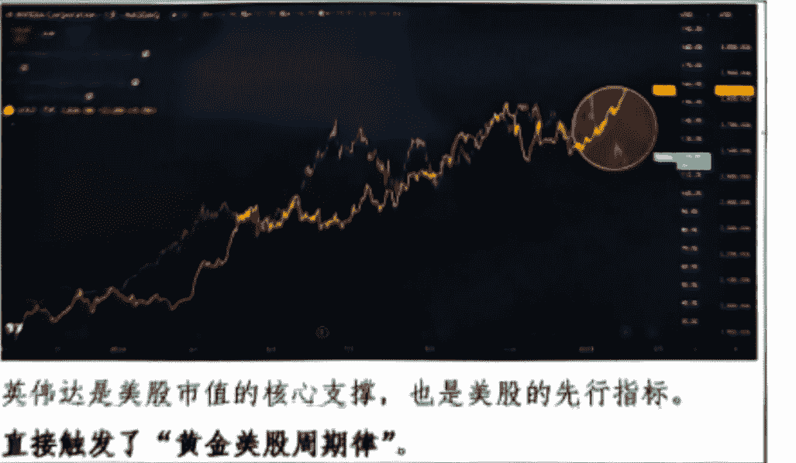

# 三、黄金上涨的幅度测算

### （一）“黄金股市周期”

货币是权力的表达，黄金是货币的“克星”，因为实际上黄金可以作为霸权夺取财富的指标：金价越贵，纸币越便宜，权力通过纸币对财富的榨取越甚。据此，我们对美元黄金周期按美国在全球的相对国力和权力进行划分，一个简单的观察指标是“金价比股”。

## 一战后近百年历史中，黄金与美股的负相关性，在空间和时间上具有统计学特征。黄金股市周期对其统计学特征做了数学解析，简要括：

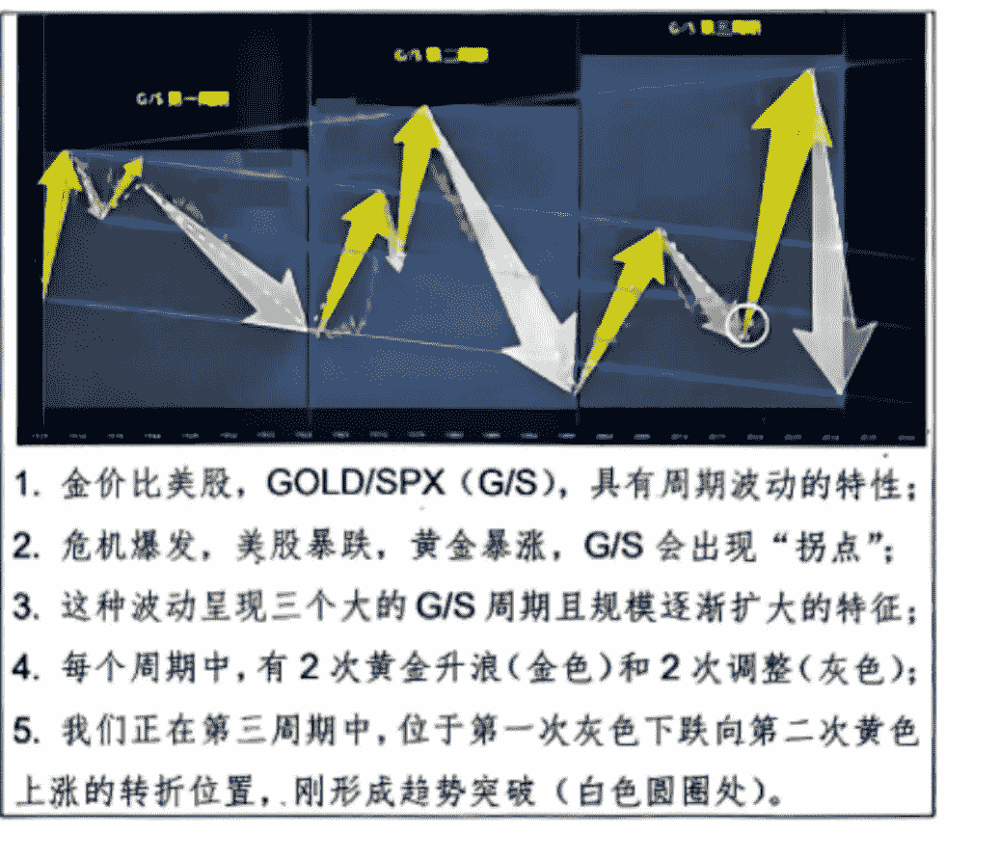

- 金价类股，GOLD/SPX (G/S)，具有周期波动的特性；
- 危机爆发，美股暴跌，黄金暴涨，G/S会出现“拐点”；
- 这种波动呈现三个大的G/S周期且规模扩大的特征；
- 每个周期中，有2次黄金暴涨（金色）和2次调整（灰色）；
- 我们在第三周期中，位于第一次黄金下跌向第二次黄色上涨的转折位置，形成趋势突破（白色圆圈处）。

上图放大来看，做一些原理方面的解释：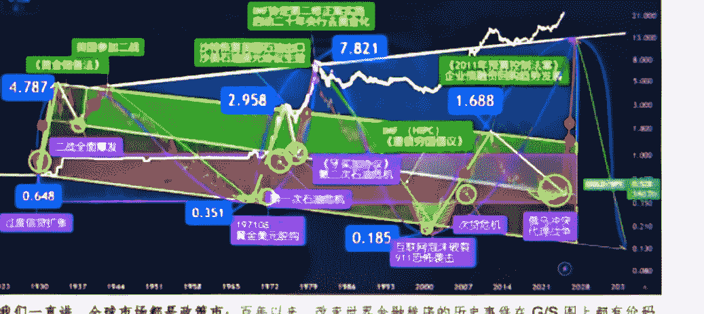 我们一直认为，全球股市政策调整：百年来，改变全球金融历史的事件在G/S图上均有。

### （二）根据周期律测算第三周期黄金的涨幅

1. 第一G/S周期：1929年至1964年横跨第二次世界大战。其中美股跌幅90%，黄金累计150%（金本位）。
2. 第二G/S周期：1965年至1998年横跨布雷顿体系解体、苏联解体和日本泡沫成立。其中美股跌幅50%，黄金累计200%。
   - 1970年1月至1974年12月，黄金上涨45%
   - 1975年1月至1976年8月，黄金调整49%
   - 1976年9月至1980年1月，黄金上涨75%
3. 第三G/S周期：1999年至2036年（估计）横跨泡沫破裂、911、金融危机。其中美股跌幅55%，黄金累计630%。
   - 2001年1月至2011年9月，黄金上涨1次
   - 2011年9月至2025年2月，黄金调整
   - 2025年3月启动，黄金第2次浪。

政治决定，G/S代表了全球的历史性波动，这是由一系列事件导致的，比如川普当选、新冠、俄罗斯、巴以等等以后有机会缓慢展开。给出一个结论：

| G/S周期 | 关键事件 | 黄金升浪 |
| :--- | :--- | :--- | :--- |
| 第二周期 | 尼克松时期 | 黄金脱钩 | 第1浪前 |
| 第二周期 | 尼克松时期 | 第一次石油危机 | 第1浪后 |
| 第三周期 | 小布什时期 | 美国再次储+91 | 第1浪前 |
| 第三周期 | 小布什时期 | 次黄金危机 | 第1浪后 |
| 第三周期 | 特朗普晋二 | 2025 年危机 | 第2浪前 |
| 第三周期 | 特朗普晋二 | 2028 年危机 | 第2浪后 |

注意：当前我们的模型分析特朗普晋三和2028年再次危机，都是概率事件。

第三G/S周期的黄金第2浪：从2020年新冠QE至俄乌冲突酝酿，至2025年QI启动，第2浪金价达到的最终目标，可能的范围如下：

| 金价涨幅倍数 | G/S=5 | G/S=10 | G/S=15 |
| :--- | :--- | :--- | :--- |
| 10 | 9.47 | 18.95 | 28.42 |
| 20 | 8.42 | 16.84 | 25.26 |
| 30 | 7.37 | 14.74 | 22.11 |
| 40 | 6.32 | 12.63 | 18.95 |
| 50 | 5.26 | 10.53 | 15.79 |
| 60 | 4.21 | 8.42 | 12.63 |
| 70 | 3.16 | 6.32 | 9.47 |
| 80 | 2.11 | 4.21 | 6.32 |
| 90 | 1.06 | 2.11 | 3.16 |

结合QI测算，美股本轮范围概率分布在可能50%—80%，以金3000美元计，峰值涨幅倍数区间概率分布在3.16—12.63倍，对应的目标价格范围为9000美元至36000美元，其中最大分布范围在6.32—8.42倍区间，约21000美元。

注意，历史上，G/S转点往任意未来黄金牛市的最低点位区间（半年左右），意味着2800至3100这个范围是接下来的G/S第三周期第2浪的最大概率底部。

主图：G/S第二周期的2次波以及2次调整；
G/S第三周期的1次波以及1次调整；
副图：蓝色代表波动，触及底部时发生月线级别；黄色代表上升阶段，白色代表阶段。该路径模型我们在2024Q2、2024Q3、2025Q2退出而关注的重要之一。

副图“顶部”信号：
- 到了顶部，意味着一是月线级别的强势，二是时间从3个月开始，同步调整；
- 该指标自1969至今共出现过13次，都是吻合的，2024年10月出现了13次；
- 在上涨早期出现时，幅度在10%，1972年回调幅度9%，第一次回调后进入月线级别加速上涨，持续半年以上，下次触发该指标，回调时间更长，跌幅也大。2025年3至4月，接近发生第14次顶部，同样，这预示着短期调整的概率提高，但更表明当前处于非常的状态，这也预示了未来的强势。

前文我们分析了G/S周期：（A）随着《2025QI》预测的美股见顶，美股于2月确立顶部，触发G/S周期；（B）最近一次“顶部”信号于2024年10月出现并与2025年1月完成调整，因为“关税战”为代表的宏观系统不稳定提升，推动黄金进入历史上最强势的状态。（A+B）确定了新的趋势性机会。

现在，我们对照历史开始分析：

（二）G/S第二周期—黄金第1/2浪

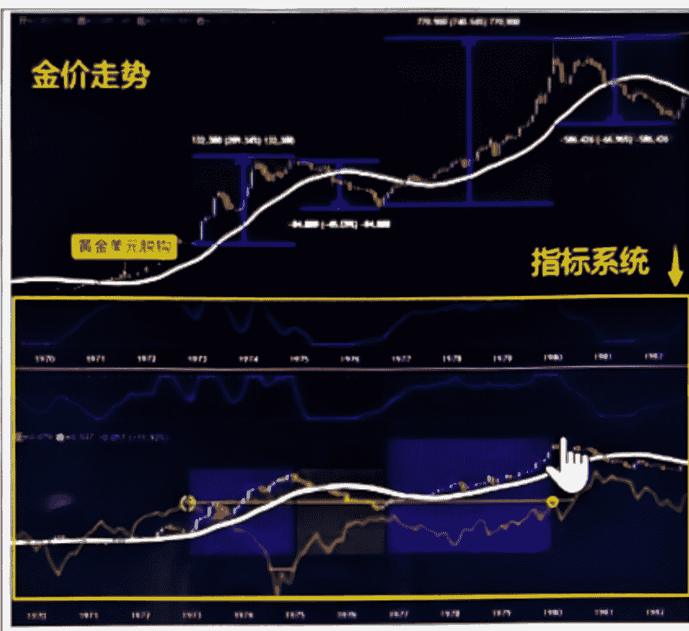

路径特征：10年左右。
- 美股见顶前，黄金处于震荡上涨
- 美股1973年1月见顶后，黄金震荡上涨
- 1974底美股底部成型后修复，黄金同步回调
- 1977年美股再次下跌，黄金再次上涨
- 1980年美股突破1972年的“前高”，黄金转入趋势。

（三）类比：1972年12月=2025年1月

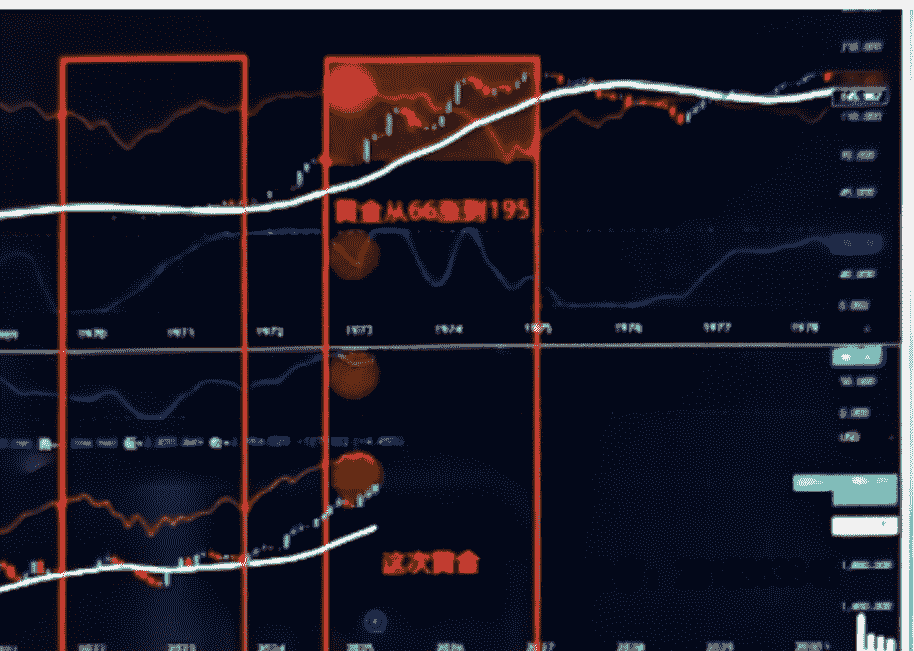

以美股见顶为标志认为黄金启动，1973年1月至6月，黄金强势上涨7个月，涨幅97%。

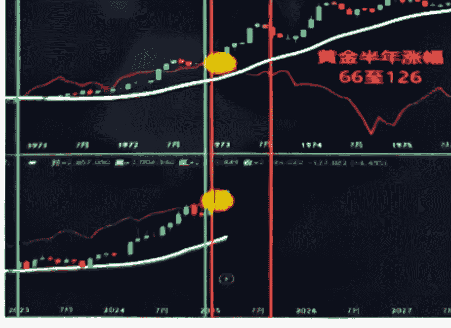

短期看，2025年更可能复制1973年的走势。

### （四）G/S第三周期——第一2浪（前段+后段）

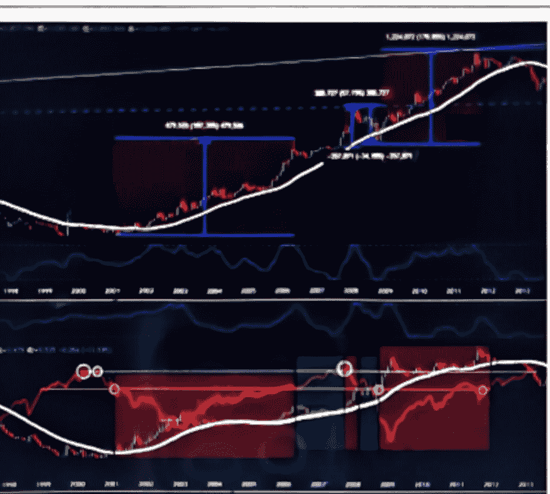

路径特征：10年左右。
- 美股见顶前，黄金处于震荡上涨
- 第一次回调后进入月线级别加速上涨，持续半年以上，下次触发该指标，回调时间更长，跌幅也大
- 2025年3至4月，接近发生第14次顶部，同样，这预示着短期调整的概率提高，但更表明当前处于非常的状态，这也预示了未来的强势。

### （五）美元QE驱动全球贬值

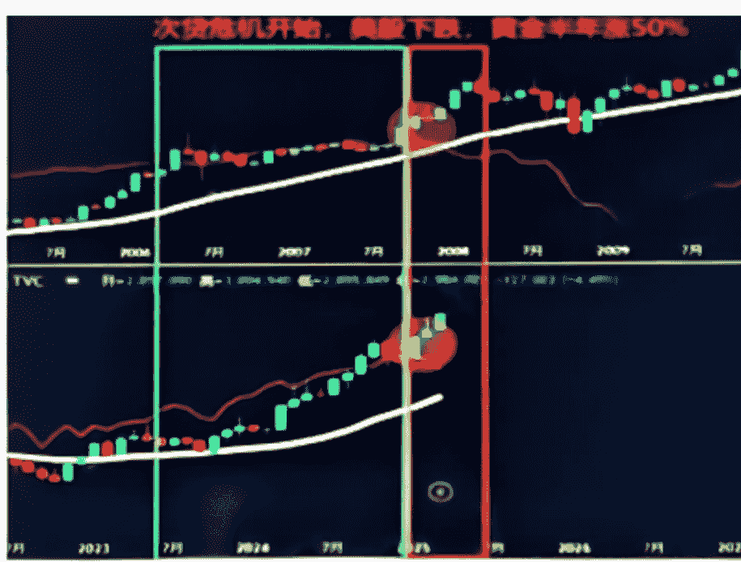

我们的黄金模型之一：1971年黄金脱钩以后，用M2代表美国印的美元。数据显示过去55年的规律：
- 新冠以后，美元M2有一个突然的“超发”
- 70-80年代有一个“突变”
- 新冠“爆发式”与70年代“温和突变”相比，金价涨幅并没有得到充分体现
- 美股SPX基本上是M2波动的上下，长期来看两者总体是“负相关”的
- 在细节上：当股市跌，黄金开始涨

### （六）股市崩盘的确定性和领先性

U—一经济学，本质是在为更多的美元找说法。我们在《新货币战争—总论》介绍了黄金美元、石油美元、贸易美元、股票美元到中国美元，当时的美元是一种靠想象力和游戏规则价值的美元——AI驱动美国变得更劲，领先世界半级，而现在的制造业值得投资。这是用未来来理解现代工业文明——甚至人类。如此巨大的M2已经无法用常识掩盖了，只能靠科技PE和心理PUA。

### （二）路径校正：2007 年 10 月至 2009 年 2 月

2007 年 10 月，美股贷危机蔓延，美元贬值预期不如当前强烈，黄金相对弱势；2008 年 9 月，次贷危机全面爆发，略强于当前的关税退预期。

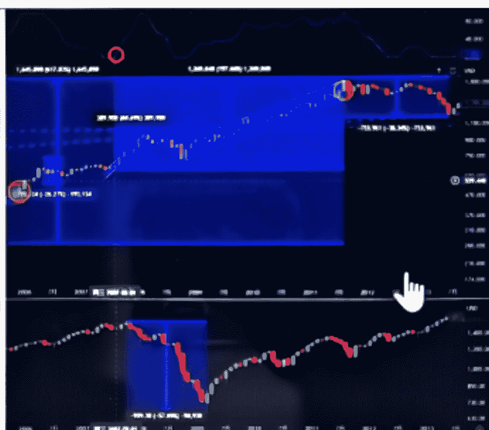

复盘：
2007 年 10 月美股见顶，连续下跌至 2008 年 3 月，随后，经历了 5 个月震荡，至 2008 年 9 月进入次贷危机模式，至 2009 年 2 月起线。累计 17 个月。
从时间上看，2026 年 11 月中期迄前需要止跌。
2025 年 2 月至 2026 年 10 月，累计 20 个月。
节奏基本相当。

### 1973-2001-2008 合并校正

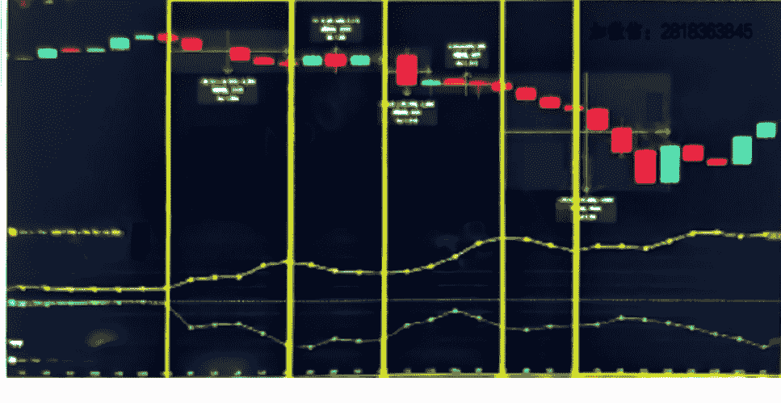

> 引用经典的香奈杯形形态

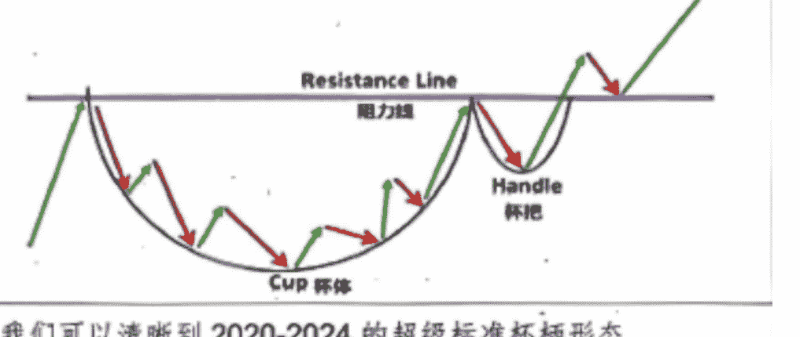

我们可以听到 2020-2024 的超级标准杯形形态，甚至 2001 至 5000，概率分布在 4500 附近；甚至 1971 至 2024 也是。

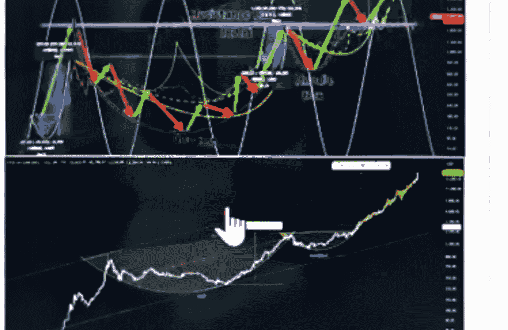

用第三种模型计算，这一波金价最终的顶点可能是 20718 美元，与前文的分析结论接近。

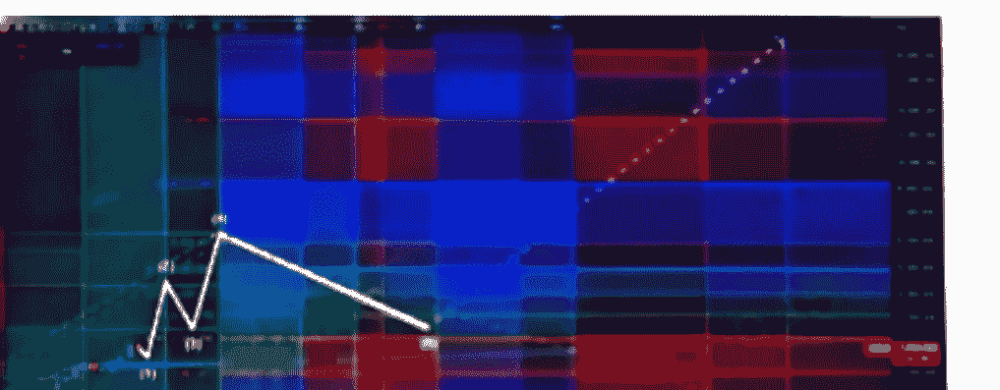

- 1. 根据我们的理论框架和模型模拟，本轮定义为 G/S 第三周期-第二黄金波浪，最终目标是在 2031 年突破 20000。
- 2. 在趋势向立的前提下，具体路径是波浪上升的。其中，概率最大的路径，分为前后两段：
- 3. 前段波浪至 2026 年底或 2027 年初，在未来的 12 个月中，第一个平台分布在 3700 至 5000，大概概率分布在 4500 附近；
- 4. 第二段波浪至 6400 美元左右（中期大选前后的触顶）；
- 5. 前段调整至 2027 年初至 2028 年初左右，约 3500 左右（下一次大选底）。
- 6. 后浪段至 2031 年 Q1（新总统治期），峰值突破 20000 美元。

风险是确定的，误差会非常大，可按 20%考虑。也即：

- 1. 趋势是确定的。
21000±20% = 16000 至 25000，这是根本。

- 2. 过程是扭曲的，基于当前所掌握的各种信息和模型，可以寻求最大概率的路径，也即上述路径，作为一个参考，但不能完全灵活，整体过程要动态调整模型是必须调整的。

关注人民币的黄金 ETF，在整体涨幅路径与美元黄金一致的前提下，会受到人民币汇率的影响。另一个潜在的不确定性是作为本次新货币战争第一场登场的加密货币。

我们在《新货币战争—汇率》和《新货币战争—加密货币》中，详细讨论了汇率和加密的走势以及相应投资机遇或风险，和他们作为变量对金价的潜在影响。

在不考虑汇率和加密货币影响的情况下，黄金 ETF 可以作为《2025Q2》“应对超预期的外部冲击”环境下，也即美股下跌阶段作为防御的主要关注品种。

结合《总论》，美元秩序崩溃，是一个王朝重构的过程。历史上，黄金美元脱钩、石油危机、互联网泡沫破裂、次贷危机，都不能与之并论，因此，巨大的确定性是黄金的成长空间，巨大的不确定性是过程路径。

# 七、黄金股

### （一）美股的黄金股特征

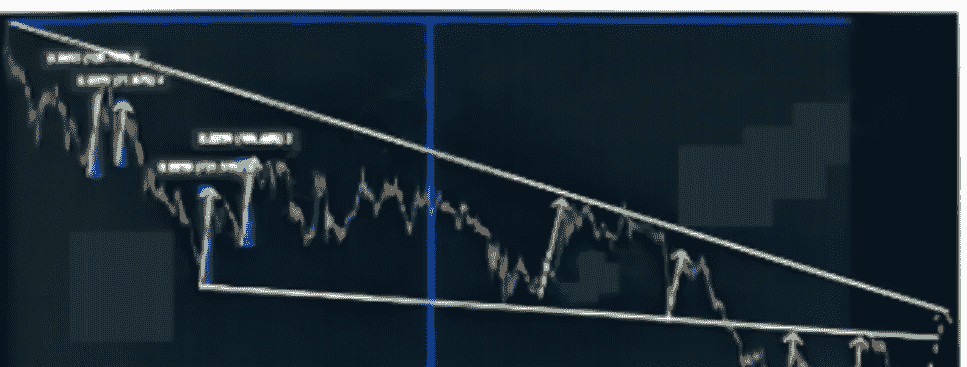

- ① 以 1971 年为基准，黄金股票累计涨幅仅为黄金涨幅 3%；
- ② 但 1971 至 1981 年，2001 至 2011 年两轨牛中，黄金股票出现了在金价暴涨阶段超越金价的同期暴涨（半年至一年）。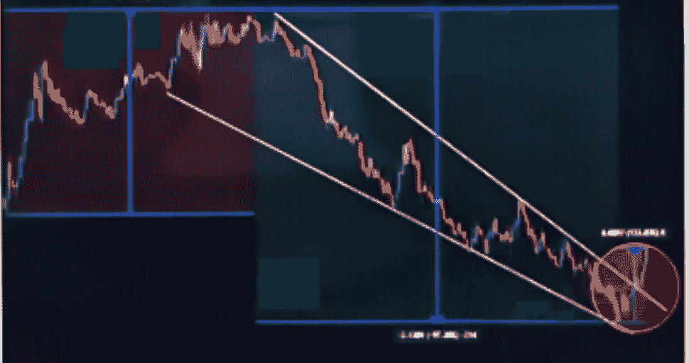
- ③ 金矿股与科技股（UI金矿指数/费城半导体指数），属于股市周期轮动的“跌落”，2008 年以来，只有科技股的表现出现了历史性的转折。

黄金股体现了两个属性：黄金属性和股票属性。从上述分析中可以看出，股票属性对黄金股是主导，尤其在 2008 年以后，基于 PE 的美元秩序建立。现在，可以确认的是：黄金属性方面，黄金价格上涨走立，利好黄金股；股票属性方面，科技美元瓦解，利好黄金股。

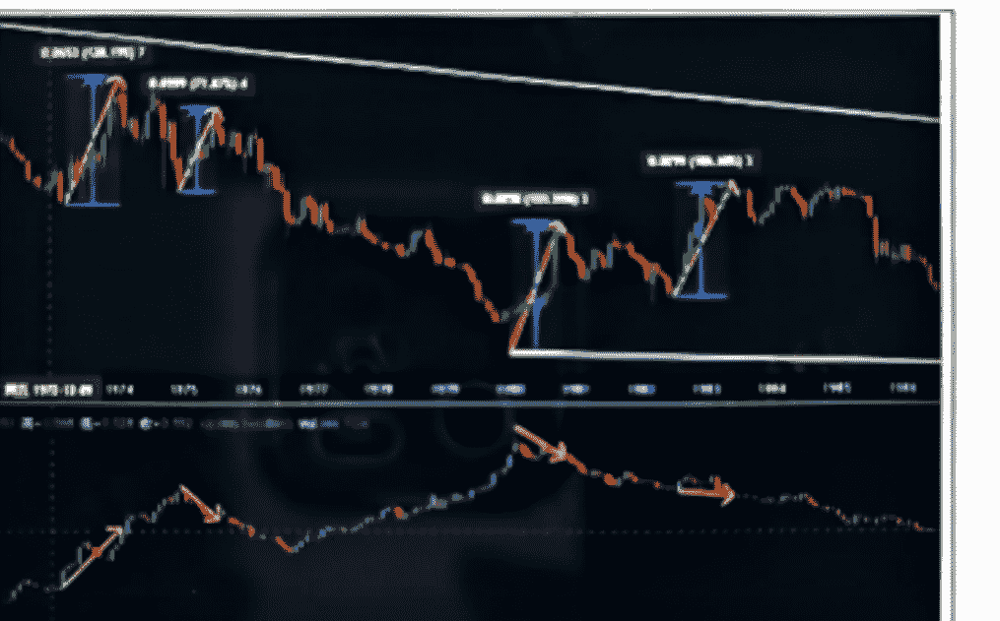

前文分析认为，当前的场景类似于 1972 年 12 月，对应：
- ① 1973 年 1 月至 1974 年 1 月，美股下跌，但黄金股比黄金多涨（叠加周期，黄金股涨幅在 20% 以上）。
- ② 1974 年 12 月至 1975 年 7 月，美股反弹，黄金调整，黄金股走弱。
- ③ 1980 年以后，黄金完成牛市，股市迎来牛市，黄金股也是相对大幅上涨的（超跌）。

### （二）中国的金矿股特征

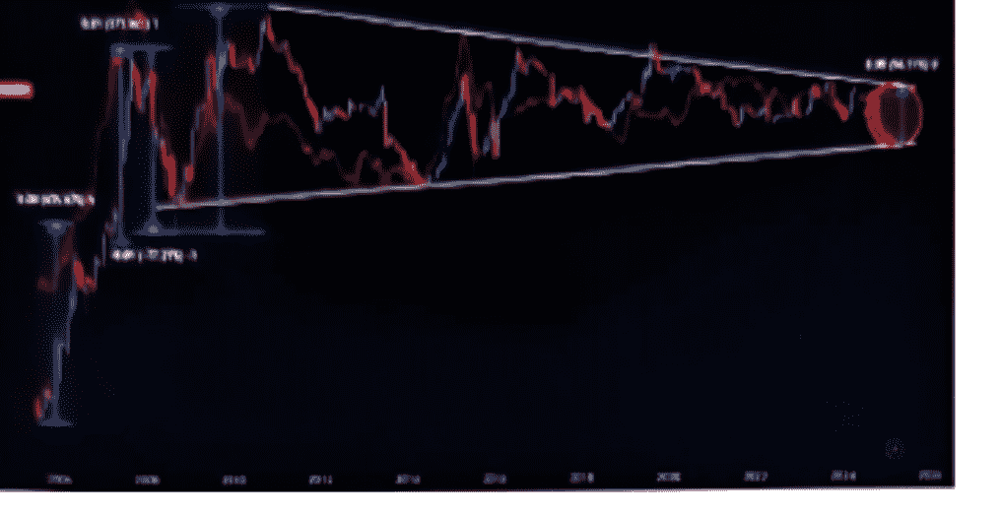

上市历史长的（2005 年 7 月）为例：
- ① 中国与美国，都有黄金属性和股市属性，其中黄金属性相同，两国市场周期存在差异。
- ② 2005 年 7 月至 2010 年 10 月的牛市阶段，相比黄金涨了 3 倍左右（叠加周期）。
- ③ 次贷危机恐慌下跌，黄金相比黄金跌幅更大。
- ④ 次贷危机稳后，2008 年 9 月在 2 年内相比涨了 5 倍左右。
- ⑤ 大多数时候，黄金与上证指数频率波动不同，而近期出现了显著的背离。

结论：中国的黄金股在黄金走强区间，总体趋势会大幅上涨，优于黄金。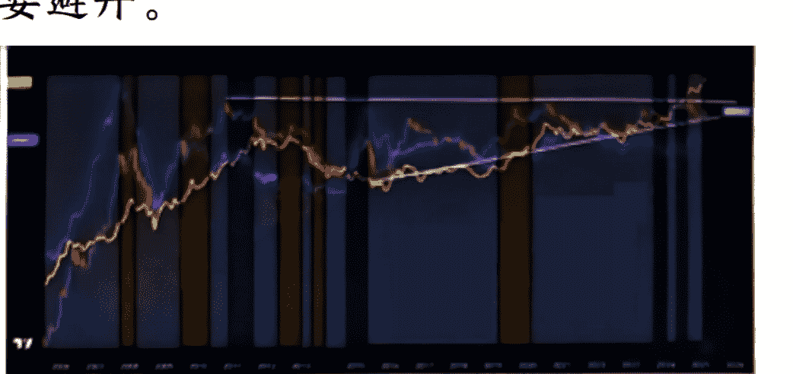

- ⑥ 白色代表，超过 70% 的时间，黄金趋势一致；
- ⑦ 黄色代表，黄金属性决定作用，大概占 20%。
- 紫色代表，股市属性决定作用，大概占 10%。

结论：
- ① 这一轮牛市中，黄金股都会破新高，且弹性很大；
- ② 黄金股在股市流动性发生短期变化，比如暴涨暴跌的时候，股市属性才会强属性。
- ③ 危机前可少量关注；危机后重点关注。

以最大的金矿—金矿业进行分析：紫金矿业在海外 16 个国家和中国 17 个省（自治区）拥有 30 座大型、超大型矿产资源开发基地。

#### 1. 营收组成
2024 年总收入 3036 亿元，其中营收和毛利占比高的矿山产金和矿山产铜。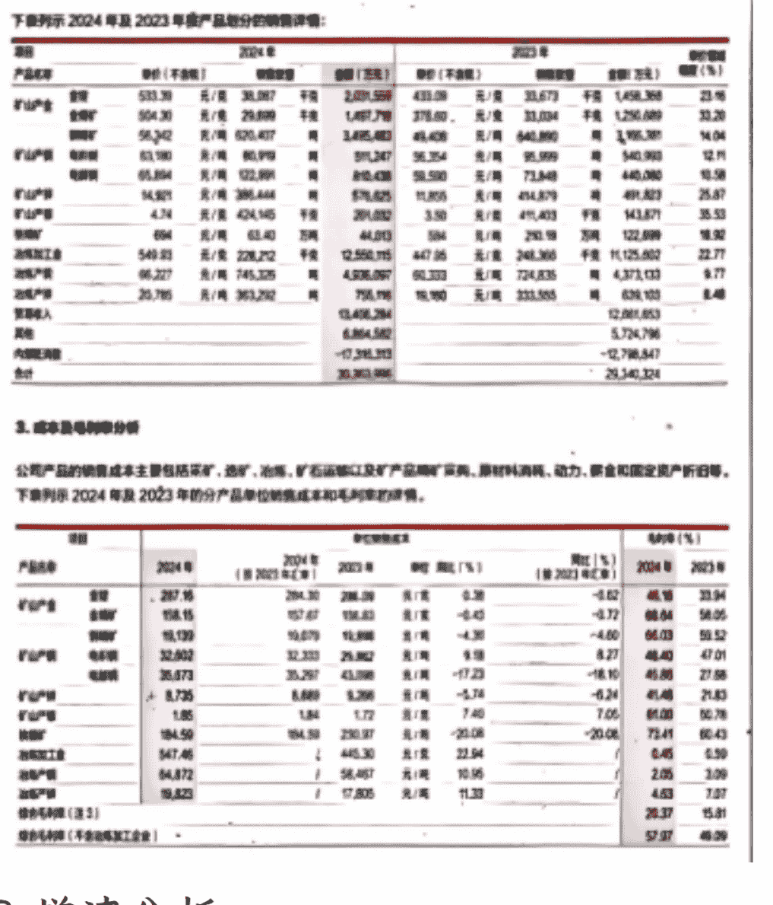

#### 2. 增速分析
价格上涨：2024 年紫金矿业收入增长，但利润增长——息税前摊销前利润 632 亿元、利润总额 481 亿元、归母净利润 321 亿元，分别同比大幅增长 36%、54%、52%。利润高增的主要原因是矿产资源价格上涨，其中金银价格涨幅超过 20%，这充分体现在毛利率上面。

产量增长：矿产铜产量突破百万吨大关后再增长、矿产金产量快速提升、全年实现矿产铜 107 万吨、矿产金 73 吨、矿产锌 45 万吨、矿产银 436 吨，其中矿产铜、金增分别为 6% 和 8%。

#### 3. 业绩展望
价格上涨：截止到 2025 年 3 月底，金银铜价格较 2024 年年底均有明显上涨，其中黄金价格上涨 17.5%、白银价格上涨 18.1%、铜价格上涨 11.65%。考虑到美联储降息预期，以及美元弱势，预期今年金银铜等价格会保持上涨趋势。

产量提高：2024 年 5 月紫金矿业发布《关于未来五年（至 2028 年）主要矿产产量规划的公告》，将原定于 2030 年的目标提前至 2028 年，实现矿产铜 150—160 万吨、矿产金 85—100 万吨、矿产锌 44 万吨、碳酸锂 45 万吨、矿产银 50 万吨、矿产钼 35 万吨。此外，2024 年报披露了公司 2025 年产量计划：矿产铜 115 万吨、矿产金 85 万吨、矿产锌 44 万吨、碳酸锂 45 万吨、矿产银 50 万吨、矿产钼 35 万吨，其中核心产品较去年增长 37%，金增长 24%，银增长 5%。今年紫金矿业产品大概会量齐升，带动公司增长。目前根据机构预期，2025 年净利润增速在 30% 左右。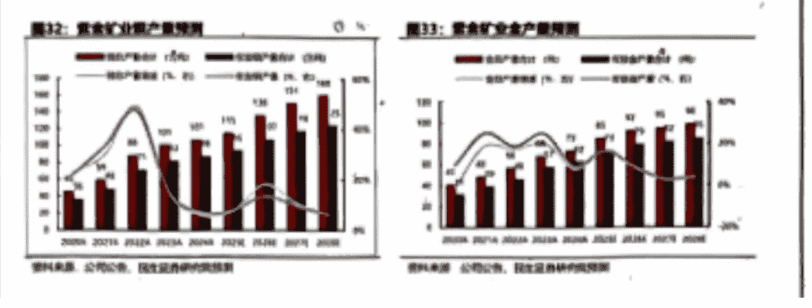

#### 5. 技术图形—短期判断
月线图：可以看到金银铜价格呈现上涨走势。周线图：考虑到随着股价上涨，高位震荡的空间变小，可以参考周线指标。目前看到，之前一次高位突破，周线 MACD 出现金叉，而当下周线 MACD 也处于刚刚金叉的阶段，因此图形上给出了比较积极的信号。

### （五）标的

赤峰黄金（HK），可能是黄金矿业的综合体。赤峰黄金 A 股与山东黄金几乎同时上市（2005 年到2007 年底次贷爆发有接近 2 年），可以看到现在的累计涨幅，山东黄金达到 6800%，赤峰黄金 5000%，而紫金矿业只有 150%；但赤峰黄金一直创新高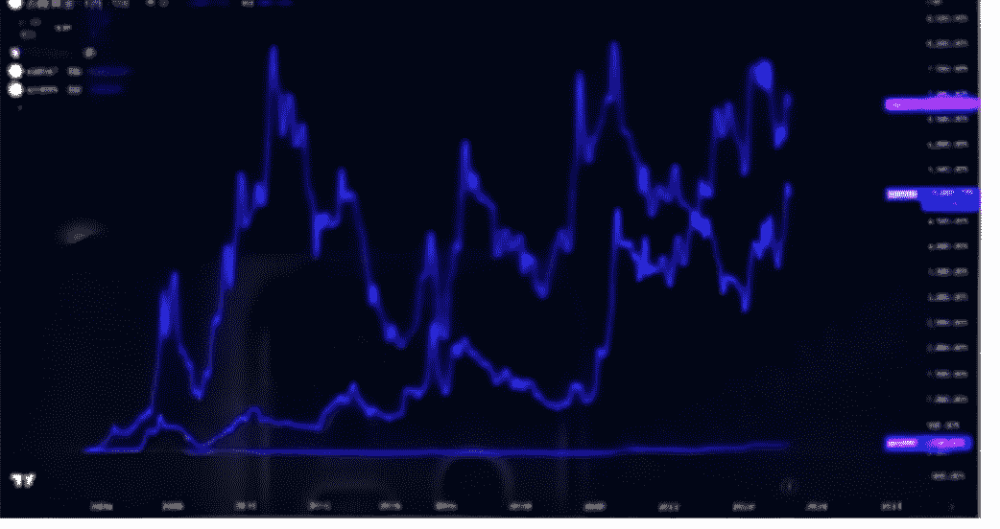

赤峰黄金 H 股，是所有金矿股中最新上市的（2025 年3 月），这是对着 G/S 拐点安排的；但和紫金矿业上市到流动性危机爆发（2008 年 4 月危机期间，14.65/6.65=2.11 倍）的情况类似，只是距离危机爆发的时间长个月。

赤峰黄金 A 股、山东黄金、紫金矿业，统一按上市的时间计算，自 2008 年 4 月截至 2025 年 3 月底，累计涨幅赤峰黄金 1562%，山东黄金 294%、紫金矿业 236%。综上，赤峰黄金 H 股对着 G/S 拐点，且是所有黄金股中最新上市的（2025 年3 月）：风险更大收益更大的特点更显著。

# 八、结论

《总论》介绍了当前美元秩序处于“美股美元和中国美元”耦合架构；本文进一步介绍了“黄金美股周期律”，讨论了 1929 年以来的百年中，三大周期轮动；现在，当美股下跌，并可能导致美元体系巨大的动摇，全球资本向黄金长期趋势性转移，在此基础上我们历史拟合模型和测算，分析了黄金的长期趋势目标和可能的路径。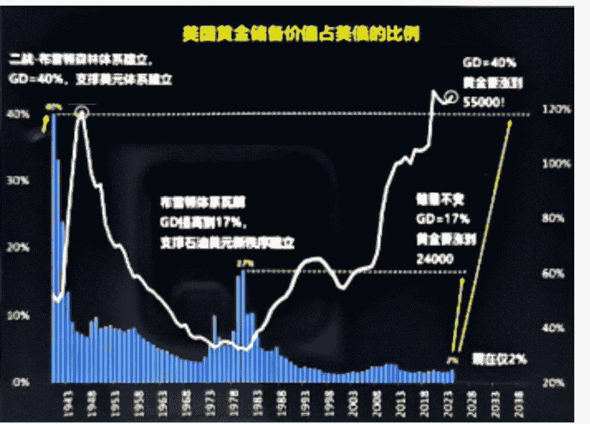

这幅图说明的是，现在看 21000 的目标，似乎有点“夸张”，但如果放在历史中对比，实际上，真正夸张的是美债。
