# 九品中正制都自收之

欧洲金靴金靴主义2023年05月27日12:43

## 文/欧洲金靴

> 【观察者网】25-03-26 11:56 观察者网(www...已编辑

# 【长沙引人人才不能影响教育公平#】3月24日，长沙市教育局公布了另一项新政策，2025年起，高层次人才将受优惠政策，不纳入统招计划。由于涉及教育公平，引发了热论关注。

由于引入高层次人才，都会产生一些具有吸引力的优惠政策，但是如果优惠性机制影响了教育公平，就需要权衡之忧。目前的选拔机制规定了优质的重点高中是稀缺资源，而中考、高考一直被视为中国教育公平的底线。很多在吸引人才时可以帮助子女在教育上优选，免除户籍限制，这提供了方便，也保障了普通的教育机会。但目前的本质是，好的人才名额是有限的，所谓“单列不纳入统招”的说法并没有依据，需要当地有关部门更清晰的解释。

其次，“高层次人才”的认定标准有多宽泛。什么是“高层次人才”？根据长沙市人社网站公布的《长沙高层次人才认定名单》，长沙市高层次人才按照国际人才、国家级人才、市级人才、高级人才等四级分类分别为A、B、C、D类。

其中A类包括国际奖获得者、中国科学院士、中国科学院院士、中国社会学院委员等。B类人才包括文学奖获得者、鲁迅文学奖获得者等。C类人才包括播音主播“金舌语”获得者等。D类人才包括长沙市优秀人才、创业新兴产业年薪50万元以上的经营管理人才和研发人才。

可以说，A类很少。今年3月第一批公布的《长沙市42批高层次人才分类认定名单》显示，共有89名者中，有A类1人，C类12人，D类81人。与其关注的人数最多、却又宽泛的D类。在列述的第42批中的81人，大多是湖南当地企业的总经理、副总经理、财务总监、人力总监、广告营销总等。

# 免费 价值 及时 专注

# 扫码加入 知识星球TOP 免费资源群

- 每日免费获取有价值资源
- 可提供各类资源搜索服务

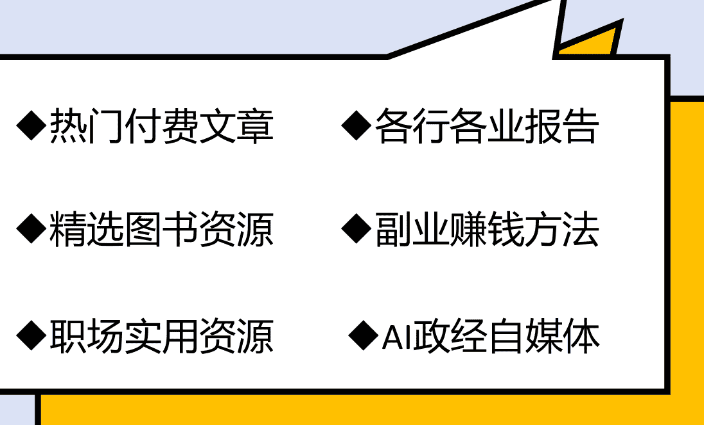

| 热门付费文章 | 各行行业报告 | 精选图书资源 | 副业赚钱方法 |
|---|---|---|---|
| 职场实用资源 | AI政经自媒体 | | |

公众号: 知识星球TOP | 微信号: jntsg8 | 微信号: jntsgj2

分享资料仅供个人学习，请及时删除，切勿商用传递

千手万以外的工程人士，聪明守心人气，又远高于高收入的“高层次人才吗？”恐怕未必能够等号。

再者，高层次人才本身已经是社会能力者的回报了，凭什么还要特殊优待子女？对子女享受加政策的，因为对国家凝聚力、认同对全社会的大贡献，与高收入人士可以同日而语。

再说一遍来说。高校是保证社会人才流动的机制之一，特殊的口子不能解决。高层次人才的子女，如果不是自己的努力而获得高层次资源，其实他们的成才未必是好事。不可否，长沙希望吸引人才的出发点是好的，但具体政策需要三思，需要综合参考社会会计方面的管理意见，进行优化调整。《网络小伙伴》

# 长沙高层次人才子女入学单列 公号+金融主义

# 长沙此举，高层次人才子女入学单列，竟然直接在高考中录取。

当然，其实长沙是第一例了。

# 政策都自不如

七年前，海南省教育就出台过政策，“一事一议”，甚至高考还能突破户籍限制，这对于高端人才的吸引力不可谓。

两年后的2020年，成都也赶上，规定“院士子女在全范围内中考降分”。赣州某更是明显的是省级高层次子女。

在国内则更为如此。2019年3月，美国爆出人数最多的高校招生，斯坦福、加大等，相关人员涉及高管、好莱坞明星、高校体育教练、行政人员。其中她打开了斯坦福的大门。

除了高层次人才子女的家庭，网友们还扒出了赵思帆，她在直播分享经验，告诉大众：“坚定奋斗，理想大学”。

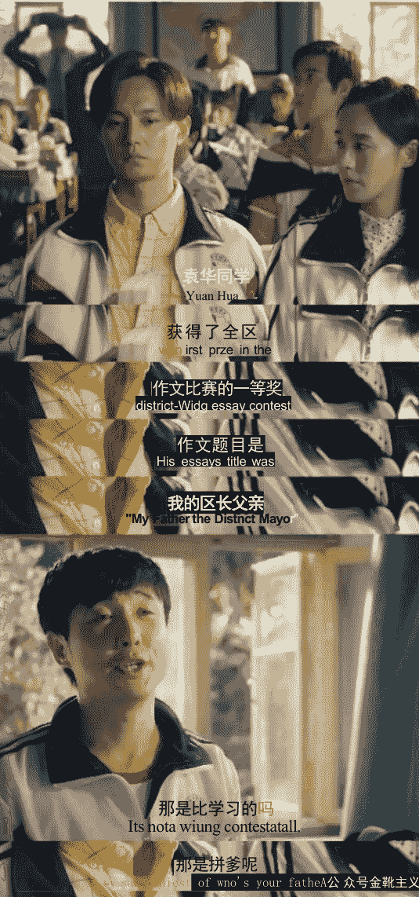

# 2023年夏天，两个新闻：

- First prize in district-wide contest
- His title was his father's all
- My father's

# 2023年夏天，两个新闻很有效果——

- 新闻①：2023年某高校在高考中取得优异成绩，八名被清华大学录取，两名被北京大学录取；

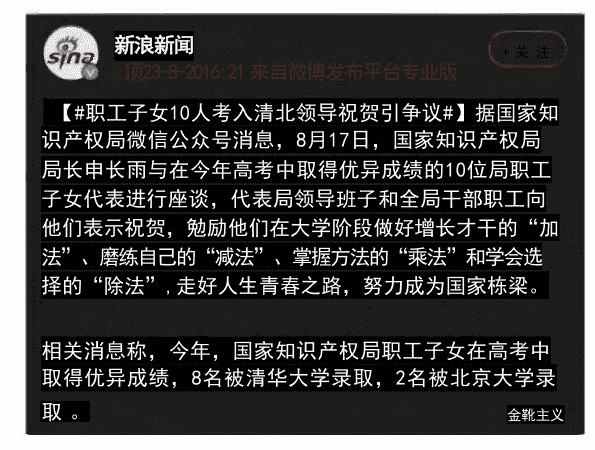

- 新闻②：迷考公热潮，认为所有人都适合体制内工作，研究生不应跟风...

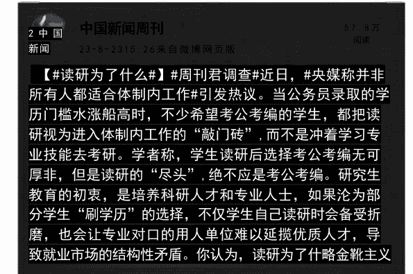

这说的没错，确实不是所有人都适合体制内，尤其是北京编制。比如，京外人员似乎不适合。

# 国家知识产权

信息名称：国家知识产权机关服务中心2023年度公开招聘公告
索引号：00001643/2023-0023
主题分类：人员招聘
发文机构：人事司
发布日期：2023-04-18

## 国家知识产权机关服务中心2023年度公开招聘公告

发布时间：2023-04-19

国家知识产权机关服务中心是国家知识产权局直属事业单位，主要负责服务保障工作。因现工作需要，需面向届毕业生招聘人员2名。有关事项如下：

一、招聘原则本次招聘坚持德才兼备的人才标准，坚持“公开、公平、择优”的原则，实行公开招聘。二、招聘岗位及人数目前面向届毕业生招聘工作人员2名，具体岗位说明和人员见《国家知识产权局机关服务中心2023年度公开招聘岗位信息表（附件1）》。三、招聘范围面向符合招聘基本条件和岗位信息要求的2023年以内届毕业生须取得毕业证、学位证，不含优秀类届生、定向和留回人员进行公开招聘。北京籍具有北京市户口的毕业生，不含北京地区集体户口毕业生，年龄不超过35周（1988年1月1日出生）。京生源符合北京市接受京境外应届毕业生政策要求，其中硕士研究生不超过30周（1993年1月1日出生），博士研究生不超过35周（1988年1月1日出生）。

> 承认别人优秀就不这么像

B-2018-05-28 来自山西

最搞笑的是，配合你这IP，喜剧效果拉满。你要是北京人、上海人我就不说了，一个山东人的我竟然在这儿主了，搞笑程度+100%

8-2019-02 来自上海

看不得不要敲键盘了，显得自己像傻了，在智和刚这边没有任何判别的情况下，官官家里孩子为什么农村家的孩子更能达到你理解的“优秀”，这正是采取讨论的目的。贱你那副模样吧……

并不是现象还有《人民日报》招聘：

## 人民日报2023年度公开招聘岗位信息表

| 序号 | 岗位 | 接收部门 | 专业方向 | 学历 | 北京 | 备注 |
|---|---|---|---|---|---|---|
| 1 | 业务 | | 新闻传播、英语、中国语言、社会学、政治与法学、经济学、历史学、汉语言文学与历史学、马克思主义理论 | 硕士 | | |
| 2 | 业务 | | 海报设计、数据分析 | 硕士 | | |
| 3 | 业务 | | 总策划 | 本科 | | |
| 4 | 业务 | | 地方 | 硕士 | | |
| 5 | 业务 | | 策划 | 本科 | | |

## 招聘计划

| 序号 | 岗位名称 | 岗位要求 | 学历要求 | 人员 | 备注 |
|---|---|---|---|---|---|
| 6 | 策划类 | | 艺术类、设计类、美术类 | 本科以上 | 1 | |
| 7 | 策划类 | | 本科以上 | 1 | 人员 |
| 8 | 维护类 | | 英语类、英语等 | 本科以上 | 1 | 翻译 |
| 9 | 维护类 | | 计算机技术、英语等 | 本科以上 | 1 | |
| 10 | 管理类 | | 公关、行政、财务、市场、法律、政治、公共管理 | 本科以上 | 2 | |
| 11 | 管理类 | | 计算机技术、管理类 | 本科以上 | 2 | |
| 12 | 管理类 | | 法律、经济、会计、市场、管理类 | 专科以上 | 1 | |
| 13 | 管理类 | | 工程类、管理类 | 本科以上 | 1 | |
| 14 | 技术类 | | 电子、工程、动画类 | 本科以上 | 1 | |
| 15 | 技术类 | | 计算机、网络、大数据、人工智能、硬件、软件 | 本科以上 | 3 | |
| 16 | 技术类 | | | 本科以上 | 1 | |
| 17 | 管理类 | | 人力资源、行政、财务 | 本科以上 | 1 | |
| 18 | 管理类 | | | 本科以上 | 1 | |
| 19 | 管理类 | | 人力资源、市场、计算机技术及其他 | 本科以上 | 6 | |
| 20 | 管理类 | | | 本科以上 | 6 | |
| 21 | 财务类 | | 会计、财务、审计 | 本科以上 | 7 | |
| 22 | 财务类 | | | 本科以上 | 7 | |
| 23 | 语言类 | | 英语、日语、俄语、法语、阿拉伯语、西班牙语、意大利语、韩语等 | 本科以上 | 2 | |
| 24 | 其他类 | | | 本科以上 | 2 | |
| 25 | 技术类 | | 计算机技术 | 本科以上 | 1 | |
| 26 | 管理类 | | 人力资源、市场、计算机技术及其他 | 本科以上 | 5 | |

注：更多信息，请关注“2023年暑期校招校园招聘公告”及“人日报招聘”微信。

## 二、招聘对象

招聘2023年普通高校及专科高校毕业生（含当年入职的高校毕业生，不含专业技术类、定向岗）以及海外留学生、海外留国籍人员在2023年7月前获得海外学历证书、海外留国籍人员在2023年7月前获得教育部留学中心国际学历认证。符合岗位要求的专业为该岗位的最高学历，毕业证书已取得且为北京市户口内的高校毕业生，不含北京高校毕业生

## 三、招聘细节及具体要求

1、国内留学生毕业生可面向公开报名，海外留学生回国报名。非外语类专业，通过英语四级（CET-4）、英语六级（CET-6）成绩在425分以上，外语类专业毕业生需具备良好的语言能力。符合岗位8、10、17、18、19、20、21等岗位的毕业生的岗位条件是适当的。
2、海外留国籍人员可报名5、6、7、8、9和12等岗位。
3、符合教育部留学中心规定的在京留职人员
   - 具体细节及要求请查阅招聘“网聘指南”，其中有关岗位的专业请咨询教育部发布的专业目录。

## 五、日程安排

1、报名方式及时间通过官网方式、人民社开展，地址：http://hr.peodaily.cn。申请人需在2022年12月26日至2023年1月15期间登录网站、投递简历、本人正面证照，每位毕业生限报一名。

经济基础决定层级，高考分数不是结果，它体现的是一个孩子过去积累的能量。引用王教授《不同社会层次教育机会差异的研究》数据（注意，这是十年前的调查）：

- 国家与管理者
- 私营企业主
- 专业技术人员
- 个人工户
- 商业服务员
- 工业工人
- 农业劳动者
- 乡村（半业、无业）

抽样调查了四千份卷，统计了这些阶层对应的“跃出率”，某阶层在大学生中的比例与该阶层人口中所占分别为：3.9、2.5、5.9、2.7、3.84、5.1、7.6、5.9。当年跃出率最高的是私营企业主（5.9），其次是无业阶层（4.7）的2.6倍，是工人阶层的7.8倍，是农民层的10倍。

6月25日，这位杭州学生的高考成绩出来了，总分700分。朱也告诉记者，知道自己考700分心里还是激动的。面对网络上“迈巴赫少爷”的外号和质疑，朱也回应并不喜欢这个称呼，并表示将通过自己的努力实现价值，摘掉“不学术”的标签。（潮新闻记者张鑫实习生林汝嘉转）

# “迈巴赫少爷”身份曝光：高考700分，家族公司将上市？

高考700分，“迈巴赫少爷”彻底火了！今年高考考试期间，一则高考学霸“迈巴赫送考”的视频引发了网友的热议。

本以为只是普通的“家门少爷去高考”，想到他的背景：他是中国美术大师、国家级铜雕代表传承朱炳仁的孙子。他的父亲朱军斌是国家级非物质遗产“朱府铜”的第五代传人，一手创了“朱炳仁·铜”品牌，在铜质艺术界享有极高的声誉。他们的家族更是打造了杭州的著名景点“江南铜屋”，将铜质艺术发挥到了极致。

从公开资料来看，朱也家庭环境较为优，朱军斌本人是“朱府铜艺”第五代传人，浙江省铜美术大师，能够上各种不足为奇。

与此同时，朱军斌旗下公司还在独控“铜美术行业第一股”。

去年10日，杭州朱炳仁铜艺股份有限公司上市筹备获证证券局受理，辅助机构是华泰证券。

关于杭州朱炳仁铜艺股份有限公司首次发行股票并上市筹备工作进展说明（第五期）

杭州朱炳仁铜艺股份有限公司（以下简称“朱炳仁铜”）发行人（以下简称“发行人”）申请人在中华人民共和国和境内开展首次发行股票上市期间，华泰证券有限公司（以下简称“证券发行上市监管机构”）作为承销机构，根据《证券发行人上市备案管理办法（2023年）》

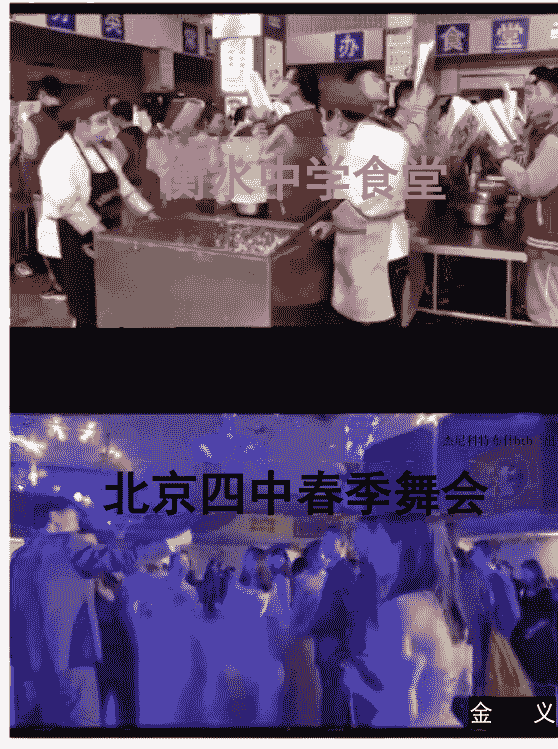

## 北京四中春季舞会

美国哥比亚大学社会学教授莫斯曾有研究：

> 90%哈佛学生来自家庭收入高于55000美元的国民收入中位数，而且哈佛的招生主任定义的哈佛家庭的“中等收入”是介于110000美元和200000美元之间。

七十年代到九十年代中期，在关于十一所声名显赫的大学的样本里，收入在全国水平下游的学生家庭占全体学生的百分比大致保持稳定，约10%。

同时，收入水平下游上游的百分比拔直上升，三分之一到一整整半……如采样扩展到前150名的大学，位居下游的只占全部学生的3%。

大可以用“优秀”一词为个体卸下社会纽带和身份的陈旧包袱，替以个人性格特点——一勤奋、守纪、具有天分和其他可以脱离社会生活来衡量的人力资本。但是，这显然会导致不合实际的结果。

## 为什么黄莉的女儿这么多都优秀？

知乎·387个回答，1万个关注

李大衡
水杨种杨

+关注
山

2.4万人喜欢了这个回答

富人的女儿

富人的女儿都喜欢心理学、哲学、经营、文学、电影、金融、绘画、雕塑、时尚设计、表演、芭蕾、舞蹈、小提琴等，共同没有智力入门，主要靠积累，圈内互相培养，易于招生推嘛。妈妈攒钱也能在家里富有。像计算机、建筑学、化学、物理学、数学、生物学、水利、能源、机械、交通、航天等这种种微都需要智力门槛的学科，就难以避之不及，能够远远，它像蜗虫一样么，都不能死他们。

反正是优秀的孩子就得硬横到他们孩子的身上，别问就是优秀。

公众号·金钱主义

事实确实如此，粗略读过一位圣保罗精英中学——典型的精英学校，是特权在握的年轻人度过青春年的地方：三分之二的学生家庭能让孩子上高支付每年40000元以上的费用，圣保罗毕业的学生有希望的学校是哈佛，接着是布朗大学、宾夕法尼尼亚大学、达特茅斯、普林因斯、康奈尔、学院和斯坦福——这些学校对圣保罗学生的录取范围是全国顶级的三倍以上。

近年来，圣保罗的30%毕业生都是春藤盟，大约80%的学生在美国名前十的大学和文理学院深造。学校每年超过8000美元的学生平均支出，几乎是大多数高中的十倍。

圣保罗中学收到的捐款是在美国所有院校中排第一（大约每个学生百万美元）。超过一个世纪的时间里，这所学校都收到了各地的关注。近年来，学校的内部继续登上了《华尔街日报》和《纽约时报》的头版，甚至像《VOGUE》这样的全国性杂志。

这也是为什么莫斯会感叹，大多数美国人想要相信这样的一个美国故事：我们想要相信，无论在新闻和报纸里目睹了多少不公现象和人情故事，我们的世界从根本上公平的。

拥有这样的希望，实际上很有可能是精英和大众的共同点之一。然而，这份共同希望很会变成成人的梦签。

2017年，经济学加拉特·切蕾和他的合作者也有发现，来自收入高层金字塔顶1%的家庭，也即年度收入超过630000美元的家庭，与那些年收入30000美元甚至更低的底部相比，对比一类家庭的孩子就读春藤盟校的可能性，比另一类高出77倍。

这项研究做过了一统计，研究者在样本中纳入了共三十八所精英院校，包括科尔比学院和巴克内大学这样的地方，结果出了一个惊讶的数据：在这些大学，来自收入居前1%的家庭的学生，其人数多超过了在后面的60%的家庭（也即年度收入不足65000美元的家庭）的学生总数；在哥罗多学院，这比率甚至已经交叉2:1；在华盛顿大学伊利分校，比率甚至已经突破了3.5:1。

还可以换一种比较方法，看看全美富豪的大学等地，无疑会有更加尖锐的呈现。

切芬的研究报告亦有所涵盖，统计收入在顶层0.1%的学生，他们就读于精英大学的比例为40%，这一百分比出身穷人的孩子读大学的比例是相同的——不过，后者要把所有的大学包含在内，是四还是两个。

不是论古典政治学之父的巴·密斯，还是社会社会主义者的奥格斯，就曾论述主导下的社会竞争争出了尖锐分析，密斯认为：人与人之间天赋的差异，实际上比我们知道的要得多。与劳动分工产生的效果相比，那些将人分配到不同职业的差异差别显得微道得。两个角度来看，人与人之间天赋的差异，实际上比我们知道的要得多。差异来自于习惯、风俗和教育。相比于此，恩斯的评论更为直白：资本打造的所谓“自由竞争”，实际上是穷人吃亏。因为对穷人来说竞争不好不是自由。

中国科学院发布的《十二五”成就与“十三五”发展展望》报告中指出：一些城市在制定招生政策时，对农村子女设置了“缴证”等要求，由于办齐证对多数农村家庭具有难度，这种要求实际上将农村子女排除在招生范围之外。有些地方规定“指定学校接受农村子女”，但指定学校远离农村的地方，农村子女不具备上学的条件。另外，农村子女读的一些学校在不同程度对待，实际上造成了农村子女的社会歧视。

近日，国务院第九次督查在山西调研发现，当地多所学校是以平板电脑为标准的。学校向家长推销与第三方合作的“智慧课堂”，缴费8000元。如果购买，公司就会送一台平板电脑，但不少家长又担心孩子学习产生不律，只好硬着皮掏腰包。督查结果初步统计，2017年至今，市近5000名学生购买了“智慧课堂”服务，相关几家公司以此收费约24000元。

| 甲方：某（某） | 乙方：某（某）有限公司 |
| :--- | :--- |
| 1. 甲方负责购买学生数字化资源，乙方负责购买。 |
| 2. 甲方负责学校信息化维护，乙方负责设备维护。 |
| 3. 甲方负责学校信息化培训，乙方负责设备培训。 |
| 4. 甲方要求购买平板电脑5000台，单价1200元，总金额600000元。 |
| 5. 乙方承诺提供教学及配套服务，甲方负责使用。 |
| 6. 甲方按期支付货款，逾期损失由甲方承担。 |
| 7. 乙方按期交付货物和服务，逾期损失由乙方承担。 |
| 8. 经双方书面同意，任何一方不得转让本项权利。 |

甲乙双方签字，本合同生效
甲方（盖章）
乙方（盖章）（代表：签字）

将一个普通人的孩子驱出门真的是很容易，如同把一个阶级逐出来越来越聚合化的水泥都市，钢筋城市……正如我们看到的，上海二号线、生活夏等标志的飘散着金钱的味道。学校，更是被曝明曾“退浊”上不起族学校的“低质量家庭”。

## 华二初中读书，你真的好了吗？

### 关于华二家长

真的好了吗？到华二做家长，你能做一个合格的华二人？提醒：你身边有没有华二初中读书的孩子，你一定要来访，询问“家校合作”这句话的深刻意义。当然，我也可以告诉你。科技的无比盛大十场开放、民俗文化的精彩炼、运动会的站跑、元宵节的访挂环、周五学的风律……这一切优秀可以成全校吗？不是因为有一个无比大的家长团和学校完美配合。100多的选修、天地地理、法学历史、机械制造、编程数学、击剑术、摄影剪辑……如此杂的选修……这一老师可以成全校吗？那是因为有一个强大的家长。曾经，占比很高的教授、法官、企业家、机械师、书画家、专栏作家、IT精英、心理咨询师等一批家长，为我们的课堂选课提供了丰富的选修课程。

另外，华二初中的春游之旅一直是迪士尼：每个学期都要去上海大剧院、上海音乐厅、保利大剧院看演出，这些并不是免费的；华二有丰富多彩的活动，可以选择的一日五餐、衣服全套校服，这些也是家长分的；当然，不少同学参加国际大赛、到海外游学，费用是用家长支付的。教育是收费教育，你一定要想清楚。

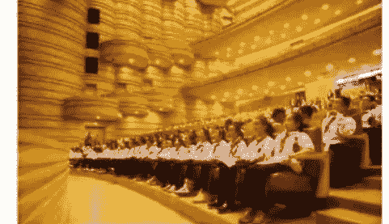

“云谷缘缘宝宝塔，校校合作得天长”。华二初中是一所知名民办初中，合作还能不能走棋？所以华二不读书，真的好了吗？

## 初步发现：教育的社会分层机制

香港科技大学的研究对于家庭背景在这一过程中的影响开展了详细分析，受访者为北京大学的771位本科生，他们的学校划分为精英大学（北大、清华）、211大学以及非211大学。为期五年的调查（2009-2013）包含了详细的学生家庭情况与入学后的经历。从数据本身就能看到家庭背景的重要影响，比如精英大学中，30%来自中上或上等经济地位的家庭，该比例在211大学和非211大学分别有18.6%和14.6%。精英大学来自农村或城镇的学生比例为19.2%，而在另外两种类型的大学此比例分别为31%和32.8%。高中类型的分类更为明显，精英大学里近80%的学生来自省优质或全国重点高中，县级重点中学；在非211大学里，来自上述重点中学的比例只有3.9%和35.8%。数据进一步显示，来自省优质或全国重点学的学生比非重点的学生精英大学的几率高10.1倍、进入211大学的几率高5.7倍；县市重点中学的几率比非重点中学分别高2.4倍和2.1倍。同时，加分优惠政策的影响也十分明显，享受优惠政策的学生进入精英大学和211大学的几率比没有优惠的学生分别高7倍和1.5倍。至于家庭背景对高考分数和优惠政策的获得没有影响，这个答案无需多言，来自收入中上及上等家庭的学生高考成绩明显高于收入中等及以下的学生，前者获得优惠政策的几率比后者高47.2%。另外，“家庭居住”在县市、地级市、省会城市和北京的学生，获得优惠政策的几率比农村或城镇的学生分别35.8%和123.4%。

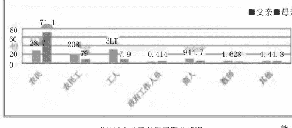

即便是在改革开放背景下相对公平的高考制度下，正如布迪厄的经典分析：家庭背景仍然发挥着“阶级再生产”的作用。

2007-2016年中国高考状元父母职业情况统计

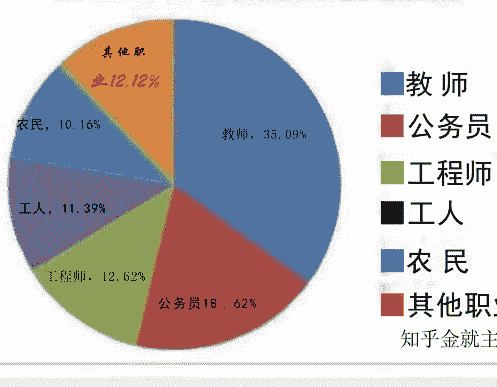
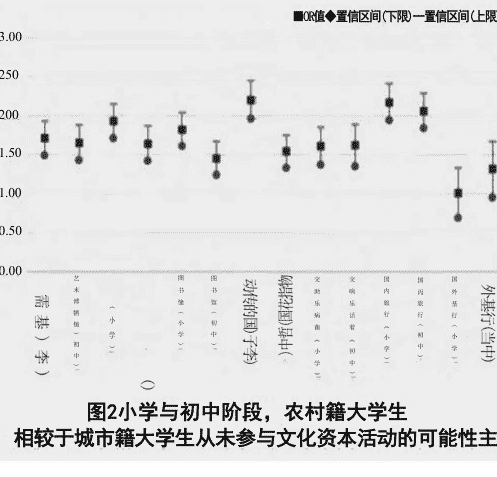

北京大学教育学院副教授刘玉宏曾统计1978~2005年近30年北京大学的家庭出身，结果发现：1978~1998年，农村大学子占三成；到90年代中期开始下降，2000年至2010年，农村子占一成%。

美国管理学家提出过“木桶原理”，认为整个社会中最脆弱的环节就是收入水平最低的弱势群体，他们的经济状况处于边缘，如果阶层流动通过正常渠道改变现状，可能会滋生颠覆整个社会的想法，发展陷入停滞或倒退。阶层结构中，阶层流动差异显著，呈现出碎片化、断裂化、碎片化特征。碎片化是指阶层之间关系不再凝聚，上下流动的通道存在阻碍，层级之间形成了分明的界限且难以实现身份转换，流动贯通。罗尔斯曾抨斥某些捍卫“秩序”的人：“制度安排总是有缺陷的，因为自然的分配和社会环境的偶然因素是不公正的，而这种不公正不可避免的必然。”这种思想被用来作为不公正的借口，仿佛承认不公正。我认为，自然的分配所谓不公正，在于“制度”，以及处理这些事实的方式。

## 调研称手机迷短视频玩游戏，如何看待这一现象？

- 为留守儿童修建滑雪场、高尔夫球场、赛马场；定期开展活动；免费组织留守儿童融入社区，前往澳大利亚发现野生动物航天中心；邀请贝尔文学得主与儿童互动，指点方向：与帕朗纳天文，指导留守儿童使用望远镜；开展留守儿童与联合国秘书对谈，探讨和平与发展话题；呼吁阿里、腾讯等顶级企业设立项目，为留守儿童闲余时间提供比赛及课外活动。这样就能根治留守儿童沉迷短视频的问题。

2021年初，世界经济论坛发布了《2020年全球流动性报告》，其中给出了全球流动性排名表。根据表的一系列参考指标，可理解为社会阶层跃迁和降级的动态程度。排名越靠后的国家，通常可理解为底层实现阶层升级、突破现有阶级状态的难度增大，同时高层群体跌落到下游的难度增大。

排行榜显示，北欧四国流动性最高，涵盖了四强，美国排名第27，在发达国家中居于最后。

| The Global Social Mobility Index 2020 rankings | Rank | Country | Score |
| :--- | :--- | :--- |
| 1 | Denmark 丹麦 | 85.2 |
| 2 | Norway 挪威 | 83.6 |
| 3 | Finland 芬兰 | 83.6 |
| 4 | Sweden 瑞典 | 83.5 |
| 5 | Iceland | 82.7 |
| 6 | Netherlands | 82.4 |
| 7 | Switzerland | 82.1 |
| 8 | Belgium | 80.1 |
| 9 | Austria | 80.1 |
| 10 | Luxembourg | 79.8 |

而中国仅排名第45，很不幸的是两个被匮乏国家和私有化冲击的国家——乌克兰、智利。

| | | |
| :--- | :--- | :--- |
| 44 | Costa Rica | 61.6 |
| 45 | China 中国 | 61.5 |
| 46 | Ukraine 乌克兰 | 61.2 |
| 47 | Chile 智利 | 60.3 |

# “知识”一旦成为父子传承的私产，或是某一固定群体才能能够购买得起的“特权商品”，那么社会的流动性也就无从谈起了。

以上华华二中、上海生复旦中学等典型的贵族学校，日复一日地“退学上不起校的所谓‘低质量家庭’”，恐怕正是中国教育均衡63.3%的缘由。

该报告关注教育还有一数字：学校内的阶级划分。

也许国内大学内所占阶级的财富丰富，那么就说明社会流动性越高。

很无奈，也很现实，在中国这一方面只有31.9%……

| B. Selected Country Analysis (in alphabetical order) | Analysis |
| :--- | :--- |
| Australia | Australia steelsberg-holish-row over 76.7 percent in scores or the Toledo Academy 88.7% and female heterogeneous (HTJ) induction rates in youth which have a high secondary school completion rate and a high home education Ad. dont type of secondary education deterioration, limited educational opportunities by providing more access to schooling opportunities. |
| Brazil | Brazil 86% girls got an enrolled-351.1-female-low-rate(4.5%) and around 220 The Education Quality deterioration of children worst misfortune poverty by age 10 6.9%, female-development de-primary and secondary education could be alleviated by reducing budget poverty providing free access among young 25.14% for children makes-education opportunities in poor areas be (15.3%) highation (14.9 caution) highlights the distress in absence of absorb the of 65% poor become and rearing the populations higher best of |
| Global South | was 61.8. rates 45% on the Global South, Middle schools (70. and Technology Access 70. and Education Ano 52.4. and 53.3) On years, a high-type of household is in rates of unemployment and a high score in terms of work |

在今天，底层青年无疑是中国贫困群体中最代表性的群体之一，其实是不合理的社会分层导致的贫困层级的身份固化和资源贫固化。

许多的产业工人、新兴农民未能充分分到教育发展的成果，在社会转型过程中却承担了许多的改革成本，依旧过着贫困的生活，这部分群体被称为“穷一代”。

往后，他们的子女为家庭贫，生存发展条件较差、不能良好的教育、缺乏社会发展的机会，继续延续其父的弱势地位，并将其称为“二代”。

微信jntsg2，进资料群

一个知识点：江沛人家的女儿已经不再学习了，人家从小去读大学，打网球，学数学，英语，16岁就去读国际本科了，不要高等考成绩，国内一年，国外三年，直接国外名校本科毕业了，再读一年硕士。这样就有更多的工作时间，成家，照顾家里，现在这种中国国际本科特别别，学费比留学还贵，真的是百姓不知道的信息。收获 · 公号·金融主义

豆豆妈：孩子都上学了还不紧时间学习，带孩子到旅游都把孩子耽误了，以后高考上不上好学校你就着急急吧，你应该尽早让孩子吃。

2024-8-11 · 河南 01.0万 9

创作者：我女儿走国际生路线，高中高考都不需要。初中我会把她送到英国读私立，我的孩子不需要费苦家里的钱她钱花不完。你不是焦虑孩子的成绩，而是焦虑不能给孩子兜底！

2024-8-11-美国 回复 37万金生

加微信jntsg2，进资料群

5451条评论

白日梦想家：你好羡慕，一年就去了这么多地方，我活活了二十年还没出过市。小时前 重庆 回复 作者赞过

二十三岁就退休合作者：我已经玩了快十年了兄弟，从17岁玩现在遍中国+活了112个不同的国家。小时前 ·英国 回复

③

因白日梦想家 二十三岁就退休：哥你们你一点都不担心的问题的，下果子，我也要这么豪横。小时前 ·重庆 回复 作者赞过

二十三岁就退休作者 白日梦想家：我出生那天起就富到自己的环球旅行十年花花的钱没我我一年多的。小时前 ·英国

众号 ·金融主义

所谓“穷二代”群体，今天不仅限于农村地区，城市的“穷二代”同样贫苦——那有些虽然有城市户籍，但父母是城市低保、产业工人、无业失业半者等弱势群体的后代，由于各种因素的影响，这部分年轻人群体生活在都市，但由于其父辈不能提供足够的社会资源，导致他们在激竞争中处于劣势地位。

微信jntsg2，进资料群

## 按年龄段人口分布

| 年龄段 | 百分比(%) | 人口(万人) | 累计百分比(%) | 累计人数(万人) |
| :--- | :--- | :--- | :--- | :--- |
| 0 | 0.39 | 546 | 0.39 | 546 |
| 0-500 | 15.42 | 21589 | 15.81 | 22135 |
| 500-800 | 14.43 | 20203 | 30.24 | 42338 |
| 800-1000 | 8.86 | 12404 | 39.10 | 54742 |
| 1000-1100 | 3.75 | 5220 | 42.85 | 59962 |
| 1100-1150 | 0.37 | 518 | 43.22 | 60510 |
| 1150-1500 | 13.30 | 18621 | 56.52 | 79131 |
| 1500-2000 | 12.33 | 17633 | 68.85 | 96764 |
| 2000-3000 | 14.81 | 20734 | 83.66 | 117138 |
| 3000-5000 | 11.21 | 15695 | 94.87 | 132833 |
| 5000-10000 | 5.42 | 6328 | 99.39 | 139151 |
| 10000-20000 | 0.56 | 784 | 99.95 | 139935 |
| 20000+ | 0.05 | | 100.00 | |

注：数据为2019年人口，与国家普查数据可能有差异。

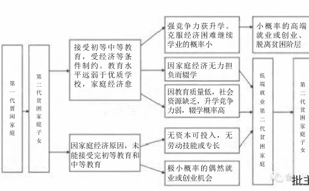

根据2017年的数据显示，城镇非人口约为2000万人，再加上那些生活质量较低、徘徊在底层边缘的无业、失业人员、产业工人，这部分保守估计在3%左右，约2500万人。对于这些青年群体而言，在城市环境中的每一个不可知的资本风险、市场波动都有可能在他们身上发生，进一步将他们陷入——房价飙涨、二手房租赁暴雷、公司裁员潮、疫情打击、烂尾楼交付等等等。尤其，当城市危机出现的频率近年来增加，部分位居阶层上游的子女自然就会遭遇此群众的反感。

# “90后某交月入超8万”热搜，中金回应：该员工被停职调查

财联7月29日讯，28日晚上，一则“90后某交月入超8万”相关截图在社交平台流传。记者带来，该事件引起关注，涉事主被停职调查。相关回复显示，有博主在红书上晒其收入水平及合照，并配合由中金公司开具“月均收入为8250元”的收入证明。据了解，该博主为证券从业员。（记者黄菁祈）

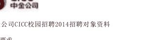

能力要求：postgraduates and MBA graduates from domestic and overseas preferred; Bilingual proficiency in English and Mandarin; Excellent academic achievement; Ability to understand and analyze financial statement and reports; Ability of facilitating financial and quantitative analysis including financial projection and valuation model; CFA preferred。

国内：
一：北京大学、清华大学、复旦大学、上海交通大学
二：上海大学、中央财经大学、人大、浙江大学
三：同济大学、对外经济大学、首都财经大学、厦门大学
（均为少数优秀高校）

海外：
一：哈佛大学、伯克莱大学、斯坦福大学、牛津大学、剑桥大学、麻省理工学院、政治学院、华州大学、澳洲商学院、康奈大学沃顿商学院
二：加州大学洛杉矶分校、芝加哥大学、明尼大学、耶鲁大学、哥伦比亚、华盛大学、加州大学圣地亚哥分校、罗西南大学、东北大学、南交通大学、曼彻斯特大学、香港中文理工大学
三：澳洲大学、爱德华大学、康奈尔大学、墨尔本大学、多伦大学、南洋理工、香港中文大学、麦加大学、新加坡大学（顶尖大学）

这些“利益家庭”是财富代际传递的典型表现，间接加速了贫富化与发展平衡。上世纪90年代以来，创业诞生了一批企业，随着时间的推移，大约到2017年为止，中国的“富贵”高峰明显出来。

微信jntsg2，进资料群

## 此表明，中国社会财富正在进行。

这些“利益家庭”是财富代际传递的典型表现。上世纪90年代以来，创业诞生了一批企业，随着时间的推移，大约到2017年为止，中国的“富贵”高峰明显出来。

## 某人家的女儿已经不再学习了，人家从小去读大学，打网球，学数学，英语，16岁就去读国际本科了，不要高等考成绩，国内一年，国外三年，直接国外名校本科毕业了，再读一年硕士。这样就有更多的工作时间，成家，照顾家里，现在这种中国国际本科特别别，学费比留学还贵，真的是百姓不知道的信息。

所谓“穷二代”群体，今天不仅限于农村地区，城市的“穷二代”同样贫苦——那有些虽然有城市户籍，但父母是城市低保、产业工人、无业失业半者等弱势群体的后代，由于各种因素的影响，这部分年轻人群体生活在都市，但由于其父辈不能提供足够的社会资源，导致他们在激烈竞争中处于劣势地位。

## 财富与权力的断层世袭，阻隔了社会资源、机会、权利的正常流动，导致社会中下层特别是社会底层失去了向上流动的机会、空间和渠道，使得社会利益严重失衡。

# 三工匠三代酿酒人

带带头的酒师是欧茂凯，虽然他是车间年龄最大的酒师，但他依然身体力行，自己挥着手中的木槌，动作灵活轻盈。曾获多年优异的生产成绩，欧茂凯2019年被评为“茅台工匠”。

特别关注的是，在批“茅台工匠”的名单中，还有两个和他相似的名字——欧茂胜、欧茂洪，他们是同一母地的三兄弟。这是一个与茅台同呼吸、共同命运的家庭，祖孙三代酒人，传承着茅台的匠人精神。

在河南濮阳，在河南濮阳的院士、博士等，占了。

在河南濮阳，在河南濮阳的院士、博士等，占了。

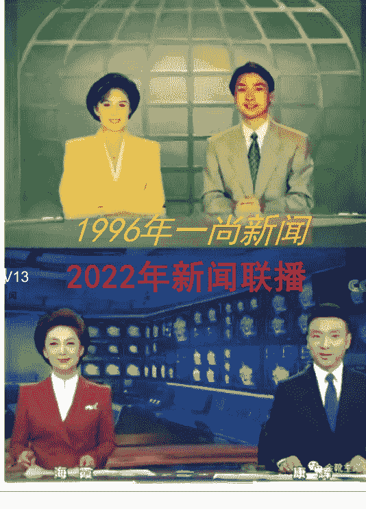

### 1922年
### 《红旗》

不难看出，在河南的的，，，，，的的。。

，，，，

，，，，

，，，““教育”的工具。

“

，，，“““”。

”。

但？在？在集团的统治下，劳动人民没有那么多钱去“教师”，又没有高高的地位得到。

他们的子女，无论在分数面前，还是在其他面前，怎么能实现““平等”呢？

且他们对新西伯利亚所做的调查为例，那里有百分之九十的农民被挤在大学外，而城市知识分子（不要忘记，其中包括官员）的子女却百分之九十都占了高等学校。

按照“原则”，或者可以这样说，百分之九十和百分之九十还不是“平等”？

其实，什么抽象的“自由”、“平等”，从来就是资产阶级的谎言。

列宁曾说过：“只要阶级还没有消灭，任何关于自由和公平的谈论都是欺骗自己，欺骗工人，欺骗全体劳动者和受资本剥削的人，无论如何，也是维护财产阶级利益的。”
