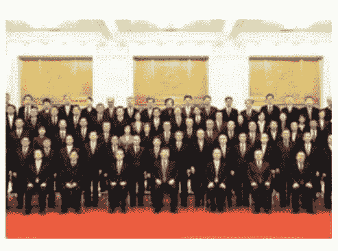

## 风云外交

文/欧洲金靴

超哥失联了，目前的消息来看大概率是凉凉。

就在15日，印度驻华使馆有个活动，按道理超哥要露面的，但是继续缺席，这就确实不正常了。

并且，代为出席的还是同样接受了调查的副部长孙海燕，说明孙海燕没问题，但超哥至少短期内得继续失联……

微信：jnts8 微信：jnts2

免费进资料群

为什么关注他，原因很简单，大致有二：

- 一、他是目前外交系统内，除了外事委员会那四位大佬（主任领袖、副主任小强、委员不歪、办公室主任老王）之外，堪称最具实权的人物。如果真的落马，将是继刚子之后又一位部级外外交干部被拿下了。这真的伤害不小，因为他和刚子一样，同样深得领袖爱……

加微信号jnts2，免费进资料群

- 二、他本是刚子错误之后热门的外长接者，此番却没能继续顽发育，反而被淘汰，这无疑将持续加剧外界对2027年外交头部拟交人选、以及“外交委”人选的猜测。毕竟老王2027年74岁了，不大可能再持待下，更不可能留任政治局——在老王之前，上一个连续两届入主政治局的外交系统高官还是钱其，而且他在足之后十五年没再再出过“外交委”，到2027年的老杨（在十大以之后的“小组治”改革体系中工作得力，受到资赏）。所以老王三年前拿到一届政治局主席这里已经是最后的巅峰，2027年外交系统一定会变幻王朝旗。

那么，既然2027年外交部要变天，谁来“过渡者”老王的班，这就成了看点。

之前在2023年底，也就是刚子已确定亮凉的时候，我在群里就说过的看法：

| 知识星球TOP资源分享群 |
| :--- | :--- |
| ♦ 付费文章 | ♦ 付费群 |
| ♦ 付费课程 | ♦ 副业&搞钱 |
| ♦ 财经&股票 | ♦ 报告 |

那年的12月30日，新华社发表新闻报道《领袖接见年度驻外使节工作会议与会使节并发表重要话主任参加接见》，报道的内容中有“中共中央政治局、中央办公厅主任蔡主任参加接见”和“中共中央政治局委员、外交部长王才参加接见并在2023年度驻外使节工作会议上发言”等内容，足见规格之高。

从官方配图可以清晰看到，在“与大家亲切合影”时，分坐正中央的领袖左右边的，分别是蔡主任和王老。

任的左边不是别人，正是中联部长的超哥。

且超哥的左边更外侧，才是外交部党委书记，同一中央委员+正部级的齐万。

加微信jntsg2，免费进资资料

同时，进一步表明表明地位的是超哥本人，中联部的机构身份与职能等级在超哥于2022年年中走马赴任之后得到了正名。

中联部在新中国建国之初是一个在中国主席“一边侧”外交战略指导下，负责联络通会社会主义阵营内各执兄弟党、以及西方阵营营内“在野共产党”的带有鲜明意识形态倾向的外交部门。

这个部门在三十年前重要性不言喻，包括“波卤事件”期间与东欧各兄弟进行讨论、陪同邓周等三人访苏联（解决波歧事件）、中苏亚恶期间负责与东欧兄弟党对接事务并保持联系等等等等，都是由中联部全权管辖。

但是进入改革开放之后，由于“意识形态外交”方针被淡化甚至拆弃，中联部的地位逐步走低，尤其是涛哥时期几乎没有任何存在。谈及外交事务，人们往往只会关注外交部。而历史的发展给予了新的机遇。十八大后，随着十八届中全会和十九届中全会的召开，中共内部创立了“小组治”体系，后期将“小组”升格为“委员会”，权力逐步收归外交部。

这些“小组”在2018年之前几乎均由部长担任，且大部分办公室直接设立在对应的部委中。

- 如此中央全面法治委员会设在司法部，才是真正的决策部门而非司法部；
- 如此中央科技委员会设在科技部，才是真正的决策部门而非科技部；
- 如此中央审计委员会设在审计署，才是真正的决策部门而非审计署；
- 如此中央外事工作委员会设在外交部，才是真正的决策部门而非外交部。

2018年5月18日，外委召开首次会议，领袖亲自主持，严厉指出：“中央外事工作必须围绕顶层设计、总布局、统筹协调、整体推进，强化顶层设计、统筹协调、提高能力、加强机制建设、确保各项部署落实到实处。”

七年前领袖这番发言还不直白，但当时间来到2023年时，领袖直接接了，2023年12月，领袖主持召开外事工作会议，毫不不动坚持党统一领导。

随即，中联部和外交部之间频繁的人事交流，比如捷储调外交部副部长，比如马赛调外交部助理，等等。今天中联部的官方介绍有这样话：“工作领域不断拓展，内涵不断深化，为自身建设、改革开放和国家总体做出积极贡献。”

注意时间点，正是在年前那场会议之后的（即2023年度驻外使节工作会议与会使节的大会），超哥坐上了高位。这次安排之间，与领袖隔一个蔡主任，无疑是超人的巅峰。而且，不妨看看两年前刚子消失，外交部几乎停援开展工作的阶段，超哥和中联部为何“哈沽”——与领袖亲密见面之后，超哥不停赴美国，分别宣布林肯、美总统安全事务助理朔衍、民主邦参议员、旧金山市长李德以及金融、工商、智库媒体界人士交流，出席中美对话框架下专题座高调表演。要知道当时台湾“大选”之时，超哥此时的外交可谓慎重。从美国回来，超哥又集中在不到星期的时间里，特种兵式连续会议蒙古代表团、日本社民党代表团、吉索亚亚洲代表团、墨西委员会考察团——如果这些属于中联部“分内工作”的话，那么超哥此时还连接会非常注目了。早早就不是第一次了。早在那半年之前的2023年4月，也就是刚子还没出事时（刚鲁晋升副国级才亡月），美国驻华大使伯恩斯居然然拜访了中联部，与超哥会晤。稍后不久，刚子陷入了失联状态，直到当年10月靴子落地。

那时候，就有声音传出超哥来了“历史的进程”，一步到位接班刚子的外长职位……不过最终，接班老王还是选中了副国级的老作为年的过渡，而非仅仅是中央委员的超哥。这里要注意一点：虽然老王在二十大上提升政治局，但老王本行外交系统层面，事实上“明升暗降”：相比于任“外交局委”的老杨，老王并未成为中央外事委员会的委员之一，而仅仅只是中央委员会办公室主任——说白了，老王没有决策权，只有执行和落地中央决策的。因而，如果不是刚子在2023年毫无征兆的出事，老王大概是高层24人中最清闲的同志，完全无需理会一线事务。超哥那边的发展似乎也证明了这个路径，即使面对老王长时光重来的境遇，超哥继续在打怪升级，去年依旧各种出访和接见，比如拜日本首相岸田文雄、会见外川阳子时，一帮日本媒体的口吻都是视为其未来中国外长，日本方面当时也是给予了超接待规格。

似乎一切都待2027如期而至，就待老王卸甲归田。可是没人想到，一年多后的今天，超哥居然凉了……干部出事，实在概率不大，这是由这个部门的人事组织特性决定的。外交部是当前怪物第一大委，人员数量和财政经费都是超级大头，且长久以来在人事安排层面“近亲繁殖”、“内部部育”、“针插不进、水涨不入”的现象极为显著，也是体制内“同事结合”、“家族联姻”最为“猎婚姻”的单位。别可以说，刚子之前的几任外交高官，比王光亚（陈总女女）、载秉国（黄镇）、李肇星（秦力真）、老王（钱嘉东），哪个不是乘龙欢上位？刚子之前的前任发言人（章曙），也是二代（章曙），且这位二代的丈夫被老王培养成了高官。但是话说回来，也因为外交部的天然差异性和封闭性（几乎没有外来空降干部），这个部门都是几十年深耕于系统内部，年轻轻轻被父辈安排进外交学院以及外交部。这使得外交系统干部较为廉。反过来，系统干部一旦有问题，通常严重，往往就是政治问题而非经济犯罪，比如同谋罪、泄露国家密等等。因为这是一个既能够接触领域、又能距离最高人亲密接触的单位。超哥是怎么进步的？不是因为贴身服务领袖而受到垂青嘛。从这个角度来说，他的落确实让人摸不透。如果不是经济问题，他只有短短一年的地方经历，即2018年后地方政，这显然不是正常的。之前分析过的，领袖的新时代用人用标准发生了变，有基层经历、地方主政经验的官员更受青睐。看看当地的地方，再看看主管事务，以及浙江相处的同事们，下了下了实的资源。所以如果不是经济犯罪，就只能政治犯罪。政治犯罪分为两种，要是对外的间谍叛，要么对内不忠领袖。超哥的仕途显然不大可能，在他加速时代，1964年生的从简历来看，不会触及其他派系，何况让他2017年去浙江“镀金”再杀回外交部，这就是一个独立王国。那么，只剩最后一个可能：因为他的简历里明明记录一条：2009年驻菲律宾共和国全权大使。别忘了，当年那个张斌就是中联部官员，长期派驻越南大使以及回到中联部任职的前二十年里，先后向美国卖了5000多份电脑、U盘存储设备，发现高达5000份国家机密。特别注意的是，近年来中联部已经深度参与涉情报的工作，不可小觑。脑洞大开，超哥又要现身了。不管怎么，如果他真的陨落，如前文所言，对领袖打击太大了，因为一位精心培养的外交后辈不幸崩台。光敏锐的同学应当看出，火箭式跃升的刚子，送到浙江培养的到底是谁？显然就是前文提到的二十大上“明升暗降”的老王，一位在外交部耕耘四十余年的超级蛇。很多时候，想要看透政策和人事，必须站在权力立场分析。老王从1998年成长为部长助理（管干部）开始，近三十年他提拔了一批亚洲出身的干部，使亚洲司逐渐与北大司（北美和大洋洲司）抗衡。曾几何，北大司多年高官，如刘华秋、老杨、张毅军、何亚飞、刘京等等。随着老王在系统内平步青云，亚洲司部门也迎来了鲤鱼门的红利期，如孙卫东、吴浩、崔凯、傅顾、赵立坚、魔宁、刘劲松等。其中孙卫东就是当年“驻巴使馆二把手”赵立坚的搭班领导，即“一把手”，真乃一衣带式的权力繁盛。这种局面，当然是领袖不能容忍的，尤其是在2018年后越发需要打破这种旧格局。在这个过程中，刚子、超哥等新锐外交“后浪仔”被选中并大力培养。带着尚方宝剑，刚子上上任后堪称大刀阔斧，连续拔擂“自己人”以稀释亚洲干部的局面。典型就是华姚、徐其鸿、汪文斌的火速进阶，以及赵立坚的彻底边疆化。结果谁料到，刚子还没来得对外部手术，自己就先凉了。不得已，老王重新出山，在本来“明升暗降”的情况下重揽大权，一切如旧。于是，与此同时在2022年快速飞跃的超哥，成为了又一位马前卒，继刚子之后再度肩负特殊使命。谁承想，爱将竟然一次轰倒地。事已至此，又回到了那个相当火热的旧话题：谁能成为2027的新外长？在我个人看来，大概有三位人选。

- 一、华姐，民间知名度高，政治形象颇佳，年龄也有优势，且和刚一样近距离服务领袖以及彭妈的出访事务（这一点非常非常关键）。但是她存在履历硬伤，现在必须再出去当个大使，像樊刚主政外交部之前急需去美国大使位置补足了履历空缺那样。所以接下来可以观察，华姐在一两年内。

- 二、马萨奇（此处原文似乎不完整，根据语义推测为某人等）。

- 三、（此处原文不完整）。
