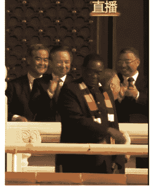
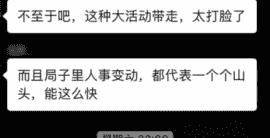
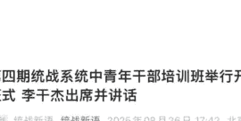
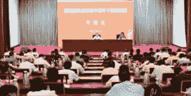
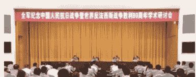

# 这场月饼，馋太足了！

文 / 欧洲金靴

首先来说一下，统战老李继续显身了。

我之前在群里和朋友圈都已经给出过判断，他所说的“西藏消失”并不是什么值得大惊小怪的事，至少短期内我看不见任何他有问题的迹象。

# 会议2025

【含专属阅读朋友】

代表团回援赛的官方新闻报道，“赢赛虽要少一人，输了要胜利起‘李子’了输”。

我的看来，还是觉得得时无妥。

我有理由：① 线上的韩国赛措很有信心，可能胜利比较容易，路线清晰，要么球员身体有问题，医生不建议赛期内坐飞机；② 球队下个赛季提前，他们已经计划了23日后的决赛赛，如果提前准备可以安排夏天（何况在路上），那么，就没有必要写明天的函，因为现在就是用来聚焦各个细节的复盘，他们今天没做工作，当然就不写你了。

我也难意难嘛，公开信息说是错误而已。

不过不用急，下周后有会议，到时候就会清楚了。

2025年8月26日 22:33

不至于你呢，这种活动带劲，太劲了

且只是儿子人事变动，代表一个山头，能这么快

直播开始 23:00

嘚。希望老赢，至少短期内内容记得
为了有的人味和如此，这次欢庆赛好好表现。

总之，这次的节奏，在外面不错了让人不可惊讶，不用自己言之？卖的，和热情激烈诚恳。

## 第四届越系统青年干部培训班举行仪式 李李华出席并发言

记者：张亚 洪新 2025年08月26日 17:42 北京
编辑：14 张磊

8月26日，第四届越系统青年干部培训班举行，中央政治局委员、中央军部长李强李华出席并发言。

# 深度视野大V文集255 有温度高质量群255

这次城上没来的人觉得应该道的大五个个人吧，四个蒸锅级：涛哥（身体一不好），见涛哥那篇会员文章《弱主？硬骨头！》）、老猪（96岁了身体承受不了，而且他早就开始缺席领袖的聚会了，包括四年前的百年庆，两人对对付非秘闻）、宋平（这个就不用说了，老身子骨）、罗干（同样老身子骨）。

以及一个富国：刘YD。她做手术了，不知道哪个器官有意，反正实在医院。

其他的，基本该来的都来了。

关于他，还是得等官宣哨再另，不宜宣宜不敢动笔......

除了城楼之上的身影，另一个值得注意的自然就是城楼下的受阅人员了。这次有两个极其显著的变化：

金钱RedBoy @微博 20-9-3 09:24 发布于 安庆
韩越延同志，中国人民解放军中部战区空军司令官。
#九三盛大通宵#

金钱RedBoy @微博 20-9-3 10:53 发布于 安庆
今年直属兵总指挥，不介绍任何对方的嫡摄人人员。全过程仅总总指挥韩越延。

## 先说韩同志。

这确实是二十年来大阅兵首次指挥“降级”，此前全部都是北京军区/中部战区的司令担任总指挥，算是“地主之尊”的体现，大佬文集圈比如2018年南海的海上大阅兵也是南部战区领导出身的沈儿担任总指挥。

但这次的天安门阅兵，总指挥仅仅是中部战区空军司令，妥妥降了一级。

这里面反映出两个信息:

- ① 各大战区的领导们实在是在摸不着人了，反腐高压之下，满目望去，尽数“消失的他”，其中包括老黄，他两个月前就缺席了国防部在人民大会堂举办的庆祝建军九十周年招待会，所以只能劳烦韩同志代为指挥。
- ② 容我卖个关子，后文会说。

再说变化二，即不再展示和播报各方的的领头人，这也是首次。

所以这场阅兵式全场呈现的氛围有点诡异，好像是在刻意引导观众只需将注意力集中到那些人目瞪口呆的超精武器装备即可，不要关注我军当下的人事......

对比六年前战旗队由五大战区的长官领衔，这次的打头阵的五座也“疑惑”化。像西部战区的司令和政委此前双缺席西藏，东部战区更是沦陷，难以重现六年前的状况。反腐还未结束，没人知道今天参加阅兵的将领几天后消失......那不如干脆报名单了。说到这里，就要说明一个现象，此产生的空军地位明显上升。

深度视V文集255 有温度高质量社群255

在阅兵一周之前，军委召开了一个纪念抗日胜利学术讨会，这个会议由政治工作部（此前的总政治部）和军事科学院主办，但这次由于冉人都被罩下，朱宪上的军委高级领导就剩下孤零一人，他的两边是科学学院的同志，再边上是政工部任张玉堂——如今主管政工的人。 各位可能会奇怪，分管政工的人会到下面一堆将，中将军，也是有趣的画面。这里给一个独家猛料：何顶哑了。不是落马，就是宇宙意思哑了。

## 深度视野文集255 有温度高质量社群255

原因具体不详，后续消息会在群里给各位更新。

加之政工部的杨毅上月已经被免职，所以现在张玉堂迎来了人生转机。所谓乱世出才，他竟然能够以将军衔掌关重要的政工，如今仍在军委会议上坐着，令人啧叹。说“空军崛起”。

这个会议下面第一排，坐着四位上将（徐、陈、郭、徐）加七位中将（周、深、韩、童、冷、毕），其中陈、郭、徐、韩、童，五都是空军出身。苗是军历史上直接从陆军“转岗”到海军政委，且晋升过程一路破格，他不符合“担任正大区职务满两年”也不满足“中将军衔掌四年”，却依旧被提拔上将。当时（2014年）他是被领袖给予厚望、加注了特殊使命的，即大力发展海军、推进海军现代化“走向蓝”。所以，海军立刻掀起史无前例的大清洗，尤其是肃清了几乎整支东海舰队，杨、宋、厉、刘等全部被铁血斩落。随后苗又大规模提拔自己的人马，比李、王、赵、秦等，这也导致了今天的空前乱象。苗去年的落马，从军种角度看，也带出了一批陆军和海军出身的将领陷入图，最顶的就是老、老、袁、李以及南海舰队两任司令（鞠、李）也陷落。这些哪个不是大人物，哪个占据位置，竟然全是苗的人马，这简直就成了“苗家军”。再如此典型的，上面提到的毕，作为信息部司令的他本不应该出席这个纪念胜利研讨，应该由政委李伟出来这个“各单位政委领导”露面的学术会议，但李也是苗在兰州军区的嫡系，此前已被调离信息支援部队，所以此番由毕参会（总不能信息部不来会吧……）。

而在空军现在成为了本轮反腐运动“最大的赢家”。包括上面提到的苗系亲赵，今年4月底的中央集体学习，作为中央军科技委员会主任的他本应出席，但他消失了，取代的是副手徐进，空军上将；还有5月底的全军场地观摩交流会（杨出席），军委训练管理部部长王鹏鹏消失了，取代的是副部长刘涵，也是空军上将。

唏到这，不妨给出一个比较清晰的本轮持续两年之久的军中反腐的时间络：

- 第一阶段：2023年下半年，苗系重建体系，几乎把整个后勤队伍和装备发展连根拔起，甚至在去年年初宣布“军反腐战斗已取得压倒性胜利”，直到去年6月在延安召开的一幅“大获全胜”那样的军委政治工作会议，这场运动看似定调、看似结束，就此打住了……然而，烈度更大的地震即将到来；
- 第二阶段：2024年下半年，杨系地面反击，将整个苗系推翻，甚至直接“清侧”干掉了一位政治局委员（何顶），造成的政治影响已实质性超过2014年那轮领袖主导、杨和许打下的新时代反腐（肃清郭及其背后的者），是改革开放以来，军中波及范围最广的一轮大事震动，以至于今天的阅兵形成负面干扰。

去年的政治工作会议，春风得马，带着他的一班人（袁、王、秦、韩），在杨面前短短几个月，整个集团宣告覆灭。如今，两军争，空军整齐，这两年来除了老，几乎没有受到挫。相比于陆军和海军，空军中的地位可谓云直上，让人们恍惚回到60年代主席号：“全国学习，解放军！”至此，列位等待苗。我之前在群里说过“他的名字一定会”，很多同志理解，看完本文，应该理解了吧？他的不会比十年前轻。结合人的先进力量的突然展示，可以明确两点：

- 军备无虞，统帅安稳；
- 那个众所知的历史目标，近两年非常期待

## 深度视野文集
群微信255

### 深度视野优质集（链接优质群，助你成功）全部包含以下内容：限时年费188/年 加微信

- 吃瓜群众圈群对话（原价365元/年）
- 子明私享汇（内）文章
- 政事室（顾子明）付费内容加送子明群
- 米联储闲间【作者米】原价599元/年）
- 欧洲金雀会员文章（原价328元/年）
- 砖瓦仁内部圈（原价400元/年）
- 卢克文优读书会专属（原价699元/年）
- 鉴茶财经星球（原价3310元/年）
- 猫哥的视界星球文章（原价299元/年）
- 财经新周【独家新闻】原价1498元/年）
- 世界在金塔（原价2200元/年）
- 森淼财经星球（原价1600元/年）
- 激泽译读付费文章（持续更新）
- 司马林解读选题全套音频和全套书籍收藏版无删减（原价2.3万）
- 虚构三部曲[民国梦、帝国战争、不被理解的Mao]（原价599元/年）
- 卢克文星球文章（原价268元/年）
- 额外再送：卢祺元新微博付费专栏、三村丰老文、三花九洞文集

不定内容：……更多资源将下去……

- 守夜人司令星球、接魔王星球、成术后财富圈、雪花花甲老头等
- 创始佳绪、达叔浅论星球、成术后财富、雪花花甲老头
- A视野、大树乡谈、江初好、泮咩说、上海家学等付费文集
- 西风付费文章、老端、赢在八小时之外、局人的视界、升值、老A体制内等一切大V付费文章（每月不低于600元的付费文章）

限时年费188/年 低成本链接全网大优质内容
