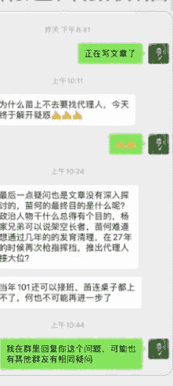
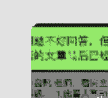
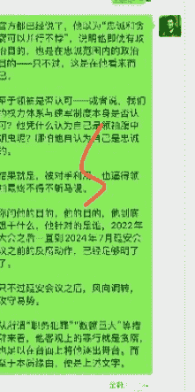

## 为什么苗上不去要找代理人，今天终于解开疑惑🙏🙏🙏

最后一点疑问也是文章没有深入探讨的，苗何的最终目的是呢？政治人物干什么总得有个目的，杨家兄弟可以说架空长者，苗何难道想通过几年的发展清理，在27年的时候再次轮回指挥，推出代理人接大位?

当年101还可以接班，苗连桌子都上不了了，何也不可能再进一步了。

我在群里回复你这个问题，可能也有其他群友相同疑问。

官方已经说了，他以为“忠诚和贪腐可以并行不休”，说明他即使有政治目的，也是在忠诚范围内的政治目的——只不过，这是他在他看来而已。

至于领袖是否认可——或者说，我们的权力体系与建军制度本身是否认可？他凭什么认为自己是领袖腹中虫呢？哪怕他认为自己是忠诚的。

结果就是，被对手利刃，逼得领袖最终不得不不断马溃。

你问他的目的，他的目的，他到底想干什么，他针对的是谁，2022年大会之后一直到2024年7月延安会议之前的反腐动作，已经足够明了。

不过延安会议之后，风向调转，攻守易易。

从所谓“职务犯罪”“数额巨大”等措辞来看，他客观上的罪行就是贪腐，也足以在台面上将他逐出舞台。而至于本质缘，便是上述文字。

金靴：

## 革化四厂·会议室

金靴进群加微信cuk255

44条新消息

金靴进群加微信cuk255

其他群友的提问，统一回答一下。

七

请问阅读文章是哪篇

欧洲金靴进群加微信cuk255

金靴进群加微信cuk255

11:28

金靴进群加微信cuk255

《这场月饼xxx》

七：请问阅读文章是哪篇

## 深度视野优质集团（链接优质社群，助你成功）

全部包含以下内容：限时年费188/年 加微信cuk255

- ① 吃瓜群众倍时文加时时群对话（原价 365 元/年）
- ② 子明私享汇（含）内部文章
- ③ 政事室（顾子明）付费内容加送逐顺子明群
- ④ 米联锦友【作者米穗】（原价 599 元/年）
- ⑤ 欧洲金雀会员专属文章（原价 328 元/年）
- ⑥ 砖万瓦内部文档（原价 400 元/年）
- ⑦ 卢克文青读书会专属文章（原价 699 元/年）
- ⑧ 鉴茶财经知识星球（原价 3310 元/年）
- ⑨ 猫哥的视界知识星球文章（原价 299 元/年）
- 10 财新周【独家新闻】（原价 1498 元/年）
- 11 杨世在金钱圈（原价 2200 元/年）
- 12 森淼财经知识星球（原价 1600 元/年）
- 13 激源异译付费文章（持续更新）
- 14 司马林解读末选全套音频和全套书籍版权无割减（原价 2.3 万）
- 15 虚构三部曲[国梦、帝国战争、不被理解的 MAO]（原价 599 元）
- 16 卢克知识星球文章（原价 268 元/年）
- 17 额外再送：卢祺元新浪微博付费专栏、三村丰老文、三花九树文集

不定内容：......（更多资源写下去了......

- ① 守夜人司令星球、摇拽魔王后星球、成术谈论星球、成术财富圈、雪花花甲老头
- ② 创始佳笔记、达叔谈论星球、成术财富圈
- ③ A 视野、大树乡谈、江宁后、泮咩说、上海海家学等付费文集
- ④ 西风付费文章、老端、高在小时之时、局外人的视界、升值、老体制内等其它一些大 V 付费文章（每月不低于 600 元付费文章）

限时年费188/年

## 低成本连接全网V优质内容

深度视野文集进群微信cuk255

深度视野（付费文集）

