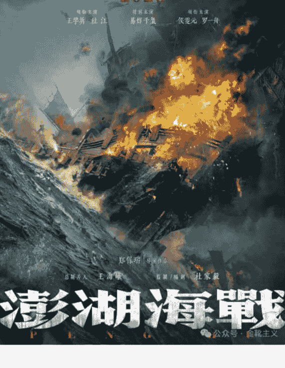
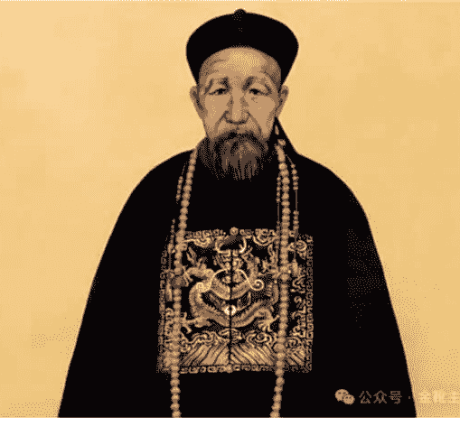
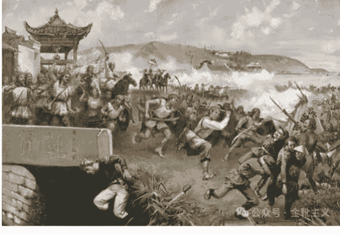
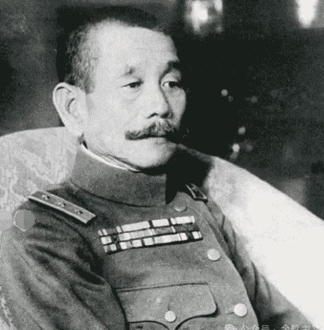
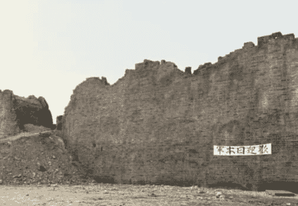

# 《澎湖海战》，并不符合“新中国价值团队不去考虑”

欧洲金靴 金靴主义2025年10月31日 09:29

## 文 / 欧洲金靴

时代的错位，史观的妥协，一定会不可避免地形成立场尴尬。

动辄喜好以影响射手法借古今令，往往会陷入政治伦理的失衡而不自知。

而这，恐怕急于完成任务、献礼式、套路创作的政商脑不会去考虑的（亦或是来不及考虑……）

一个不逸远的例子是《我在长城路上开超市》，最新一例则是激得舆论沸沸扬扬的《澎湖海战》。

推荐阅读：《我在长城路上开超市》

主主席曾对国内文艺界有过这样一句评价：

唱戏，净是老的，王世将，家院丫头……那个东西不行，要推除出现！

为什么帝国将相“不行”？到底“不行”在哪儿？

而今，电影《澎湖海战》引发的不争议算是给出了答案。

# 统一台湾势不可挡

封建王朝的底色是一个阶级压迫另一个阶级，这是不以任何历史王朝或英雄人物其客观伟大功勋、理性公正评价、史书定论为转移动动摇的。

封建就是封建，帝王就是帝王。

在“新中国价值观”的政治立场下，后世的理解与片面的定性应当共存。

在《中国革命和中国共产党》文中，毛主席曾对古代的封建社会的特点作过深刻分析，概而言之，中国封建社会中自给自足的自然经济占主要地位，农民和手工工人是创造财富和精神财富的基础阶级，而地主阶级是不劳而获的剥削阶级之一，封建社会的矛盾是农民阶级和地主阶级的矛盾。

中国古代的农民，就在这种封建的经济剥削和封建的政治压迫之下，过着贫穷困苦的奴隶的生活。

地主对农民有随意打骂甚至处死之权，农民是没有任何政治权利的。地主阶级这样残酷的剥削和压迫所造成的农民的极端劳苦和落后，就是中国社会几千年在经济和社会生活上停滞不前的基本原因。

由此，对于封建王朝统治阶层，从早期儒家道德学说，到转为激进的民主主义者，再至转变为马克思主义者，一手主导并代表着“新中国价值观”的毛主席，在读史过程中某些历史人物的评价就发生过极大变化。

比如清廷曾国藩。

早年的毛主席对曾国藩推崇备备，而对太平农民起义持否定态度。

他曾在致黎锦的信中说：

> 愿于近人，独服曾文正，观其收获实洪一段，完美无缺。使以令人易其位，其能如彼之完美乎？

而在革命征程中逐步变为马克思主义者后，毛主席转而批判国藩、肯定洪秀全。

1926年3月，他在《纪念巴黎公社的重要意义》一文指出：

打倒太平洋输出势力最多的是曾国藩，他当时是地主阶级的领袖。曾国藩是统团出身，团团就是地主阶级压迫农民的武力，他们可见洪秀全带领的一班农民革命，对于他们不利，遂出死力来打倒他。太平洋之地，不是满汉的战争，而是农民和地主的阶级斗争。

还是前文那句话：封建就是封建，皇帝就是帝王。

用毛主席在《关于辛亥革命的评价》里的话说：

> 辛亥革命以后，谁要再想做皇帝，就做不成了。

这就是“新中国价值观”。

我们不妨把话说直白些：你不能只有在涉及对抗外侵略者（荷兰）时，才把明郑政权（及郑成功等人）视作正面形象与英雄人物；你不能只有在涉及“一统疆土”这一历来今天第一号政治正确的，才把连域外侵略者（荷兰）视作合理行为。

没错，我说的就是清廷。

1663年，为围困厦门的郑军，靖南王耿继国与荷兰印度公司巴达维亚局秘密签订了《清荷条约》，共谋“剿灭明南余孽”，以期“夺回台湾”。

荷兰驻台总督豪一在信中直陈动机:

协助满人灭郑，乃复复福尔摩沙之唯一途径。

清方代表耿继国在给康熙的奏报中称：

借红毛火船之之力，可收夷庭夺穴之功。

1663年10月，清荷联军向郑氏发动进攻，荷兰舰队由博特指挥，配备十二艘战舰；清水师由黄德率，出船五十艘。

作战中双方分工明确：荷兰舰队负责封锁厦门门外，“以巨炮击败郑军战船”；清水师主攻陆地防线，“突袭沿岸炮台，配合荷军夹击”。

彼时，荷兰印度公司的庞大舰队刚刚经历胜利成功秋风落叶遭遇重创，“痛失台湾”，被侵占三十八年之久的宝岛最终回归。

恰是此时，破入其中的八旗舰登陆给了快失去台湾的荷兰人“一线希望”。

荷兰人对台岛的观测源于构建全球贸易网的经济野心。

巴达维亚总督卡本特尔在1622年曾致董事会信中直言:

台湾则得到中国，中国则得天下的利。

台湾岛当时被荷兰人设计为连接“日本—中国—欧洲”的三角贸易中枢，通过台湾转口的中国生丝在日本售价可达中国的倍，出口鹿皮年均达十五万张，占亚洲市场主流。

除此之外，荷兰人还强占台湾原住民种植甘蔗（蔗糖出口量突破十二万磅），以及垄断琉璃、樟脑等战略资源。

同时，面对对明海禁政策，荷兰人在台湾建立秘密私银网络。

据《荷兰通舆日记》记载，1640年经台走私秘密入境的白银达三百万两，占当时中国白银流入量的15%。

荷兰印度公司驻台长官于1625年报告中强调：控台则垄断马尼拉（西属）、澳门（葡属），我方霸权乃固。

1624年荷兰占台湾南部后，1642年取锡隆，完成全岛控制，就此下基础。占岛多年，荷兰人在台湾经营掠夺，通过强征劳工、额外收税、强收土地等方式致台岛人口锐减，完全沦为早期帝国主义殖民。

# 《澎湖海战》，并不符合“新中国价值团队不去考虑”

定位尴尬，恐怕就是电影《澎湖海战》的主角。

- 士琅是维护国家统一的民族英雄吗？
- 士琅是践行传统道德的风骨之士吗？
- 士琅是契合古典政治的气节吗？

这几个问题，几乎每一个独立成章，却共同汇聚于同一个历史人物身上。

近代以降，出于国家统一和领土完整的政治需要，士琅作为“恢复台湾”的功臣，其形象被广泛传扬和塑造了。然而，这种宏大叙事有意或无意地忽略了其行为背后更为复杂和阴暗的，其是在明末清初艰难抗争背景下，在我看来士琅行为的性质应当更为严苛审视。从传统史角度，士琅恐怕仅为所谓时务，将个人恩怨与功名置于民族大义之上的机会者。他的所谓“历史绩”，却是建立在对民族抵抗力量的血腥镇压和彻底灭之上。

其本质，终究是政治集团、极端主义与投机主义的结果。自春秋以来，“尊华攘夷”成为儒家文化的核心之一。明朝作为最后一个统一王朝，其亡亡于外之手，在当时主体大夫和普通民众心中，是一场不不扣的“亡国”，而不仅仅是“亡天下”。“亡国与亡天下”之辩，正是这一时代的深刻反映。在此背景下，判断一个人的行为是否构成“功臣”的核心，在我看来绝非“统一”，而是其在“华”与“夷”的对抗中站在哪一边。毕竟，还是前文所述：纵使统一，不过也是失败。

然而，士琅非孤例。明末清初、清末民初、抗战时期，士琅类似的亡亡者自然出现。吴、桂、洪等，这些此前构成了助清的“汉奸”群体。他们或为私利，或为高官厚禄，或为保存实力，动机各异，但结果相同：都成为了征服中最锋利的刃。士琅的政治生涯始于迷茫，但他早期跟随芝龙参与过抗清斗争。然而，他的第一次“变节”来非常迅速。顺治三年（1446年），当其主帅决定降清，士琅未像郑成功那样选择与父辈决绝，继续抗争，而是毫不犹豫地追随芝龙一同降清。这一次选择，便奠定了一生的基调。在明朝屡陷失败、南征抵抗之际，他放弃了汉家将领的立场，选择了被“夷”政权。这次背叛不仅彻底暴露了他的格局狭隘，更直接导致了郑氏内部力量的崩溃，为士琅日后成为灭郑的主力埋下了伏笔。士琅与郑成功的矛盾源于多方面：首先就是士琅人才有傲、性格偏倚，在军中与郑成功的治政、用人理念存在冲突；直接的冲突源于曾信事件——士琅因庇护逃犯曾信，与郑成功产生激烈冲突，郑成功下令捕其家人并处死了士琅父亲、弟弟士显。这枉血深渊，成为了士琅彻底倒向清的直接动机。然而，正是对这一事件的反应，在民族灭亡后最能检验一个政治人物的公私之辨与大义。当时情境，郑成功领导的郑集团是东南沿海至整个中国范围内硕果仅存的最实力也最有希望的民族武装力量，是无数愿屈从“刻发易复”统治的民族复兴热忱。面对私忧与公的博弈，最终刻画了士琅最重要的历史形象。藉此，亦揭露了封建王朝的历史基因。权力的差异与集中，必然会导致驾驭民族团结和集体向心力——高阶级压迫带来的政治诱惑，相比于守民族节气，实在过于肥美，过于诱人了。士琅晚年编《靖海纪事》，该书收录了他攻台期间的各种奏奏、告和往来文。但这部书与其说是历史记录，莫说是一部精心编排的个人功劳，核心目的在于彰显士琅“不世之功”，为背叛郑成功集团进行维护和美化。在书中，士琅将自己塑造为一个深谋远、忠心为国、力排众议、最终奠定全功的完美将领形象。他在笔触下反复强调自己对廷的“忠诚”和对康熙的“感恩”，将攻台之举成为给上天、顺民心的正义之举。明郑集团被他贬为“海寇”、“逆寇”，其抵抗被贬为“负国顽徒”，从而将自己消灭同族的军事行动彻底合法化。在所有士琅的遗书中，《陈陈台湾弃薛留闽》被后世世誉为“最具战略眼光”，体现其所谓的“爱国情怀”的代表作。

在攻台后，士琅逐渐出现“统一”的观点，认为台湾是民族统一的基础。这一行为，成为史书的核心论述。然而，此处提出一个关键疑问：士琅的真实动机是什么？仅仅是出于考虑？事实是，士琅在台湾获得了巨大的利益和土地势，成为主主。。，，台湾也意味着也意味着，，作为作为作为作为作为作为作为作为作为，，，，，，，76，，，，，服康熙皇帝，，的。亡。

还是文文，失败。![](img/76ff053668a7e2bfaf2cddf4f11a1dc4_1_0.png）的。

在人类文明中，我们一直在寻找认同与归属感。从最初的采集到后来的定居，到如今数字时代，人类对未知世界的探索从未停止。这种探索不仅是为了生存，更是为了满足内心深处的奇心。随着人工智能技术的飞速发展，我们面临着前所未有的挑战：当机器仅仅是人类的工具，而是开始在创作、逻辑甚至情感领域展现人类的能力时，我们如何定义“人”？这不仅是一个技术问题，更是一个深刻的哲学问题。在技术的浪潮中，我们必须重新审视自身的价值、独特性以及机器共生的未来。

# 时代浪潮中，未来更阔

我们正处在一个变革的时代，机遇与挑战并存。只要我们紧跟时代，就一定能看到广阔的未来深度学习下，AI能够生成令人惊叹的成果，在复杂的科学上给出突破性。这种进步带来了便利，也引发了前所未有的焦虑。如果算法可以预测人类喜好，甚至模拟情感，那么人类是否具有不可替代性？

士琅的本质，终究是政治集团、极端主义与投机主义的结果。自春秋以来，“尊华攘夷”成为儒家文化的核心之一。明朝作为最后一个统一王朝，其亡亡于外之手，在当时主体大夫和普通民众心中，是一场不不扣的“亡国”，而不仅仅是“亡天下”。

# 投资的未来

首先，我们要明确的是，投资不是为了规避风险，而是为了承担风险。投资的本质是对未来价值的预期，如果你无法接受这种波动，那么就不可能获得超额收益。在市场中，波动是常态，而正是制造机会来源。对于很多投资者来说，最难其实是保持良好的心态。在市场恐惧时保持理性，在市场贪婪时保持冷静，这是投资成功的关键。我们要不断在实践中学习，总结经验，完善自己的投资体系。没有捷径，只有不断的进化。最后，祝愿各位投资者都能在投资道路上成功，收获属于自己的财富。

点评：在这个充满变数的时代，唯有不断学习的人才不被淘汰。投资不仅是资金的配置，更是对世界的认知。78 财经观察 | 2013-09-27

如果算法可以预测人类喜好，甚至模拟情感，那么人类是否具有不可替代性？

在技术的浪潮中，我们必须重新审视自身的价值，独特性以及机器共生的未来。

# 结语

没有人可以超越时代的羁绊，也没有人能挣脱所处历史单元的碑刻。郑成功（及其家族）莫非如此。1646年12月，郑芝龙被满人以高官禄诱降，郑成功劝阻父亲纳不成，率二十一人到南安福庙祭祭，焚烛倚棺，向孔子痛哀发誓：

> 身为孺子，今日为孤虏，向其而去，各行其是，诸先师昭焰。

但仅仅八年后，清廷遣裴郑郡，承诺给兴、泉、漳。士琅的的的的的的的的的的的父亲。士成功的矛盾源于多方面：首先就是士琅人才有傲、性格偏倚，在军中与郑成功的治政、用人理念存在冲突；直接的冲突源于曾信事件——士琅因庇护逃犯曾信，与郑成功产生激烈冲突，郑成功下令捕其家人并处死了士琅父亲、弟弟士显。这枉血深渊，成为了士琅彻底倒向清的直接动机。

重要的章，并对后世——延续至近代的日本华夷时期产生了深刻的影响。

我在此前电影《南京照相馆》的长篇影评，里南京会战日军军队内部重重矛盾曾写过——就南京会战的视角角度，是上海派远军与第十章的矛盾；从华战的宏观角度，则是松井石根与土留资源的矛盾；而从一个更长跨度的历史角度进行析，则是自大明王朝倾覆（甚至在大宋王朝倾覆）之后，日本民族对中国的族群认同与共存方式产生了判断偏差。

- 推荐阅读：《南京照相馆》长篇影评

用日本儒士林学的术语，是为“华夷变态”：

崇崇仪，弘光虏，流才保南，而薛虏横行中原，是华变于夷之态也。

简单而言，直到今天，日本社会都有广泛的“日本继承了汉夷正统与王法制度”的群体认知。

也就是所谓的“唐在在日本，元清中国”的“水户学”叙事。

明治天皇二年（1869年）下令国史局总裁，称：

其正政君君名之途，明华夷内之外之辨，以扶天下之纲常。

就连1945年8月15日昭和天皇玉音广播中使用的“大亚战争终结诏书”中明确自称日本为“神州”，即中国古名，所谓“神州之不灭”；陆军大臣阿南宪在同一天之时所留下的遗书中也撰写就“确信神州不灭”……

史演进四百年，如今朱舜水在日本依旧被刻礼拜（东京大学校内）立有“朱舜水先生之地之碑”，更不必说年前的血腥近代。

20世纪以前，以白梅学术、内藤湖南、稻叶亚、宫崎定等为代表的日本洋学者，开创了“满洲史”或“清史”研究范式；再如内藤湖南，提出的著名的“唐变论”，为后来的历史学奠下了战争伏笔。

当日本人可以用“理直气壮”以“尊王攘藩”旗号发动甲午海战，当伊藤博文禁李鸿章在《马关条约》上以“中国自居而勤务必须准落“清国”，当日日俄战争时期日军的口号竟然是“抵日俄、保卫中国”，当上世纪20年代所谓“大东亚共荣圈”、“振兴我们的亚洲”等包裹国主义妄心的幌子纷纷出炉。

特别，是在1937年那个寒冬的南京，当松井石根这样的屠夫会慨岸然、装腔作势地“怒批日军纪混乱”……

## 某种历史与现实的交织便无奈地产生

松井石根是一个铁杆“中国通”，倾心中华文明，特别是古代汉唐文化，也是一个虚诚异常的“泛亚主义者”。

作为著名日本人荒尾奎的疯狂崇拜者，松井主张亚洲自决反对欧美干涉事务、谋求亚洲诸国归于日本统辖。

他曾任张作顾问，并在东北地区领导日本特情报工作、为侵略东北打下基础。

后来松井与国民方面交好，尤其与蒋介石私交甚好（蒋介石1907年在日本的房子还是松井给他帮忙租的），在“反共共产主义”的大旗下，松井石根也是拉拢匪阀向日本投降的主力说客。

我们今天发现的多数谎在华敌的宣传物，比如《南京照相馆》里反复发现的“日中亲善”等愚惑人心的宣传，全是松井石根这类“亚洲派”军国主义者的杰作。

导致松井石根军事部“亚洲派”对蒋介石政府“死心”的一个重要折点，就是1936年的西安事变，蒋介石被诱往北，与共产党组成抗日统一战线，蒋由此被松井石根视为“背叛”，并在此加速了对中国的侵入，特别是长江沿线，在这个过程中酿成了世界震惊的南京屠杀案。

与土肥贵等亚洲主义者不同，松井石根主张殖民在中国建立一个统一的中央政府，并与其合作。松井石根深信：张作霖势力一旦消亡，东北一定会重回统治——历史事实也证了这一点。土肥贵在1931年将满洲国在明面上恢复了清王朝，并在此进一步寻求华北自治，松井石根等“泛亚洲”军官可谓极端反感。他对将来大局的判断错误，深表忧患。所以，当土肥贵领导在北平拓起华中地区积极推动另一个独立的“华中政权”，其目标是成为中国的核心。这就是为什么西安事变爆发后，松井石根再坐不住了，他读一本《南京照相馆》时或在路上说的那句：“南京的目标不是上海，而是南京——满清王朝与中华民国的首都。”南京这座城市，在松井石根眼中宛如“地方据”。

他没有办法接受南京如东北、华北、蒙古、山东等地被土肥贵等们树立为“亲日据”，他要的是一个统一的中国。这种的可怕部署始于1937年8月15日。这一天，松井石根受命担任上海派遣军司令。他觉获惊，迫不及待向卫文庸表示：“别无，只有拿着南京，打垮蒋介石政权。这就是我必须完成的任务。”数日后，松井在东京迎来杉山陆相说：“无论如何要打南京，使政府屈服，这是属于你的特殊使命。”

然而，随着1938年松井石根被召回国内，他们的泛亚主义理论也随之消灭。这其实是此后大陆各类汉奸阶层互不满意且相互对抗的原因。典型的1938年8月，在土肥贵精心安排下，华北临时政府和南京政府的代表在大连开会，请讨“统一”问题。会上汉奸们不断激烈、险些动手……直到9月22日，双方才同意由王克敏、王善唐、朱益和梁鸿志、温忠尧、陈群组成各汉奸的联合委员会。

此后，华北临时政府继续控制华北，南京政府管华中沦陷区。

在土肥贵、梅津、美伊他们的煽动下，东北有溥仪的满洲政府，华北王克敏为首的华民临时政府，华中有梁鸿志为首的华新政府，内蒙古德为首的蒙古自治政府，晋州划出一块淮海特区由那肃为特区行政官……至1940年3月，南京政府成立，新政权才被撤销，其成员仅有梁鸿志和少数早年由国民党为汉留任，大多数遭遣排挤、被迫下台。

由20世纪的松井石根说17世纪的郑成功，你会发现一个难以以言表的历史支线。郑成功父亲郑芝英以日本为早期基地，曾迅速建立起庞大的海上商业与军事网络，船队频繁往返福建、台湾、日本和东南亚等地，从事丝绸、瓷器、糖等贸易。在这个网络中，日本不仅是重要的市场和利润来源，更是郑氏集团获取战略物资如白银（用于购买军需和支付军饷）、铜（用于铸炮）、硫磺和优质日本刀（倭刀）的关键渠道。可以说，郑氏集团的军事力量相当一部分是依靠对贸易的利润和从日本输入的物资武装起来的。这种厚的联系，意味着郑氏家族在日本拥有广泛的人脉和商业利益。

郑成功的舅川左门等亲属，在日本社会中扮演了郑氏家族代理人的角色，为双方的沟通和物资流动提供了便利。因此，郑成功抗清时期，对日本并非一个陌生的国家，而是一个熟悉的、拥有潜在战略后方。如此后，郑成功写给德川幕府的信反复强调自己“生于日本”、“慕日本之心”，试图通过这种血缘联系将自己造成一个与德川幕府“叔侄”、“兄弟”的特殊人物，超越纯粹的国家利益，更具说服力的情感共鸣，从而请求日本援助。由于其源，他在另一封信中将自己的抗清事业描述为一场“对抗夷狄”的神圣战争，试图激发日本统治者的道义责任，从而力逐清实现恢复明江山……这自然符合明朝后期日本高层的战略期待。据史考，郑成功的对日援助几乎贯穿了他的抗清事业，重要的几次：

- 1647年（永历元年）：这是郑成功首次向日本援助。他派遣使者，希望获得军事事务支持。此时郑成功刚崭露头角，力量尚弱，急需外部。

- 1648年（永历二年/庆安元年）：郑成功再次派遣使者。此次援助的信件被收录，首次打出了“感情牌”，强调自己“生于日本，慕日本之心深”，希望日本能援助。这次援助的背景是清军在福建攻势猛烈，郑成功压力巨大。

- 1651（永历五年/庆安四年）：郑成功再度援助。

- 1658年（永历十二年/万治元年）：这是郑成功规模最大、也后世所知的一次援助。在准备发动大规模作战、围攻南京的前夕，他派遣僧人桂梅作为使者，携带金钱和辞呈前往日本。这次援助的目标非常明确，即“乞假数万之兵”，希望日本直接援兵，与他协同作战，一举恢复明朝版图。

作为“观战者”的幕府高层，对郑成功的援助颇为谨慎。尤以彦根藩主、井直享为首的保守派最为克制。井直享曾指出，出兵援助郑成功，意味着与已经在大陆建立稳固统治的清朝直接接战……集团看来，与清朝纠结是“永世之灾”，且对于刚刚通过“岛原之乱”巩固了国内统治、致力于和平和稳定的德川幕府而言，卷入一场胜负明显的国际战争，风险过高。

拒绝出兵并不等于完全失败。日本对郑氏政权的支持非常多元。比物资与武器的秘密运输，通过长崎的贸易渠道，日本能够获得的战略物资如铜、铅、硫磺以及鹿铳（一种火枪）、倭斧等武器装备。再则是情报的交流与共享，长崎作为日本唯一面向中国的窗口，是获取中国大陆情报的核心。郑氏的船和人员不仅带来了信息，也带来了大量关于清朝内部局势、军事部署的情报。这些情报通过“唐风说书”的形式被记录下来，成为幕府判断局势的重要依据，也间接服务于郑氏的抗清事业。

前文提到的“华夷变态”不仅是一情报集，更是一部思想宣言。它记录了从吴三桂起兵到郑成功抗清一系列被视为“光复中华”的事件。林春胜在序言中表达了一个期望：

若有为夷之志，则从异方域，不亦奇乎！

意思是，如果能看到（在中国）发生“华夷变”的转变，即便身处异乡，也不感到非常痛苦吗？这充分体现了当时日本主流知识界对郑成功的支持和道义认同。他们将郑成功的事视为帮助中国恢复正统、蚕吞亚洲的地缘跳板与政治抓手，从17世纪直到今天，可以说日本主义分子从来没有放弃这一理念。

## 日本第一位女性首相 高市早暮

20世纪以前，以白梅古岸、内藤湖南、稻叶亚、宫崎定等为代表的日本洋学者，开创了“满洲史”或“清史”研究范式；再如内藤湖南，提出的著名的“唐变论”，为后来的历史学奠下了战争伏笔。

当日本人可以用“理直气壮”以“尊王攘藩”旗号发动甲午海战，当伊藤博文禁李鸿章在《马关条约》上以“中国自居而勤务必须准落“清国”，当日日俄战争时期日军的口号竟然是“抵日俄、保卫中国”，当上世纪20年代所谓“大东亚共荣圈”、“振兴我们的亚洲”等包裹国主义妄心的幌子纷纷出炉。

特别，是在1937年那个寒冬的南京，当松井石根这样的屠夫会慨岸然、装腔作势地“怒批日军纪混乱”……

松井石根是一个铁杆“中国通”，倾心中华文明，特别是古代汉唐文化，也是一个虚诚异常的“泛亚主义者”。

作为著名日本人荒尾奎的疯狂崇拜者，松井主张亚洲自决反对欧美干涉事务、谋求亚洲诸国归于日本统辖。

他曾任张作顾问，并在东北地区领导日本特情报工作、为侵略东北打下基础。

后来松井与国民方面交好，尤其与蒋介石私交甚好（蒋介石1907年在日本的房子还是松井给他帮忙租的），在“反共共产主义”的大旗下，松井石根也是拉拢匪阀向日本投降的主力说客。

我们今天发现的多数谎在华敌的宣传物，比如《南京照相馆》里反复发现的“日中亲善”等愚惑人心的宣传，全是松井石根这类“亚洲派”军国主义者的杰作。

导致松井石根军事部“亚洲派”对蒋介石政府“死心”的一个重要折点，就是1936年的西安事变，蒋介石被诱往北，与共产党组成抗日统一战线，蒋由此被松井石根视为“背叛”，并在此加速了对中国的侵入，特别是长江沿线，在这个过程中酿成了世界震惊的南京屠杀案。

与土肥贵等亚洲主义者不同，松井石根主张殖民在中国建立一个统一的中央政府，并与其合作。松井石根深信：张作霖势力一旦消亡，东北一定会重回统治——历史事实也证了这一点。土肥贵在1931年将满洲国在明面上恢复了清王朝，并在此进一步寻求华北自治，松井石根等“泛亚洲”军官可谓极端反感。他对将来大局的判断错误，深表忧患。所以，当土肥贵领导在北平拓起华中地区积极推动另一个独立的“华中政权”，其目标是成为中国的核心。这就是为什么西安事变爆发后，松井石根再坐不住了，他读一本《南京照相馆》时或在路上说的那句：“南京的目标不是上海，而是南京——满清王朝与中华民国的首都。”南京这座城市，在松井石根眼中宛如“地方据”。

他没有办法接受南京如东北、华北、蒙古、山东等地被土肥贵等们树立为“亲日据”，他要的是一个统一的中国。这种的可怕部署始于1937年8月15日。这一天，松井石根受命担任上海派遣军司令。他觉获惊，迫不及待向卫文庸表示：“别无，只有拿着南京，打垮蒋介石政权。这就是我必须完成的任务。”数日后，松井在东京迎来杉山陆相说：“无论如何要打南京，使政府屈服，这是属于你的特殊使命。”

然而，随着1938年松井石根被召回国内，他们的泛亚主义理论也随之消灭。这其实是此后大陆各类汉奸阶层互不满意且相互对抗的原因。典型的1938年8月，在土肥贵精心安排下，华北临时政府和南京政府的代表在大连开会，请讨“统一”问题。会上汉奸们不断激烈、险些动手……直到9月22日，双方才同意由王克敏、王善唐、朱益和梁鸿志、温忠尧、陈群组成各汉奸的联合委员会。

此后，华北临时政府继续控制华北，南京政府管华中沦陷区。

在土肥贵、梅津、美伊他们的煽动下，东北有溥仪的满洲政府，华北王克敏为首的华民临时政府，华中有梁鸿志为首的华新政府，内蒙古德为首的蒙古自治政府，晋州划出一块淮海特区由那肃为特区行政官……至1940年3月，南京政府成立，新政权才被撤销，其成员仅有梁鸿志和少数早年由国民党为汉留任，大多数遭遣排挤、被迫下台。

由20世纪的松井石根说17世纪的郑成功，你会发现一个难以以言表的历史支线。郑成功父亲郑芝英以日本为早期基地，曾迅速建立起庞大的海上商业与军事网络，船队频繁往返福建、台湾、日本和东南亚等地，从事丝绸、瓷器、糖等贸易。在这个网络中，日本不仅是重要的市场和利润来源，更是郑氏集团获取战略物资如白银（用于购买军需和支付军饷）、铜（用于铸炮）、硫磺和优质日本刀（倭刀）的关键渠道。可以说，郑氏集团的军事力量相当一部分是依靠对贸易的利润和从日本输入的物资武装起来的。这种厚的联系，意味着郑氏家族在日本拥有广泛的人脉和商业利益。

郑成功的舅川左门等亲属，在日本社会中扮演了郑氏家族代理人的角色，为双方的沟通和物资流动提供了便利。因此，郑成功抗清时期，对日本并非一个陌生的国家，而是一个熟悉的、拥有潜在战略后方。如此后，郑成功写给德川幕府的信反复强调自己“生于日本”、“慕日本之心”，试图通过这种血缘联系将自己造成一个与德川幕府“叔侄”、“兄弟”的特殊人物，超越纯粹的国家利益，更具说服力的情感共鸣，从而请求日本援助。由于其源，他在另一封信中将自己的抗清事业描述为一场“对抗夷狄”的神圣战争，试图激发日本统治者的道义责任，从而力逐清实现恢复明江山……这自然符合明朝后期日本高层的战略期待。据史考，郑成功的对日援助几乎贯穿了他的抗清事业，重要的几次：

- 1647年（永历元年）：这是郑成功首次向日本援助。他派遣使者，希望获得军事事务支持。此时郑成功刚崭露头角，力量尚弱，急需外部。

- 1648年（永历二年/庆安元年）：郑成功再次派遣使者。此次援助的信件被收录，首次打出了“感情牌”，强调自己“生于日本，慕日本之心深”，希望日本能援助。这次援助的背景是清军在福建攻势猛烈，郑成功压力巨大。

- 1651（永历五年/庆安四年）：郑成功再度援助。

- 1658年（永历十二年/万治元年）：这是郑成功规模最大、也后世所知的一次援助。在准备发动大规模作战、围攻南京的前夕，他派遣僧人桂梅作为使者，携带金钱和辞呈前往日本。这次援助的目标非常明确，即“乞假数万之兵”，希望日本直接援兵，与他协同作战，一举恢复明朝版图。

作为“观战者”的幕府高层，对郑成功的援助颇为谨慎。尤以彦根藩主、井直享为首的保守派最为克制。井直享曾指出，出兵援助郑成功，意味着与已经在大陆建立稳固统治的清朝直接接战……集团看来，与清朝纠结是“永世之灾”，且对于刚刚通过“岛原之乱”巩固了国内统治、致力于和平和稳定的德川幕府而言，卷入一场胜负明显的国际战争，风险过高。

拒绝出兵并不等于完全失败。日本对郑氏政权的支持非常多元。比物资与武器的秘密运输，通过长崎的贸易渠道，日本能够获得的战略物资如铜、铅、硫磺以及鹿铳（一种火枪）、倭斧等武器装备。再则是情报的交流与共享，长崎作为日本唯一面向中国的窗口，是获取中国大陆情报的核心。郑氏的船和人员不仅带来了信息，也带来了大量关于清朝内部局势、军事部署的情报。这些情报通过“唐风说书”的形式被记录下来，成为幕府判断局势的重要依据，也间接服务于郑氏的抗清事业。

前文提到的“华夷变态”不仅是一部情报集，更是一部思想宣言。它记录了从吴三桂起兵到郑成功抗清一系列被视为“光复中华”的事件。林春胜在序言中表达了一个期望：

若有为夷之志，则从异方域，不亦奇乎！

意思是，如果能看到（在中国）发生“华夷变”的转变，即便身处异乡，也不感到非常痛苦吗？这充分体现了当时日本主流知识界对郑成功的支持和道义认同。他们将郑成功的事视为帮助中国恢复正统、蚕吞亚洲的地缘跳板与政治抓手，从17世纪直到今天，可以说日本主义分子从来没有放弃这一理念。

## 日本第一位女性首相 高市早暮

高市早暮作为自民党的代表之一，她毫不惜野心，主张将自卫队更名为“国防”，并公开表示“台湾有事”。在经济层面，她积极推动《经济安全保障法》，试图限制中国企业技术之外。在10月15日的国内宣布发布会上，有记者提问：高市曾多次访问“台湾问题”，她称其为“坚定的亚洲”。发言人表示：我们注意到有关选举结果，台湾问题纯属中国内部事务，日方应遵守一个原则，在台湾问题上反复慎之，无论如何对外宣示着。

与日本四百多年来的“文化误解”不同，郑成功在17世纪对日本的主观依赖，需要被放置于“反清复明”这个框架内的。郑成功一生的政治追求，从始至终都是抗清，他的身份认同核心从始至终都是一位，“大明忠臣”。这一点，在他所有的政治行动中都得以体现：他奉南明永历历正，使用永历年号，其最终目标是在大陆上重建明朝统治。

郑成功对清朝的敌视是根本性的、因为他所受的传统儒家教育中，满清代表着需要驱逐的“夷狄”。因此，郑成功所有的外交活动（包括对日）都被置于“反清复明”这一最高战略之下。郑成功最终失败了。

郑成功的历史局限始终无法克服民族意识。这就是为什么。

从发展脉络来看，新世纪以来，这个圈子通过持续不断的拍摄一系列清朝主题作品、宫廷戏、影视……如今早已落后。2012年之前的二十年，堪称是中国剧从兴起到鼎盛的关键时期，发展呈现明显的阶段性特征，大致分为三个阶段：

- 第一阶段：歌颂皇帝的所谓“历史正剧”的辉煌时期（90年代后期），以《雍正王朝》（1999）、《康熙王朝》（2001）为代表，该阶段作品普遍采用“帝王史诗”叙事，将皇帝塑为励治、忧民的“明君”形象，不仅在表现层面完美契合了大众心理，即通过重塑历史现实来改革开放后对强力领袖的社会期待，以及大量相关文艺人士是在这个过程中活跃进入娱乐圈核心舞台。

- 第二阶段：戏剧的娱乐转型（90年代末至2000年代中期），以《还珠格格》（1998）、《铁脑铜世纪晚荒》（2001）为代表的戏剧逐渐倾斜了严肃叙事。《还珠格格》全国收视超过47%，最高突破62.8%，创中国电视剧收视率记录。此类作品采用“历史空化”策略，将历史场景化为爱情故事和喜剧冲突的装饰性元素，体现了现代历史观——消除历史深度，强调了娱乐和情感消费。值得注意的是，《戏说乾隆》虽已开启内地搞笑戏说清荒的先河，但直到90年代才形成规模化产出。

- 第三阶段：斗剧的崛起（2000年代末至2012年）以《甄嬛传》（2011）、《宫锁心玉》（2011）为代表的斗剧成为新主流。《甄嬛传》在卫视和网络均取得高收视率，网络点播量24.4亿，豆瓣评分高达9.2分。这类作品创造了“宫廷丛林法则”叙事模式，将描写为权力竞技场，体现了自由历史观——将历史简化为个人在竞争性环境中的生存博弈，回应了市场经济环境对个人奋斗和社会竞争的社会焦虑。

可以看到，无论哪时期，无论是歌剧还是误剧，为了借古今以历史为鉴，清朝都成为了抓手，相关群体之上流成了文艺行业的资源的争夺。

## 京中四位满清族后裔：不是王爷就是公主，个都是“皇族”

北京作为清朝历史遗存最丰富的城市，自然成为清宫剧生产的中心。故宫、和园等实景提供了无可替代的拍摄资源，清史研究机构和清史学者高度集中在北京。这种地理优势使得北京团队在清宫剧创作中具有天然优势，形成了所谓的“京圈贵族”层以及清宫剧独有的网络。从体制内到体制外，利益均占。典型案例是英诚（满族）推动合拍《末代皇帝》，这也可视为影视热潮的重要起点。

漫长的历史演进，二十年之久，大批“京圈贵族”的文艺从业者通过创作，实际上参与了清朝的话语争夺。在主流汉文化视角下，清朝过去被视为“异族统治”时期，而新世纪以来大量清剧的传播通过突出清朝成就，重构了人的形象和定位。这种重构不是直接的历史辩论，而是通过情感化、故事化、文艺化的叙事实现的。

再说得深，这些群体当中，某些人真的是爱国的多年来如今也不反省。但是一个根本性的逻辑在于，他们自认为是政权是对封建王朝、中华民国的“血脉延续”，是历史自然的框架。过去是门阀贵族，他们自认为在新的中国继续坐高位、享受社会地位和资源待遇。这种逻辑，我个人是绝对不认的。在我看来，中国建立的合法性，不是所谓“延续王朝”，而恰恰是推翻旧王朝，是消灭旧的一切反动牛鬼神差并卷土重来。

这是毛泽东领导农阶级引起的新民主革命的底层逻辑，非什么“延续王朝血脉”。拜托，1949年了，大清早亡了，还整什么？

破坏旧，建设新！封建制度要不要破坏？不去破坏这些东西，你就想着建设。只有把这些东西破坏了，中国才有未来，中国才能建设，否则不是讲梦话而已。只有破坏旧的腐朽的东西，才能建设健全的东西。相对于下面这段话：

毛主席在1959年2月已经给出如此回应：“对于民族资产级的生产资料，我们没有采取无偿剥夺的办法，而是实行赎买政策。因为他们虽然是剥夺者，但是他们曾经是民主革命的盟友，现在又反对社会主义。”

就现实论之，如今娱乐圈那个“圈子”并没有得到整改，反而近年来有“添砖加瓦”的迹象，另一个当年的移民似乎也加入了……你别说，倒也符合清朝时期的民族图谱。

## 清朝满家皇族联姻次数一表

| 皇帝 | 皇族女嫁蒙古 | 皇族男娶蒙古女 |
| :--- | :--- | :--- |
| 努尔哈赤 | 2 | 14 |
| 皇太极 | 24 | 43 |
| 顺治 | 22 | 23 |
| 康熙 | 55 | 23 |
| 正雍 | 26 | 1 |
| 乾隆 | 176 | 14 |
| 嘉庆 | 27 | 4 |
| 道光 | 52 | 17 |
| 咸丰 | 4 | 4 |
| 同治 | 15 | 5 |
| 光绪 | 27 | 15 |
| 宣统 | 2 | 0 |
| 总计 | 432 | 163 |

1958年9月，毛主席在第十五次最高国务会议上的这段话直击人心：“说阶级不存在了，阶级斗争消失了，这个观点恐怕是不对的。像吃鸦片烟一样，吃完鸦片烟上了瘾，是不容易戒的。资产阶级思想，还有封建主义思想，那么容易戒的。”

列宁曾在全俄第一次代表大会上说过：“战争的性质是由哪个阶级决定的，而不是由纸上写决定的。”1945年5月，《联合政府》里的这段话如其分：“非革命力量的统一——抗战，非分裂的统一——团结，非倒退的统一——进步。只有革命力量的统一才是真统一，其他一切都是假的。没有人民的自由，没有人民的民主，能够统一吗？”

在许多后者看来，历史的发展并不是用新事物替代旧事，而是用努力保持事物免死亡；不是以阶级斗争去推翻反动的封建建筑，而是像他们那样否定压迫旧民的阶级斗争。我们的作者们过去历史中经历过中国的人，究竟是些人？我们的作者们也不研究从1840年鸦片战争以来百年中，中国发生了一些向旧的社会形态斗争的新社会形态，新的力量，新的人和新的思想来决定应该是称颂的，什么东西是不应该称颂的，什么东西是不应该反对的。这是社会主义的核心价值观，也是引导社会主义发展的根本方向。秦始皇、宋宗不是史书里的正面人物，至于清朝康熙也是得到毛泽东领导下稳定中国版图贡献。但是，他们又是反动的。在革命叙事里，他们是封建君主，是帝王将相，是地主阶级。这就是辩证法。从英雄主义到群众主义，从“城头变大旗”到无产阶级专政——在新中国的眼中，浩瀚史书中的一座一座山巅峰，，都是“略输风骚”了。

那么，我们应当怎样？“数风流人物，还看今朝！”

---{全文完---

## 深度视野优质圈（链接优质社群，助你成功）

全部包含以下内容：限时年费188/年

- 吃群众含帝训练文时群对话（原价365 元/年）
- 子明私享汇（含内部文章）
- 政事（顾子明）付费内容加返送顾子明群
- 米联锦拓【作者米横】（原价599 元/年）
- 欧洲金雀会员专属文章（原价328 元/年）
- 砖瓦斥内部文档（原价400 元/年）
- 卢克文青读书会专属文章（原价699 元/年）
- 鉴茶财经知识星球（原价3310 元/年）
- 猫哥的视界知识星球文章（原价299 元/年）
- 财新周【独家新闻】原价1498 元/年）
- 杨世光在金钱圈（原价2200 元/年）
- 森淼财经知识星球（原价1600 元/年）
- 激泽异读付费文章全套音频和全套书籍珍藏无割减（原价2.3 万）
- 司马林解读谋选全套音频[民国梦、帝国之路、不被理解的]（原价599 元起）
- 卢克知识星球（原价268 元/年）
- 额外再送：守夜人司令星球、接换魔王后、成术财富圈、雪花金甲头部等其它一些大V文章
