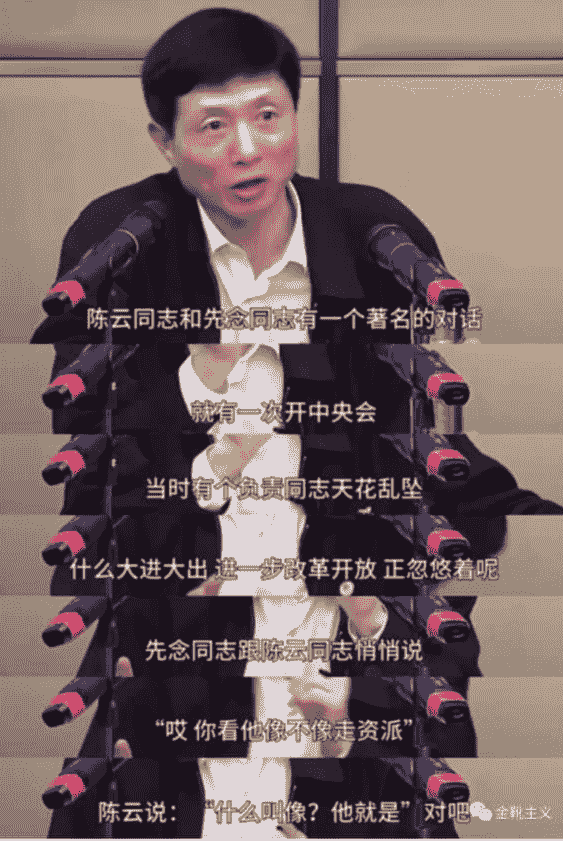
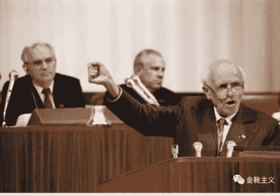
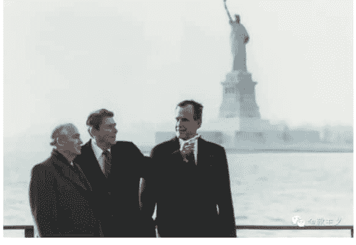
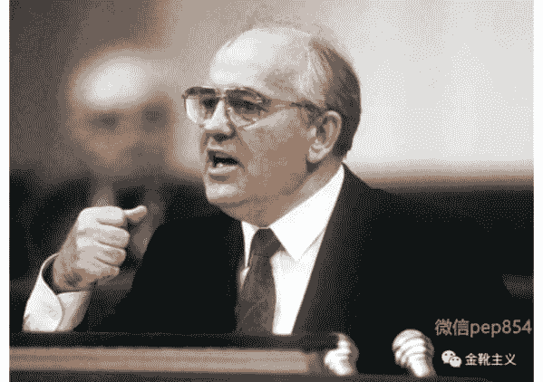
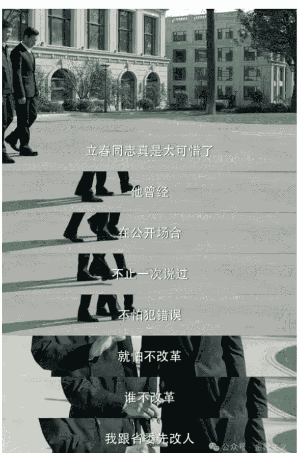
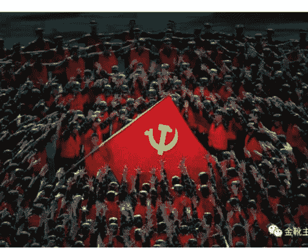
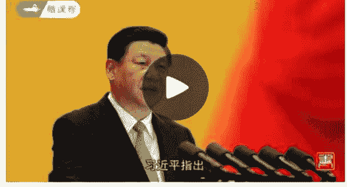

# “党政分离”的始末

原创 欧洲金帖 金鞍主义 2025年07月25日 10:38 安徽 / 欧洲金帖

1986年6月6日，“党政分离”被正式提出。

至当年11月7日的“政治体制改革研讨小组第一次会议”，最高层面上已数次提出“党政分离”为核心的政治体制改革：

“经济体制改革到了一定时候，就必须提出党的政治体制改革……党政分离要放在第一位。”

尤其是这场“研讨小组第一次会议”，是那研讨小组七次会议中，涉及最广、内容最丰富、影响最大的这一次。

不仅在原则上确定了“政治体制改革”的含义、目标和重点，而且也提出了政治体制改革若干项重点内容的基本方向，可以说，对下一步开展的“专题研究工作”到了重要的指导作用……

随后的1987年10月14日，在十二届七中全会预备会上，继续深入阐述了“党政分离”的内涵：

这次全会审议的文件，《三大报告》有了这个内容，《政治体制改革总体设计》也有这个内容。

政治体制改革，首先是领导体制改革。党政不分、以党代政这个问题不解决，整个政治体制改革都无从开展。

现在许多社会主义国家都在讲政治体制改革，所有政治体制改革的社会主义国家，又无例外地都提出要克服党政不分的弊端，要充分发挥政权机关的作用。

看来，在社会主义各国，党政分开是个大的潮流。这项改革，非搞不可，或迟或早，总得进行。

# 1

在当时，这个所谓“潮流”的领者就是苏联的新领导人戈尔乔夫，特别是其在遭受经济体制改革失败之后转头进行的苏共政治体制改革。

将“党政分开”写入我国的十大召开一年后，1988年6月28日，苏共十九次全国代表会议在莫斯科开幕，把“人道的民主的社会主义”确立为政治改革的最终目标和理想。

第二春天，全人代表选举在万众瞩目、尤其在西方等国的注视下开始。

这是戈尔巴乔夫效仿资本主义会议在苏联国内举行的第一次所谓“全民选举”。

格格廷斯曾说过：

> 我们党内可以有来自任何阶级的别，但是我们绝不需要任何代表资本家、中等资产阶级或中等农民的利益集团。

然而，1989年苏联的选举过程是一片混乱，许多分子甚至连坐人、投机倒把的恶性罪犯油头滑脑地出现在人民代表的候选人中。

至于那些反苏反共的愚态人心，包括大资本家更是不胜数。

此前，由于戈尔巴乔夫“新思想”的推广，雅科列夫在舆论领域已经是政治层面的“异者”。

反苏反共反社会主义的力量在当时纷纷组织起来，在街头、校园、工厂周围发表竞选演说，带领群众集会代表自己利益的候选人。

从1986年开始，苏联国内就出现了“非正式组织”，以辩论会、俱乐部、知识分子小组和青年小组等面目出来，1987年蔓延到戈尔巴乔夫很多大城市，当年就已经发展到三多个到九万个。

这些“非正式组织”中的打着保护本民族利益旗号要求脱离苏联的，有的西方民主主张全面西方化，有的甚至要求复辟沙皇式专制主义等等……而着急资产阶级“民主”和人道主义旗下的组织尤为活跃。

前所未有的复杂局面下，作为最高领导的戈尔巴乔夫本人却要求苏共与选举保持距离。

他公开命令苏共的各级党组织“不得干预候选人的活动”，而完全放弃了对党对选举这一重大政治活动的领导权，把干预候选人的权力交给了国内的外的各路资本势力。

在这个过程中，把波罗的海的三国分裂势力人物的“反共积极分子”连续选为人代表，苏共内部的头号反对派列宁宁也在此莫斯科获得高票当选。

让人作呕和愤慨的是，是深受美国欣赏的苏联异分子萨哈罗夫在苏联科学学院落选后，戈尔巴乔夫竟然又增加了一个名额，强行使其获得当选……

由此形成鲜明对照的是，160 名苏共的党委第一书记之中共有 32 名落选——这比当时让戈尔巴乔夫本人都惊讶了，他后来曾回忆道：

> 我那时都无法召开政治会议了。

在列宁格勒，市州两级党和苏维埃的领导人以及州党委委员没有一名当选；而全16个军区有14个军区士兵更是忠诚。

列宁格勒、俄罗斯科学院、俄罗斯国立大学校长伊万科夫就有感：

> 召开第一次人民代表大会的时候，无论是在首都还是在外地，选举都失败了。在后来参加选举选胜的人，都是放弃了社会主义和共产主义信仰的人。

1989年5月25日，苏联第一次人民代表大会选举了最高主席、第一副主席、最高苏维埃成员之一其中近15%的“民主派”及其支持者。

这个结果得到了老布什的赞许：

> 我们可以看到，苏联正在从最高维度走向文明化，我期待两国友谊继续深化。

包括布列日日钦、波波洛夫、萨哈罗夫、阿法纳西夫等一些“民主派”人物当选最高主席。在那场大会上，戈尔巴乔夫率先提议取消“苏联宪法第六条”，该条明确规定苏共在社会中的领导地位。

叶利辛即附议赞成，但是大多数学者表示坚决反对其做法。会后，苏联国内“自由派”与学者纷纷控诉，西方媒体也加足马力，戈尔巴乔夫必须“深入改革”、“取消宪法第六条”……

# 2

回想1917年，列宁领导了“一切权力归苏维埃”，这是因为在俄境内争取属于工人阶级和人民的政权条件成熟。

然而，苏联多年，戈尔巴乔夫等人提出“一切权力归苏维埃”这一口号，却是要全盘接受西方的政治制度，引入多党制，从根本上取消党的执政。

半年之后，戈尔巴乔夫又宣扬西方民主的三权分立：必须改进整个社会基础。根据权力分立原则，人民代表大会应当作出以下决议：

- 取消宪法第六条
- 改变苏共法律

苏共的法律要在共和国境内产生效力，必须经过人民代表大会批准……

1990年1月，戈尔巴乔夫发表：“实行多党制不是悲剧……我们不应该像害怕多党制那样。”

一个月后，苏共中央全会前一天，“民主派”在斯科动员了二十万人集游，喊出了“取消苏共领导地位”、“审判苏共”、“实行多党制”等口号。

2月5日，戈尔巴乔夫在苏共中央全会对上述行为不仅明确表示反对，反而是说：苏共的领导地位应当依靠宪法合法化。这已经表明了戈尔乔夫已经彻底默许了苏共国内外反对派对布尔什维克合法性的彻底，他已经完全放弃了执政地位。

在戈尔巴乔夫的推动下，3月1日，苏共中央全会决定向人民代表大会提交修改宪法第六条建议。

三天后，第三次苏联人民代表大会通过修改宪法的法律，将其中“共产党是苏联社会的领导力量和指导力量，是苏联政治制度和社会组织的核心”修改为“共产党、其他政党及工会、其他社会团体和运动通过人民代表、苏维埃代表以及其他形式参加制定国家的政策，管理和社会事务”。

原中共中央局委员书记库米林加夫痛心道：“这是一个错误，这是毁灭性的开始。取消党的领导就是取消了党的领导。”

原《真理报》主编、前国家主席列聂兹科夫也哀叹：“宪法第六条取消了，这就就像一座大厦的顶梁柱一样，把顶梁柱抽掉了，国家大厦也就倒塌了。”

取消宪法第六条和实行多党制后一年，联盟一级的政党出现了22个，共和一级的政党多达500多个，其中绝大多数成为最终推动苏联共产党亡国的政治力量。

随多党制的就是西方的联合制。

在1990年的苏中共二中全会上，戈尔巴乔夫以“多党制条件下国家不能出现权力真空”为名，建议设立总统，以确保其继续领导苏联的最高领导权。但实质上，这从根本上削弱了苏联在国家权力中枢的领导地位。在此之后，原本作为社会政治生活核心的中共政治局很少开会了……

# 3

1927年9月9日，主席领导了中国工农军第一军第一师，发动了秋收起义。

由于敌强我力悬殊，攻长沙的计划受挫，原有5000多人的起义部队只剩下不足1000人和48匹战马。其时，一股浓浓的失败主义情绪笼罩着整个部队。

赖毅将在回忆当时的情况时：“部队中弥漫着一股失败的情绪，许多知识分子和军官出身的人，看到失败似乎已经定，纷纷告别。有些资产阶级出身的共产党员这时放弃了革命，走向叛变或者消亡的道路。其中一个营，就在排长的掩护下，利用放哨的机会全部跑了，并且带走了所有的武器。那时，逃亡变成了公开的事，投机分子相互询问：‘你准备哪儿去？’这种危险迹象表明，即使没有敌人，这支杂乱无章、毫无凝聚力的队伍随时会崩散，无法担起责任。面对如此严峻的形势，主席不断思考解决办法。当时军队中组织人数很少，共产党员人数也很少，很难抓住士兵，最重要的是抓住部队的领导权。之后，主席与何哲颖、张子清、陈浩等交流了意见，当了解到北伐军在一级建立了军事组织，而营连级并没有建立党组织时，更加坚定了‘把组织建在连上’的决心。这也是三湾改的历史地位与历史意义所在。”

主席在《井山战斗》中总结：“后抗日战争时期，1942年9月，在关于统一地的领导及其组织关系的决定中，主席又提出‘实行军委元化’。自此，党的‘一元化’领导成为继古田会议建立的新型军队制度，从此建立在历史舞台。”

国民军中的政工干部几乎与我们完全不同，作为部队中政治基因的政委，不仅要参与战斗部署指挥，还要负责部队中政治教育、扩充、百姓生活。在二十世纪初，贪腐军队几乎没有发生。在倒戈时，各级权力几乎没有控制部队。”

这一切，归功于“党的领导”。

1927年9月29日下午，主席到达了江西新县三湾村。当天晚上，在三湾村召开了委员会会议。会上主席认为，缺乏党对军队的绝对领导是导致革命失败的教训，决定：

- 一、组织整顿；
- 二、由委员会统一领导；
- 三、部队中实行民主制度，官兵平等。

显然，三湾改的核心是将支部建在连上，明确了党和军队的关系，将成分复杂的旧军队改造成了有理想的人。在基层就有核心，同时通过组建党支部，积极发展党员，使党在部队里扎根。

# 4

1980年7月，波兰发生了历史上规模最大、持续最久的工农浪潮，波兰统一工人党（共共产党）中央第一书记盖莱克于当年9月被迫下台。同月，来自波兰各地三十六个独立自治工会的代表在格但斯克斯举行第二次会，决定脱官办，成立国家的独立自治工会，即团结工会。瓦卢萨为该工会全国委员会主席。

团结工会成立后，反政府势力逐渐占据了上风，以工罢和游行示威为手段对政府压力，对执政的波兰统一工人党提出了挑战，波兰执政的地位开始动摇……这种状况，直接影响了波兰其后的发展道路，并对东欧的其他社会主义国家的历史进程产生了重大影响。这股风也进入了我们的家中……一个月后，1980年8月18日，在《党和国家领导制度的改革》重要讲话中，系统地阐述了关于“解决党政不分、以党代政”的问题，指出：

“要真正建立从国务院到地方各级政府从上到下的强有力的工作系统。今后凡属政职范围内的工作，都由国务院和地方各级政府讨论、决定和发布文件，不再由中央和地方党委负责指示、决定。”

这篇访谈，后来被尊为“中国政治的里程碑”。

从坚持党的领导到放弃党的领导，最直观的结果就是：激烈的十月革命变成了悲惨的十月事件。

俄罗斯科学院、社会政治研究所所长瓦·奥希伯夫对十月事件曾评论：“这是人类有史以来第一次遭遇炮轰。就连列宁散会当时也没有用武力，最多只是把议员从议会赶了出来。叶利辛竟然下令炮轰议会，开了人类历史史的先河。”

‘改革’，本应是为了人民，为了国家，为了社会主义。从某·阿尔巴乔夫说，“我们研究所就开始进行国家的社会政治经济局势的年度调研，我们的调研报告连续退出——通过我们的调研，我们认定阿尔巴乔夫、叶利辛所行的‘改革’路线都是反人民的。”

严格讲应该算是改革进程中一些不可或缺的一些失误错啊，荣号。赵立春书记当时说过：改革就是一场革命，难免会出现失误，但是即便失误，也要去改革。

# 群众·金权主义

群众同志真是一太可怜了。他曾经在公开场合至少一次说过：不怕犯错误，就不不改革，谁不谈改革，我跟他们改人。

群众委员会经历近三十年的“改革”，那一阶段的中国与论场早已不谈顽固公有制、不谈高举马恩列斯主义、不谈坚持党的领导，那是一个堆积将各级党委加为加宁、沦为胆盖的时代。

如孔东教授所说，那时候在中国的高校，哪个教授是在讲台上宣扬毛主席、宣扬党，那简直直看着像是“有毛病”。

那么“没毛病”的是什么呢？是学术组织的官僚主义和学术行政的族门阀化。

四年前成都大学的书记还记得吗？

1992年末湖湖经济学院院长兼院部书记的解万亥教授，到2013年重庆大学机械自动化国家重点实验室创始人周梁昌教，多少孤身一耿的学术生命逝去，在控诉着中国政党之下知识领域的污染生态。

校长成了地头蛇，博夺了资本权，黄四他们要不要拿枪，而是纷纷戴上了博士士帽——文革中那些被击倒的学阀，重新挺起来，地方地方主义与官僚主义崛起的结果，就是“党委领导”的灭亡。

由高领域延伸的，是教育市场化、医疗私有化、企业自主化，乃至到了十年前南方新闻集团沦为猎狮的顶流巅峰时，“军队国家化”都被唤上了主流媒体的台面。

这一幕，大佬文集圈其殊相似：1990年3月，苏联第三次人大会上通过了《设立苏联总总统职位和苏联宪法（根本法）修改补充法》，其规定苏联总总统是苏联武装量的最高统帅，有权任命和撤销军队高级指挥员——这就从法律上夺了苏共领导、指挥苏联军队的最高权力。

当历史来到今天，我们将比以往任何时候都需要巩固和加强“党”的领导。

# 暇

2015年1月16日，中央政治局常委会会议召开。会议议题是听取人大常委会、国务院、全国政协、最高人民法院、最高人民检察院党组工作汇报——这是全面加强党对政党领导的标志性会议。

会议明确了中央党与全国人大常委会、国务院、全国政协、最高人民法院、最高人民检察院之间是“领导”和被领导的关系指出：

> 要加强纪律建设，把守纪律权威放在更加重要的位置，而最根本的的政治规矩就是坚持党中央的集中统一领导，党组是党中央和地方各级党委为党外组织的领导机关中设立的组织机构，是实现党对非党组织领导的重要组织形式和制度保证。

山雄有脊，房固则牢。

2021年深秋，党的十九届中全会的核心要：

中国共产党是领导我们事业的核心力量。中国人民和中华民族之所以能够扭转近代以后的历史命运、取得今天的伟大成就，最根本的是有共产党的坚强领导。

> “紧密团结在党中央的周围，未来很长一段时间我我相信这句话会越发深入人心，令人深入信服的。

只有党中央，才能发动真正有意义的“人民战争”。而只有“人民战争”，才能赢得华夏文明与西方财阀之间的人类未来生存权的争夺。

文末，我摘录一段2020年中央经济工作会议的公告，请同志们认真品味：

党中中央权威，是危险时刻全全国各民族迎而上的根本依靠。党中中央权威，是危险时刻全全国各民族迎而上的根本依靠。党中中央权威，是危险时刻全全国各民族迎而上的根本依靠。党中中央权威，是危险时刻全全国各民族迎而上的根本依靠。党中中央权威，是危险时刻全全国各民族迎而上的根本依靠。党中中央权威，是危险时刻全全国各民族迎而上的根本依靠。党中中央权威，是危险时刻全全国各民族迎而上的根本依靠。党中中央权威，是危险时刻全全国各民族迎而上的根本依靠。党中中央权威，是危险时刻全全国各民族迎而上的根本依靠。党中中央权威，是危险时刻全全国各民族迎而上的根本依靠。党中中央权威，是危险时刻全全国各民族迎而上的根本依靠。党中中央权威，是危险时刻全全国各民族迎而上的根本依靠。党中中央权威，是危险时刻全全国各民族迎而上的根本依靠。党中中央权威，是危险时刻全全国各民族迎而上的根本依靠。党中中央权威，是危险时刻全全国各民族迎而上的根本依靠。党中中央权威，是危险时刻全全国各民族迎而上的根本依靠。党中中央权威，是危险时刻全全国各民族迎而上的根本依靠。党中中央权威，是危险时刻全全国各民族迎而上的根本依靠。党中中央权威，是危险时刻全全国各民族迎而上的根本依靠。党中中央权威，是危险时刻全全国各民族迎而上的根本依靠。党中中央权威，是危险时刻全全国各民族迎而上的根本依靠。党中中央权威，是危险时刻全全国各民族迎而上的根本依靠。党中中央权威，是危险时刻全全国各民族迎而上的根本依靠。党中中央权威，是危险时刻全全国各民族迎而上的根本依靠。党中中央权威，是危险时刻全全国各民族迎而上的根本依靠。

党中中央权威，是危险时刻全全国各民族迎而上的根本依靠。坚持，只要坚定坚持，人民能够做出正确决策。制度优势，只要坚定坚持，人民能够做出正确决策。制度优势，只要坚定坚持，人民能够做出正确决策。强大力量。

---全文完---
