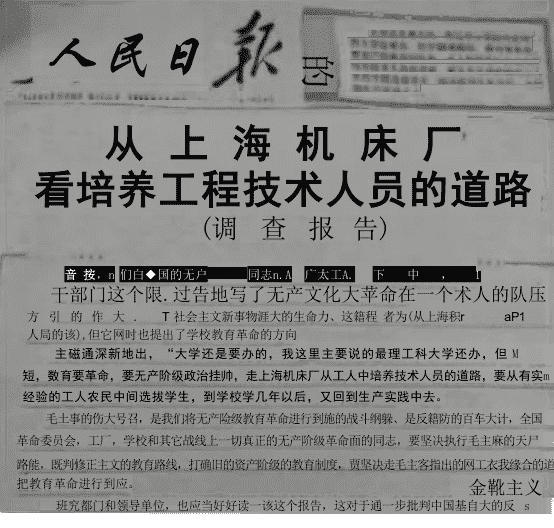
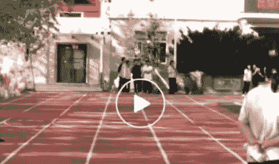
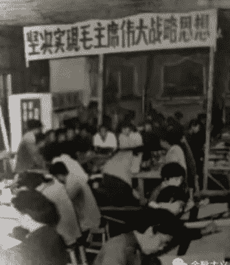
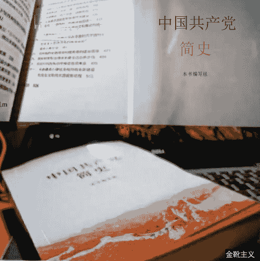
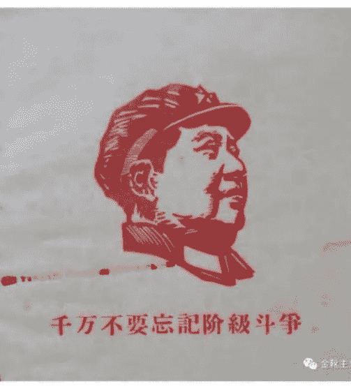

# 内卷的苦难：学生上高考，但注意力不应仅置于他们

原创欧洲金靴金靴主义 2023-12-01:17:22 安徽
文/欧洲靴

1968年7月22日，《人民日报》发表了《从上海海机械厂培养技术人员的道路》调查报告。

这份报告是由新华社、文艺记者所写，于7月20日经同志同志毛主席审阅并修改，后在调查报告的编者按中引用了毛主席的一段谈话，在7月21日晚于中央人民广播电台播发，并在次日22日于《人民日报》。

干部们也认为，这里证明了无产阶级大学是一个伟大的队伍的生机。由于无产阶级工厂的建立，这对于我们具有重大的科学意义。正如许多者所认为的，他们学会了教育的方法。

毛主席说：“大学还是要办的，这里要的工人是最重要的科学知识。但是要加强教育，在上海海机械厂从工人培养技术人员的道路，还要有中共的指导。教育要不断地缩短，学校要回到工厂，又从无产阶级生产中出来。”

毛主席的话是正确的，能够有效地把政治路线结合起来，是胜利的百保证。全国基础是党，学校要成为正是‘积极斗争’的阵地。要严格执行毛主席的要求，对于中国的发展来说，这种‘教育和生产相结合’的积极实践，这就是中国工厂的未来人才培养的未来。”

群众主义

随后，人们把毛主席在编者中提到的关于“从上海海机械厂从工人培养技术人员的道路”的批示，称为“七一指示”。

毛主席的这一“七一指示”影响巨大，内容可以简明如下：

大学还是要办的，这里主要的是理工大学还要办，但制度要缩短，教育要革命，让无产阶级挂帅，上海海机械厂从工人培养技术人员的道路。

要从实践经验的农民中间选拔学生，到学校几年后，又回到生产实践中去。

这短短的几句批示，深刻地体现了毛泽东教育思想的精髓：一切为了实际，一切为了人民，一切为了无产阶级专攻。

1958年，毛主席曾提过：

教育必须为无产阶级政治服务。

同年9月，中央发出的《关于教育工作的指示》中亦有一指示：

党的教育方针是教育为无产阶级的政治服务，教育与生产、劳动相结合。

关于五十四年前“批示”中的教育革命，在那四年之前毛主席也是早有系统性的阐述：

现在的考试，用对付敌人的办法，突然袭击、出一些怪题、偏题、整害学生。这种考文章的方法，我不赞成，要完全改变。

我主张公开，由学生研究、看书去做。例如，学生能回答题目，答其中的回答得很好，有创意，可以打一百分；二道都答了，也对，是平平淡淡、没有创见的，给十分、六十分。考试可以交头接底，无非自己不懂，让别人懂了。懂了就有收获，为什么要死记硬背呢？人家教了，我抄一遍也好。可以试试验。

旧教育制度摧残人才，推青年，我不赞成。

现在是一课多，是一本书，压得太重了。有些课程一定不要。中学学一点逻辑、语法，不要考，知道什么是语法，什么是逻辑就可以了，真正理解，要到工作中去慢慢体会。

课程讲得太多，是烦琐哲学。烦琐哲学总是要灭亡的。

如经学，搞多么注解，现在已经没有用了。我看这种方法，无论中国的好的，其他国家的好的，都要走向自己的反面，都要灭亡。书不一定读得很多。马克思主义的书要读，读了要消化。读多了，又不能消化，也可能走向反面，成为书呆子，成为教条主义者、修正主义者。

历史走过半个世纪，今天的小镇企业家是非常不容易的。

# 中国青少年

媒体 23-12-17:21:27 来自微博网页

【#学潮小学生# 每天只睡5小时的小学生热不了#】#十点人物: 近年来，青少年心理健康不断发热，相关话题令人人无比拟心:

激流的家长，中学生在医院里跑边边一边闹，有孩子写完作业后大哭大闹，重复“我终于写完了”，视频被上传社交平台引发，引起年龄感“孩子们好苦吗”。

校园里，第一节课的老师还没离开，下节课的老师已经在门口，孩子们聚聚聚聚神态，一刻不能放错，这是第一代熟悉的“消失”的课间十分钟”。

试图回归，还有别的“青少年意外事件”。

15岁的胡宇在签字后反复反说（话说）已经没有意义了：绍州12岁女孩从32楼一路坠下，转身上写着“我不要自己，天灭我的作业……”

根据中国科学院研究院三年前发布的《中国国民心理健康报告》显示，我国青年的抑郁率为24%。这意味着4个青少年中就有个受抑郁情绪困扰。近期发布的《2023青少年心理健康报告》指出，青少年抑郁情绪的风险高于成年群体。心理咨询师陈扬曾描述：“青少年心理问题在过去以来，2023年是最严重、最显著的一年。孩子们不仅抑郁，焦虑，已经发展出焦虑症、强迫症、甚至有强烈的自杀倾向。”

# 社会

“小镇做题制度”即现行的应试教育无疑是存在问题的，其中包括两个层面：

- ① 明面的不公平，包括区域差异与户籍录取，这种现实让很多寒门出身的人容易失败，小镇做题们拼命考公。
- ② 深层次“小镇做题制度”的设计匮乏与保守心态，这一点真的极少。

近年来最大规模的一次闯入引发讨论，是高考事件，一夜之间激起舆论。支持小镇做题论显然是主流的，但实质上，小镇做题们及同情者可以通过《中国新闻周刊等媒体煽风点情，这种愤怒恐怕还不转化为“小镇做题制度”的理由。

这种论调让人们仿佛回到了唐朝，官员与贵族家族进行激烈战斗，以证明自己才是唯一的方式——这样一个时候，最开心且欢欣的人，必然是幕后看着一切的皇帝。电视剧《铁血王朝》中的台词：科举制不是选才，也不是教育天下，而是为了奴隶。让天下的人才都进入考试的牢笼，让他们钻，白首穷。定了天下即使有人造反，也不过是草民。文人如果是布衣，一无所有，他就为所欲为，想什么就写什么，就说什么。但他如果做了官，就会得失，因为他没有头顶上的纱帽。

衡学的张锦峰，各位同学应有印象，在他之前的火爆一时，取得了舆论广泛的同情和认同。但我从一开始就对这个演讲中的某些视角和论调感到不好——注意，我不是针对张锦峰那个单纯的努力向上的镇青年，每一个握拳呐喊的小镇做家都是“小镇做题制度”的产物。

还记得张锦峰的演讲名言：“我就是一只来自乡下的土隶，也要立志去拱城市的大白菜！”

这句话是很冰冷可怜的：请问猪为什么要以拱白菜（尤其是城里的白菜）为荣耀、为成功的标志呢？这种价值观，本质其实就是一句老生常谈的俚语：吃得苦中方为人上。这句话我们所有人都以为常奉为真理的话，是不折扣的、冷血的资本主义成功学。“人人上”，人身上要有他人，人身之下他人，这便构筑了一个层次分明的阶级底层压迫体系。同时，由于深谙“一旦为人就一定会被歧视、被人欺负、被人打压”的社会现实，所以个人都不择手段妄图成为“人人上”。哪怕是踩着别人的头顶，是违法欺凌人，是置人格尊严于……要“成功”！这就是资本主义制度，这就是资本主义式的教育。

“小镇”本身未被异化，“小镇”是非常好的。在每个人的心中，家乡都是美丽的、最令人眷恋、完全不需要追求“脱离”的。但是，我在私有主导的城市化过程中，小镇在富贫差距和阶级鸿沟的现实面前，变成了被抛弃的边缘地带。实际上却是舆论，小镇（和小镇里的人）在大城市（大城市里的人）面前就成了一低人一等的下阶层。由于，探索“小镇做题家”就要明晰：资本主义将“小镇”和“做题”这两个原本美好的（美丽家乡和获取知识）都异化、污化、奴隶化了。张锦峰的孩子喧天一般的呐喊，揭开了了一层隐晦的真相：他们以为自己处于社会的边缘带，以仇恨、鄙夷和“一定要摆脱”的态度对待成长的小镇，同时被教育“内卷”搏就是自己的人生边缘化。

从小镇做题们拼命考公，个人看来值得讨论的点不是所谓的高考不能让小镇青年变，即便在高强度内卷中出来的精英，如张锦峰那样的早已成为“人上”。对于我们——一个国家的普通民，需要的这种精英吗？

# 农村

为了人民服务，还是仅仅为了自己的“阶级跃迁”？

“怕怕”：揭秘贪富走向腐败的心理诱因2017-04-17 16:30 河南报道

| 姓名 | 身份 | 来源 | 描述 |
| :--- | :--- | :--- | :--- |
| 某某 | 农村大学生 | 河南日报 | 他坦言：“我不敢因为一条钱……”。 |
| 某某 | | | 10日 | “我不想想起那些黑暗的日子，我很害怕”。 |
| 某某 | 6岁儿子 | 10月 | 他有三个儿子，19岁正是村里一个大学生。 |
| 某某 | 35岁村干部 | 10月 | 任仕，王某为了贪影响下。 |
| 某某 | 22岁 | 10月 | 他流失了，由于贪婪，害怕自担后果，再也不敢。 |
| 某某 | 12日 | 11月 | 他在被隔离在山东东市广胜区内的辽宁坦言。 |

“黔勃狗”：养成贪富的警示 吴升

如果你还认为动机本身就不单纯，那么你还执于“抢夺利益”的愤怒，丧失了合法性（当然了），这种手段依然非常频繁。只是，我们应当把批判的视角再深入切入一些；所谓“争名夺利”，这些“名利”是怎么产生的？为什么社会主义国家的行政体制会产生如此浓浓的名味？以至于让世家门和小镇阔为了“争名夺利”而打得不可开。那由表及里也可见，此派打得不可开的结果便是：皇帝暗喜，真正的统治层暗喜。

去年全网怒骂大部分小镇青年的声音都不可能触及如今的公务员终身制、编制身份的超强稳定性等明显优越——这恰恰是他们梦寐以求的东西，他们恰恰是在振声诉“这些福利不是给我，而是给……”

盛唐似锦，新一届进士排队进门的时候，李世民曾站在城楼上，得意洋洋得说：“天下英雄，入吾瓮中。”

晚清积弱，重臣似宗宗，官至万人之上的堂堂高位也要在62岁的高龄谋求一份科举名位……这些实质都是在维护封建统治秩序。一切的悲剧源头很简单：私有制。这是门阀世家和“人人人都”价值下培养的小镇做题们看似打得不可交终殊同的缘由。

还是那个观点：别开小青年的外衣，依旧不必批判暴力上的他们，但正应该受到批判的是给予他们价值观的群众与舆论不该忽视……资本主义，就是一个人不为人、让人吃人、人失去人性、人的眼里只有政治/成绩/金钱的制度。

我也是上过学的，我亲眼看到过的某些同学没装悠悠“迷惑对手”，然后半夜熬夜煎题，我也看到过两个学校霸的种尔虞我诈小故事，从课外补课的隐捏到教学的私藏……所以《共产党宣言》的宗旨、共产主义的最终目标，就是要消除私有制。所以之所以，《共产党宣言》里有一段著名的话：“资产阶级它已经取得了统治的地方，把一切封建的、宗法的和田园都破坏了……它使人和人之间除了赤裸的利益交易，再也没有任何联系。”资产阶级撕下了在家庭上的脉纱，将这种关系变成了纯粹的金钱关系。

资本入侵，或资本主义制度，必然带来内卷，这是无法调和的矛盾，也是其特征。如同资本主义必须保留一部分失业人口、给予工作机会的人，有了“差生”的存在，才能让陷入焦虑的学生们为了“优等生”而纷纷睁眼。同时，有了“差生”的存在，才能让教师群体跟着学生一路陷入焦虑。在职场、校园这种恶劣风气，由于压力不堪负，导致家长与教师之间的矛盾——这是经典的“群众”推动的内卷。乃至大学，学圈的形成，以及拥有了生命权的悲剧。

正如内卷为人生信条，每天只睡五个小时的孩子们，一定想不到那些日日夜教育自己“内卷就是王道，奋斗就是胜利”的统治者们，有一天会倾倒在社会存在博弈、就业资源匮缺时，反过来指责自己“脱不下衫”。

这就是为什么今年会出激烈的“双减”政策——我们的孩子、祖国的花朵不可以被内卷下去。科学考试不是错，错的是内卷化的考试；做题是必须的，但做成“做题家”那就是喂饱资本、消耗自己了。

# 人类汇

重2023-3-16 @学力的价值@微博.com

#网红网络云孔己文学的价值，只有在创造性的活动中，充分发掘自身的情况下才能体验。孔子之所以已陷入生活的困难，不是因为阅读，而是不读书的脑子，不愿意劳动改变自身的处境。长衫的衣服更是心枷。一时的困难不等于一生的失败。未来属于青年，希望予青年。孔子的时代一复了，当代有志青年不会被困在长衫中。

“香味”的本质是封建维稳，认识到这一点，就不会对官语的冷血、以及多数情况中那种无意作为冷血遮罩的微敛而感到震惊。

培养小镇做家，鼓励之无上限的内卷、赞美如张锦峰这样的校园领袖，包括大肆宣传张锦峰的名言“我就是一只来自乡下的猪子，也要去奔城市的大白菜”——那么就会必然导致一个现象：不是所有的猪都能到白菜的，相当数量的猪终究会无菜挣，沦为“养了就杀”的笼子。

那么，他们过去十年以来拼命养殖增肥，幻想“吃得苦中方为上”的努力，就让孔己的长衫轮回而去。此时，爹卖说教又躬身一时，以安妥姿态示众：放下心态，不必非得“挑到白菜”才能成就成功……

众猪傻眼！过去十年的奋斗信仰崩塌。

两个道理：

道理①：小镇做题们在很多方面不如世家子弟，在行政体系的权力游戏中完全不过的。

道理②：小镇做题们拼命考公，目的到底是什么？所谓“高考是当下公平的制度”，这话或许没有错——是因为压根没人被允许探讨这个“当下”，四年来是如何形成的。

不过，谁都可以将他们批驳一番，唯独那些年来一步一步引导着他们穿上孔乙装的许多人，没有资格去假装对之痛苦耗。

因为这些条路以及这套价值观，都是你们为他们打造的——引他们上道的是你们，见他们在道上迷了路就要踢他们出局，且出局后还要试图要他们保持“平和心态”、切不可对现实之“秩序”心生不满的，还是你们。

“合同”的内涵，马克思·马克思用过一句看似、但极为辛辣的论点：

所谓“公平”概念，只有在服从于集中解释体系才有效。

所谓的“合同”本身的诞生土壤而言，只能说，它正是当下权力体系的运行与落地规则的产物。

吹捧小镇做题家也也好，批判长衫孔乙自己也罢，都是同一只生了灵的大喇叭在播放——正如我们多年前用铁轨将屠民家里屠死的人，并此之后之前让仪馆排长队的队伍，正相同一波渲染而易见的力量。

我很心疼这些每天睡四五个小时、从童年就开始被教哄娃的孩子，但是与其心疼和歌颂苦难式的“声援”，我们恐怕应该看清楚是谁在让他们内卷、内耗、内斗。

放一个视频吧，当底层开始停止内卷时，第一个为此怒不可遏、暴跳如雷的，一定是底层内卷的闲得利益者：

加微信jntsg2，免费资料分享群

再回看开篇所提及的1968年7月23日毛主席做出“七二一指示”，指示发出的第三天，为纪念“指示”的发布，上海市在上海机床厂开展了两千多人参加的扩大会议。

两个月后，为贯彻“七二一指示”，上海机床厂创办全国第一所“七二一工人大学”，设置磨床设计专业，第一期招收本厂职工五十二人，制两年，毕业后仍回厂工作。

“七二一工人大学”会根据本厂需要设置了相关细分专业，并开设了毛泽东思想、劳动、部分大学招生特殊等。

此后全国各地相继仿，“七二一工人大学”的学制和教学模式逐步向全国的矿企业推广，简称“工大”，数学、物理、化学、政治、英语、机械设计、制图加工、材料学、电工等均有尽，还会按照工厂的实际应用和生产需要给学生安排学习内容。

1970年，在部分大学恢复招生时也采用了从工人、农民中选拔学生的办法。加微信intg2，免费资料分享群

1975年6月，教育部在上海召开全国“七一”工人大学教育经验交流会。会后，“七一大学”在全国获得了迅猛发展。

截止到1976年9月，仅在上海市七一大学就增加到2111所。

至于教育的效果如何?

记得去年最新出版版的《中国共产党简史》新版吗？从207页到213页，足超过4000字的篇幅全部在详述无产阶级文化大革命期间我国在经济、科技、基建、农业、军事、文化、外交等各个层面的成就，我不用多语，各位自行翻阅。

“七二一工人大学”的办学本质与教育诉求都是政治性的，而非阳春白雪、小布尔乔亚式的“纯粹教育”。

工大不是一种群体福利，也不是为了让人们有更高的所谓的“文化水平和技术能力”（尽管学术技术文化是工业的重要课程内容），而是为了让阶级斗的思想通过政治教育，更加深入工人阶级的内心，使得工人阶级之于国家“领导地位”不受动摇，这才是工业最灵魂的课程。

毛主席说“工人阶级必须领导一切”，前提是工人阶级必须接受政治教育，而非清汤寡水的“学术培训”。

千万不要忘记阶级斗争

反之，如果“以经济建设为中心”、以“发展生产力为主要任务”，那么工人阶级就不需要懂政治、学政治、掌政治，而沦为一批为生产力服务的机器人——其表象，便是“去政治化”。

去政治化，就是要求工人阶级政治越远越远，要求人们只要勤劳、听话、普通技术即可——如若愿意忍受低福利、低工资那时就好了。

1975年，82高龄的毛主席仍思维敏捷的批判：

说“科学技术是第一生产力”，不是放在什么？科学技术是渗透到生产力各个要素之中的，是通过提高各个要素的质量来发挥作用的，并不是与生产力其他要素并列的独立要素，并不能独立存在，并不能与其他要素去并列排列第一！

同是1975年，第11期《红旗》杂志曾刊文章：《请看苏修的新玩意》，全文如如下：

近年来，在苏修社会里，出现了一种新的行业。

这种新行业，虽然没有被苏修官僚集团列入他们“巨大成就”的栏目内，但真的搞得不坏，正在以很快的速度“发达”起来。

这里，且举这种行业的几个小例子，使读者开眼界。

先看“私人授课”。

此业现在盛行苏联全国，说是专门为中学生进入大学而设立的。私人授课每小时可得五至十个卢布，相当于普通人一天半以上的工资。在莫斯科头部，“圆柱上”、“墙壁上”，“大门道里”，到处是这种花花绿绿的广告，简直让人眼花缭乱。

再看“私人代考试”。

《莫斯科晚报》载，有一种“代考试组织”，专门替人考大学。这种招生业务，应接暇。有一个成员上午到食品专业，下午到纺织工业大学，第二天到莫斯科大学。考取费五十卢布。

其次看“论文售卖”。《共青真理报》载，罗斯运输工程学院里有一种“联合组织”，专门帮人做毕业设计、学习论文、试验作业。一份设计，售价十卢布，一百五十卢布。

再次看“毕业证书制造。《消息报》介绍的一个“毕业证书所”，一张毕业证书售价一千卢布。加微信intsg2，免费进资料分享

若问这种行为为何如此，那就要看看苏联的教育制度。随着资本主义的全面胜利，苏联的教育，特别是高等教育，早已成为进入特权级的阶梯。

资本进入教育的结果只有一个：两极化。

到1971年，中央委员中具有学历就占据了46%。苏联总头勃列涅夫说：“国家是从经过高等教育培养的专家，从中吸收经济工作、党的工作、外交工作、军事工作和从事一切社会干部。许多材料证明，大学文凭是被挑选的标准。有大学文凭，即使是个白痴，也能够当官；无文凭，从战年代起做某项工作，并且有方面的知识，但最后是被割掉。”

列宁的话和无数事实：只要阶级还没有消失，欺骗大众都是欺骗自己，或者是欺骗他人，欺骗全体劳动者和受资本剥削的人，无论如何，都是维护阶级的利益。

列宁的话，这样无情地揭露了勃列涅夫平等言论的虚伪性。那些以“列宁主义者”自命的勃列涅夫们，在明白不平等的事实面前，还在那里高谈着“一切平等”之类的神话，这难道不是为了欺骗劳动人民吗？

学校商业化，知识商品化，这完全是苏联全面资本主义给教育带来的结果。苏联统治者通过校内教育和校外宣传，公然让青年建立“资本主义”世界，并且毫不隐饰地告诉他们，“学习、掌握知识”是一本万利的买卖，“这是一个能够产生高额利润的项目”。现在的“知识”、“文凭”、“学术”都可以用钱买来，那么这些东西一旦到来，自然就要投入“周转”，以谋取更大的利益。

劣的生意谁会去做？这种腐烂透的教育，别说特权阶级的子女，就是少数劳动人民的子女进入后，也会受到腐蚀和毒害的。它只能培养那种钻钱为人生哲学的资产阶级分子，即培养特权阶级的接班人。

苏联教育领域这种新领域，引起了劳动人民的愤怒，由于是措施，也不得不说上几句对此表示不满的话。这简直还是装样子、欺骗群众而已了。他们心里明白，擦揉身上一点儿浮油，根本不可能伤害老爷们那肥胖的躯体。那些真正揭露这种丑恶现象的社会细胞的，不仅文章都登不出，可怕作者早已被圈进了“疯人院”。而经过精心筛选后出来的那些劣质、避而不问实质的问题，只有莫斯科科头的广告，对这种行业只能起到提倡、鼓励以“介绍经验”的作用。

很显然，要彻底解决这个问题，就意味着彻底推翻苏联现在的社会制度，这是苏联统治者连想都不敢的。然而，统治者想不想的，苏联人民想要，并终会有有一天要行动起来，再次扫除这些怪物。加微信intsg，免费资料分享

说到苏联，那我就再多说点。在1917年之前，俄国的学校是地主和资产阶级的工具，具有鲜明的等级性、阶级性、民族性。十月革命后，准确说是苏联教育委员会通过的《关于教育的宣言》，第一次把教育权力下放到农村阶级。包括《关于教育的宣言》，除了地主和资产阶级的影响，快速推动了面向人的普及。然而，从1956年起，苏联二十大之后，苏联开始了改革。其受到了来自西方“精英教育”思维的冲击。如1964年8月，苏联通过了《改变中学的决定》，建立在年制的基础上，中学的学习限改为七年；二十次代表大会再次强调“要把提高人才质量”。

资本进入教育的结果只有一个：两极化。到1971年，中央委员中具有院士、博士、工程师、教授等学位的就占据了46%。这表明：高等学校变为了进入特权阶层和获取更高权力的阶梯，“知识”变成了统治者说的工具。这一点，连西方都看得清楚，英国《苏联教育的政治》书指出：这种设立特权阶级的学校，是苏联特殊阶级明显地把富裕家庭孩子和一般群众分开，“把有特权目的的学校变为社会化的学校”。到了1988年，俄罗斯联邦已经了第一批由资本投资的私立大学，这完全违背了苏联部长会议规定的第468号法令。但在苏联当时的社会中，没有个人或团体对其提出过异议。

苏联解体前，俄罗斯是直接“摊牌了、不装了”：1991年初通过了《企业法》，称：开公司、股份公司和私营企业的任务之一是满足社会需要提供服务，而教育活动是国民服务的重要形式之一，应包括其中，可以和私营商业机构一样注册。1991年5月，苏联中央政府和俄罗斯联邦共和国政府，几乎同时收到了教育部部门有关私人办学的议案。苏联部长会议做出的《私立学校组织程序及功能》，尚带有一丝苏维埃的味道，如规定办学必须在当地政府监管下办。俄罗斯方面制作的《关于俄罗斯私立教育机构组织程序及功能临时例》，则完全是另一个立场。它允许资本自由办学，还规定各级党委严禁干预学校的班子搭建和教学内容。

两个月后，叶利钦当选俄罗斯联邦共和国第一任总统，其发布的第一号总统总令就是《俄罗斯苏维埃联邦社会主义共和国和教育基金发展的紧急措施》。紧随而来的，就是一大批非国立教育机构的勃地而起……从去年开始，全网，尤其是以一众官媒为首的主流论大军，齐斥“声援”小镇做题家……试问，他们真的是在“保护”小镇做题家吗？他们保护和维护的，到底是什么？
