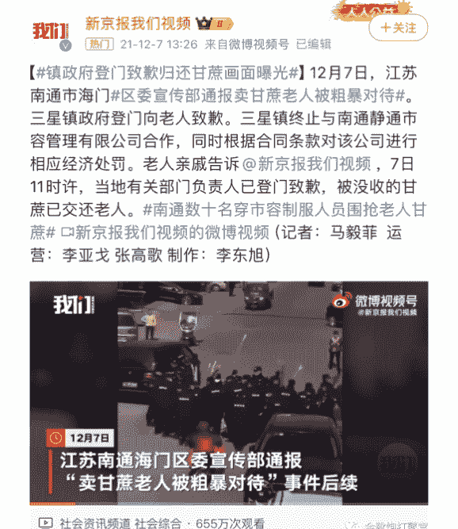
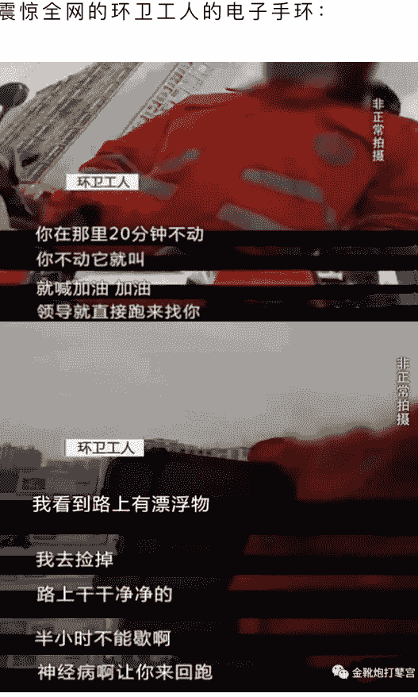
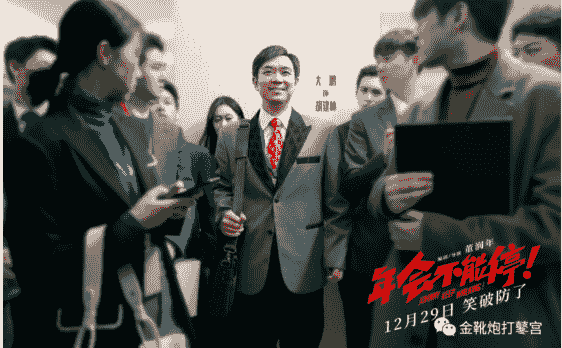
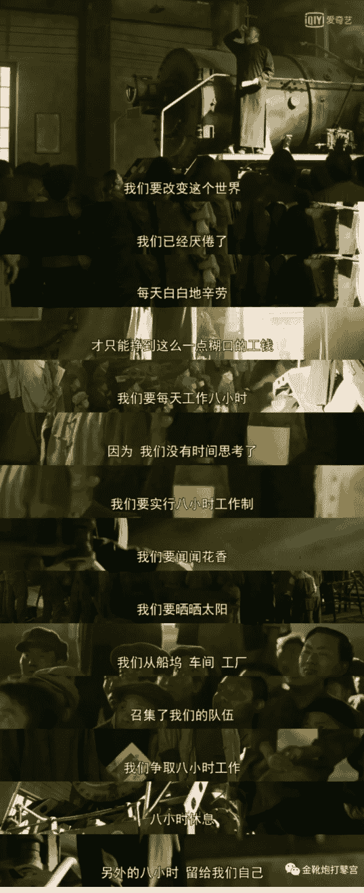
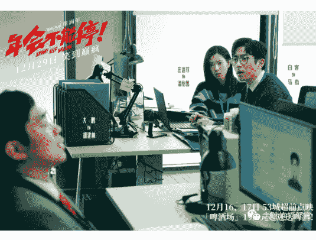
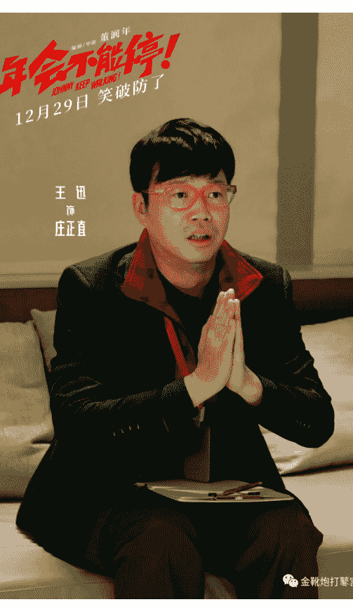
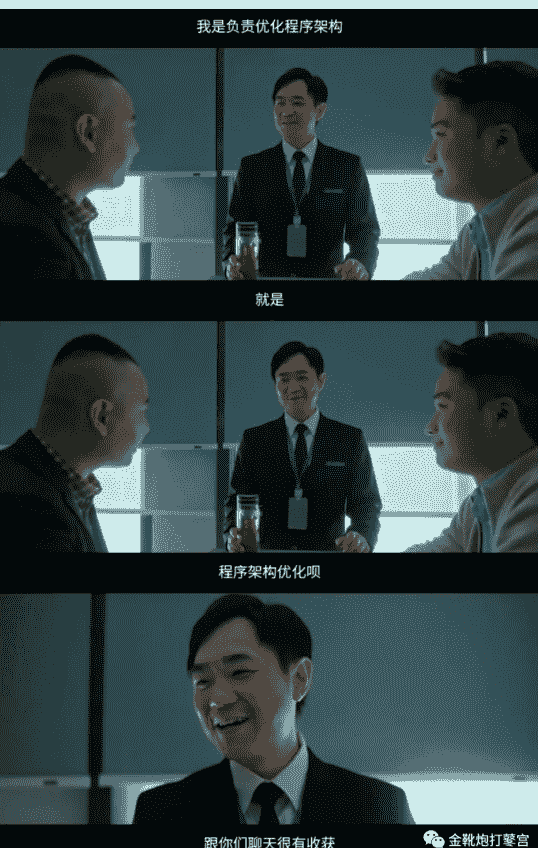
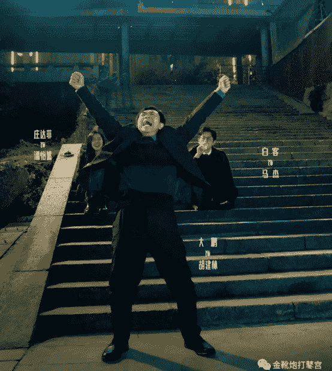
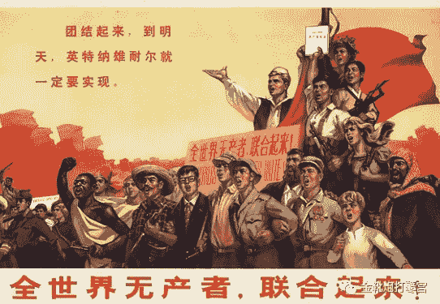

<!-- no content -->[/content]”。

[content]<!-- no content -->

今天我们“打工人”以为为常，资本家则断不提的八小时工作制、周末双休福利制度，哪一个不是历史上那些阶级用生命鲜血换来的？

2020年5月份，针对语文压力，职业写手圈曾爆发了“五五断更节”，但是时候未能得到头部写手的支持——这一部分人，我不背负“工贼”之名。

在早期工人运动中，人们选出一个代表来和资本家谈判，但这个代表在资本家的胡萝卜大大棒双管下发挥了作用，容易被收买……

这种人的存在，也会让工人阶级的工人运动有所阻碍。

1982年，迎着某种“春风”，宪法完全取消了此前的1975年和1978年明确规定的“公民拥有职业自由”的条款。

从此，工人不再是一种无产阶级的权力和荣耀了，它成了破坏与没有大局观的表现……

比起如今，仿佛先苦后乐地狂欢购物、下单付款、通过各个超级网红的直播间……才是生活活络积极的主题。

没有什么“困在系统里”，实质就是困在阶级压迫里。

# 4

被困在阶级压迫下的底层人们，在今天的生态下，往往不会由自主坠入的，便是我们所见不见的“底层互搏”、“无产阶级内斗”……

恰如早就见到不怪的外卖员与保安人员的斗争。

除了本次青岛的惨剧，自外界行业兴起以来此类事事端就从未歇过：

阳春白靴

这种事情在我看来是最悲剧的一种社会事件门类，因为在我眼里，这就是“底层斗底层”。

再比如这样的事件：

同样是底层互援，只不过这是一群力大气的底层负一力小的底层而已，其它的性质和结论都是让人无语凝噎。

我2021年9月在评论西安地铁“暴力推拽”事件时也说过，现在业务外包即所谓“引入社会力量”，已经成了诸地方政府的惯性手段，从而导致了今天基层地方每小时出事的大漏洞：外包人、临时、监控。

比如江苏联运通，这些同志有理想结果和惩罚措施吗？呵呵

市城管工作外包给第三方也是一样，北京市大概是在2018年开始各区政府和街道都引入了外包机制，但外包的是业务而绝不是执法权。像今年3月浙江省桐市就有一案，外包的城管人员身上印有“市容巡查”制服，要求沿街药店拆毁围圈的 unfortunately标识、宣传及防疫要求贴纸等，当药店工作人员对此提出质疑并要求其出示相关文件时，其中的某某执法人员竟然张口怒骂：“这是我们城市的命令，你要违反的话，后果严厉！”

......最后还是有道歉、相关处理，但很明显：外包机制漏洞非常大了。

就前著名的西安地铁“扒内门”，我看了西安地铁公布的对外招聘，发现保安队伍的相关岗位要求非常低，属于绝对的低门槛。

而且，这种职位是没有编制的，连五险一金都是绝对的承诺。它说兼职也行，说临时也要，很多是外包劳务公司与地铁方进行承包合作，比如陕西鑫武保安公司、陕西龙兴卫保安公司。总之，这样的招聘里间都透露着一个诉求：便宜。

| 西安地铁8小时 会员 |
| :--- | :--- |
| 薪资 | 4000~5000元/月 |
| 更新 | 今日 查看：29人 |
| 职位 | 保安 |
| 要求 | 招6人/学历不限/经验不限 |
| 地点 | 西安 |
| 福利 | 加薪补贴 调补 五险一金 包吃 住房 年度双薪 |
| 操作 | 申请职位 | 分享 |

| 地铁安检巡逻保安 会员 |
| :--- | :--- |
| 薪资 | 3500~6000元/月 |
| 更新 | 今日 查看：17人 |
| 职位 | 保安 |
| 要求 | 招10人/学历不限/经验不限 |
| 地点 | 西安-莲湖 |
| 福利 | 包吃 加薪补贴 年度双薪 五险一金 工作灵活松逸 每月四天带休假假 市内交通便利 |
| 操作 | 申请职位 | 分享 |

西安地铁检修员
4-5k 2021-02-02 经验不限 西安 金花路 学历不限
陕西龙井安保安全服务有限公司
服务费:100~499元 | 私营 灵营企业

## 职业介绍

- (1) 工作内容: 地铁进出出口安全检查、安全员
- (2) 工作要求: 男女不限，年龄:17~35岁，男165+、女158+、无纹身、高中以上学历肯。
- (3) 工作时间: 三班制，早班7-15点、中班15-23点、夜班23-7点。
- (4) 经费福利：每天80元+午餐10元，每月工资4000—4500元，不用体检，不用培训，住宿免费，服装免费。
- 年龄要求：不限
- 语言要求：不限
- 专业要求：不限

一个面对乘客，直接参与到一线岗位，可以在这种草率吗？如果招聘都这样草率，那么招聘进来之后的岗位、培训等必要环节，必也是形式主义的。由于这种位置，那位西安地铁的保安在压力之下、害怕担责，也就难理解了。南通与甘甜老人也是一个道理。拿着几千块工资，却时刻着巨大的压力——自己所在基层地方的双重压力，看到一个“坏狗”。外包机制存在漏洞，实质是基层政府与公众企业的懒政。其引发的乱象，对政府形象的抹黑，该由谁来承担？

这一时，他当遇到同样失控的、“不听话”的乘客，他会做出什么匪夷举动。双方都是“无产人”，而在悲剧发生后，他们分为两派——或是女拳vs男拳，或是粉红圈vs群众——站队拆叛、互相伤害。

## 内卷的时代，无产阶级该内斗和伤害，我们需要意识到共同阶级敌人是谁……

# 5

回到这次青岛的惨剧，一方承受物业公司极其凶狠的裁判（月工资2k，放一个外卖员进去罚50元），一方则面临更复杂的、恶毒的、直接的资本剥榨。

根据《三联生活周刊》的报道：
> “城市都是外卖员的噩梦之地。”外卖员成为一家外卖平台的专送骑手，他几乎每天接到一两单一的单。他说小区面积、楼多，进去就要长时间，还要问路，再加上小区在三十层的楼高，又要等电梯，送一份外卖的时间在5-10分钟左右，很容易超时，如果骑车进入，至少需要半小时。对于外卖员来说，他们应对着一系列的数字法则，而这背后直接指向的是他们的收入。何成告诉本刊，每个月，专送手会有130多的基础服务，送单多、有口碑或遇到劣天气都会加分，从0.1分到0.5分不等，还有可能翻倍。与此相对，如果送超时、客户差评或是取消订单，会被扣分，分数是加分的许多倍。何成说，分数随着单量实时更新，系统依照分数评分至六至星级骑手，每单给予0-0.49元的奖励。“想增加星级，就得跑。”

在一个一个数字制造的“壁垒”里，骑手们最怕的就是超时，何成一天跑60-80单，“我跑20才能加2分，但单超时就跑掉了。”何遇到过一次严重的超时，今年9月份的一天，青岛下大雨，系统派给他10个单子，好几个都不在同一个线上，有几单都超时了。他送过最后的一单，已经比约定送达时间晚了20分钟也没有等到。顾客取消订单，何成被扣了几百块钱——他一天的收入才300块钱。罗可也是李山区的一名外卖员。他告诉，每次送单，距离约定送达时间还有一分钟时，手机的外卖平台新系统会一秒一秒倒计时，他觉得自己像背了个定时炸弹一样。

这让我想起了前震惊全网的环卫工人电子手环：

恩格斯曾这样描述过19世纪英国的工厂：

工人是禁止携带自己的钟表的，对于工作时间以工厂的时钟为准，而他的工们常常在钟表上做脚：上班先把钟拨早一些，下班时把钟晚一些，通过增加工作时刻消耗掉剩余价值。

马克思指出：资本主义生产的不是商品，其本质上是剩余价值。工人生产的目的不是自己，而是为了资本家，所以工人只完成一般意义上的生产是不够的，他为了资本家实行剩余值。对于这种劳动，外包机制存在漏洞，实质是基层政府，进一步挤压了工人阶级的血汗成果，拉大了阶级之间的差距。

尼基尔·萨瓦尔（Nikil Saval）在《办公室进化史》书中指出：从80年代起，办公室氛围不断演化，从斯坦福大学的校园生活，这种办公室氛围的有意引导，选择性的强调，自发性的关注，兄弟会的氛围，这一切都在消解着旧有的——对工作和闲暇的区分。这一切被包装为企业文化，让员工相信自己从事一项自由、创造性的工作，长久地工作不是为了他人，而是为了自己。

这种残酷的工人阶级，工人。让工人。让工人。让工人。让工人。让工人。让工人。让工人。让工人。让工人。让工人。让工人。让工人。让工人。让工人。让工人。让工人让工人。让工人。让工人。让工人。让工人。让工人。让工人。让工人。让工人。工人提供的慷慨福利，但实际是变相的“工贼”，员工更多时间在办公室里工作，甚至将全部的个人生活交给公司。

如今，这种企业文化已延伸至中国界，这也是为什么中国的资本领袖敢公然说“996是福报”。劳动的长短是由无产阶级和资产阶级这两个阶级的力量决定的，无产阶级为了缩短劳动时间维持生存的权利，同资产阶级开展顽强的斗争——这个斗争从英国开始，随后逐渐资本主义世界。1866年美国工人代表大会和第一国际召开，根据马克克的建议，提出了争取八小时工作的战斗号。1917年俄国十月革命爆发，八小时工作制在国家层面颁布；1919年，刚成立不久的国际劳工组织（ILO）通过的第一号公约即规定了工作时间不得超过八小时，每周不得超过48小时。在国内，我国无产阶级为缩短劳动时间也进行了长期的斗争。1922年，在中国共产党的领导下，在广州召开的第一次劳动大会通过了争取八小时工作的决议。1924年，中国共产党又把八小时工作制的决议和节日、假日以及限制童工年龄与工作时间，列为工人最低限度的要求。在工人阶级坚持斗争下，迫使资产阶级不得不限制劳动日的、将劳动限制在一定的长度内。

工人阶级为争取缩短劳动时间而进行的斗争具有重要的意义，但是这种斗争究竟是一种经济斗争，它不可能从根本上改变无产阶级的地位。

无产者要获得彻底的解放，必须把阶级斗争发展为政治斗争，进行无产阶级革命，推翻资本主义制度。但是今天的困境，正如列宁所言：

> 只有群众的革命斗争，才能使工人生活和国家管理真正有所改善。无论有教育的人怎样同情工人，无论单个恐怖分子英勇斗争，都不能撼动沙皇专制制度和资本家专横势力。只有工人自己起来斗争才有千百万群众同斗争才能做到这一点——而当这种斗争衰弱的时候，工人所得的成果立刻被剥夺回去。

《劳动法》的漠视、“有关部门”的袖手戏，让劳资对立只会产生一个赢家。马克在《德意志意识形态》中指出：只要人们还旧工人，他们的所有还是资本的时候，即使他们把他们的雇主“抓住住脖子”，但由于国家站在当中，工人也得不到什么，甚至比结成团体获得的还要多。无须证明，以竞争为基础的阶级和资产阶级，由于它整个物质基础，还有任何其他的斗争。由此造成的结果便是：资本与权力，底层陷入无休止的内斗。

在电影《年会不能停》中，为了高层奖赏、一个位置、一次加薪的机会，无数工人没日夜的内卷、消耗、勾斗，最终的结果自然是让公司苦了自己。甚至电影都直讳地露了底层玩耍要挑战底层。

一百年前，毛泽东让工人、农民等广泛群体“组织起来”。恩格斯说：

> 工人阶级的状况是当代社会运动的真正基础和出发点，因为它是社会一切灾难的最尖锐表现。

需要看到，并不是工人阶级登上舞台，而是工人阶级被剥削群体。这种内部官僵化、浮化、反向淘汰的电影。现代工人阶级作为工业化与世界产物，长久以来处于散落的被侵犯状态。在革命之前，他们一直是分散的、没有信仰、没有集体力。高台上的挥洒一点蝇头小利——或是碎银几两、或是“权力”，就可以使分化、工杂、叛徒，最终让底层者陷入无穷的内斗、内卷。

# 6

如果我没有错，这是全景式呈现十年来我国互联网大厂生态裂变之后（实际也是量博弈之后）的电影。在《年会不能停》中，有无意义的加班文化、无休止的内耗内卷、无法的“互联网锁”语言体系、难以根除的职场性亢奋、令人神俱疲的勾斗角、向着越深的等级制度，让许多不逊的“出事背锅，有功领奖”的规则……这部电影几乎全方位立体地展示了国内互联网企业在市场经济与私有环境下的全部恶性本质。这所有悲剧的痛苦者，通常都是底层的打工人即工人阶级。

电影大部分场景都能让观众联想到今日中国的第一互联网财富，比如“杰克马”的，他们使用巨大LED屏幕（马云与蔡磊侯过一次场合就大厂预算谈判），比全公司员工都要放弃自己的命运另选一个工作名（阿里巴巴的“金花名册”）——无论是否有意为之，阿里确实如今所谓“大厂文化”的领头羊。

但像电影导演所说的那样，从传统的实业工厂到新的互联网企业，从“大厂”到大厂，再无论如何“转型、改革、变化”，也不应该拿着工人开刀。如反派高管曾云峰所冷述：历史的车轮不能向前前进，总有人要掉落在铁轨上，给火车增加摩擦。由此，电影的另一条暗线——1998年企业改革/工人淘汰也随之浮现。

所谓“企业改革”血淋淋的真相：少数富者的鲸奢狂欢，工人阶级家庭所习惯的一种生存都被彻底掏底，且几乎没有任何救济措施和情绪安抚，任由他们由抓零被飞机洒的私有化进程，生硬又凶阻拖在后面。乃至他们获得了这份财富的路径，同样也是卑劣的。作为手握优势和资源的企业高，徐云峰竟然在零件生产上如此。

## 底层内斗，基层互搏

群众放弃团结而走向彼此敌，从阶级的角度而言，这是悲剧中的悲剧，胜过一切的这种悲剧的潜滋与惨案。

正如片中电影所言，胡建健那句朴实的反响：

> “优化”，不是个好词吗？

这就是与底层共情、与生活接轨的艺术作品。

作为一部电影而言，《年会不能停》或许仍然是有瑕疵的，不是节奏（最后）第三幕还是没能接住前两幕）还是主题（终竟没指向打工人真正的敌人，仍由所谓“董事长”充当救世主，但这非主创所能左右，倒也不强人所为难）都存在一定深度层面的偏差，但是题材的突破论来说，这部影片显然应当在史上立名。

多年后的研究者在回溯中国互联网行业与新兴城市工人群体就业历史时，想均都不会漏掉这部《年会不能停》作为相当分量的艺术佐证。

## 坡

文章的最后，以列宁在《社会主义民主党领纲草案及其说明》的话作为收尾：

> 与工人对立的已经不是个别官吏的个别不公，而是国家政权本身的不公道。

这个政权把整个资本阶级置于自己庇护之下，并发布了对这个阶级有利而大家都必须遵守的法令。这样，工厂工人同工厂主的斗争，就必然变成反对整个资本家阶级、反对以资本剥削劳动为基础的整个社会结构的斗争。

因此，工人的斗争具有社会意义，为代表全体劳动人民反对一切雇佣他人劳动的生的阶级的斗争。

要铲止资本对劳动的剥削，只有采取一种手段，就是消灭劳动工具的私有制……只有这样，工人阶级同资本的斗争才能结束。

为此，就必须使政权即管理国家的权力，从资本家和土地所有者影响下的政府手里，或者说从直接由资本选出的代表组成的政府手里，转到工人阶级手里。

这就是工人阶级斗争的最终目的，这就是工人阶级获得彻底解放的条件。联合起来的觉醒工人应当朝着这个最终目的奋勇前进。

金靴炮打击官
欧洲金靴，嫉恶如仇
35篇原创内容
公众号

金靴主义
去拆闹楼，拿回你们自己的东西
134篇原创内容
公众号

商务微信：ouzhoujinxue
新浪微博：金鞋RedBoy
B站/抖音：欧洲金鞋

## 欧洲金鞋

> “金鞋，是人民的金鞋”

■ 钟意作者

喜欢此内容的人喜欢

## 假洋鬼子狐虎威，这是1924还是2024？

金驼炮打袭宫

## 72亿身家的老板与“我早上没吃饭”的员工，MANNER咖啡事件是一出幽默的时代悲剧

金驼炮打袭宫

## 混乱它是自由的底色，无序是它最大的秩序|美洲杯，属于“我们”的赛事

金驼炮打袭宫

