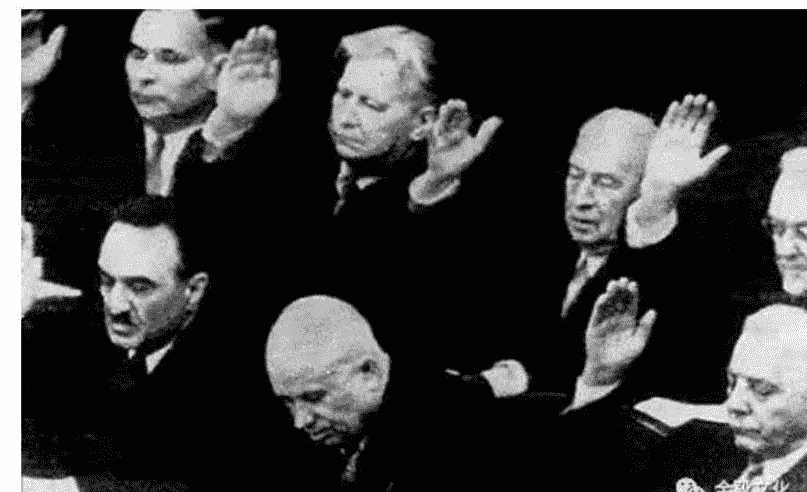
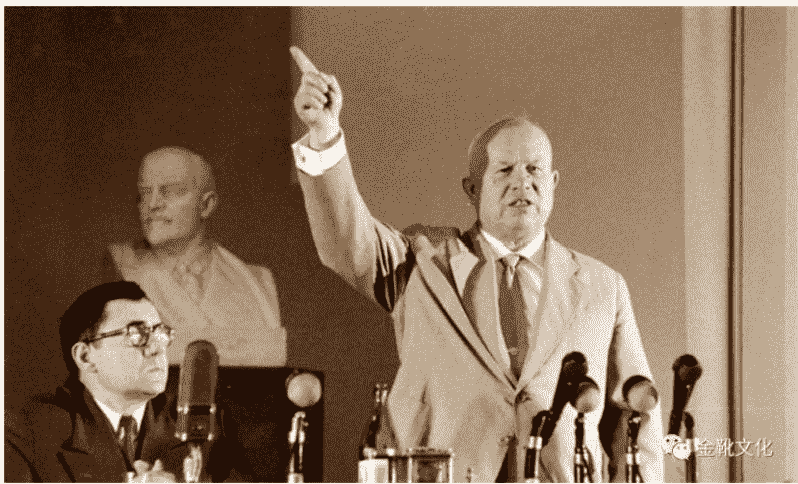
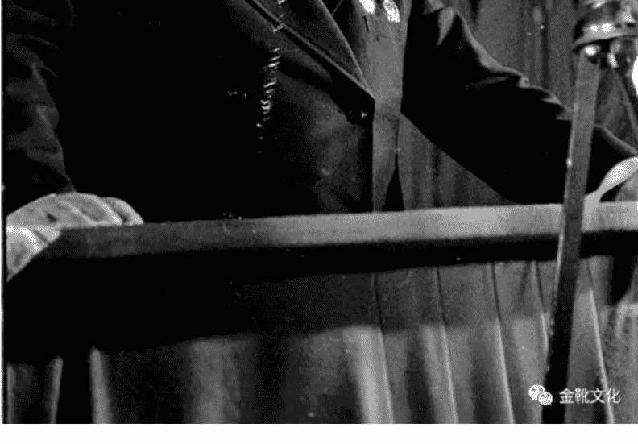
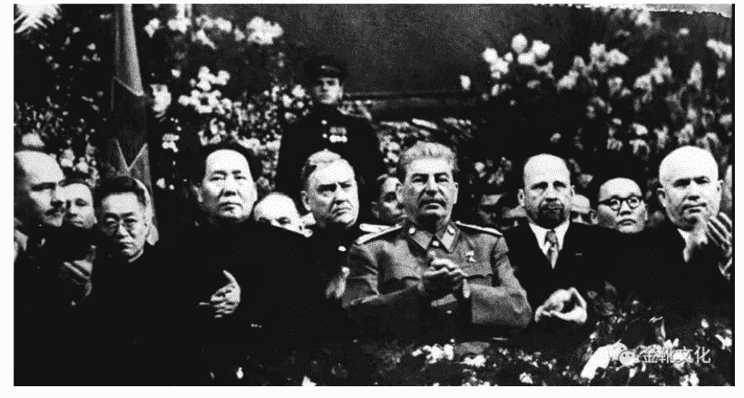
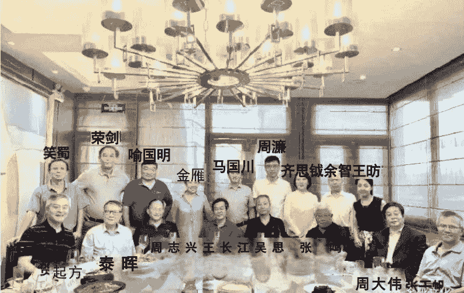
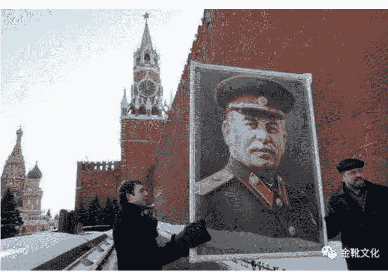
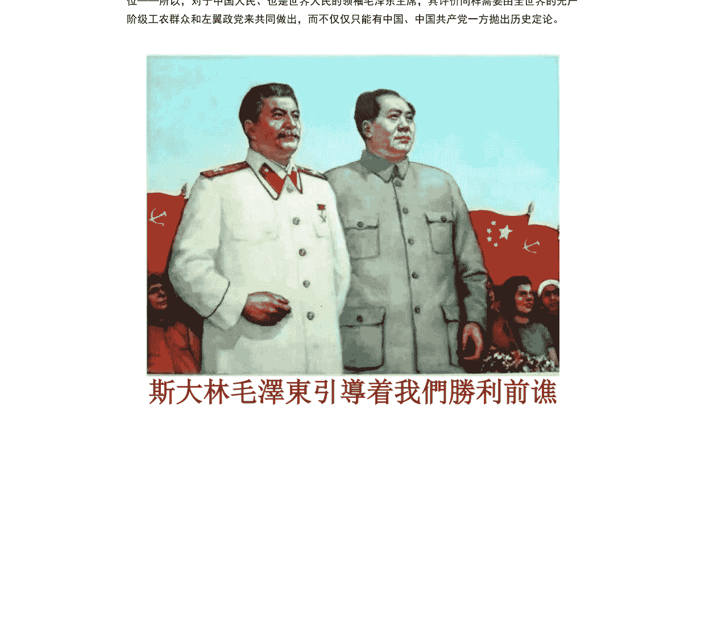

# 欧洲金箔：评价领袖的权力归于人民

在民众中，我们（共产党）是沧海一粟，只有当我们正确代表群众时，我们才能管理国家。否则共产党就不能引导无产阶级，而无产阶级也不能引导群众，于是全部机器就会倒塌。

我们共产党是具有特殊性质的人，我们是由特殊材料制成的。

我知道，在我死后会留下一堆垃圾埋在我的墓碑上。历史的我们无情将它剥走。

1956年2月14日，西方的景色。这天的莫斯科满地雪华，苏联共产党第二次全国代表大会揭幕召开，也是在这次会议上，新共产党中央第一书记的赫鲁晓夫作了《关于个人崇拜及其后果》的秘密报告，震动了社会主义氛围。

在半年前，1955年的7月，中共全会已经决定在1956年2月召开第二次代表大会，在二大会上要讨论斯大林的问题进行批评和驳斥，并且并非日后认为是“中共全会”的意见。

按照正常的程序，二大会要听取中共委员会的报告、中共中央审查委员会的报告，以及中共委员会对苏联六个五年计划（1956-1960）的报告，并进行中央机构的选选，这才是界定的二大会内容。

1955年11月5日的中共主席团会议上，“非斯大林主义”首次出现。

由于12月21日是斯大林的生日，往年这一天要庆祝活动，所以这个日子就变得尴尬了，成了问题。

赫鲁晓夫提到，将在报纸上刊登，不行举行任何活动。赫鲁晓夫希望不举行活动人们反响。布尔加维·米哈林是不搞此类活动，理由是“要以前的区别”。这是主席团内部讨论斯大林问题的第一次会议。

根据俄罗斯国家史学档案馆解密的档案，档案卷里有份1956年2月13日（二大会之前一天）的中共中央主席团会议的记录如下：

> 关于召开中共中央主席团会议的意见，委托中共委员会第一书记赫鲁晓夫宣布中共中央主席团会议召开，并向中共委员会提出建议：中央主席团在党的代表大会的秘密会议上做关于个人崇拜问题的报告是必要的，确定由赫鲁晓夫将报告。

在档案记录中，赫鲁晓夫是这样的：主席团讨论了这份报告后，这份报告是以主席团的名义，而是以中共委员会会议的名义，怎样？全体将听报告。

大厅里传来片唏嘘声：

“同意，明天再报！”

如重万负的赫鲁晓夫给出结论：“那么我们认为：报告将是由中央委员会合作做出的，而且全会要求在代表大会上做的这个报告。”

接着，赫鲁晓夫又说道：

还有一个需要在在这里讨论的问题。主席团经过多次交换意见并研究了大斯林同志去世后的形势和材料，感到认为：有必要在党的第二次代表大会上，在秘密会议上（即在没有任何客人时候）以中央委员会的名义提出关于个人崇拜的问题。在主席团里我们商量好了，委托中央委员会第一书记，由我来做这个报告。有没有人反对意见？”

见没人提出反对意见，赫鲁晓夫说道：“我们这次大会会解决所有的问题，已经解决了。”

事实很清楚的：二十大上那份被世稿的批判大斯林的材料，那份被阴谋包裹的《秘密报告》，并非共产党全体意志的意志。

甚至，并非象征着党的权力中枢的“苏共中央委员会会议”的意志，仅仅是“苏共中央委员会主席团”这个党的最高权力机关的意志。

也就是说，对大斯林同志进行历史性的批判，其实不是赫鲁晓夫集团做出的决定——在他们成功击倒并杀死他们眼中的“第二个大斯林”之后。

小集团在没有任何民主制度的情况下，就胜利代表了全部的意志，推选由赫鲁晓夫在14日发表《秘密报告》，并成功撼动了这个世界的格局。

## 赫鲁晓夫的何虑

将斯大林从权力中枢移出，又被掠夺大斯林的像后，1954年在边疆巡视时，他第一次将张旗竖起来！党需要一项任务，这就是要把在斯大林年代被肃清除的被极权主义消灭的人的首之一！

赫鲁晓夫的何虑：斯大林被改回原名“伏尔加”。从1956年2月3日开始，斯大林的名字从官方文件中取消。这一天，最高苏联授予了赫鲁晓夫“社会主义劳动英雄”称号。苏联联邦部长在信中改变了称呼赫鲁晓夫为“伟大列宁守护者”。按照惯例，赫鲁晓夫在会上说：揭露说明斯大林已经无法作为领袖了。如果所有人都想要他的话，他还要什么秘密？应该有谎言吗？

意见是：一定要向代表大会说明，需要的是什么样的说明，由谁来说？如果这样做，我们的代表大会就不会了。二十大召开之前，对大会做“秘密报告”这项工作，赫鲁晓夫本人没有列入议程，而是以中央政治局向代表大会建议这项工作必须准备。这次会议非常不利秘密报告，可以随时撤。

## 赫鲁晓夫的何虑

从中央委员会主席团对“个人崇拜”问题的解决，其实是不清楚的，万不会成为这样的政策。为了将24日（大会最后）的《秘密报告》，在26日（大会第三天），米高林在大会上点燃了大斯林，将大斯林的工作、经济政策、历史问题清理，并在其中使用了大量反对言论。米高林的发言无意义，简直引起与会代表相同的反对。

尤其是苏联共产党的负责人，专门向方面发了电报：

> 我完全同意米高林的击！这对于整个被质疑的会议的中心思想是大斯林光辉的胜利！这将使得整个资产阶级所接受，教育我们要参与斗争和建设的大斯林同志，大斯林同志不可动的动的勋。

不管如此，在24日深夜至25日凌晨，赫鲁晓夫还是很快向代表作了《秘密报告》。24日早，苏共二十大按照程序闭幕。当晚，当新一届中央委员的代表参加赫鲁晓夫同志的中央全会，其他代表则收拾准备准备回。

就在深夜，所有代表突然被召回赫鲁晓夫同志。当我们来到会场时，发现现场多了许多人：一百多名30代遭受过的“斯大林追害”，后来又恢复名誉回到工作的党员干部。赫鲁晓夫与苏共第一书记坐台下，用胜利的目的贯眼台下，随即正式作了《关于个人崇拜及其后果》的报告。

当夜，外国代表们，赫鲁晓夫再次邀请了捷克斯劳动人民党第一书记拉科西和波兰工人党中央书记贝日鲁芬。正是这位党内领袖贝日鲁芬，在3月12日心脏发作，在莫斯科去世。诊断显示，是“由于受到强烈的心理刺激所致”。

《关于个人崇拜及其后果》两万字，内容大体上介绍斯大林独裁专行、残酷屠杀异己、在卫国军事中“用地划定成就计划”导致苏联民众遭受重重损失、严重无视农业、实行民族高压政、国际关系上将南苏联共产党开除情报等“严重错误”。

那时，没有人有勇气和思想去考虑这份《秘密报告》的真实性，但如此大范围清洗的罪责，第一罪人都应该是斯大林了，还是……

# 为什么赫鲁晓夫反复淘汰了很多人，却唯独不给赫鲁晓夫、别夫、加米斯特等人反击？

只能是因为：当时清洗扩大化，处决赫鲁晓夫等人不是，正是赫鲁晓夫自己。

事实上，这些油润清面的“新领袖”，他们经营的所谓“大清洗”，哪个不是沾满鲜血的。马林科夫清洗了自己在中央机关中的政敌、柯西夫清洗了外交系统的政敌、伏洛诺夫清洗了军队中的政敌……结果斯大林死后，罪全部给了斯大林。

那一行，他与众拦截透露了自己的意图：“大厅内部动起来”、“大厅内部不安”、“大厅内激动”、“大厅内动起来”。

赫鲁晓夫及其后的意图是从哪里来的？在二十大会上已经为大林同志发声，赫鲁晓夫一定程度，是中国给予了赫鲁晓夫以信心。特别是纠正斯大林的错误。二十大开始之前，习近平作为团长、习近平作为副团长、栾林同志、刘同志等组成代表团，抵达了莫斯科。赫鲁晓夫在会见斯大林时说：斯大林在农业上遭受了严重破坏，他本来不是农民，而是把土地给农民搞太大了，就可以源源不断从他们身上再出东西……斯大林……太搞了。

紧接着，赫鲁晓夫向毛主席示意：苏联代表团在二十大之前致电毛主席并反对斯大林。对此，毛主席拒绝回应，致电毛主席和其他代表团是否参加。中央委员会在毛主席的主持下经过反复辩论，回电毛主席：同意代表参加。赫鲁晓夫传递了一个信息：毛泽东同意批评斯大林。这就是事实了。在莫斯科，代表团对于苏方公开批评斯大林，表态，拒绝任何意见。在苏方之前，对于中方文件内容就贸然发表《秘密报告》的情况下，我们不得不采取回避的态度。

## 赫鲁晓夫的何虑

将斯大林从权力中枢移出，又被掠夺大斯林的像后，1954年在边疆巡视时，他第一次将张旗竖起来！党需要一项任务，这就是要把在斯大林年代被肃清除的被极权主义消灭的人之一！

赫鲁晓夫的何虑：斯大林被改回原名“伏尔加”。从1956年2月3日开始，斯大林的名字从官方文件中取消。这一天，最高苏联授予了赫鲁晓夫“社会主义劳动英雄”称号。联邦部长在信中改变了称呼赫鲁晓夫为“伟大列宁守护者”。按照惯例，赫鲁晓夫在会上说：揭露说明斯大林已经无法作为领袖了。如果所有人都想要他的话，他还要什么秘密？应该有谎言吗？意见是：一定要向代表大会说明，需要的是什么样的说明，由谁来说？如果这样做，我们的代表大会就不会了。二十大召开之前，对大会做“秘密报告”这项工作，赫鲁晓夫本人没有列入议程，而是以中央政治局向代表大会建议这项工作必须准备。这次会议非常不利秘密报告，可以随时撤。

## 从中央委员会主席团对“个人崇拜”问题的解决，其实是不清楚的，万不会成为这样的政策。为了将24日（大会最后）的《秘密报告》，在26日（大会第三天），米高林（此处应为米高林）在大会上点燃了大斯林，将大斯林的工作、经济政策、历史问题清理，并在其中使用了大量反对言论。米高林的发言无意义，简直引起与会代表相同的反对。

尤其是苏联共产党的负责人，专门向方面发了电报：

> 我完全同意米高林的击！这对于整个被质疑的会议的中心思想是大斯林光辉的胜利！这将使得整个资产阶级所接受，教育我们要参与斗争和建设的大斯林同志，大斯林同志不可动的功勋。

不管如此，在24日深夜至25日凌晨，赫鲁晓夫还是很快向代表作了《秘密报告》。24日早，苏共二十大按照程序闭幕。当晚，当新一届中央委员的代表参加赫鲁晓夫同志的中央全会，其他代表则收拾准备准备回。就在深夜，所有代表突然被召回赫鲁晓夫同志。当我们来到会场时，发现现场多了许多人：一百多名30代遭受过的“斯大林追害”，后来又恢复名誉回到工作的党员干部。赫鲁晓夫与苏共第一书记坐台下，用胜利的目的贯眼台下，随即正式作了《关于个人崇拜及其后果》的报告。

当夜，外国代表们，赫鲁晓夫再次邀请了捷克斯劳动人民党第一书记拉科西和波兰工人党中央书记贝日鲁芬。正是这位党内领袖贝日鲁芬，在3月12日心脏发作，在莫斯科去世。诊断显示，是“由于受到强烈的心理刺激所致”。

《关于个人崇拜及其后果》两万字，内容大体上介绍斯大林独裁专行、残酷屠杀异己，在卫国军事中“用地划定成就计划”导致苏联民众遭受重重损失、严重无视农业、实行民族高压政、国际关系上将南苏联共产党开除情报等“严重错误”。

那时，没有人有勇气和思想去考虑这份《秘密报告》的真实性，但如此大范围清洗的罪责，第一罪人都应该是斯大林了，还是……

## 赫鲁晓夫的何虑

在大会进程中，赫鲁晓夫（斯大林的家属）发生了暴动，苏联军予以镇压。当时，毛主席下下举措将赫鲁晓夫围困：东方的朋友，你们来评评！赫鲁晓夫在莫斯科对斯大林同志，到底公公平？！毛主席站在台上，顶着杂风，挥手：“我知道你们现在遇到了困难，但是大家要冷静……中共代表团返京后，3月12日，毛主席主持了中央政治局会议，专门讨论斯大林的问题。毛主席说：赫鲁晓夫的秘密报告是一揭开了匣子，这是好的；又开了匣子，全世界震动。揭开匣子，说明斯大林的特殊做法是没有错误的，各国可以各自的情况办事，不要再盲信；但是开了匣子，突然爆发，许多各国没有思想准备，苏联自己也没有思想准备。这么大的事情，这要重要的国际问题，不同各国要商，这是不对的！

毛主席的思路很清晰：斯大林同志属于苏联共产党，属于苏联人民，他也属于所有共产党，属于全世界劳动人民，工农阶级。然而，苏联共产党并没有方面对斯大林同志进行历史评价的权力，苏共必须与其他共产党交流，共同对斯大林同志给出公正的历史评价。

3月19日和24日，中共政治局连续召开会议，继续论述赫鲁晓夫的“秘密报告”。毛主席再次指出：问题在于如何评价斯大林，是二八开、三七开，还是二四开？我觉得，还是三七比较合适的，他的成主要的，错误是次要的……他还是个马克思主义者，是优秀的革命者！我们中国，要维护斯大林同志！斯大林对中国同志没有犯过错，作为中国共产党，作为中国党的领导集团，我们当然是深以为的，毛主席心里自己。

斯大林同志的错误大致分为四点：

- 第二次国际革命失败时期，斯大林支持托林，把当时的根据力量夸大了90%并几乎完全失败；
- 抗战时期，斯大林把民主从胜利胜利来源，从“左”倾向右倾；
- 战胜利后，斯大林决定把中国的一部分交给英国，交出军事力量和经济实力更厚的资本管理；
- 1949年后斯大林访华期间，斯大林对于“废除”“签署”意见错误，仍有社会主义主义和老子主义的狭见。

可是，即使如此，他具有大局观、掌握历史规律的毛主席，对反对斯大林是正确的。他在革命生命中无数次“接受”斯大林的“气”，虽然不能一次向斯大林投降，并通过妥协肯定斯大林的行为路线。毛主席说得很对，赫鲁晓夫认为斯大林当时的路线是错的，这必然不利于社会主义的巩固，也会动摇马克思主义的历史正确性。

现在，斯大林同志已经看到，毛泽东同志已经是世界社会主义的新希望，中共作为重要的无产阶级执行力量，下下必须要对他的《秘密报告》做出了回应。

## 赫鲁晓夫的何虑

在社会主义范围内，几乎开始了反对斯大林的洪潮，唯有共产党犹如树立，坚持对大大林的评价，且赫勃频动不已。从历史看，或许也决定了两不同的国命。

《秘密报告》发表后，在比诺利和大斯林等地盛行对大斯林的纪念活动，并逐渐转化为针对《秘密报告》的抗议和示威。1956年3月4日起，比诺利的反对者和群众搞大斯林像，“大斯林主义”又方，“打倒赫鲁晓夫”等号出口，美国派出军队和总统敢游行，军队和示威群众发生了冲突，最终士兵溃散了，有数百人伤亡，超过200人被逮捕……这被称为“军队”、“人民军队”的武装，第一次用手枪阻止对大斯林的冲击，仅仅是为了维护秘密报告的信誉。

同时，资本主义国家的各共产党都受到了巨大冲击。在意大利，许多原本为党的优秀分子纷纷离开，党对意大利工人的吸引力不如从前。战后初期的意大利工人加入了共产党，后因《秘密报告》公开后，已不足14%。在美国，美国共产党党员数量最多的一个就是赫鲁晓夫发表秘密报告后。很多共产同志纷纷表示：我们有责任对自己进行审查，再没有任何人可以自欺自瞒和永远不错而使别人立即受于了。

世界范围围绕对大斯林的讨论引起。针对大斯林模型的辩释，《秘密报告》的反应，第一次爆发世界性影响的，就是勃勃事件。勃勃事件在苏联方面也是美国方面所受到的冲击：在军事力量上无法撼动苏联、倾覆共产执政的情况下，苏联已经发生了爆炸原子弹（1949年苏联爆炸原子弹），完全可以通过色彩、辩论渗透、意识形态渗透的进行运作。二十大结束未，美国中央情报局就通过以色列情报机构破译，获得了赫鲁晓夫《秘密报告》的全文。美国国务院获称：这个报告是击共产主义世界的原子弹。杜勃逊建议艾森豪威尔总统立即公布。1956年10月10日，赫鲁晓夫《秘密报告》英译在《纽约时报》全文发表，这许多社会主义国家的群众看到全文。接着，美国的《世界报》也刊登了《秘密报告》译文，迅速传遍共产党。赫鲁晓夫的最后是《个人崇拜及其后果》，是对斯大林在世上的。

# 苏联最高领导集体经历了五个时期

从列宁到赫鲁晓夫，苏联最高领导集体经历了五个时期：

- 第一个时代：以斯大林为核心，主要成员有赫尔斯·德洛夫、加米涅夫、普鲁晓维、托拉夫、达斯林等人（出生在1870年至1885间）。
- 第二个时代：以斯大林同志为核心，主要成员有莫洛斯洛夫、日丹诺夫、卡米诺维奇、马林科、捷日维、马林等人（出生在1890年至1902间）。
- 第三个时代（勃勃时期）：主要成员有米高诺、赫尔日列夫、柯西列夫、柯戈夫、波格涅戈夫、安斯洛夫、罗米列夫（出生在1902年至1910间）。
- 第四个时代：以日丹诺夫为核心，主要成员有柯金、斯瓦洛夫、罗米列夫、谢尔托、安德罗列夫、马斯捷林等人（出生在1890年至1920间）。
- 第五个时代：以勃尔巴晓夫为核心，主要成员有利西科夫、雷日日、玛戈列夫、叶列夫、谢尔戈万德戈夫等人（出生在1930年至1940间）。他们都是斯大林去世后成长起来的，世界基本形态形成于勃尔巴晓夫时期。

苏联后期的信仰改革，正是以赫鲁晓夫为代表的这“三十人”为主的，他们是苏联共产党、苏联国家和共产党事业的赢家。而且，这在“第三十人”后，有一个著名的名字——“二十人物”，意指1956年的苏共二十大会。80年代后，在人的鼓励下，终于将1956年的二十条线高举起来，将“反斯大林”的道路走出了新态度、新格局。1986年，戈尔巴乔宣布“公开”，这是苏联理论与意识形态彻底崩溃的开始，也是苏联国内“反斯大林”的又一次潮。当然，也是最后一次。年后，戈尔巴夫公开邀请群众大胆“批评苏联党政机关”，他对国际媒体：在当今社会发展面临，我们的领导可以是特殊的反对。典型玛戈列夫的反作《苦行酒》，他这样写道：

在座的各位，从来没有公开地、诚实地指出的问题和错误，总是随声和对我的建议都表示支持，你们缺乏原则性和勇气了！

斯大林的段落。

而这部风行一时的作者都是当时苏联知识界的名人，他们中有经济学家波波夫，政治学家布尔拉斯基，哲学家费罗洛夫等。

大致类比后来说中国的张纲、贺方、亚亚之流。

很多大林主席、俄罗斯科学院院长培道利这样分析道：

在斯大林时代，广大知识分子与群众保持密切的联系，与人民群众利益基本一致。斯大林去世后，自由化改革开始，部分知识分子的权力迅速扩张。但当时苏联的内部环境仍在萎缩，知识分子自由化的空间，于企图将自身利益的那部分分子目光向国外，通过内外交联系，转而获取俄罗斯更多的资源，从而成为阿尔巴夫领导集团颠覆社会主义的一个为特殊的敌对力量。

力量从来是双性的。

1989年，美国会议拨款“全国争取民主基金会”的款项已经花费2500万美元的巨额，主要用于在社会主义中国，特别是支持苏联“发展民主”和“反对反对”。

很难说苏联内部的巨大变化对中国产生影响。

1989年5月，苏联领导人在会议上对阿尔巴夫说：

经过二十年的实战，回来看，双方辩论过许多话题……多年来，确实存在一个马克思主义、社会主义的问题……苏联去世以后是十年多来，究竟发生了什么变化，在变化的条件下，如何认识和发展马克思主义，我们还没有完全搞清楚。

到1990年上旬，苏联内部的改革被称为“特殊”时期，出版物已上千旬。

同年6月12日，《苏联版》获批，宣布对反对者和私人纠正合法化。

斯大林就不在了，而与苏联的节奏很快活跃起来。

## 微信公众号jsnts2，免费进资料群

今天，饱受美西方法西斯集团围困的俄罗斯依然要要去寻找历史庇护，但是时光已经不会倒流。

## 新俄军事

置顶 23-2-3:10来自微博视频号
发布于北京

【外媒：普京林，80年后又去了，俄罗斯再次受到德国入侵威胁#普京80年后后再受德国入侵威胁#2月2日是俄罗斯纪念大格林堡保卫战胜利80周年。根据俄罗斯卫星通讯社、英国广播公司（BBC）等媒体报道，俄罗斯当天举行纪念活动并发表言论，期间提到他目前的乌克兰冲突，认为在历史上重演，在这一处二关键战役过了80年后，俄罗斯再次受到德国入侵的威胁。

（这一次）让人难以置信，但是事实：我们再次受到了德国坦克—“虎式”入侵的威胁，它们的侧面（图）有十字标志，”普京说，外国势力目前正试图用斯捷捷·班德拉——那个二战中名昭著的乌克兰纳粹合作者的追随者来攻击俄罗斯。

卫星通讯社，普京表示，对于试图对俄发动“不宣的战争”的大国，俄罗斯将做出强硬回应。“我们不会向他们的朋友派出坦克，”他称，但俄罗斯将报复其他办法。对于普京这一言论，报道称，克里姆林宫发言人俄罗斯新统秘书书记斯科斯科夫解释称，普京的意思是随着西方国家继续向乌克兰提供武器，俄罗斯将在更大程度上利用其能力进行调度。

> 金钱文化

## 新浪军事

热门 23-2-22:51来自微博发布平台专业版

【俄境#俄罗斯下令升级苏联期防空洞#】俄罗斯媒体报道，知情的俄罗斯官员透露，克里姆林宫多地已升级该国苏联期的防空洞。目前俄罗斯多地的防空洞正在接受检查和维修。一名在俄罗斯的俄罗斯官员日前透露：“俄策紧急情况、国防部和（某）文部门已下达了对防空洞进行大规模检查和维修的命令。”俄罗斯远东地区的一名政府高级官员也证实，莫斯科下达了升级防空洞，该地区距离俄乌冲突线有700多公里。

> 金钱文化

关注公众号jnts2，免费进资料

在1994年，饱受苏联影响的俄罗斯历经十年后，俄罗斯作家帕列尼夫在描述当时的情境时说：

在六十年当中，他们经历了从欧洲最贫弱到世界上最强大的未能实现的目标。我们拥有了最先进的设备，但少了一样东西——这就是“时代”。无数个，在80年代末，斯大林及其代表布尔维克革命后，就不如苏联精英。2010年7月，俄罗斯电视台推出了名为“时代”的节目，其主题主要涉及俄罗斯历史的问题。其中提到“布尔维克拯救了俄罗斯吗？”这一问题，72%的电视观众认为是布尔维克拯救了俄罗斯。

帕列尼夫表示：现在有70%的俄罗斯百姓崇拜斯大林。无论是老的人，还是二十多岁的人都崇拜斯大林。群众在上六年前，苏联还煽动群众，气势汹汹，却是让所有人陷入了混乱与饥荒；斯大林死后，这个被称为“巨人”的人有五个脑袋、一个笔记本、两个白色伞、四个帽子和毯子，除了这些基本的用品，斯大林的存款到哪里去也不清楚。

斯大林认为在他的指导下，二战中取得了成功的胜利，他将国家保卫了；他是最幸运的领袖，但他要把土地放在身上都不愿意负担；他把家庭拯救了。从1956年的大清洗开始，苏联活跃到90年代初，美国对苏联解密运动引发了内部威胁；虽然斯大林结束了生命，任由赫鲁晓夫执政后，苏联主义依然激烈。六年前二大召开期间，赫鲁晓夫和代表们一起举行了国际会议，莫斯科面对巨大的压力，固执的立场比几年前的斯大林面对苏联的战术要灵活得多。斯大林认为自己完成了一件大事，但赫鲁晓夫忧心忡忡，认为领袖已经写了一个什么样的计划，更不理解旧苏联是如何这样的。关于针对秘密报告，贝利亚夫的评价来说：党的上层们都是斯大林的。斯大林在我时，父亲是克里姆林人。顺便说，斯大林自己也这样做，其实是克里姆林内最强调集体主义的人。

我相信，在斯大林生命的最后几年，党的上层们有意进行个人崇拜，划将斯大林的权威，并不是由于外界的逼迫，毫无意义，他们有着更接近的目标。可以说，我们大家都没有，就把斯大林捧成皇帝、沙帝、主君……一切都是他的。斯大林去世后，宪法在二大之后其实非常地上修订了一遍，把一切都归到了领袖身上，其他人都是无章的；然而，没有任何一个斯大林过去的战友敢站出来，在大斯林期间在群众的记忆制度里没有一个，也没有。

这或许也是他们像斯大林肯那样。他们老老实实不停地划船，随波逐流，至于流水会将他们冲到哪里去，他们却不知道，甚至不愿意知道。结果会怎样呢？结果是很清楚的，起初他们崇拜斯大林，接着他们就觉得沉沉，后来他们就陷入了泥潭，来了他们成了十足的庸人。这就是真正异化的道路。

苏联/苏共走向崩溃，正是从二十大大否定斯林的领袖的国家都没有好下场。

而在今天，延续毛泽主席的思想——斯大林同志不仅属于苏联共产党，他属于苏联人民，他也属于全世界各国共产党，属于世界劳动群众，工人阶级等。因此，苏共并没有方面对斯大林同志进行历史评价的权力，苏共必须与各兄弟同志进行交流，共同对斯大林同志表现出的历史地位——所以，对于中国人民、也是世界人民的领袖毛泽主席，他的评价同样需要由世界的无产阶级群众和左政党共同得出，而不仅仅只有中国共产党一方给出历史定论。

## 斯大林毛泽东领导着我们胜利前进

加微信信号jntg2，免费进资料群

## 知识星球TOP

付费资源分享群 添微信 免费入群

微信: jnts2

| 序号 | 公号/星球/社群 | 原价 | 领域 |
| :--- | :--- | :--- | :--- |
| 1 | 生财有木 | 2765 | 副业、搞钱 |
| 2 | 怂容吃瓜 | 365 | 时政、历史 |
| 3 | 赢在八小时之外 | 365 | 成长、职业 |
| 4 | 欧洲金 | 328 | 时政、历史 |
| 5 | 卢克文会 | 699 | 时政、社会 |
| 6 | 体制内主任 | 599 | 体制 |
| 7 | 外局人的视角 | 669 | 金融、成长 |
| 8 | 濑泽异谈 | 4166 | 财富、成长 |
| 9 | 守夜人总 | 599 | 时政、经济 |
| 10 | 江宁知府 | 365 | 时政、国际 |
| 11 | 政堂/顾子明 | 568 | 时政、经济 |
| 12 | 唐书院 | 1399 | 金融、财富 |
| 13 | 大树乡谈 | 199 | 时政、成长 |
| 14 | 水犀欧太 | 10000 | 房产、经济 |
| 15 | 洪灏的宏观策略 | 4376 | 经济、搞钱 |
| 16 | 金政通鉴/北海道山 | 4576 | 股票、行研 |
| 17 | 猫豹的世界 | 299 | 时政、社会 |
| 18 | 飞莱王 | 3600 | 股市、经济 |
| 19 | 米联储见闻 | 599 | 经济、金融 |
| 20 | 鉴茶财经院 | 330 | 房产、股票 |
| 21 | 赢在八小时之外 | 365 | 成长、职业 |
