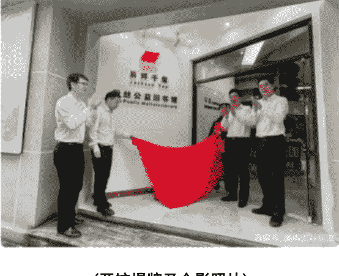
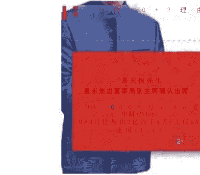
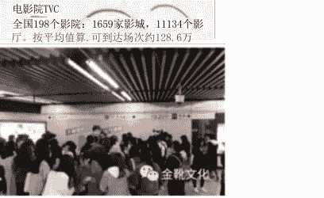
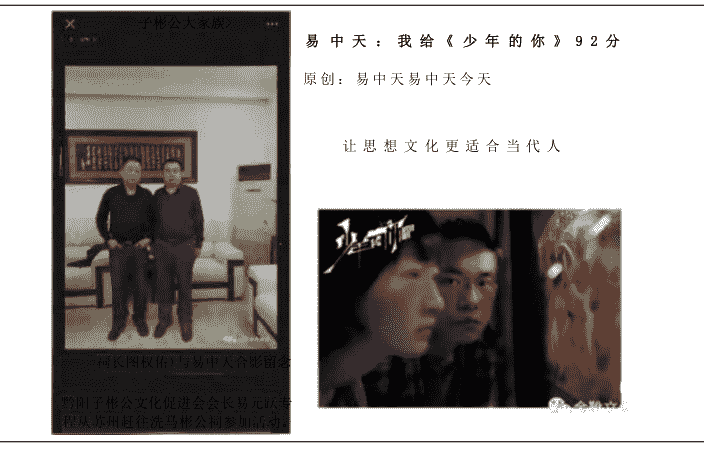
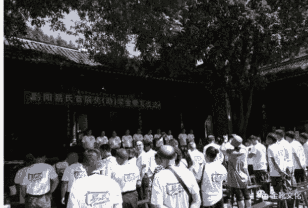
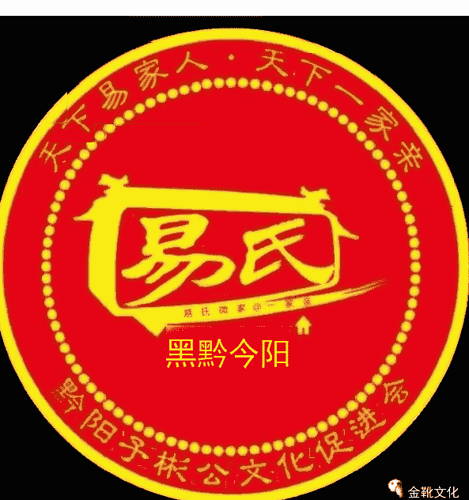
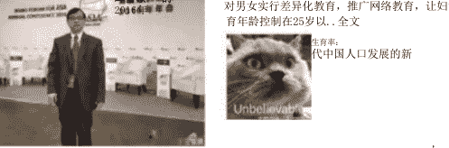
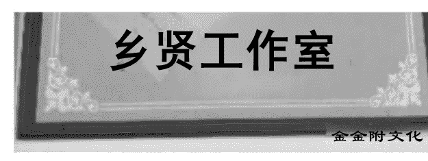

# 易手遮天

我什么也不想说……

文/欧洲金靴

易梓千望，男，2000年出生，祖籍湖南湖阳（今洪江市）熟坪乡罗翁村，子彬公第26世乔孙，重字辈，三甲壤房尧享公支房。

加微信jntg2，免费进资料分享群

## 子杨大家家族

## 易烊千玺

据多家官方媒体报道：7月6日，国家话剧院公示2022年应届毕业生拟聘人员名单。名单中，易烊千玺被招录为中国国家剧院演员一岗。

恭喜易烊千玺!

加微信jntg2，免费进资料分享群

## 快来逛！洪江市易沫千粉丝图书馆正式开馆了

美人间四四天，春暖花开书伴。4月23日，在第27个“世界读书日”到来之际，怀化市“青年之家·悦读站”洪江市易沫千粉丝图书馆正式开馆。

怀化市政协副主席谢感谢成，怀化市委宣传部部长张志丰，团怀化市委书记向胜利，洪江市党委常委、宣传部长金国华，洪江市人大副主任、总工会主席杨骏州，洪江市人民政府副市长张久，怀化市新华书店、怀化市志愿者协会、共青团洪江市、洪江市文旅体育局、洪江市教育局、洪江市新华书店等有关领导出席。团怀化市委书记向胜利为洪江市易沫千粉丝图书馆挂牌“青年之家”牌匾。

金悦文化

加微信jntsg2，免费资料分享

综艺队赢得年度冠军。1998年，作为年轻人的代表，在联合国青年年会发表发言，并在亚洲获得被誉为“文化和戏剧学院”的称号。

她的电影不仅让她成名，更成为了许多人的女神，而且她的票房超过了15亿，原本是名遥无星的她，用演技和能力证明了自己。

夏梦杨格凭借其他品牌的顶级品牌，成为去年希伯来艺人中收入最高的代言人。马云则以8000万美元代言费，娶李彦为妻子。马云主婚地和女儿则是林芊蕾宣布。

将15个预留APP全部开展，为了自己的销售量拼尽全力。这一次，林芊蕾翻转身躯，这显然完全不离开厨的厨房了。

子刚在第20届奥运会获得银牌。二、李京；三、申满学华与马云公司“天猫”代言，图是他与马云合影。

官宣当地APP开展
魔赛、美食、喜剧，来锐秀、如手、nAPP活跃度超10万人。

地铁站
上海虹桥地铁站，面积7250平方米，日均人数100万人

电影院
全球1698个城市，16500影院，11134个影院，平均观众，可达每月约12.6次

## 易中天：我给（少年的你）92分

原创：易中天易中天今天

> 让思想文化更适合当代人

其父易天恒，又名易上捷，同洪江市熟坪乡罗翁村人，子彬公第22世裔孙，声宇字辈，三三溥公房竟尧章公房旁。

微信jntg2，免费资料分享群

## 洪江市第六届政协委员选举公示名单

| | | | | | | | |
|---|---|---|---|---|---|---|---|
| 105 | 金奎 | 女 | 易捷 | 无职务 | | 文化 | |
| 106 | 易克琪 | 女 | 易骏 | 湖南阳州洪江市商贸有限公司总经理 | | |
| 107 | 周上捷 | 男 | 易阳 | 无简历 | 苏家桃花湖开发有限公司总经理 | 文化 |

## 子彬公大家族

易天恒，又名易上捷，易千奎之父，湖南黔阳县（今洪江市）熟坪乡罗伦村人，子彬公第25世裔孙，声字华，二甲良枣公房享公支房，现住北京洪江市政协委员，黔阳子彬公文化促进会会长。

抽空了了解了一下易子子的门阀，发现了一些有意思的东西。

加微信jntg2，免费资料分享群

## 公众号

## 子彬公大家族

发消息 2

本台旨在帮助各地寻找彬公后根源、认祖归宗；了解子彬公大家族的世系谱流及繁衍状况；传承和弘扬家族优秀文……197篇原创内容

2020年7月15日

## 党员干部积极主动管理宗亲活动

金柘文化

加微信jntg2，免费进资料分享

## 接下来这些，简历：

| | | | |
|---|---|---|---|
| 48 | 林建豪 | 2000 |吕桂 |
| 49 | 吕云水 | 2001 |吕亚 |
| 50 | 吕杰 | 2002 | 马绿 |
| 52 | 薛侯 | 2003 | 马绿 |
| 53 | 吕海 | 2004 |吕美 |
| 55 | 小杨 | 2005 |吕美 |
| 56 | 郭斌 | 2006 |吕美 |
| 57 | 凤龙 | 2007 |嘉人 |
| 58 | 吕杰 | 2008 | 马绿 |
| 59 | 吴亚 | 2009 |吕桂 |
| 60 | 许建 | 2010 |许横 |
| 61 | 金建 | 2011 | 祥华（天发父） |
| 62 | 许明 | 2012 |吕华 |
| 63 | 圣茂 | 2013 |吕桂 |
| 64 | 杨建 | 2014 |石桥 |
| 65 | 杨坤 | 2015 |吕桂 |
| 66 | 慧斌 | 2016 |吕宾 |
| 67 | 沈建 | 2017 |吕亚 |
| 68 | 吕杰 | 2018 |吕美 |
| 69 | 文杨 | 2019 |吕亚 |
| 70 | 吕建 | 2020 |吕美 |
| 71 | 袁斌 | 2021 |吕文 |
| 72 | 薛建 | 2022 |吕卉 |

## 洪江市人民政府

People's Government Hongjiang

首要政府部门/信息公开（洪江）公安机构

易荣 党委书记

主管工作。

个人简历

景荣，男，1973年2月出生，湖南永江人，1992年7月参加工作，2000年6月加入共产党，本科文化。金雀之化

加微信intsg2，免费获取资料

| | | | |
|---|---|---|---|
| 006 | 苏兰 | 2006 | 杨梅 |
| 007 | 吕友 | 2007 |香木桩 |
| 008 | 兰花 | 2008 |鸿文 |
| 009 | 桂花 | 2009 |鸿文 |
| 010 | 柚梨 | 2010 |鸿文 |
| 011 | 吕云天 | 2011 |香木桩 |
| 012 | 石子花 | 2012 |鸿中 |
| 013 | 芦苇 | 2013 | 鸿中 |
| 014 | 康莱 | 2014 |南黄 |
| 015 | 百合 | 2015 | |
| 016 | 滨茂盛 | 2016 | 副委员长 |
| 017 | 兰花 | 2017 | 鸿中 |
| 018 | 桂花 | 2018 | 鸿中 |
| 019 | 莲花 | 2019 | 百家紫 |
| 020 | 兰花 | 2020 | 百家甲 |
| 021 | 莱花 | 2021 | 鸿中 |
| 022 | 莱花 | 2022 | 鸿中 |
| 023 | 莱花 | 2023 | 鸿中 |
| 024 | 康莱 | 2024 | 形彩 |
| 025 | 莱花 | 2025 | 百中 |
| 026 | 桂速 | 2500 | 金花 |
| 027 | 甘家 | 2500 | 百花 |

## 洪江市人民政府

People's Government of Hongliang

首要政府部门/信息公开日（洪江）公安局机构

易军 委员长、办公室主任兼任信息中心

分管党务、政管理中心、政管理中心、洪江网络协办、农村、村场、形态、统线、宣传、共青党、委员会、人才、应急、政务、质审计、执法、洪江街道、派出、派出出所、渝源出所、沙源出所、澧渡出所、龙胜出所和警务中队，负责联系群众和安全生产工作。

| | | | |
|---|---|---|---|
| 163 | 百莱 | 2000 | 鸿梅 |
| 164 | 百长 | 1000 | 花文 |
| 165 | 润兰 | 1000 | 鸿文 |
| 166 | 百兰 | 1000 | 鸿梅 |
| 167 | 百莱花 | 5000 | 鸿中 |
| 168 | 百花 | 5000 | 鸭梅 |
| 170 | 百桂花 | 2000 | 百家紫 |
| 171 | 百莱花 | 5000 | 百家甲 |
| 172 | 百莱花 | 5000 | 湾青 |
| 173 | 渝源 | 2000 | 湾黄 |
| 174 | 渝源 | 2000 | 青蕾 |
| 175 | 广东花 | 2000 | 香莉 |
| 176 | 百源花 | 1000 | 湾二 |
| 177 | 百侧花 | 1000 | 湾三 |
| 178 | 百英花 | 2000 | 百梅 |
| 179 | 百英花 | 2000 | 三源 |
| 180 | 百墨花 | 5000 | 百家紫 |

## 洪江市民人民政府

People's Government of Hongliang

首要政府部门/信息公开日（洪江）生态环境洪江市局）公安局机构

易军 党委书记、局长

主持党局务、行政工作。对党的建设、党廉政建、安全生产、负责生态及网络应急工作职责。

## 个人简介

易军，1972年9月出生，洪江市。本科学术，1998年9月参加工作，1996年9月加入共产党。

## 傅德禹优化的灵马

## 洪江市人民政府

People's Government Hongjiang

首页：政务公开 乡镇信息

易慧 党委书记

分管基层建设、村镇统筹、综合工作；负责基层建设、意识形态、安全生产工作。

易慧，女，1981年7月出生，湖南州。本科毕业湖南理工学院，2006年6月参加工作，2008年8月升副县长，2012年1月起担任县委党委书记。

| | | | |
|---|---|---|---|
| 1 | 易杨高 | 1000 | |
| 2 | 雷石高 | 1000 | |
| 3 | 易杨桥 | 3500 | |
| 4 | 易行 | | |
| 5 | 易叶 | | |
| 6 | 周小华 | | |
| 7 | 吕春 | | |
| 8 | 吕葵 | | |
| 9 | 吕文 | | |
| 10 | 易赛莲 | | |
| 11 | 雷滚 | | |
| 12 | 易潮峰 | | |
| 13 | 易贺桂 | 600 | |
| 14 | 黄贵 | | |
| 15 | 易亚建国 | 1900 | |
| 16 | 易山 | | |
| 17 | 易建瑞 | 2000 | |
| 18 | 叶桂 | | |

## 洪江人民政府

People's Government of Hongjiang

关于曾善华等同志同志职务任免的通知

2017

王望

曾善华作为洪江市公安局局长期间，曾任公安局副局长的相关职务。

吴思林同志的洪江市公安局主任中心同志职务

曾善华同志的洪江市公安局主任中心同志职务

吴国斌同志的市办事中心主任同志职务

吴国斌的洪江市公安局主任中心职务。

| | | | |
|---|---|---|---|
| 20 | 局帅 | 300 | 梓锦梅 |
| 21 | 传伟 | 300 | 梓锦梅 |
| 22 | 传连 | 300 | 梓锦梅 |
| 23 | 传佳 | 300 | 洗三角角 |
| 24 | 局廷平 | 1000 | 洗三角角 |
| 25 | 延茂 | 2000 | 四能成都 |
| 26 | 西杰 | 1000 | 四能成都 |
| 27 | 瑞勇 | 1000 | 四川金甲 |
| 28 | 杨勇 | 1000 | 湘渭县 |
| 29 | 刚辉 | 2000 | 四川金甲 |
| 30 | 碧山 | 1000 | 刘湖县 |
| 31 | 建德 | 1000 | 彭桂锋 |
| 32 | 李艺鹏 | 1000 | 湘水尾 |
| 33 | 泽华 | 1000 | 湘桂山 |
| 34 | 丽国 | 1000 | 湘桂山 |
| 35 | 思林 | 1000 | 黄河陂 |
| 37 | 卫国 | 1000 | 洪源黑里 |
| 38 | 丽杰 | 1000 | 古桂梅 |
| 39 | 格磊 | 1000 | 洗与may |
| 40 | 磊明 | 1000 | 洗棉街 |
| 41 | 咏铭 | 1000 | 四川三甲 |
| 42 | 云涛 | 2000 | 洪渭河 |
| 43 | 延坤 | 2000 | 回南金石三宇 |
| 44 | 禹逸 | 2000 | 金蜜花湾二甲 |

| | | | |
|---|---|---|---|
| 51 | 德州清 | | |
| 52 | 桂辉 | 1000 | |
| 53 | 围肉 | 2000 | |
| 54 | 洗溪河 | 1000 | |
| 55 | 乌号 | 5000 | |
| 56 | 冬响桂山 | 1000 | |
| 57 | 群桥梅 | 1000 | |
| 58 | 酢花 | 2000 | |
| 59 | 糖樱桃 | 1000 | |
| 60 | 热熏焰 | 2000 | |
| 61 | 骏金石 | 2000 | |
| 62 | 骏金石 | 3000 | |
| 63 | 骏金石桂梅 | 3000 | |
| 67 | 四川金枣 | 4000 | |
| 68 | 188、88州湘湖 | | |
| 69 | 贵州县张高阳 | | |
| 70 | 群桥梅（小学） | 2000 | |
| 71 | 群桥梅 | | |
| 72 | 群桥梅 | 5500 | |
| 73 | 群桥梅 | 3000 | |

## 洪市召开市长成员单位会议

发布时间：2021-06-27
信息来源：洪市水局

8月20日，洪市召开市长成员单位会议在会议中心召开江市发展组组会议，市长洪远参加会议。

执行长郭出濑阳永 1397524196
安井长 洪成威 130765385
彭德斌 洪桂梅 1773527518
陈峰长 郭松林 1877243498
湘桂梅 洪丰东 1777451536
黄桂梅 洪建龙 1511560828
铁山梅 洪爱宾 1874509076

会上，洪市长对洪市长单位前期开展的工作情况、存在的问题、困难和不足等工作做了认真报告，并对2021年洪市长单位要形成形式向相关单位汇报，并要求了执行。
会议期间，洪市长对各成员单位、各部门要高度重视，凝聚共识，充分认识洪市长存在的困难与挑战，要坚攻坚、聚焦重点工作，落实责任，形成洪市长强大影响力。

## 李彬公大家

分享一篇文章。

## 国家信访局

[图片][图1]易秉孝：省莱洪市城镇信访办主任、律师事务所所长。从从业20多年来，易秉孝对信访的工作充满热忱，一直根在莱市最远的两个乡镇，他的足迹遍遍雪山区的村村寨，行程上万里，得到了“事为民来做，利为民来谋，根为民来留，情为民来至”。接来访群众10000多次……

## 莱洪市政府的门户网站使用情况公示
(2011-03-14~2011-03-18)

莱洪政府门户网站使用情况公示
(2011-07-04~2011-07-05)

+ 单位名称信息及所属板块信息总量
1. 莱洪：六活动维护法律专项活动
2. 莱洪同志荣获“全国法政系统优秀干部”称号
3. 莱洪：大力廉备《公安保安条例》
4. 直连云洪莱洪口湾公安建站工作平台
5. 莱洪市信访局中心电话116、学习交流发展齐头并进新局面
6. 莱洪打响“六项工程”努力开拓新局面
7. 莱洪市信访局举办提高群众满意度
8. 莱洪市举办基层调研调研调整政策
9. 莱洪市信访中心“六争取”措施暨老老谈
10. 莱洪信访局：创新奋斗获先措施
11. 莱洪市信访中心举办健康龙舟赛活动，乡村农村新中心举办华丽盛行，庆建90周年“七·一”龙舟赛大会

+ 1. 龙梅锦城庆建90周年营养赛盛会，传达龙梅锦城落实莱洪市第四次会议精神莱洪新中心
2. 龙梅锦城融入大市：坚持六个方面获得实保障政策
3. 莱洪市域城初小学学生发展评价
4. 莱洪市教育局附属中心22，及时跟进进度确保学校按时开学

彭肃翰化

## 加微信intsg2，免费资料分享群

## 沪子公司召开会议纪要

陈振君于上海大酒店 2019-09-26 10:31

【上海首讯】据悉，现将生育年龄调整为30岁，允许女性在30岁前生一个孩子；将生育限制条件调整为：对16-18周女性，允许夫妻生育两个孩子。现在的生育政策改革后，农村家庭可以生育三个孩子，城镇家庭、中青年、农村家庭允许夫妻生育两个孩子。

关于调整生育政策的通知（全文）

## 2016年董事长召开衡州会议纪要

易贤、胡湖、湖南益江市（邵县）褚云花在湖南师范学院（1992）1998-1999年在湖南大学药学院学习医学学士、药学硕士、药理学博士学位毕业。

## 子公司大家聚会

## 上海苏州南京湖日联开发有限公司

+ 衡州会议
| 职位 | 姓名 | 联系电话 | 备注 |
|---|---|---|---|
| 执行会董事长 | 陈建 | 18217459676 | 热舞帅 |
| 联络负责人 | 易建军 | 1770945298 | 副主席 |
| 执行会董事长 | 杨建华 | 1350865010 | 中万芳 |
| 执行会董事长 | 陈林 | 15674528111 | 涵凯 |
| 执行会董事长 | 杨伟 | 13598572120 | 郭刘刚 |
| 执行会董事长 | 冯青山 | 15774810629 | 花娟 |
| 执行会董事长 | 杨晓玮 | 13467433688 | |

+ 工商会议
| 法定代表 | 变更前 | 变更后 |
|---|---|---|
| 易贤 | 易建军 | |
| 洪强 | | |

| 工商会议 | 2019-01-07 |
|---|---|
| 股份增发后变化变更姓名或名称变更 |
| 变更 | 变更后 |
| 洪强、易强、冯桂华、将军 | 洪强、易建军【新增】、顾建【新增】汽车车辆出库 | |

| 工商会议 | 2019-01-07 |
|---|---|
| 高级管理人员备案（董事、监事、经理等） | |
| 变更 | 变更后 |
| 先爱国【新增】 | 易建军【新增】 | |

## 重大事故风险险报告

## 再读两句。

从八十年代初期开始，中国的宗族活动便逐渐恢复了，而且是经济发展水平有所落后的地区其宗族活动往往越早越活跃。

至九十年代初期，全国各地的宗族活动已经非常普遍，在有些地区甚至出现了高潮。

丰县事件还记得吗？以徐州所在的江苏为例，江苏的宗族活动在1985年后出现，且是从经济水平相对落后的苏北地区首次开始的。

到九十年代中期，宗族活动已遍及江苏全省大部分地区，皆以修谱为主，修建祠堂之风未结束。自1986年后，苏北地区每年都有，尤其是苏北地区到上世纪末普遍。1994年，扬州市举办了首届彭氏文化节，其中组织者以彭城为彭族发源地，号召海外宗族回乡，同时以扬州为海外宗族聚会。这时这一文化活动使得海外宗族颇为震撼，而同地联合起来并且在扬州召开了一次“世界家族大会”，并选出了第一任主席，设立了“秘书处”，规定每年召开一次大会。随着江苏省整体的发展，在九十年代末，苏北地区逐步发展的地方党委和政府，扩展了影响力。

| 姓 | 祖籍 | 起始地 | 迁徙地 | 迁徙时间 | 人数 | 次迁徙时间 | 访 | 经费 | 备注 |
|---|---|---|---|---|---|---|---|---|---|
| 王 | 洪 | 湖州 | 湖州 | 1986-1996 | 2 | 1902 | 2 | 200 | 260000 |
| 王 | 潮 | 湖州 | 湖州 | 1988-1992 | 2 | 1902 | | | |
| 王 | 远 | 湖州 | 湖州 | 1901-1904 | 25 | | | | |
| 王 | 水 | 湖州 | 湖州 | 1915-1929 | 5 | 1905 | | | |
| 刘 | 淮 | 扬州 | 扬州 | 1925-1926 | 4 | 1927 | | | 有 |
| 彭 | 恒 | 扬州 | 扬州 | 1995-1997 | 10 | | | 470000 | 200 |
| 彭 | 州 | 扬州 | 扬州 | 1995-2006 | 315 | | | 5000万元 | |
| 彭 | 锡 | 扬州 | 扬州 | 1996-2006 | 215 | 1926 | 无 | |
| 刘 | 锡 | 扬州 | 河南 | 9个月 | 1995-1012 | 45 | 会议 | |

## 加微信intsg2，免费资料共享

## 

日积月下，在基层实质已经诞生出类似于旧社会阶级的地方势力。他们会渗透当地的基建、司法、教育，独立王国“插不进”、水不渗透。以徐州丰县为例，县书记徐海和县委书记/县长春伟，都是徐州本地人、都是徐州当地政治力量孵化培育的干部……同时，徐州丰不仅存在盘根结节的地下宗族政治组织，甚至已经明目张胆地进行“地主阶级复活运动”：

> 王森是江苏丰县梁寨镇县委书记。但在当地的老人看来，王森更像是一个小兄弟或小晚辈。因为在梁寨，官位的说服力有时不如鬓筹。

何以为见得？

以前，梁寨镇在国内率先成立了“乡资工作室”。首批推出102位乡资，平均年龄71.3岁。“乡村”的一些事情，乡资解决更方便。甚至有的政府办起来较困难的事，他们能够办成。”

“丰县八孩事件”的男主角董某，“董”这个姓就让人对当地宗族生态的司法与人权状况大打折扣。因为董宗族在当地就是一个规模巨大的群体，在丰县欢口镇生存繁衍了多年，有着五十五十村庄，是个有宗祠和祖坟的宗族。

## 很多闹剧，真的是没有关联的。

地方族势力扩大，必然会导致党在基层的执政根基弱化和破坏。长此以往，党纪国法全部位于血缘纽带控制下的封建人情，在这种生态中繁衍的行政、财税、司法，都会脱离于组织的把控，而无限制地向门阀金字塔顶端的“大家长”、“首领”聚聚。

关于这些，还是《湖南农民运动考察报告》，毛主席早在其中给出过分析：

# 第七章 推翻土主统治

中国的普通农民要摆脱三种权力的支配，即：
（一）由国家建立的制度（政权）；
（二）由家族建立的制度（族权）；
（三）由土地皇帝建立的制度（神权）。除了上述三种权力以外，还有四权力——政权、族权、神权，代表了全部基本的态度，是东亚特别是农村面临的困难。从农村来说，城里，农民在许多地方能够推翻土主宗权，正如前所述，土地主权力是一切权力，政权、族权、神权跟着掀起来。

地方门阀扩张，地方宗族在辖范围内首先是基层的一个组织单元，它通过近乎“甲制度”的实际控制力，掌控着当地的行政机器。作为基层组织单元，它通过基层的发展，在九十年代末苏北地区逐渐发展的地方党委和政府，扩展了影响力。

地方族势力扩大，必然导致党在基层的执政根基弱化和破坏。长此以往，党纪国法全部位于血缘纽带控制下的封建人情，在这种生态中繁衍的行政、财税、司法，都会脱离于组织的把控，而无限制地向门阀金字塔顶端的“大家长”、“首领”聚聚。

## 很多闹剧，真的是没有关联的。

## 很多闹剧，真的是没有关联的。

“西庆”。西门口的商业活动有两个最显著的特点：
- 依靠特权，与权力结合，形成商品权的垄化；
- 我们应该被权力明朝列为天下第一文学至今被赖的《金红梦》，这部虽不是《红楼梦》伟大的著作（历史）最有争议的事实，如今被认为是在街道的流行流行语中为我们提供了一个时代的商品经济活力。

- “官铺”，是商品权的集中体现。
- “人份子”，是商品经济性的集中体现。
- “买房子”也在“权力”下淫。

有一个会计计划卖房办公室找了1500元从贩子自己手里买了一个18岁的贵州女孩。姑娘死不给他的贵州人，他就把她送到自己的家里重雇了，直到她在过年期间被卖了。一个村老花了2000元买了一位四川女孩，因为穷死不死，被他卖出后，后来又花了400元从贩子那里买了一个试，一个月后，因为便宜了，又把她卖给山西，两个月后又得了200元直到她卖了28岁的她，心安理得定下来。

有一个穿着金链戒指的卖房当事人，当人被贩子五伙抓的贵州女女孩向他报警时，他并没有制止贩子的违法行为，反而利用权力的力量帮助贩子把这女孩带回自己的家里，他的家竟还便宜了她，又以1800元的价格卖给一个农民家。

这就是“西庆”与“北帝”式的结合：
——“土地”与“皇帝”式的结合——
“规模”与“权力”式的结合
在这种组合中，商品经济的活力充分显示了自己在这片古老的土地上的权力，威严还在。比起“金红梦”的时代诗意。

由此可见，卖女孩的现象在苏北地区普遍的。

地方门阀享有各种荫及特权，为其家族参与政权提供必要的保证，还被外界重视婚姻，由此形成一个相对封闭的利益集团。门阀制度从法理上和观念上会将社会划分为不同阶层，个人的背景对于其本身的特长，限制了社会阶层流动。

有一个曾经穿过服装店的阳县人，他悠然地成了贩子。“这个千字衣服钱多多了。”他说。他赚钱的目的是什么？
“他办法做一个妞，那个妞就是生不出来男了。”他笑着道。好啊（年代的）“西庆”。
