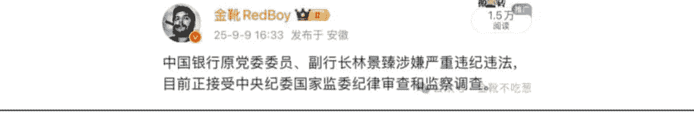
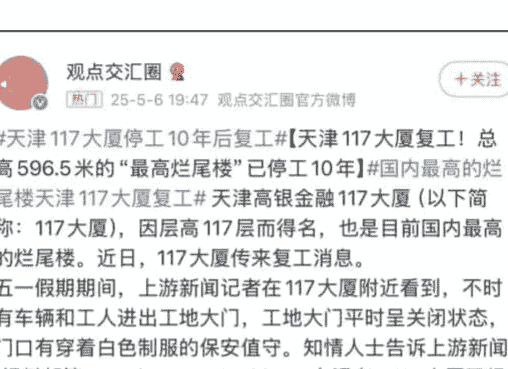
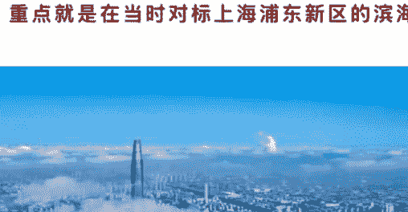
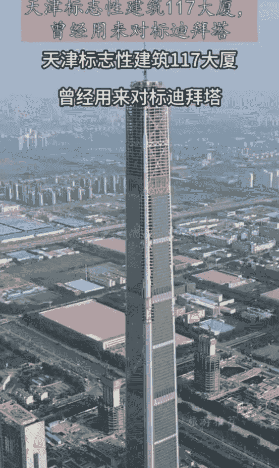
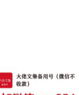

# 翻过这一页

欧洲金雀 金雀不吃 2025年09月17日 20:08

文 / 欧洲金雀

出身于总行线的林景臻，曾长期分管对业务，包括贸易及金融；退任前分职有过调整，分管个金条线。

在长达三十七年的中国银行职业生涯中，有两段香港任职经历非常引人注目：

曾担任临时总监，仅用于衔衔，将在短期内离任。

派驻香港银行分行长达八年，历任信任部主任、高级主任、副经理、经理，这是他香港资源积累的开始。

其二，2015年5月至2018年1月，林景臻重返香港，担任香港银行（控股）有限公司、中国银行（香港）有限公司副总裁，当时负责环球企业金融部、中银金融部、交易银行部、机构业务部、中国业务以及东南亚业务，其中交易银行业务由传统的贸易金融升级而来。

中香港银行是中国银行的子公司，但在它香港却有着类似于央行的“发钞”身份，也是香港地区唯一的人民币清算银行，之中中银香港在中行直系体系内的地位是非一般的省级分行所能比拟。

一直以来，中银香港董事长都是由中行董事长兼自己兼任，中银香港总裁相当于中行总行副行长级别。

今年夏秋之际，中行贸易金融领域活跃不断，比如丁浩，原是中行一名中层干部，早年在中行深圳市分行结算业务部工作，后担任该分行贸易金融部总经理，此前在中行深圳市分行贸易融资业务违规，近期吕及丈夫（曾在行政职）已双双归案。

2022年8月，深圳银保监局公布行政处罚单，中行深圳市被罚款1130万元，四人被被禁业（包括丁浩）。监管处罚单显示，中行深圳市分行办理业务和融资信贷业务，贸易融资业务“三查”不尽职，回流型、隐蔽型保险产品内部配置、研发程序不审慎，保险融资业务规模超过，经营行为等，对其对损害承担责任，被禁止终身从事银行业。

> 而该与知名香港金融巨擘潘涛及其旗下高层资本有关。

潘涛在香港政界属传奇人物，以元转杠杆、空手套白出名。九年前，他曾以63.81亿价拿下中环一套住宅，同年12月又拿到中环站上盖顶；两个项目后续在2018年售出。潘涛通过中内地持股的公司，因其人享有“有地王”之名，风头无两。

潘涛1963年出生，祖籍广东韶关，1976年移居美国，1984年回香港与日本松下电器公司曾从事贸易业务。

2002年，他收购香港上市公司“英豪利科技资讯”，将其改名为“松日通通讯控股有限公司”，2008年9月该公司更名为“高银地控股有限公司”；年底，潘涛通过收购另一家香港上市公司广益国际，改名为“高银金融（集团）有限公司”，

主要业务包括四大领域：酒品、保理、房地产、金融投资。

几个月前，一则新新闻曾引发热搜，随后引起反响不断明朗：有“中国第一烂尾楼”称号的天津117大楼，时隔十年终于复工。

这个天津117大楼，正是2009年前后房产渗透率高高层资本进军地产业、进军天津这个北方二城市的头之争。

潘涛通在天津投资，重点是在当时对标上海浦东区的滨海新区。

其投资项目不仅止一个117大厦，还在天津规划了一个大型综合综合体项目，名为“高……

但是之后等来的，就是资金链断裂、神话故事说下去、PPT成为泡影、投资者跑路、项目烂尾……

巧妙不巧，潘涛通的主要债主之一，正是中行（深圳分行）——2017年，潘涛通用自己控制的松日数码公司，找中国银行深圳分行签署了授信协议，担保人为……

在2020年后，中行深圳市分行与高银系及潘涛通旗下企业产生了大量债务纠纷。比起当年9月，深圳法院一审裁决书显示，查封、查扣、冻结申请人——松日发展（深圳）有限公司、高银地产开发有限公司、广州市城科技有限公司、天津锦宝有限公司、广东高银韶关福苑有限公司、韶关万联投资有限公司、高银地产（天津）有限公司、天津华鼎业有限公司，均为“高银系”旗下内地企业，而“潘涛通”大概就是潘涛通本人。

潘涛通早就知道跑去太平洋岛上逍遥了，如今只下了上海松江和香港深水湾的两处别墅被封，价值人民币94亿元。

而在广州富大开发有限公司、广州市城科技有限公司、天津锦宝有限公司等企业，均为“高银系”旗下企业。

此外，原中行国际证券董事长董盛鑫于7月被查，线索同样指向潘涛通。

林景臻此人在中银香港担任总裁、分管贸易业务时，潘涛通正处于兴盛之时。需要注意的是，潘涛通及“高银系”贷款比例一项，自2021年起一度出现线性攀升，由2021年末升至27%，2022年末升至33%，直至去年维持在50%。

解释：2022年疫情反复、全球地缘政治风险、部分行业面临严峻挑战，特定客户贷款余额，2021年末为24亿港元，较2020年末增加8亿港元，接近翻倍；2023年末为77亿港元，较2022年末增加73亿港元，接近翻倍。

然而，这个“若干客户”具体包括中行年报披露，林景臻以中行国际证券执行董事、副行长的身份任职多年退休，大部分业务经历均在招商银行。吉田惠宇君在2022年落马，且是非高管干部接受纪律调查，也是潘涛通高银系最大债主之一。结合今年上半年用50亿资金“复工”天津117大厦——实际上，这点钱只够装饰门面，外观不再“烂尾”，以及此番对潘涛通金融的脉络已十分清晰：这一页也必须要回去了。

# 大文集 VIP 群 简介

 包含以下全部内容历史清单：

- 吃瓜群众帝实时对话（原价365 元/年）
- 顾子明私享会（内部文章）（原价568 元/年）
- 政事堂（顾子明）付费内容内读顾子明
- 米联储见闻【作者米穗】（原价599 元/年）
- 欧洲金彻会员专属文章（原价328 元/年）
- 纯瓦内部头部文章（原价400 元/年）
- 卢文青读书专属文章（原价699 元/年）
- 茶茶财经知识星球（原价3310 元/年）
- 猫猫的视角星球文章（原价299 元/年）
- 财新周刊【独家新闻】（原价1498 元/年）
- 杨世光在财经（原价2200 元/年）
- 森森财经知识星球（原价1600 元/年）
- 泽洋异谈付费文章（持续更新）
- 司马畅解逸全套音频和全书珍藏版无割（原价2.3 万）
- 虚部部曲（民国史、帝国扩张、不被理解的MAO）（原价599 元/年）
- 卢克知识星球（原价268 元/年）
- 额外内容：卢泉新微博付费专栏；西村屯老王、三花九树集；不定期内容：————（更多资源写去了……）
- 守夜人司令知识星球、拯救漫画王星球、生财术知识星球
- 创始笔记、达达天论知识星球、成竹财富圈、雪花老头等
- A视野、大树乡谈、江宁知府、砰咩、财上海学家等付费集
- 西风付费文章、老端、赢在八小时之外、外人的世界、升值纪等大V付费文章（每月不低于600 元的付费文章）

微信：daizongdai2021
大文集 VIP（微信不...）

长按识别二维码

大文集VIP群内号（免费不）
加微信pp854

大文集 VIP 络群，年费300 元，现仅需249 元/年，包含以上内容。
