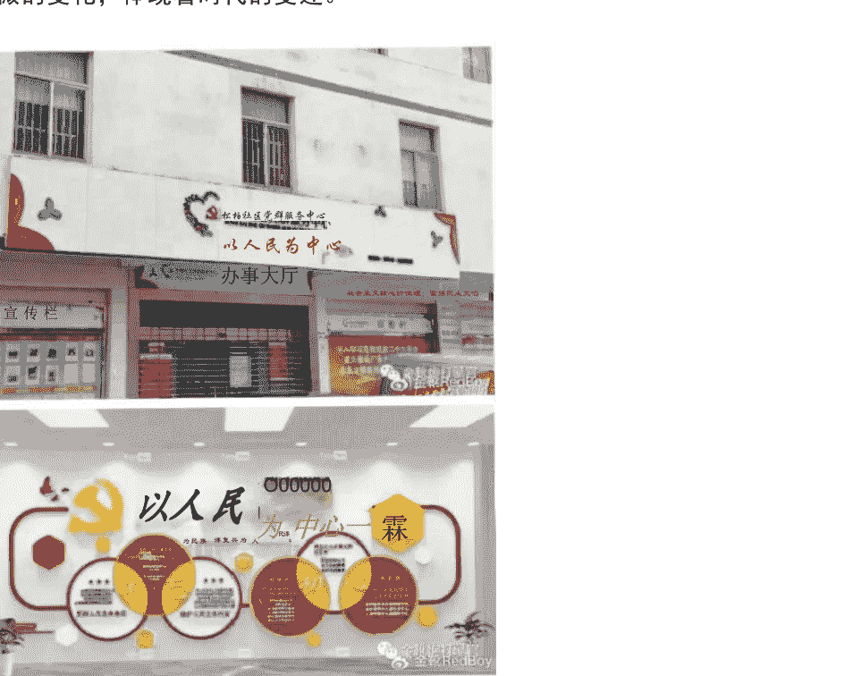
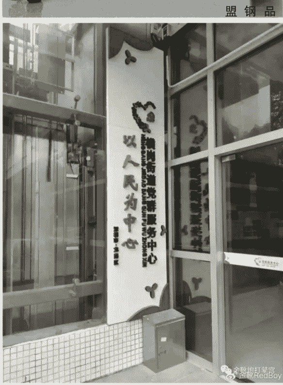
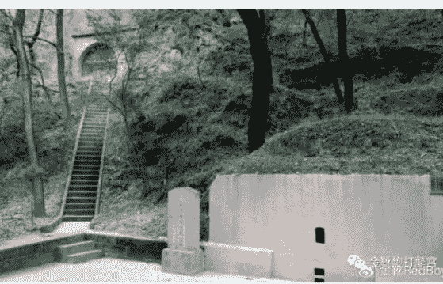
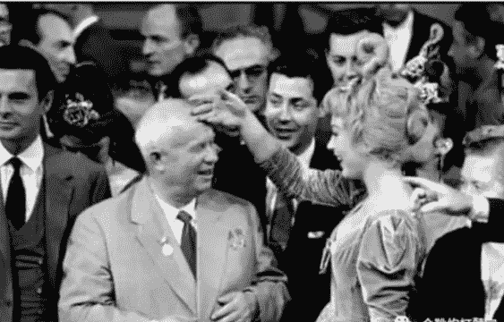

# 金鞋RedBoy

# 还是“为人民服务”比较好

11-0713:02 阅读19万+

“服务主义”还是“管理主义”，根子还是在于我们站在那一边。

## 文/欧洲金靴

近来，其实也不是近来，准确的说是近年来已经看到诸多党政机关、事业单位、国有企业等的办公场所，将“为人民服务”的标语替换成了“以人为中心”。

近来似乎动作在升频，“为人民服务”的字样屡屡被替换。

其实严格来说，“以人为中心”是对“为人民服务”的某一种脉承，并非对立。

2015年10月29日，在十八届五次中全会上，领袖第一次明确提出了“坚持以人为中心”的发展思想。

两年后，被写进党的十九大报告，也是新时代思想的重要内容内涵。

但是就理论与实际的角度，“以人为中心”是指导，“为人民服务”则是要求。

同时更重要的一个别在于其阶级身份的变化：“为人民服务”，一个“为”字体体现了对民众的俯视姿态和自己的极低身份。

人民熟悉和群众的一股浓浓的“老安”味道，总是能够通过“为人民服务”这五个大字散开，暖人心脾。

而“以人为中心”，似乎又添了一丝相当高的指挥感、管理感、支配感。

加微信intsg2，免费资料分享

敏锐秋在《中国民国革命与董涛主义》中曾对董陶有过精准总结：

他的主张，实际上是追求资产资本家“仁爱的性能”和智识阶级“智勇兼备以行仁政”的热诚，来替农民群众革命。这不是纯粹的空想主义，而且是想要暗示工农群众停止自己的斗争，听从上等阶级的命令和指使，简单来说，便是上等阶级利用农工群众的力量来达到他们的目的，却不准农工群众自己有阶级的觉悟。

细微的变化，体现着时代的变迁。

加微信jntsg2，免费进资料分享群

# 永远初心 记使命
为人民服务中心

不忘为群众服务为人民服务的宗旨——造了人民信赖人民的人。

经考证，近代以来最早提出“为人民服务”这一伟大的命题，是在1936年7月初，党中央迁到陕北时。

陕北山高沟深，地高气寒，交通不便，经济发展极其落后，加上近代以来历次战争的破坏，城里有一家商店，日品奇奇，群众买药要赶上毛跑到七百里外的宁夏盐去，一盒火柴要用几个鸡蛋从小贩手里换，衣服棉更是难买，有的家里一件衣服缝补缝补要穿几代人。

看到这些，初入陕北的毛主席心情十分沉重，他把中央贸易部和保安县政府的负责人请到他的洞窑里说：

“你们考虑一下，是不是在保安城里办一个供销社？”

这些负责人考虑了一下，都赞同主席的意见。

主席随后指出：

> 我们共产党的政府是为人民服务的，你们做什么事情，都要走群众路线，一切都要从实际出发，一切都要同群众商量。
> 比如办供销合作，就是群众目前迫切需要解决的问题。你们要到群众中调查研究，看群众迫切需要哪些东西，比如布匹、火柴、食盐。你们要注意工作方法，关心群众生活。

加微信jntsg2，免费进资料分享群

1939年2月20日，在致张湖南的一封信中谈及儒家旧道德之用时，主席又有指：在此后在1942年5月，主席在著名的延安文艺座谈会上的讲话再次明确了“文艺应当为人民服务”的思想。

在延安那场文艺动员中，主席慷昂地：对于过去的文艺形式，我们并不拒绝它。但是这些旧形式到了我们手里，必须改造，加入了新的内容，也就变成为人民服务的东西。这个“人民”指的是什么？是占全国、乃至全球的大多数无产阶级，还是少数的、自私的精英阶层？

加微信intsg2，免费进资料群

“人民”这一词，在《周易》《孟子》《墨子》中均出现，但此处“人民”是指全部被压迫、统治人口。共产党的“人民”词已成为严格的政治概念，马克思在使用“人民”词时，并没有抹去阶级之间的差别，而是用它把各个阶级连接在一起。到1942年5月的延安，主席给出的答案更加清晰：巨大的人，占人口百分之九十以上的人，是工人、农民、士兵和其他武装群众。第一为工人、农民八路军、新四军，这是革命的主力。第四为城市阶级劳动群众和知识分子，他们也是革命的盟友。这种人，就是民族的大部分。两年后的1944年9月，在张思同志的会上，主席发表了震动当时的稿，《为人民服务》与《纪念张思德》被称为经典作。张思同志是1933年参加红军，当过机枪、地下交通员，长征中经过草地，到陕北后曾在中央卫警团担任通信兵，曾担任班长。他过线，是远名的战士。1942年，中央卫警团合并，规模减少，张思由队长，他毫不须意，服从组织安排，在每个岗位上完成过任务，是中央卫警团的模范。

加微信intsg2，免费享资料

1944年9月5日，张思德同志在一次战斗中，窑壁突然崩塌，他不幸壮烈。张思德的牺牲，引发了毛主席的深沉思考。出身农村，生命短暂，青春定格在29岁，在当时的党内十分普遍又典型。在党的队伍中，张思德是一名普通党员；在人民军队的队伍中，他是一名普通士兵；在整个革命队伍中，他还是一个默默无闻的奉献者；在人民群众的汪洋大海中，他不属于一时，而是小的一滴水。

张思德没有官职，没有财产，没有家庭，也没有豪言壮语，连一次恋爱都没有谈过，就这样平平实实，一条条条去，奉献了自己的生命。

毛主席慧眼卓识，他从“小人物”张思同志平凡伟大的历程中，看出了“为人民服务”的精神境界——胸怀杂念，心无挂碍，一片天真，一片朴素，一片忠诚，一片大义。

在张思德的悼词中，主席振振道：我们的共产党和中国共产党领导的八路军、新四军，是革命的队伍。我们这队伍完全是为解放人民的，是彻底为人民的利益工作的。张思德同志就是我们队伍中的一个同志。人是要死的，但死的意义有所不同。中国时候有个作家曾说过：“人死有一死，重于山，轻于鸿毛。”为人民利益而死，就比泰山还重；法西斯主义死去，屠杀和迫民的人死去，就比鸿毛还轻。张思德同志为人民利益而死的，他的死是比泰山还要重要的。

因为是我们为人民服务的，所以我们如果有缺点，就不怕别人指出。不管是谁个人，向谁我们就听谁。只要你说得对，我们就会纠正。你说的办法对人民有好处，我们就照你的。“精兵统政”这一意见，就是党外人士士廉先生提出的；他得好，对我们有好处，我们就采用了。只要我们为人民的利益坚持有的，为人民的利益纠正的，我们队伍就会兴旺起来。

我们都是来自五湖四海，为了一个共同的革命使命，走到一起了。我们还要全国大多数人民走这条路。我们今天已经拥有着九千一百万人的根据，但是还不够，还要更大一些，才能获得彻底的解放。我们的同志在困难的时候，要看到希望，看到光明，提高我们的勇气。中国人民正在受苦，我们为人民而死，有责任。我们要努力战斗，会有牺牲，这件事是常发生的。但是我们考虑到人民利益，想到大多数，应当尽量减少不必要的牺牲。我们的干部关心群众，一个革命队伍都要相互相关，互相帮助。一切从人民出发，而不是个人或集团利益出发；向人民负责和对党一致。这就是我们的出发点。

因此，七大正式把“为人民服务”的思想写入党章，明确了“全心全意为人民服务”是中国党的根本宗旨。

由于国民党胡宗南部队占领延安之后，在中国共产党“为人民服务”宗旨的诞生地，别出心裁地开了一个“为人民服务处”。服务处挂牌那天很热闹，因为通告上说：不管男女老幼，只要来此，就发给救济法币二十元，或者布二尺，或者米二。随即“为人民服务处”门口一下热闹起来，来的人很多。然而几天后，胡宗南感到不对劲，每日发放物资难以为继；更重要的是，老百姓领了东西之后依然只说共产党好。无奈，胡宗南只好停止了这起所谓的“创拳”，悄悄地把“为人民服务处”的牌子摘了。

关于国民党的种种虚伪，1943年毛主席就评价：国民党也需要百姓，不是外国。

加微信intsg2，免费享资料

“人民”这一词，在《周易》《孟子》《墨子》中均出现，但此处“人民”是指全部被压迫、统治人口。共产党的“人民”词已成为严格的政治概念，马克思在使用“人民”词时，并没有抹去阶级之间的差别，而是用它把各个阶级连接在一起。到1942年5月的延安，主席给出的答案更加清晰：巨大的人，占人口百分之九十以上的人，是工人、农民、士兵和其他武装群众。第一为工人、农民八路军、新四军，这是革命的主力。第四为城市阶级劳动群众和知识分子，他们也是革命的盟友。这种人，就是民族的大部分。

两年后的1944年9月，在张思同志的会上，主席发表了震动当时的稿，《为人民服务》与《纪念张思德》被称为经典作。张思同志是1933年参加红军，当过机枪、地下交通员，长征中经过草地，到陕北后曾在中央卫警团担任通信兵，曾担任班长。他过线，是远名的战士。1942年，中央卫警团合并，规模减少，张思由队长，他毫不须意，服从组织安排，在每个岗位上完成过任务，是中央卫警团的模范。

1944年9月5日，张思德同志在一次战斗中，窑壁突然崩塌，他不幸壮烈。张思德的牺牲，引发了毛主席的深沉思考。出身农村，生命短暂，青春定格在29岁，在当时的党内十分普遍又典型。在党的队伍中，张思德是一名普通党员；在人民军队的队伍中，他一名普通士兵；在整个革命队伍中，他还是一个默默无闻的奉献者；在人民群众的汪洋大海中，他不属于一时，而是小的一滴水。

张思德没有官职，没有财产，没有家庭，也没有豪言壮语，连一次恋爱都没有谈过，就这样平平实实，一条条条去，奉献了自己的生命。

毛主席慧眼卓识，他从“小人物”张思同志平凡伟大的历程中，看出了“为人民服务”的精神境界——胸怀杂念，心无挂碍，一片天真，一片朴素，一片忠诚，一片大义。

在张思德的悼词中，主席振振道：我们的共产党和中国共产党领导的八路军、新四军，是革命的队伍。我们这队伍完全是为解放人民的，是彻底为人民的利益工作的。张思德同志就是我们队伍中的一个同志。人是要死的，但死的意义有所不同。中国时候有个作家曾说过：“人死有一死，重于山，轻于鸿毛。”为人民利益而死，就比泰山还重；法西斯主义死去，屠杀和迫民的人死去，就比鸿毛还轻。张思德同志为人民利益而死的，他的死是比泰山还要重要的。

因为是我们为人民服务的，所以我们如果有缺点，就不怕别人指出。不管是谁个人，向谁我们就听谁。只要你说得对，我们就会纠正。你说的办法对人民有好处，我们就照你的。“精兵统政”这一意见，就是党外人士士廉先生提出的；他得好，对我们有好处，我们就采用了。只要我们为人民的利益坚持有的，为人民的利益纠正的，我们队伍就会兴旺起来。

我们都是来自五湖四海，为了一个共同的革命使命，走到一起了。我们还要全国大多数人民走这条路。我们今天已经拥有着九千一百万人的根据，但是还不够，还要更大一些，才能获得彻底的解放。我们的同志在困难的时候，要看到希望，看到光明，提高我们的勇气。中国人民正在受苦，我们为人民而死，有责任。我们要努力战斗，会有牺牲，这件事是常发生的。但是我们考虑到人民利益，想到大多数，应当尽量减少不必要的牺牲。我们的干部关心群众，一个革命队伍都要相互相关，互相帮助。一切从人民出发，而不是个人或集团利益出发；向人民负责和对党一致。这就是我们的出发点。

因此，七大正式把“为人民服务”的思想写入党章，明确了“全心全意为人民服务”是中国党的根本宗旨。

国民党胡宗南部队占领延安之后，在中国共产党“为人民服务”宗旨的诞生地，别出心裁地开了一个“为人民服务处”。服务处挂牌那天很热闹，因为通告上说：不管男女老幼，只要来此，就发给救济法币二十元，或者布二尺，或者米二。随即“为人民服务处”门口一下热闹起来，来的人很多。然而几天后，胡宗南感到不对劲，每日发放物资难以为继；更重要的是，老百姓领了东西之后依然只说共产党好。无奈，胡宗南只好停止了这起所谓的“创拳”，悄悄地把“为人民服务处”的牌子摘了。

1943年毛主席就评价：国民党也需要百姓，不是外国。

“人民”这一词，在《周易》《孟子》《墨子》中均出现，但此处“人民”是指全部被压迫、统治人口。共产党的“人民”词已成为严格的政治概念，马克思在使用“人民”词时，并没有抹去阶级之间的差别，而是用它把各个阶级连接在一起。到1942年5月的延安，主席给出的答案更加清晰：巨大的人，占人口百分之九十以上的人，是工人、农民、士兵和其他武装群众。第一为工人、农民八路军、新四军，这是革命的主力。第四为城市阶级劳动群众和知识分子，他们也是革命的盟友。这种人，就是民族的大部分。

两年后的1944年9月，在张思同志的会上，主席发表了震动当时的稿，《为人民服务》与《纪念张思德》被称为经典作。张思同志是1933年参加红军，当过机枪、地下交通员，长征中经过草地，到陕北后曾在中央卫警团担任通信兵，曾担任班长。他过线，是远名的战士。1942年，中央卫警团合并，规模减少，张思由队长，他毫不须意，服从组织安排，在每个岗位上完成过任务，是中央卫警团的模范。

1944年9月5日，张思德同志在一次战斗中，窑壁突然崩塌，他不幸壮烈。引发了毛主席的深沉思考。出身农村，生命短暂，青春定格在29岁，在当时的党内十分普遍又典型。在党的队伍中，张思德是一名普通党员；在人民军队的队伍中，他一名普通士兵；在整个革命队伍中，他还是一个默默无闻的奉献者；在人民群众的汪洋大海中，他不属于一时，而是小的一滴水。

张思德没有官职，没有财产，没有家庭，也没有豪言壮语，连一次恋爱都没有谈过，就这样平平实实，一条条条去，奉献了自己的生命。

毛主席慧眼卓识，他从“小人物”张思同志平凡伟大的历程中，看出了“为人民服务”的精神境界——胸怀杂念，心无挂碍，一片天真，一片朴素，一片忠诚，一片大义。

在张思德的悼词中，主席振振道：我们的共产党和中国共产党领导的八路军、新四军，是革命的队伍。我们这队伍完全是为解放人民的，是彻底为人民的利益工作的。张思德同志就是我们队伍中的一个同志。人是要死的，但死的意义有所不同。中国时候有个作家曾说过：“人死有一死，重于山，轻于鸿毛。”为人民利益而死，就比泰山还重；法西斯主义死去，屠杀和迫民的人死去，就比鸿毛还轻。张思德同志为人民利益而死的，他的死是比泰山还要重要的。

因为是我们为人民服务的，所以我们如果有缺点，就不怕别人指出。不管是谁个人，向谁我们就听谁。只要你说得对，我们就会纠正。你说的办法对人民有好处，我们就照你的。“精兵统政”这一意见，就是党外人士士廉先生提出的；他得好，对我们有好处，我们就采用了。只要我们为人民的利益坚持有的，为人民的利益纠正的，我们队伍就会兴旺起来。

我们都是来自五湖四海，为了一个共同的革命使命，走到一起了。我们还要全国大多数人民走这条路。我们今天已经拥有着九千一百万人的根据，但是还不够，还要更大一些，才能获得彻底的解放。我们的同志在困难的时候，要看到希望，看到光明，提高我们的勇气。中国人民正在受苦，我们为人民而死，有责任。我们要努力战斗，会有牺牲，这件事是常发生的。但是我们考虑到人民利益，想到大多数，应当尽量减少不必要的牺牲。我们的干部关心群众，一个革命队伍都要相互相关，互相帮助。一切从人民出发，而不是个人或集团利益出发；向人民负责和对党一致。这就是我们的出发点。

因此，七大正式把“为人民服务”的思想写入党章，明确了“全心全意为人民服务”是中国党的根本宗旨。

“人民”这一词，在《周易》《孟子》《墨子》中均出现，但此处“人民”是指全部被压迫、统治人口。共产党的“人民”词已成为严格的政治概念，马克思在使用“人民”词时，并没有抹去阶级之间的差别，而是用它把各个阶级连接在一起。到1942年5月的延安，主席给出的答案更加清晰：巨大的人，占人口百分之九十以上的人，是工人、农民、士兵和其他武装群众。第一为工人、农民八路军、新四军，这是革命的主力。第四为城市阶级劳动群众和知识分子，他们也是革命的盟友。这种人，就是民族的大部分。

## 3

“为人民建设”，意味着看着阶层与人民群众是一体的，意味着群众对于政治活动与发展建设是深度参与且处于较高阶级地位。让群众参与政治、成为国家机器的政治主体、充分实现“服务主义”。而不是沦为生产力的奴隶、国家车轮滚前进牺牲品，这也是主席所提倡的“建设社会主义经济”的同时还要“保卫社会主义政治”的理由所在。

权力的持有者究竟是服务者还是管理者，这是决定民主主体在政策执行时会如何以姿态呈现的关键。主席晚年时常与秘书、警卫员等谈起：不少领导干部官了久，不愿意意淫群众，而是做了“老爷”。

应当看到，“管理主义”叙事，便是中学历史选修（岳鹰版选修）《20世纪的战争与和平》里的那段经典案文：英国资产阶级倾力向民展现一种意识：资本家的财富就是整个民族的财富，资本的事业就是全民的事业。“伦敦东区最贫困的爱国者，只要一想起英国的工业和财富，也会不由自主地挺起腰”。正是在这种遵循下，极端资本主义在欧洲大陆滋溢。

一如列宁在《公社的教训》中所言：

党的力量加强了，但如果自己不接受群众监督，不实行政治民主，要保证我们党脱离群众，并向井冈山时的士兵委员会就要差多了。

全国性的政治民主更没有成为一种制度，一种有效的方式，而井冈山时期士兵委员会是有很大作用的。

主席将井冈山士兵委员会的作用提到一个很重要的地位，他重新提起《井山的斗争》一文中他所说的：“中国的人民需要民主主义，军队也需要民主主义。军队内的民主主义制度，将是破坏建国军队的一个重要的武器。”

那是1965年的春和夏，毛主席隔十八年重上井冈山，显然不是简单的怀旧革命，是在追求连续革命。

五年后，一九七十年代，人民日报发表《论胜利的七十年代》。

六十年代初期，毛主席曾经验瞻远眺指出：“从现在起，五十年内外、一百年内外，是世界上社会制度彻底变化的伟大的时代，是一个历史时代都不能比拟的。”“六十年代的历史，雄辩地证实了毛主席这一伟大的预言！”

所谓的“社会制度彻底变化”，就是指人民群众被拿回垄断和剥夺的权力，真正意义上实现自己管理自己、自己建设自己、自己解放。

正如如何保证这一群众的有效性，唯有那些不可靠的四个字：阶级斗争。

斯诺尔特·费拉斯哈姆认为为：“作为一个政治组织和革命战略的大师，毛泽东满是一个“天生的列宁主义者”。但在这里理智上，毛泽东不是一个纯粹的列宁门徒，因为他从未真正成功用了一种纯粹列宁主义的解决办法解决了“觉悟”和“自发性”的关系。”

他的党（和它的领导人）是“社会主义觉悟”的思想路线，但却被与之相的信念，即“人民（特别是农民）群众是知识和社会主义斗争的真正源泉”的信念，削弱和淡化了。

我们一生“与天奋斗、与地奋斗、与人奋斗”的毛主席说过这样的话：

中央如果出了军阀也好，修正主义也罢，总而言，不是马克思主义，那造反错误就准备造反！

至生命终点时，接近晚年的老人更是如此悲叹：

有些人后退了，反对革命了。为什么呢？为了当官了，要保护大官们的利益。他们有了好房子，有汽车，薪水高，还有服务员，比资本家还劣劣。

回到关于“服务主义”与“管理主义”的讨论：

苏联作为一个第一个将人送入宇宙的国家，其整体国力、国家生产力的高度一度到了文明的顶点——但是，对布尔什维克真正的考验，对这些曾以革命者的身份登上历史舞台的人真正的考验，是当自己取得政权、掌握了几乎无限权力下作何表现。

列宁时期的革命者们，面临的是逮捕、坐牢、酷甚至绞，若能从监狱中逃，不是转入地下就是逃亡国外。

但是后来那些阶级高大学文凭和口喊着“为共产主义事业而奋斗”入党的人，眼睛盯的是飞黄腾带来的金钱、地位、特权、美女……以及由党和国家完全包干的一切物质与精神满足。

经过这一系列的变动，苏联特权阶层控制苏联党政和其他部门。

即毛主席1965年5月重登井冈山，在山上与王卓超等人谈及苏联民主主义特权集团时所评述的：

这个特权阶层，把为人民服务的职权变为统治人民群众的特权，利用他们支配生产资料和生活资料的权力来剥削小集团的。这个特权阶层，侵吞苏联人民的劳动成果，占有比苏联一般工人和农民高十倍甚至百倍的收入。他们通过高工资、高奖金、高稿酬以及花样多的个人附加津贴，得到高额收入，而且利用他们的特权地位，营私舞弊，贪污受贿，化公为私。他们在生活中完全脱离了苏联人民，活着像寄生的蛆。这个特权阶层，思想上已经完全异化，完全背离了布尔什维克的革命传统，抛弃了工人的理想。他们反对马克思主义，反对社会主义。他们背叛了革命，他们唯一的想法是如何巩固自己的地位。

与中国传统的文化氛围极为相似，对于他们的党，面对的困境极其凶险，正如中国式的教育，对莫斯科说：当我们的人民将来来，你的地位就保不住。

在俄罗斯严峻的国内形势面前，高声鼓励布尔什维克：我们为人民的热潮，我们首先激发了人民热情，然后又激发了他们的热情！

但是半个世纪，苏共已经变成了“维护权力”的机器：

- 1962年诺沃基尔卡提高粮食价格的斗争
- 1963年萨玛头抗议涨价的罢威
- 1965年获胜利的群众游行
- 1967年肯特大暴动
- 1968年至1969年马斯克橡胶厂罢工
- 1968年拉多矿冲突
- 1968年拉多矿群众斗争

在 1968年群众斗争：
- 1968年拉多斯托夫附近的小镇冲突
- 1968年拉多斯托夫的群众

这些纵横之间，主席与劣兵武、裹着美国法西斯精良装备的蒋介石进行一场民心和意志的较量。密洞里的毛主席临危不乱，自信地表示：“我们要用一个延安，换取整个中国！”

毛主席当时在接受美国记者安娜·路易斯·斯特莱访时指出：“一切反动派都是老虎……真正的力量是不属于反动派，而是属于人民。”

1947年10月10日，离开延安七个月后，在陕西佳县神泉堡，主席为中国解放军总部起草了《中国人民解放宣言》，宣布了中国人民解放八项基本政策。同日，中央公布了《中国土地大纲》，并指出中国革命的根本问题是农民问题，农民的根本问题是土地问题，因此，土地改革是“完成中国革命的基本的任务”。包括“三大纪律八注意”也是在神泉堡重新修订的。从此，内容统一的“三大纪律八注意”就以命令的形式固定下来，成为全军广泛的统一纪律。

一周后，毛主席应佳县县委书记张俊复的要求，为佳县人民、也是为了当地党委员会了一句：“站在最多数的一面。”

## 服务

从毛主席提出“为人民服务”这一科学命题，到党的七大把“全心意意为服务”正式写入党章作为根本宗旨，再到党的十九届六中会议通过的《中共中央关于百年奋斗和历史经验的决议》强调：“只要我们坚持全心意意为服务，坚持群众路线，终将江山就是人民，人民就是江山，坚持一切依靠人民，坚持人民执政，坚持发展为人民、发展成果由共享，就能取得中国特色社会主义的新胜利，任何想把中国人民离开的企图永远不会得逞”。再到党的二十大党章规定“中国党员必须全心意意为服务，不惜个人的利益，为实现共产主义奋斗终身”——“为人民服务”，永远是中国共产人的最高行为准则，也是一切执政逻辑的政治内核。

“服务主义”还是“管理主义”，关键在于“革命了谁”的问题——十六年前，共产党在八七会议上提出了直指矛盾核心的论断：革命了谁，谁就是我们力量的源泉。还记得毛主席的那句话：“站在最多的人的一面。”

1947年3月，胡宗南奉蒋介石之命令，亲率二十五万法西斯大军向延安发动突袭。迫于战局危急，以毛主席为首的中央和中央军决定延安，转战陕北。在当时被内外势力定义为“共产党的末路”、“毛泽东走向失败”……然而，主席始终在敌人的周旋中指挥着全国战场，从未有过信号中断或失联。在陕北期间，主席先后往三十七孔洞，正是这些纵横之间，主席与劣兵武、裹着美国法西斯精良装备的蒋介石进行一场民心和意志的较量。

