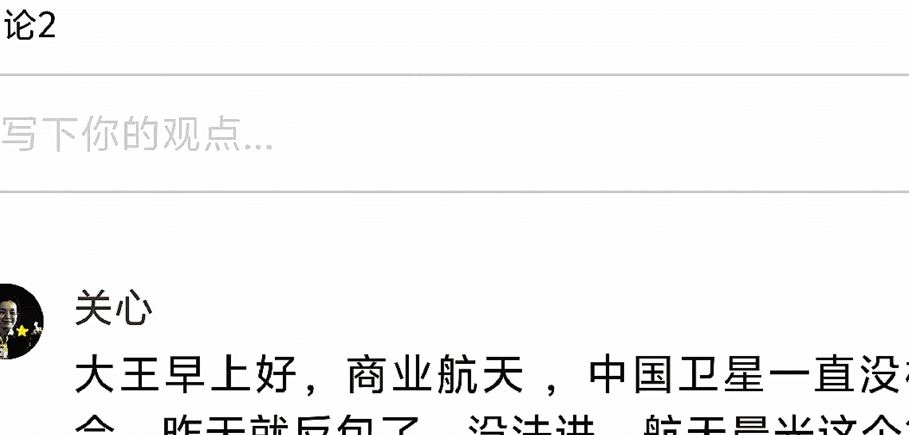

# 进入：蓝享财经院

升值

人民币汇率在不断升值，破7是迟早的事。

汇率一升，外资被动流入。

现在是金银铝涨价了，纤维涨价了，6F涨价了，中芯国际涨价了，Q布箔涨价了，原材料价格上涨，工业品在反内需行情下会涨价，带动PPI上涨，最后传导到物价上涨，消费回落，遏制宽松，完美。

这套路我们太熟悉了。

看懂？主线是谷歌男女方今天说的那几个，冷冷电源依然有机会，今天看OCS转换机会无修复。

商业航天是主线吗？不是，因为不能影响大盘。

反是大盘不好，企购，和主线互踩跳跳板。

昨天的反复，也是量化机构不想主拉的太舒服，机构进入的前奏有，有二三波，游资的杂木就没了，我们再看两波。

未解决“雷天大世”，如此提醒谷歌符合语义的谷歌电源雷能，它同时也做卫星电源，明年涨是没问题的，折合PE25倍，千万别追高啊。

付费进群:cuk255
人工进50+V加微...
加多会员免费福利

昨天3936的突破是假突破，因为没量，今天的压力在3950左右，盘中急杀不要节奏。

24 赞

# 评论

写下你的观点...

大王早上好，商业航天，中国卫星一直没机会，昨天就反包了，没法，航天板块这个算给机会吗？
2023/05/25 08:52 回复 进加微信cuk255

看了昨天的文章要站错，可是现在站隔夜暴越是大大腿了2
2023/05/25 08:53 回复 呵呵

# 深度视野优质文圈 链接优质群，助你成功

全部包含以下内容：限时年费188/年 加微信cuk255

- 1 吃群众粉丝倍时文圈加时群对话（原价 365 元/年）
- 2 子名私享亨（会）内部文章（原价 568 元/年）
- 3 政事堂（原子明）付费内容加送顺子明群聊
- 4 米联储闽【作者米糕】原价 599 元/年）
- 5 欧洲金准会员专属文章（原价 328 元/年）
- 6 传五厂内部圈（原价 400 元/年）
- 7 卢克文青读书会专属文章（原价 699 元/年）
- 8 鉴茶财经知识星球（原价 3310 元/年）
- 9 猫哥的视野知识星球（原价 299 元/年）
- 10 财新周【独家新闻】原价 1498 元/年）
- 11 杨世光在金钱（原价 2200 元/年）
- 12 森森财经知识星球（原价 1600 元/年）
- 13 源译译付费文集（持续更新）

# 深度视野文集
群微微信cuk255

深度视野（付费文集）

- 14 司马林解读毛选全套音频和全套书籍珍藏版无割（原价 2.3 万）
- 15 虚虚三部曲【民国梦、帝国争霸、不被理解的 MAO】原价 599 元/年）
- 16 卢克文知识星球文章（原价 268 元/年）
- 17 额外再送：卢阡元新浪微博付费专栏、三轩村边老王、三花九洞文集

不定期内容：（更多资源将不下去了......

- ① 守夜人司令星球、接鸽魔王知识星球、生才有知识星球
- ② 创始笔记、达沃译论星球、成付财富圈、雪花花甲老头等
- ③ A 视野、大树乡谈、江宁后、咩说、财经上海海学等付费文集
- ④ 西风付费文章、老端、赢在八小时之外、局人的视野、升值、老体制内等其它一些大V付费文集（每月不超过600 元付费文集）

# 限时年费188/年 低底链接全网V优质内容
