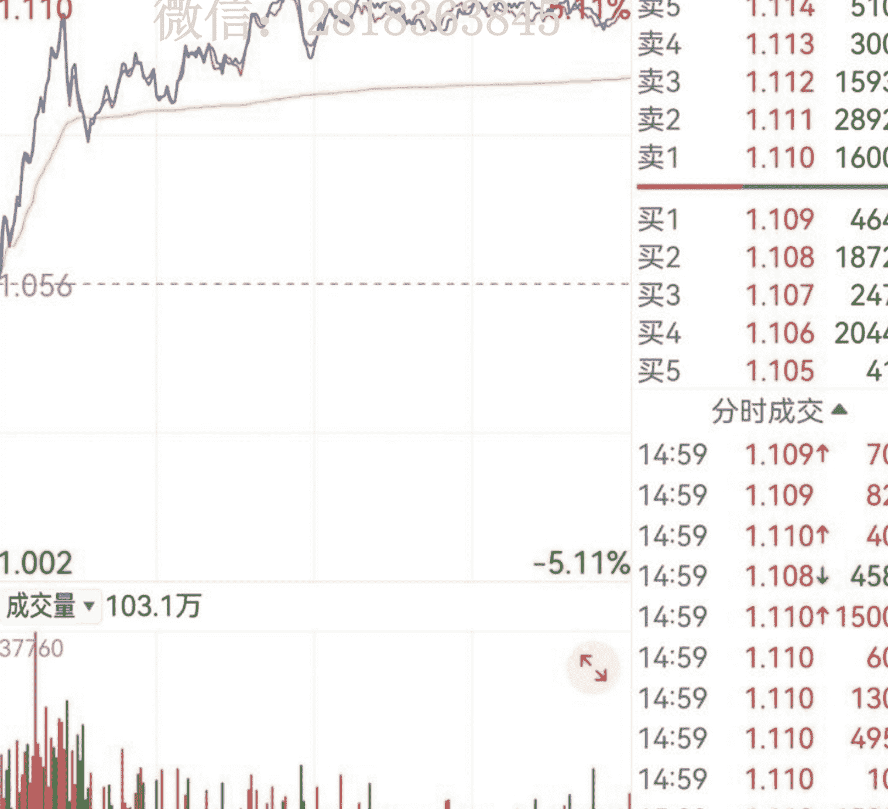
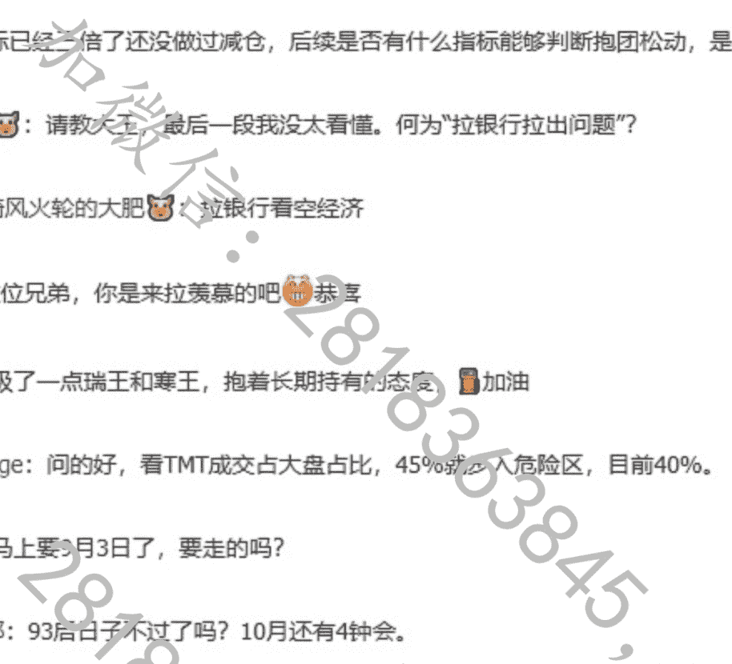
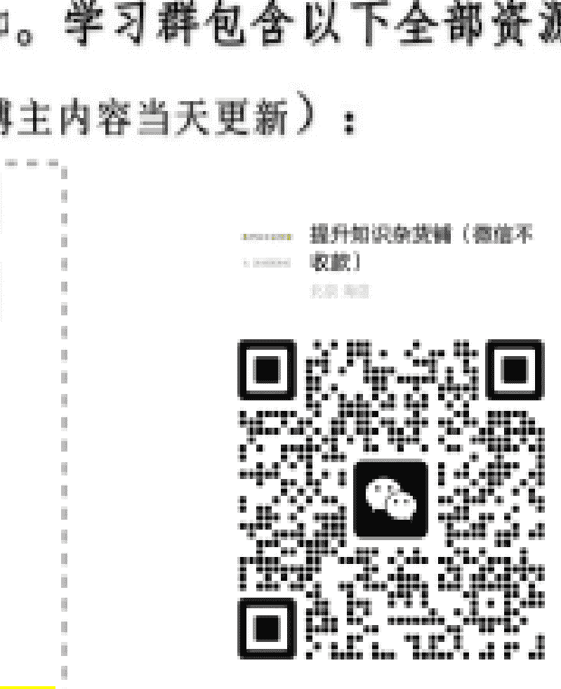

# 一起出发

双轮驱动，每一轮都有动力，这就是牛市。

科技轮子的主线，易中天的强势再次让你体会到了吧。反内卷轮子的有色和电池，一早就猛拉。逻辑都有兑现的机会，这就是“念经任何都能成佛”。

创新药，节奏点的三个很好，一个涨20cm，指数大涨5个点，牛市起飞非常剧烈，不止是重训，深V才是好机会。

像今天的电池设备，你真追进去性价比就很低，早上我们坚持持股科技为主线，专门强调华为仍要补涨图没走，大盘杀到绿没把溃住低，起码你不能割肉吧。

华为的PCB今天比英伟达PCB胜强，华为的两个模块就更流畅了。熟练利用高低原理和补涨理论，这一轮就能鱼得水。

比如SoC，王魔又上天了，全志在地上，今天还在补涨，历史新高，局局扬眉吐气，人生也是历史新高。

今天，上面上图行情跟指数，险些拉出问题。明天看点后，要不要发动上。

但是跌的，咱们只观察涨而不涨涨，而操作弹性更大。微信：2818363845，提升认知学习圈，看更多优质资源。

## 1.109 今开 1.057 最高 1.110 最低 1.056

5.02% 0.053 总手 103.1万 金额 1.13亿 量比 1.37

实时估值 1.1050 折价率 -0.36% 最新份额 2.63亿

跟踪指数 创新药 1535.22 5.05% 跟踪错误 0.32%

分时 周日 K线 周线 月线 更多

进群加微信：2818363845 tisheng2027
微信：2818363845

| 价格 | 涨幅 | 数量 |
| :--- | :--- | :--- |
| 卖5 | 1.114 | 510 |
| 卖4 | 1.113 | 300 |
| 卖3 | 1.112 | 1593 |
| 卖2 | 1.111 | 2892 |
| 卖1 | 1.110 | 1600 |
| 买1 | 1.109 | 464 |
| 买2 | 1.108 | 1872 |
| 买3 | 1.107 | 247 |
| 买4 | 1.106 | 2044 |
| 买5 | 1.105 | 41 |

| 时间 | 价格 | 状态 | 数量 |
| :--- | :--- | :--- | :--- |
| 14:59 | 1.109 | ↑ | 70 |
| 14:59 | 1.109 | | 82 |
| 14:59 | 1.110 | ↑ | 40 |
| 14:59 | 1.108 | ↓ | 458 |
| 14:59 | 1.110 | ↑ | 1500 |
| 14:59 | 1.110 | | 60 |
| 14:59 | 1.110 | | 130 |
| 14:59 | 1.110 | | 495 |
| 14:59 | 1.110 | | 10 |
| 15:00 | 1.110 | | 1500 |

1.002 -5.11%
成交量 103.1万
37760
09:30

加微信：2818363845，进群学习更多更多更多

小哥、乐山水、香萍、葫芦、小宝非非、王哥、易水长流、SONG、G等54人觉得很赞

Hygge：大王，中际已经翻了还没做过减仓，后续是否有指标能够判断抱团松动，是不是看换手率？

2025-09-01 15:10
爱骆风火轮的大胖：请教大王，最后一段我没看到。为何“拉银行拉拉出问题？”

2025-09-01 15:12
南南大王 回爱骆风火轮的大胖：拉银行看空经济

2025-09-01 15:12
Lin 回 Hygge：这位兄弟，你是来拉膜慕的吧 拜

2025-09-01 15:12
上善若水：今天低吸了一点瑞王和尊哥，抱着长期持有意的爱情加油

2025-09-01 15:13
南南大王 回Hygge：好的，看TMT成交占大盘占比，45%以上危险险，目前40%。

2025-09-01 15:13
邱望：问下大王，马上要3月日了，要走的吗？

2025-09-01 15:17
南南大王 回邱望：好的。

2025-09-01 15:18
加微信：2818363845，进群学习更多更多

## 优质资源分享

提升认知学习圈，看更多优质资源

### 一、财经博主（财经群28人，包含以下7个博主，每天更新）：

- 灵买财识星星球（原价 568元/年）
- 米粒米锦创圈（原价 599元/年）
- 大树树谈识星星球（原价 199元/年）
- 薇薇的世界识星球（原价 299元/年）
- 砖瓦广厂后Q的内部文章（原价 400元/年）
- 卢克文财经+青会会员文章（原价 268元/年）
- 卢克文青云读书会（原价 699元/年）

### 二、时事博主（时会群19人，包含以下11个博主，每天更新）：

- 子明私洽仁（原价 319元/年）
- 鉴茶识星星球（原价 3510元/年）
- 血血之家星星球（原价 2280元/年）
- 卢颖元V会员（原价 1000元/年）
- 智谷趋势研判（原价 199元/年）
- 南半球聊财经（原价 404元/年）
- 欧洲韭会会员文章（原价 328元/年）
- 树树西风云公众号付费资源，单买 29.9年
- 江宁江公众号付费资源，单买 29.9年

### 三、各种公众号付费资源：

金色通融、局外的视角、源游译语、雪球伏甲老人、幻话识你、A视野、NEO掘鱼、洛终局中、观海逐五行对市的观察、觉得的小橙、在八小时之外、雷瑞梅、盛京盛等等公众号付费资源不定更新，内容很多，不一一列举！

提升知识学习群包含以上全部内容，分享365天，赠送历史文章。

