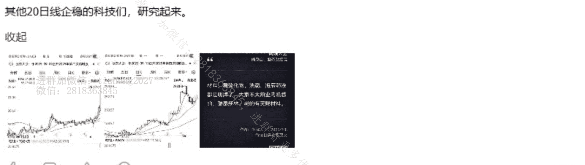
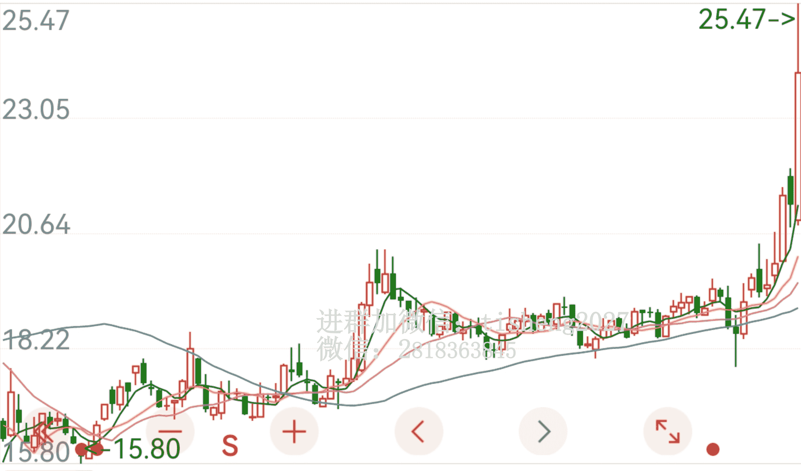
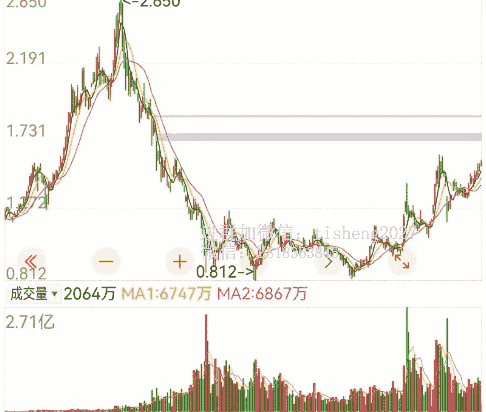

# 要看到希望

之前们下过一个判断，易中天王欧菜了，牛市也就完了了。

不亮也得没半条命。

高低切的本质，低位固然要补仓，前提是高位不能倒倒。

擂倒了，你看市场行情了吧？

周一不建议大家退高大涨的电池光伏，早上了，套路就是周末未热炒，周一专门让你盯高，周二狠狠狠下杀，让周二割肉，

如果不割，周三再来低开，你割就v了。

所以讲不追高，不缘买，

今天同时还要看到什么？

高位的科技，出来企能的态势。

虽然不能定完全的站住，但起码走了抵抗。

XYS，萧玉都是在20日拉了起来，CPO的前哨逐渐拒绝绝再放量下杀，我们专门盯过的萝卜，前天就先走出来。

之前有同学拿着川汇和萝卜，非向割不割肉，也是服了。

萝卜，给正经的“共封装光学”滤镜，未来的OSC光交换机就是腾的，可惜等了等回调。

经历过一轮的来回彻底散户先是割了高位的核心科技，再是追高割了固芯和电池，

# 等差不多，就该冲击新款更多优质资源：微信cuk255

电池，尤其是固态，明天多压这一天，两天先涨业内熟悉大家不熟悉的，后天无无意外大队可能就要涨了。

寇风冷雨的时候，我们再告诉大家，科技就是主线，校友不是一般人能的。

颜值学习性尚，缺一不可。

其他20日线企稳的科技，研究起来。

# 收起

达达、骏轩、大林、杨旭杨、时归晚、elsa~专用、火红的pzh、叶薇、美美等11人觉得很赞

涨停：明天调仓再战固态🚀

2025-09-09 15:16

杨光：今天午学学习大王的文章，入了点西域，走势也比大盘强👍

2025-09-09 15:17

上赛若水 回复 张停：没有后悔今天就去了，不过有一点位仓😂

2025-09-09 15:20

阿伟 回复 上赛若水：长阳昨天进的，希望名副其实

2025-09-09 15:24

上赛若水：新人手里没护佑，重仓科技，快趁起来狂，要不要有点不住了🚀

2025-09-09 15:24

Ryan：学习委员帮把固态大队带我们复习一遍，我只想起来先和宁王守

2025-09-09 15:30

无语：没意思？你有没看到，还是靠谱的

# 24.00 今开 20.91 最高 25.47 最低 20.80

13.05% 2.77 换手 9.66% 总手 70.84万 金额 16.77亿n总值 176.0亿 流值 176.0亿 市盈 107.44 更多

盘后固定价格: 24.00 量: 5 额: 12000 盘后分时

股东大会: 于2025-09-09召开2025年第二次临时时股...

分时 五日 日K 周K 月K 更多

均线 MA5:21.24↑ 10:20.17↑ 20:19.62↑ DK点 前复复

成交量 70.84万 MA1:42.52万 MA2:30.79万

70.84万

20250414 更多优质资源: 微信cuk255 20250909

# 中概互联网ETF
513050

| 今开 | 最高 | -- | -- |
| 总手 | 金额 | 量比 | 0.00 |
| 昨收 | 1.572 | 外盘 0 | 内盘 0 更多 |

跟踪指数 中国互联网50人民币 9886.74 0.00% 跟踪误差 0.71% >

分时 五日 日K 周 月K 更多

均线 MA5:1.512 ↑ 10:1.466 ↑ 20:1.421 ↑

DK点 前复权

2.650
<-2.650

2.191

1.731

更多优质资源：微信lishen202
微信:51890538

0.812
0.812->

成交量 2064万 MA1:6747万 MA2:6867万

2.71亿

20190906 更多优质资源：微信cuk255 退 20250906

> 摘录自：鉴茶财经院

材料，看硫化物，洗霸，海辰药液都是明牌了，大家不太熟业内内悉的，瑞泰新材，老的有奇材料。

作者：南院大王 2025/9/8 微信码查看原文

知识星环

更多优质资源：微信cuk255

