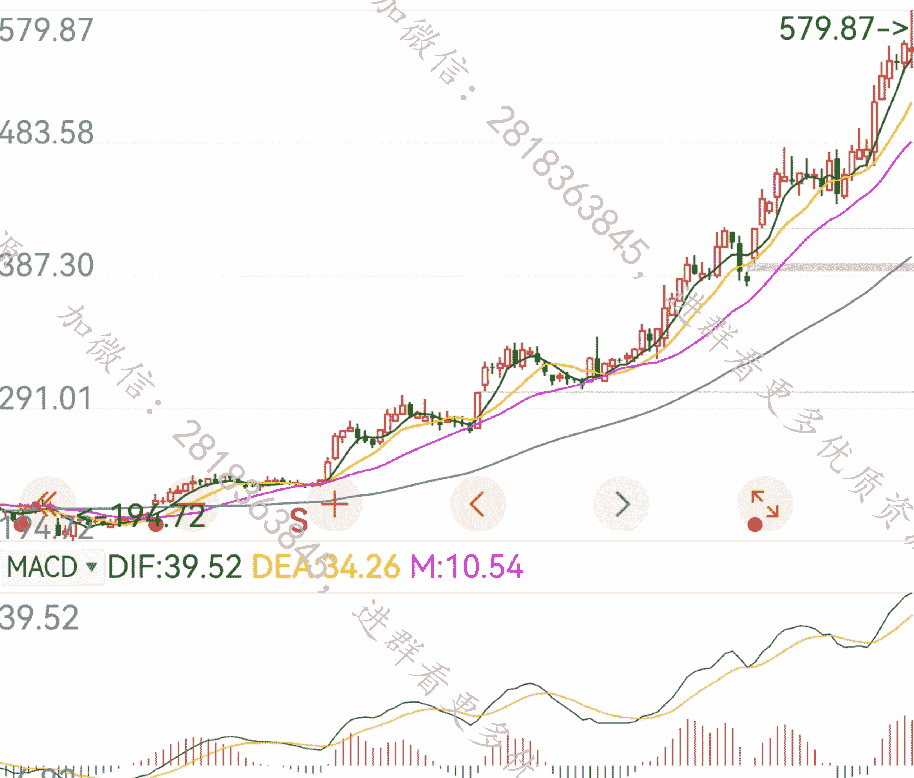

# 南院大王

2025-09-18 15:05

 冲高回落

太正常了，昨天40个亿压盘券商，就是国家队不想让涨太快。

回落无所谓，谈T的T，该抄的抄。

我们要看到什么？

主豪男方的崛起

- 紫禁之线，延伸到ASIC分支，寒王代表的Soc，到中芯，中微，飞测等代表的打铁的半导体设备。
- 华为线，华工，华丰科技等都创下新高，光闰，生益等都在走修复。
- 外外的机器人线，拓普，三花等核心链没受什么影响。

当弱不弱为强，后面看看继续看它们就行了。

郭明：1isheng021

恒生科技也给了-2%多的倒车机会。

整体界定就是假装，影响中期路线。

机构的打法就是拥抱，

拥抱的力量有多强，这是给大家讲过的游戏案例（不是购买建议，谁让那你买300多你不看），抱到天荒老地，有些客户一手手都做不起。

微信：2818636845，提升知识学习群，看更多优质资源

# 552.00 今开 550.00 最高 579.87 最低 538.00

-0.55% -3.06 换手 3.04% 总量 21931 金额 12.36亿

总值 397.7亿 流值 397.7亿 市盈 30.84 更多

分红送转:2025年中分配10派66元(含税), 股权登...

分时 五日线 日K 周K 月K 更多

均线 MA5:544.70↑ 10:512.97↑ 20:484.68↑ DK点 复复

MACD ▼ DIF:39.52 DEA:34.26 M:10.54

20250325

# 南院大王

摘录自：鉴茶财经院

紫禁之巅涨会涨什么，设备。中芯国际和各种光刻机部件，尤其是大基金三三期成立后也在投

作者：南院大王 2025/9/16

微信扫码查看原文

知识星球

胡丰展、上善若水、木炭炖楠、坏sohohai、牛店plus、胖瓜、夏、khm1995、杨志强、大师小粉等103人觉得很赞

往昔：哈哈，又是电梯硬坐的一天，一不动稳如老。……

2025-09-18 15:07
时闲羽宇：不敢做啊，晚上梦到T306，可怕接不回来了。家里就这么一个传家宝。

2025-09-18 15:09
Jenna：盘中不知道什么时候该T，有时候T飞了，有时候T早了。有没有朋友给讲的。

2025-09-18 15:09
五城：这几天高点都没涨，还是知识不知道。

2025-09-18 15:10
无赢：回复往昔：我是坐过山车，一上一一下再上，差点就跪溢血了。

2025-09-18 15:10
Sarah：大王判断太准了，虽然冲高回落，今天在最低点上了车恒科。

2025-09-18 15:10
七月和B宝：我就只想抱光科技这股，天天涨7.8个点的，是不是里面有量化妖怪。

2025-09-18 15:12
二佐徒：尾随抄了绿的频谱

加微信：2818363845，提升知识学习群，看更多优质资源
