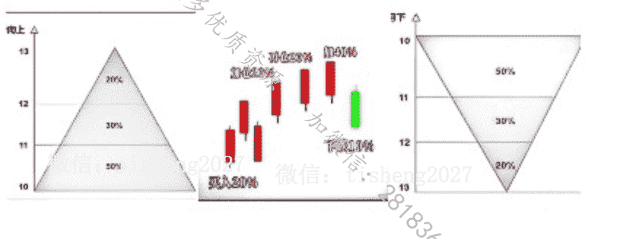
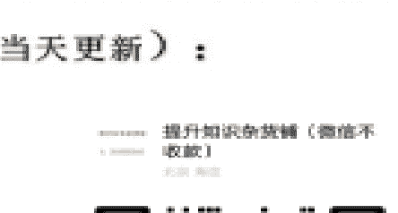
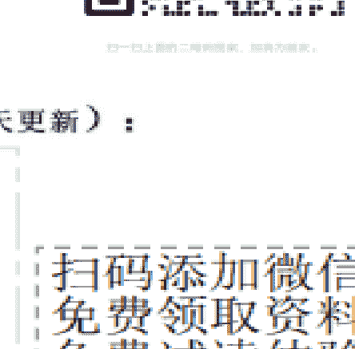

# 利弗莫尔和金字塔买入法

注：这是同一进阶的升级版。
这一轮，有些同学学空了，有些人还还没进场，很多人可能焦急的是，怎么买？

你可以明天就买，因为后天还有人进场，新人要9号才能进场，明天的局势是“空中加油”，进去的位置反正不舒服。

你也可以等到暴跌再买，它不可能永远远，熊市多长阳，牛市多长暴跌。
读书会里面有利利弗莫尔的《股票大作手回忆录》，里面谈到他的买入法：

第一，先买20%总仓位，如果跌了，亏了，你买错了，下跌10%立即止损。
此时，你只亏了总仓位的2%。2%你不肉疼吧？

第二，假设买对了，也就是它在涨涨，上涨10%立即加20%，再上涨10%立即加20%，微信:tisheng2027，最后一次直接加加40%，将胜利成果扩大。

第三，只要没有跌到-10%就持有，一旦跌10%立即将仓全部卖出，如果你非常稳健和谨慎，可以选-8%卖出。

然而，大大来只有牛市，很少熊市，所以，首次买入20%还是30%，取决于你的心理素质和承受能力。
微信:2813638455，提升提升学习学习，看更多优质资源。

然而，A大来只有赢家，很少人，首次入20%还是30%、40%，取决于你的心理素质和承受能力。

新手怕，可以选择指数，可以创业ETF，科创50ETF或行业的芯片游戏ETF等。

对于老手，亏损淘汰多化优质资源，要去打股票的，喜欢去博一下，那么，有一个方法，金字塔买入法。

上来3-50%的资金买入，上涨10%时，再用30%的资金加仓，同类再再20%。

当然还有倒金字塔式加仓，越跌越买，比如10%-20%，再买20-30%，再买10%，再买10-20%，这个在下跌期特别适用。

最后金字塔的那个尖，要设定成关键支撑位，比如3%靠靠，间隔比例多少，根据市场情况灵活把握，大部分都不会在一天内完成。优质资源

> 利腓莫尔说：
华尔街没有什么新鲜事。投机与山与丘一样老树，无论今天股市发生什么，以前都会发生，以后永远不要担心你买看不。

“而我总是，进领先的股票——表现最强趋势的股票”。
在任何领域，交易的股票——表现最强趋势的股票。

微信：2818363845，提升知识学习，看更多优质资源

提升知识学习365年（365天服务），微信扫码或微信：2818363845
欢迎进更多一手优质资源，客户都抢购。学习群包含全部资源：

# 一、财经博主（财经会员群258人，包含以下7个博主当天更新）

- 1、 灵犀财富知识星球（原价 3310 元/年）/ 单买 149 年
- 2、 鉴茶茶财经知识星球（原价 3510 元/年）/ 单买 149 年
- 3、 血焰之家的知识星球（原价 2280 元/年）/ 单买 199 年
- 4、 凡鞭元微博V+会员（原价 1000 元/年）/ 单买 79 年
- 5、 智谷趋势内部分研（原价 199 元/年）/ 单买 19.9 年
- 6、 南半球财经圈（原价 404 元/年）/ 单买 19.9 年
- 7、 洪澜的宏观概述以及众的其他财经类博主付费免费分享

- 1、 子明私享（原价 568 元/年）/ 单买 29.9 年
- 2、 米糯米联储视闻（原价 599 元/年）/ 单买 29.9 年
- 3、 大树树谈识知识星球（原价 199 元/年）/ 单买 19.9 年
- 4、 芭芭的世界知识星球（原价 299 元/年）/ 单买 19.9 年
- 5、 砖瓦幻广芒OQ的内部资料（原价 400 元/年）/ 单买 19.9 年
- 6、 萨克知识星球+青会会员会员（原价 268 元/年）/ 单买 19.9 年
- 7、 萨克文青读书会（原价 699 元/年）/ 单买 59.9 年
- 8、 芭悦俗绘会员群和对话（原价 365 元）/ 单买 29.9 年
- 9、 欧洲金会会员群（原价 328 元/年）/ 单买 19.9 年
- 10、 罗树西风萨公众号付费文章，单买 29.9 年
- 11、 江宁获公众付费文章，单买 29.9 年

# 三、各种公众号付费文章：

金政通通、局外人的视角、源泽异咏、雪花桃花后老衰的影响、费海幻话话你、A视野、NEO捞鱼鱼、冷眼潮中人、观海诸五行对股市的影响、费竟的小茶馆、赢在八小时之外、雷雷、盛京剑创、第三章观眼等等付费文章不时更新，内容很多，不一列举！

提升知识学习群包含以上全部内容，分享365天，赠送历史文章！
