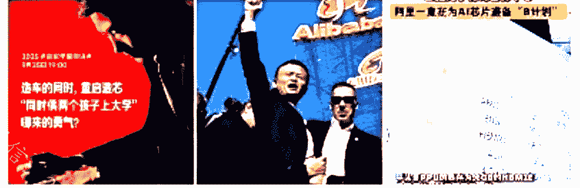
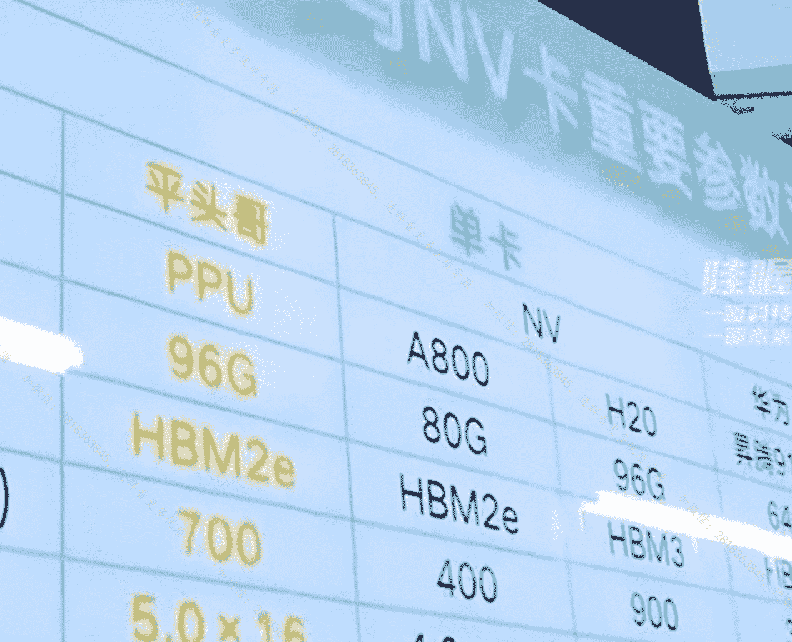

匿名用户提问：大王大王，小白第一次提问。特朗普大选前270的时候卖空的特斯拉，现在涨到444拉了，只能不断追加保证金避免爆仓。现在可以调动的资金已经快枯尽了，美联储还要继续降息，心被晾凉凉的，怎么办？

咋不早点点，只能说，长线看特斯拉的增长还有空间，一是它的机器人业务还没爆发，董事会给了马斯克1万亿美元的激励，这个好几周前就讲过了，二是后面的飞机、航天等领域他也不错，基本全是我们的十五五规划，三是他还没有去玩左脚踩右脚，如果和英伟达结给1000亿美元搞联名款...至于短线自己判断吧。你可能不了解的是，别人做空一个东西，也会同步偷偷购买它股票做对冲。

港港、GM zz、福田、洛川、从明天起做幸福的人、平常心、科学的人、Cool、卡酥、Bob等11人觉得很赞 进群微信cuk255

## 大芯片

大佬们兜了一个圈子，发现无论公于私，花钱去砸硬科技，才是最终归宿。

才能让社会满意，群众满意，上峰满意。

- 雷布斯想了很久，咬牙提出“汽车+芯片”的双核战略，家里供两个大学生很辛苦。
不知有没有一丝后悔，3年前不应该该去造车的，资产太重，战线太长。
你看华为坚决不造车，高。

- 老师回归以后，大刀阔斧，退出豪森零售、银百百等实体零售资产，整合了京东、饿了么、盒马等资源，推动阿里全面人工智能转型，要求每日汇报AI业务进展，亲自主导了昨天3800亿的投资计划。
从7月现在，阿里的美股涨了80%。

- 百度你以为没声音了，其实它的昆仑24年出货6.9万万，超过赛灵加2.6。去年还中标了中移动50亿元的大单。

那后面会怎么办呢？

美股又七回，中国有互联网巨头，可能会形成：“互联网巨头们砸钱芯片——央企和城投公司买算——提供给中小企业和社会——消费者去消化巨头们的大模型”，的良性循环。

这就是我们一直看好恒生科技的重要原因之一，建议新手新手着，你以为恒科是你买，不是的，全球大资金。美苏的三家互倒醋涨了点，它们没有平台公司，所以抓紧搞了半国产英特尔。

那么后面的大A呢？

大概还是围绕算力和半导体做文章，尤其是中芯系和先进制程，设备会接主线，总体上，设备 > 材料 > 封测 > 代工厂，中报业绩越好，三季业绩越好，昨天高高回落的基本都没有影响稳态。

进群加微信cuk255

合适通人的ETF不愁述了。总有人问券商，蹲空了打铁设备的部分老苍们，昨天资金埋伏了什么？午后的券商。

那你今天看券商科技就行了，券商动你再动。主奥男方的逻辑当然是没走的，假日期间，很可能给颜好个什么科技兴国或者技术突破的大新闻。

收起

Kevin、飞天武舞、蕾心忖得、天旻、平常心、海鸥、人生就像一滴水、阿甘正传、碧泽、时光等74人都觉得很赞

小怡牛：雷葱，国家鼓励三胎，俩还不够黄

往昔：昨天加加的文添相，突破的时候慢得靠他探杯为号

进群加微信cuk255

上善若水回复 往昔：大王说的券商科技是什么来的？🙏

## 阿里自研AI芯片“平头哥PPU”曝光
重要参数与英伟达H20相当
已经用于青海智算中心

## 阿里一直在为AI芯片准备“B计划”

平头哥PPU的显存为96GB，与H20一致
接口支持PCIe5.0，与H20一致
功耗为400W，低于H20

## 深度视野
全部包含以下内容：限时188/年 加微信cuk255

- 袁万群内部（365 元/年）
- 子明私享
- 袁事（子明））
- 米锦顶【作者】599 元/年）
- 欧洲金雀专属文章（328 元/年）
- 砖瓦内部（400 元/年）
- 卢克青读书会专属文章（699 元/年）
- 鉴茶财经知识星球（3310 元/年）
- 猫哥的视界知识星球（299 元/年）
- 财经周刊【独家新闻】1498 元/年）
- 杨世在钱圈（2200 元/年）
- 森森亚知识星球（1600 元/年）
- 激源异译付费文章（持续更新）
- 司马林解读谋选全套音频和全套书籍无损（2.3 万）
- 虚政三部曲[民国梦、帝国争合、不被理解的MAO](599 元/年）
- 卢克知识星球文章（268 元/年）
- 额外再送：卢薛新微博付费专栏、三村丰老王、三花九树文集

更多内容：
- 守夜司令知识星球、接换魔王后星球、成术译论星球、成就财富圈、雪花甲老头等
- 创始世纪、达叔达译论星球
- A视野、大树乡谈、江初好、咩咩说、财上海家学等付费文集
- 西风付费文章、老端、赢在八小时之外、局外人的视界、升值、老A体制内等一些大V付费文集（每月低于600 元的付费文集）
