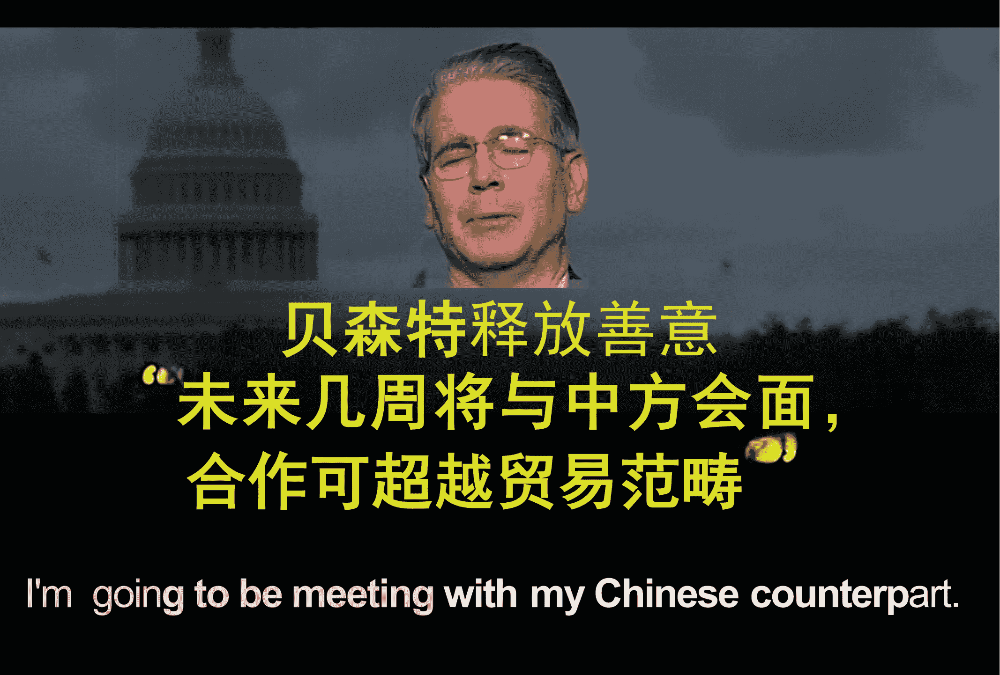
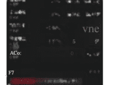

# 南院大王

2025-07-10 08:12

反内卷和英伟达扩散研究

之前的文章被和谐，调整之后后再发一下，

主打是光伏，后面延伸到电池、碳酸锂、风电、猪。

光伏目前就看最贵的硅和玻璃，硅胶最贵的是通威、大全、控股协鑫，玻璃最贵的福莱特、金晶科技、东日等。

PCB 如果没有早入胜蓝生蓝莱之类错错50%，空的主力现在电子布和铜箔。

电子布代表备，宏和科技、国际复、生益科技等，有几个反正也买不到，有点预期差，但弹性不够大，同时兼电子布、军工、导弹、核电的概念的菲莉华。

菲莉最大的问题是里面的机构太多，有利有坏。

微信信号jntsg2
微信号:jntsg2
免费资料群

铜箔是德福科技、广合科技、铜铜、金安国纪。

光模块旧，易中天太辰光和后面那些，低市盈率的早上来，

今天可能铜锂里继续流入，

位置低，就是王道。

铜镍谈谈，沃尔尔核材，瑞可、龙龙互联，我们熟悉的老朋友博博，之前主宰的是铜缆，收购的长芯后进一步深化光伏模块/光伏领域，

还有一个开发北美市场预期的，联特科技，

弹性风险也大，仅供超高手护鉴。

弹性大风险也大，仅供超高手打鉴。

以上仅供学习，自己不够接费手机分批次玩低的，如果是新手菜鸟，还是看确定性更好的游戏，创新药等，ETF更稳，如游戏ETF，港股创新药ETF。

更稳的是你在绿盘时吸险做T，新华是投资资本市场激烈进出钱最多的多的。

当然，以上板块不是天天涨，机构的做法，总要调整，进退进进，所以不要追高和上头，跟着轮子动走。

要搞你擅长的，有手感的，能让你赚的总让你赚。

反内卷只是刚开始，

后面还会有。

“取得一定成效”、“
“取得积极成效”、“取得成效”
“取得显著成效”。

最终，

“获得圆满成功”。

收起

# 贝森特释放善意

“未来几周将与中方会面，合作可超越贸易范畴”

I'm going to be meeting with my Chinese counterpart.

邱邱：大王，光伏里隆基，爱旭咋样？

2025-07-10 08:32

**南院大王回复** 邱邱：BC电池也能受到扩散

2025-07-10 08:45

**乐奕昂回复** 南院大王：大王，协同数据还有没有钩子？

2025-07-10 10:34

**萧露喜洋** 中报业绩对创新新药短期影响大不大

2025-07-10 08:55

**独门功夫**：大王，像下面这种光伏龙头ETF和生物医药ETF，累计净值都跌到三四毛了，现在进有机会吗?

2025-07-10 08:56

**Amey**：博创20cm大长腿

2025-07-10 10:10

**城志**：大王，6月13日的文章没看到：
“英伟链的补涨和二供扩散研究”
是发表在其他群了吗?

2025-07-10 12:26

**南院大王回复** 城志：今天不就是

# 鉴茶院运营-思想

通信行业深度报告：AI 驱动光铜共进，AEC等受益于高速短距离连接需求

- 20250708-开源证券-通信行业深度报告：AI 驱动光铜共进…
查看详情>

人生就像一滴水、羚轩、孙晓艳、呵呵、G、山野村夫、叶枫、充电宝、小鱼儿、征尘等14人觉得很赞

# 鉴茶院运营-思想

无人车行业深度：AI 驱动无人车技术持续发展，智慧物流有望迎来快速发展期

- 20250708-东吴证券-无人车行业深度：AI 驱动无人车…
查看详情>

人生就像一滴水、羚轩、孙晓艳、杨志、山野村夫、叶枫、充电宝、征尘、上冻的菜头、Dr •Lee 等12人觉得很赞
