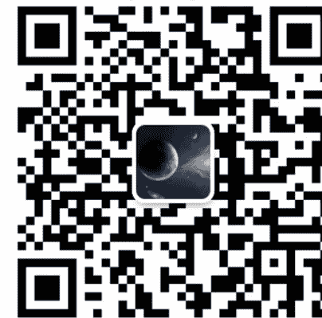
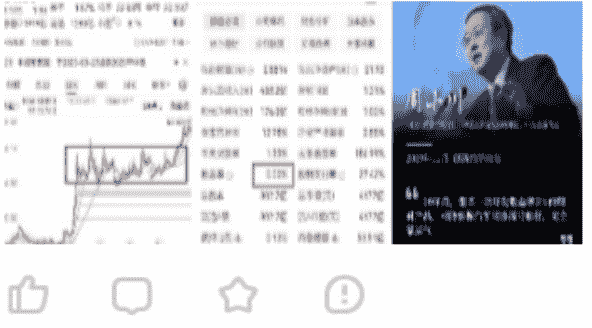
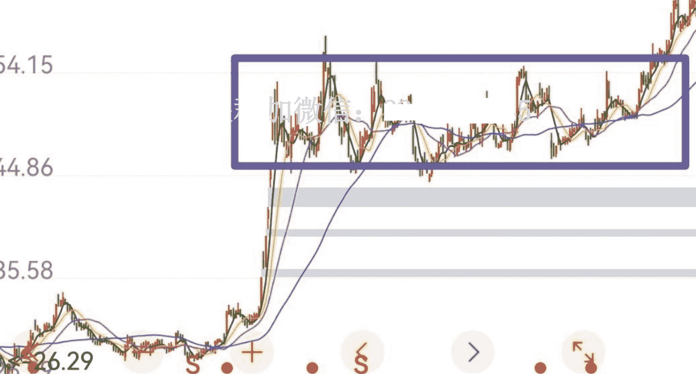
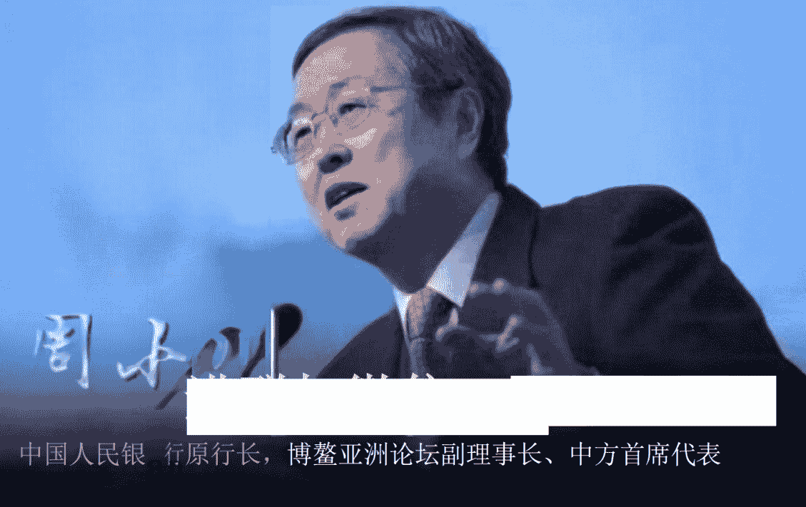

# 南院大王

2025-07-11 11:55:30

## 杠铃市场

市场就是两端，

一端的高科技和成长股我们不提了，涨的，有体验，特点是起伏大，难度高，体验不好。

一端是银行的高成长股，主力高度控盘，涨的慢，没快感。

昨天很多人投买了银行，结果银行今天给你来个冲高回落。

机构买银行看什么？股息率，4%的分红和回报太实在，资产慌。

知道很多人下不了银行，所以我们多次给大家讲了躺平概念，保险。

今天再跟大家深刻刻逻辑：

- 1. 新华和保险是4%的股息率，超过很多银行，银行现在正在加速，很多垃圾一起起涨。
- 2. 他们是救市的主力，银行的钱是他们自己的。
- 3. 保险资金入市是保费的30%，大约9万亿，目前入了3.5万亿左右。
- 4. 很多银行早就新高了，保险刚刚脱离2024年的高点，盘整了整8个月。
- 5. 保险真的只有4家上市的，比银券商稀缺。

123是宏观，456是微观。发生金融危机，国家会救险保险公司，不一定救银行。

要说国家队真是害事的，你不买我就效劲，强到你买为止，成功把一堆量化、大散户，杠进了垃圾商城行农商行，它们叫做“化债人”。

jntsg2 免费进资源群

jntsg8

其他拿着题材和业绩的不要急，给国家队一点时间，好让他们腾笼换鸟。

收起

0和1、飞雪、上沫的菜头、蝉娟、福、华仔、敏、吴文峰、Qi7、佛爷爷等73人觉得很赞。

小宇：gjd，牛b造 2025-07-11 15:32
小宝非宝：扶我起来，科技人不值

小字：gjd牛b 2025-07-11 15:32
小宝非酋：扶我起来，科技人不哭 2025-07-11 15:40
涨不停：不眼红，不参与，割不着🙈 2025-07-11 15:42
向阳而生：感谢大王，入坑也很久了，之前只做ETF面，第一个韭就吃到小肉，新华四个点已挣。请大王加大力度，小小白如此易易操作的指导，加微信pep458 2025-07-11 15:46
MLQ：大王说对，我们国家队真的不输给太人的，服务于整个国家。大王要在保险里做T，是一种策略啊 2025-07-11 15:48
南院大王回复MLQ：在时代的一粒沙里打滚💩 2025-07-11 16:01
五城：没看到，啥情况 2025-07-11 16:16
Send：这一周多，我就死咬着没买 2025-07-11 17:18

## 61.50 今开 59.59 最高 63.43 最低 59.58

3.19% 1.90 换手 1.57% 总手 32.83万 金额 20.25亿

总值 1919亿 流值 1283亿 市盈 8.15 更多

H股报价: 43.50 3.45% (A/H比价=1.55 >)

## 中报预披露: 于2025-08-29披露2025年中报

分时 五日 日K 周K 月K 更多

均线 MA5: 60.32↑ 10:59.69↑ 20:58.57↑ DK点 前复权
55:53.76↑ 63.43->
54.15 44.86 35.58 26.29

KDJ K:58.10 D:60.65 J:53.00

## 浦发银行

13.80 -2.82%

+ 股吧 盘口 资讯 公告 研报 财务

## 复盘必读

## 公司概况

## 财务分析

## 股本股东

## 核心题材

## 分红融资

## 交易数据

## 大事提醒

| 项目 | 数值 |
| :--- | :--- |
| 每股收益(元) | 0.5814 |
| 每股净资产(元) | 21.93 |
| 营业总收入(元) | 459.21亿 |
| 营收同比 | 1.31% |
| 归母净利润(元) | 176.0亿 |
| 资本充足率 | 12.98% |
| 净资产收益率 | 2.55% |
| 不良贷款率 | 1.33% |
| 拨备覆盖率 | 186.99% |
| 股息率 | 0.00% |
| 股利支付率 | 27.42% |
| 总股本 | 302.7亿 |
| 总市值(元) | 4177亿 |
| 流通A股 | 302.7亿 |
| 流A市值(元) | 4177亿 |
| 质押比例 | 0.13% |
| 商誉规模 | 53.51亿 |

中国人民银行行长，博览亚洲论坛副理事主席、中方首席代表等

# 2019年11月创新经济论坛

> 10年后，想买一款年化收益率3%的理财产品，可能像汽车牌照摇号那样，完全靠运气。
