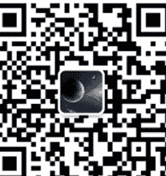
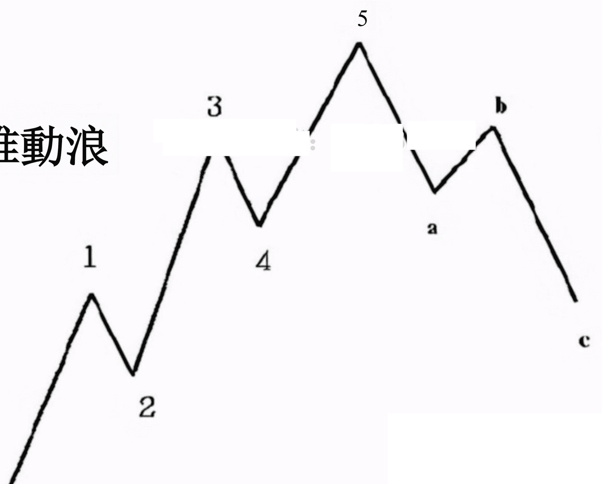

# 易经第22卦(下)-牛市的演进阶段

所有的化妆，都是人工的，牛市也是。

就跟小姐们化妆要有路径，得先洗脸，再用爽肤水，再用粉露，再用粉底，再用眼影一系列装饰流程。

微信号:jntsg8
微信号:jntsg2

牛市也是分阶段的。

免费进资料群

## 初九：贲其忌，舍车而徒。

象曰：此弗弗乘也。

给脚趾做美甲，是为了凸显漂亮，理应有车不坐，徒而行。

装扮和炒作，都是先从小的题材开始的，牛市的第一阶段，一般不涨大盘，而是涨蓝筹股。

而蓝筹弹性更大的是什么?券商IT，又称金融科技。

所以，如果你看到券商涨，快的可以去搞给券商卖铲子的，什么东方财富，大智慧之类，如果它同时有跨境支付和稳定币的概念，更好。

## 六二。贵其须。

象曰：贵其须，与上开兴也。

修饰自己的胡须，和上面的意见保持一致。

美甲是女孩玩的东西，是试探。胡须，是朝堂和威严的象征，要跟着领导的意志。

第二阶段，指数和大盘开始上涨。

为了拉指数，资金买入宽基ETF，而目前这个阶段，沪深300的主力就是银行。

所以买指数成了牛市必备功课之一，如果你下手不了银行，还有调整的保险。

## 九三。贵如，濡如，永贞吉。

象曰：永贞之吉，终莫之凌凌也。

向前奔跑，爽的汗都出来，不长时间的情况，而得吉兆。

一直能跑得很，因为没有人侵凌正君子。

这就是牛市第三阶段，遍遍，各个板块轮动上涨，跑的又快又高，宏观，微观，技术，资金同频共振，没有人能忤逆大势。

“濡如”这个词，说是汗水在肌肤上闪着光泽，极度贴切的形容了牛市的加速阶段。

## 六四。贵如，嬉如，白马喻如，匪婚婚妇。

象曰：六四位疑也。匪婚婚妇，终无尤也。

奔跑气呼呼，太阳辣辣这时看到高头白马，向前飞袭。

原来不是来抢劫的，而是来娶亲的，疑虑冰释，终无灾祸。

牛市第四段，通常会遇到较大的，突然的暴跌，却没有调整依然继续向前。

但此时，你就要“当位疑也”，高位需要警惕了，开始逐步止盈。

## 六五。贵于圆，东郊戈戎。吝，终吉。

象曰：六五之吉，有喜也。

白马王子过来，来婚怎么求呢？

装饰圆丘，又拿出薄薄的丝绸，虽然略有遗憾觉得小气，但终运吉祥是个喜事。

此时已进入牛市的第五阶段，收获还是有的，结果还是好的，但是已冲顶阶段，鱼尾行情了，与你的期望有差的。

此时，你只能在“圆丘”，就是主线板块的前排抱团核心捡些利润的慢慢开始涨不动了。

## 上九。白贲，无咎。

象曰：白贲无咎，得志也。

到了最高阶段，你发现不需要任何装饰的，洗尽铅华，返璞归真才是最美的。

牛市到了最终的阶段，是繁华褪去，价值回归，回到初始纯净状态。

白天瑰丽多彩，惊艳众人，到了晚上，你总是要卸妆的；

牛市轮动上涨，反复逼空，到了高峰，总是要回回归的；

一切，都是一场人为的绚烂烟火。

这就是易经第21卦，贲。

第22卦，就是“剥”卦，讲牛市过的下跌和大调整。

你会发现，这和艾略特的“五浪模型”如出一辙。

只能说大道相通。

“不是爱风尘，似被前缘误。花落花开自有时，总赖君主。也终须去，住也如何。若锦山花插头，询问火归处”

## 波浪形态基本结构

| 推动浪 | 调整浪 |

