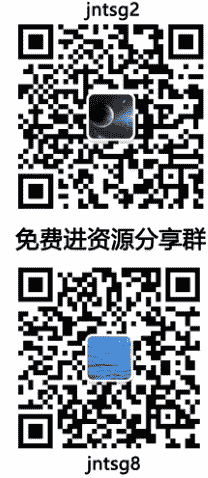
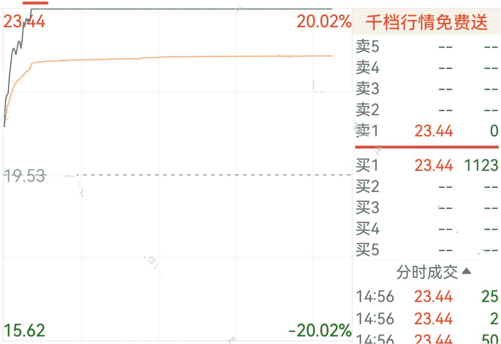

南院大王
2025-07-24 15:17

反内卷的风，今天吹到了碳酸盐，连带着10倍PE的逆变器。

半个月前，加上昨天，专门又梳理了下反内卷块都有些家伙。

这就是轮动，不用追涨等风来，

拿了有机硅也不用担心，今天~4.5%也逐步拉上来。

铜链接和光模块杀跃正常，懂王乱喊话，牛市多爆发。

市场，就是反内卷和高科技的双轮驱动，

手快的同学可以搞高杠杆配置，

反内卷的，科技的，各有一部分，

不够快的，拿住一个领域，

不够专业的，更稳健的看ETF，

现在创业板~反内卷，

叶枫同学不是和大家发了159977，

恒生科技ETF有外资加持是低位，

机器人ETF有长线定价值。

比如创新药的映射，就是CXCXO。

# 23.44 今开 20.67 较高 23.44 最低 20.45

20.02% 3.91 换手 27.01% 总手 61.85万 金额 13.81亿 总值 194.3亿 流值 53.68亿 市盈 1022.42 更多

盘后固定价格: 23.44 量: -- 额: -- 盘后分时

限售解禁: 2025-07-28 预计解禁数量6亿股, 占总...

分时 五日 日K 周K 月K 更多

| | | |
| :--- | :--- | :--- |
| 卖5 | -- | -- |
| 卖4 | -- | -- |
| 卖3 | -- | -- |
| 卖2 | -- | -- |
| 卖1 | 23.44 | 0 |
| 买1 | 23.44 | 1123 |
| 买2 | -- | -- |
| 买3 | -- | -- |
| 买4 | -- | -- |
| 买5 | -- | -- |

分时成交 25

14:56 23.44 2
14:56 23.44
14:56 23.44

西山蝴蝶兰：天齐今天出了一部分，等了快一年了，终于等到了
2025-07-24 15:15:19

小于儿：铜矿今天大肉肉简直太香了
2025-07-24 15:15:24

123：我有铜了
2025-07-24 15:15:29

牛皮市：大王，如果房地产产内卷的话，看哪些比较好
2025-07-24 15:15:34

其乐荣荣：大王，我已经加入两个星球，希望加入交流群，请问怎么加思思的微信
2025-07-24 15:15:43

鉴茶院运营-思思回复其乐荣荣：加我微信

2025-07-24 15:15:48

星辰回复小于儿：昨天我还在问呢
2025-07-24 15:15:57

南院大王回复牛皮市：等建材卫浴反反，地产主要看月长老老大大会
2025-07-24 16:16:02
