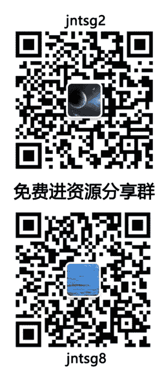
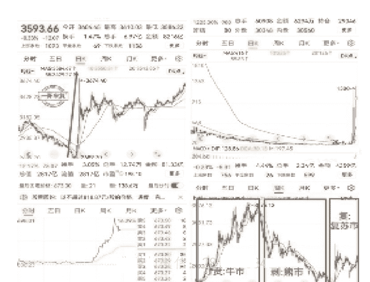
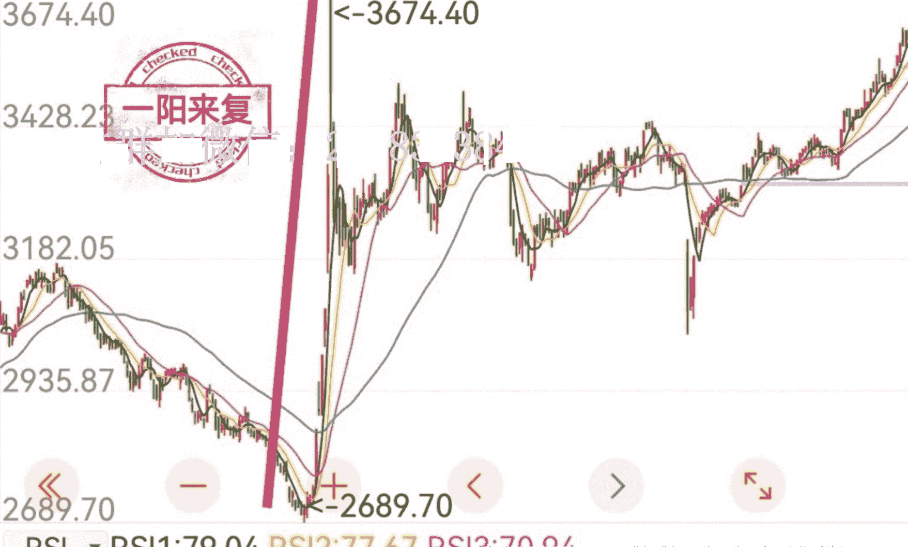
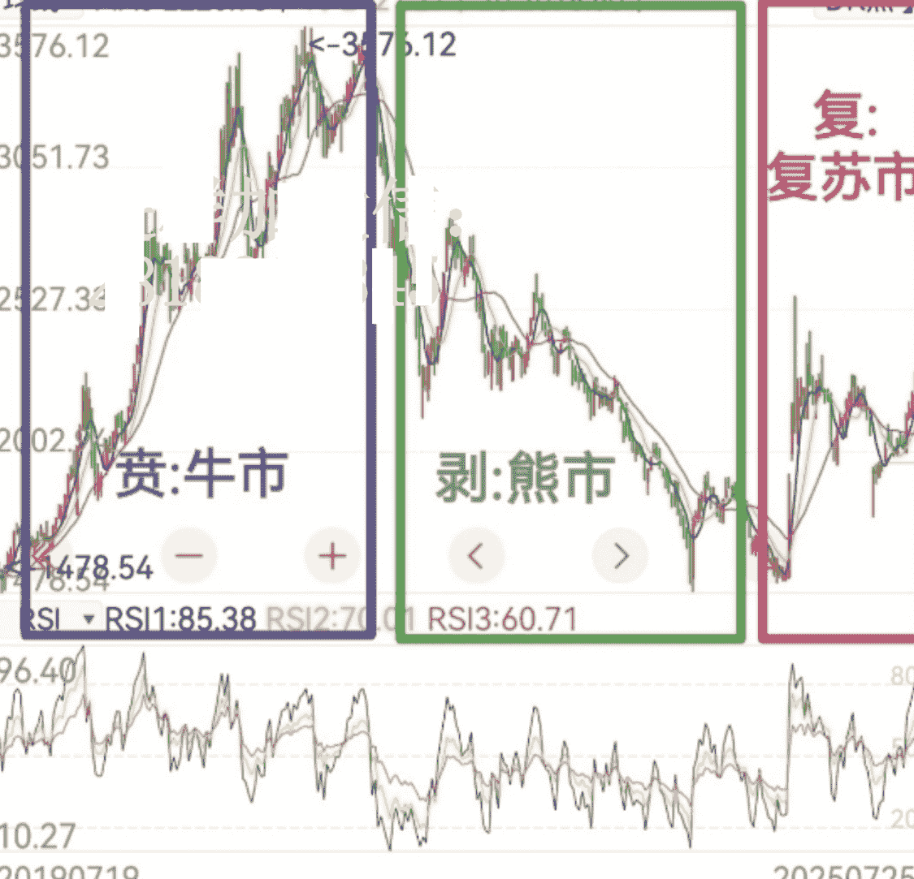
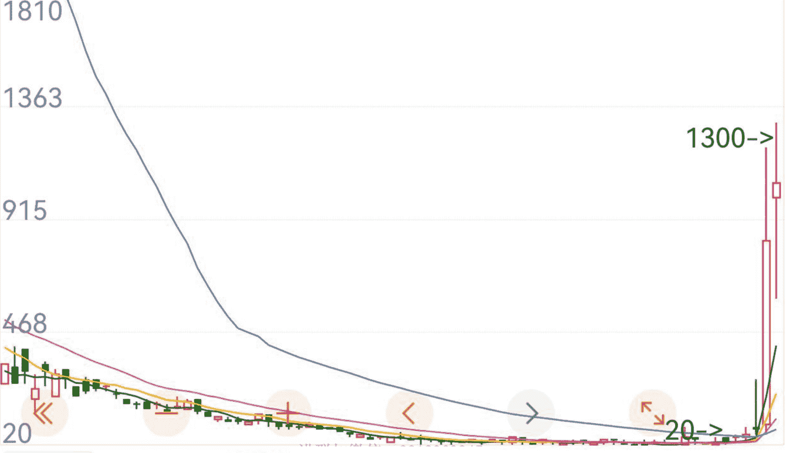
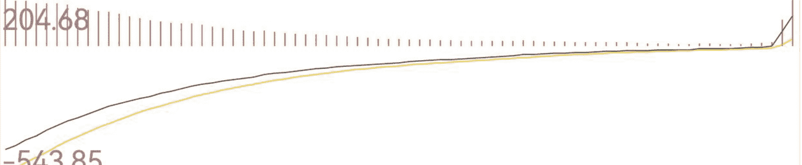
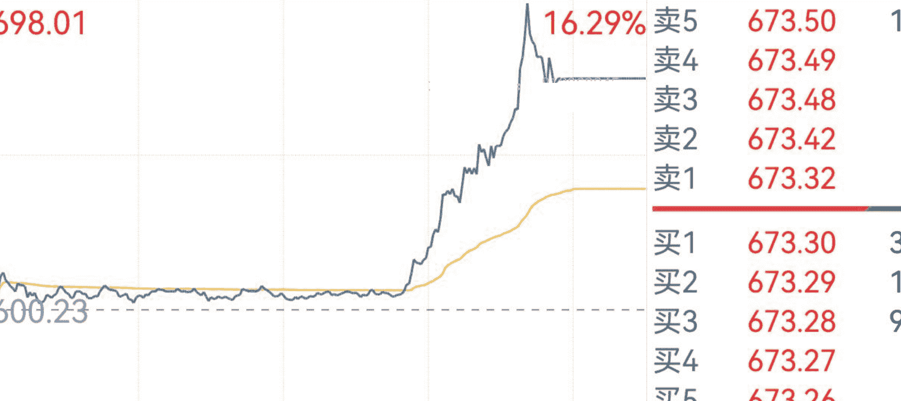

2025-07-02:26:09:51
# 易经第24复（上）：地上拨霓，百点长阳

前几天有人问，你在哪里耕牛市？

易经第23卦，是艮，人工牛市，一片大浪，
易经第24卦是剥，剥脱，剥落，熊市，
但剥到了极致，横住盘否拒绝再跌了，
那就会“一阳来”，“万象更新”。

上周五，资金是不是寻路涌进牛市的半导体和国产算力，牛到极致走熊，熊到极致走牛，轮轮循环，生生不息。

也是第24卦“复”，

10年前人们涌入互联网大厂摒弃体质，
现在人们拥体摒弃体质企业，再过几年可能又倒过来。

宇宙和人间万事万物，都是在玩高低低的，在高低低循环中一轮又一轮的变换。

真正妙炒股票，好好投资，规划自己的人生和未来，上来不是先看到几个代码，而是先通透智慧。

免费资源分享群
jntsg8

不然，你何以平静持仓，不为所动，一定是会卖飞牛股，割肉底部。

世界上最伟的力量就是时间，它一定会促进进值的回归，

“亨，出入无凭，朋来无咎。反复其辞，日来日去，有利攸往”。

复击，是亨通的。出门出君无问题，对外外交也毫无无。万物运行周期，并且反复循环，你要在转折点蓄力待发，迎接新的机遇。

“象曰：雷在地中，先王以至日闰，商旅不行，后不省”。

复具体的意意的，是坤上震下，大地上，雷声在下，内部在酝酿蕴的力量，先王看到这种Perhaps，关闭城门，谢诸商旅，也不视视地方自身，酝酿能量，以待春天。

每一个优秀的人，都有一段沉淀的时光，那段时光，我们付出了很多努力，却默默无闻也看不到结果，那段蛰伏的日子，我们把它叫做护肝。

如此朋友，如果你现在不太好，请不要放弃，积蓄力量，等待自己的时刻；如果你现在很好，请戒骄戒躁，百尺竿头，寻求自己的增长曲线。

横有多长，就有多长，正可谓，

金鳞不是池中物，一遇风云就化龙。

一阳来复是什么图形，经典的就是924行情，这几天的，放两张图大家体会一下。

当然仅为示范不构成建议，复了之后怎么参与，我们下篇再说。

收起

## 枫：万物皆周期！

循环往复，人生皆如此

2025-07-26:10:50

智字：大王，英伟达链的PCB、光模块都创新高了，国产算力链的PCB、光模块是不是迟早也会创新高

2025-07-26:11:17

飞雪回复叶枫：

2025-07-26:12:53

南院大王回复智字：华为的华工科技就不新高了吗，国产算力链看的是芯片和AIDC，这两天会话

2025-07-26:14:48

牛王魔回复南院大王：下一个资金修复的版块医疗还在底部聚聚市

2025-07-26:16:57

陈.W.M：大王，能分析AI眼镜未来一两年的走势吗？是否可以重点关注，有哪些受益个？

2025-07-26:20:22

南院大王回复陈.W.M：眼镜的核心不是soc

2025-07-26:20:40

叶枫回复陈.W.M：目前几个比较突出的：附加智能功能后的轻化，续航发热问题，算法卡延迟及信息处理能力，部分体验者反馈还带着晕头，性价比比等等，小米的发布会没进多少，看阿里的能有多少进步

2025-07-27:00:09

## 上证指数
000001
## 3593.66

今开 3604.45 最高 3610.03 最低 3586.22
-0.33% -12.07 换手 1.47% 总手 6.97亿 金额 82166
上涨家数 1093 平盘家数 69 下跌家数 1156 更多

分时 五日 日K 周K 月K 更多

均线 MA5:3584.67 ↑ 10:3550.31 ↑ 20:3513.85 ↑ 55:3429.27

## 创业板
399006
2340.06 今开 2348.28 最高 2350.06 最低 2332.02
-0.23% -5.31 换手 4.44% 总手 2.34亿 金额 4359亿
上涨家数 756 平盘家数 26 下跌家数 599 更多

分时 五日 日K 周K 月K 更多

## 碳酸锂25年月购100000
1060
12.50% 昨结 980
今开 1000 总手 6098
最高 1300 金额 6294万
最低 600 持仓 2904
内盘 3056

分时 五日 日K 周K 月K 更多
均线 MA5:416↑ 10:255↑ 20:126↑ 55:83

MACD DIF:128.86 DEA:30.13 M:19.45

## 673.30
今开 599.53 最高 698.01 最低 599.53
12.17% 73.07 换手 3.05% 总手 12.74万 金额 81.33亿
总值 2817亿 流值 2817亿 市盈率 98.10
盘后固定价格: 673.30 量: 21 额:138.6万
盘后回购:以不超过818.87元/股的价格，进度:完...

分时 五日 日K 周K 更多

16.29% 卖5 673.50 18
卖4 673.49 8
卖3 673.48 8
卖2 673.42 2
卖1 673.32 2
买1 673.30 35
买2 673.29 16
买3 673.28 94
买4 673.27 4
买5 673.26 2

分时成交↑
14:56 673.50↑ 42
14:56 673.28↓ 83
14:57 673.28↑ 25
15:00 673.30↑ 228
600.23 -16.29%
502.45 成交量 12.74万

## 大王，给看看鼎秦高科前景如何

查看详情>

征尘、玲轩觉得很赞属于补涨品种，目前线没啥问题，二线PCB龙头是景旺，基本都看风向，整体已经鱼尾阶段，将由海外转向国产。

南院大王：pcb后排
2025-07-26:14:50

蜜麻喜洋 回 南院大王：锐捷网络算国产算力吗
2025-07-26:17:40

南院大王回复蜜麻喜洋：算
2025-07-26:18:25

山 牛王回复南院大王：阿宝呀!
2025-07-26:20:52

2 钱塘回复 蜜麻喜洋：锐捷网络也是高高在上了。
2025-07-26:21:40

蜜麻喜洋回钱塘：希望能再创新高
2025-07-26:21:41

黑洞先生回复南院大王：大王，国产能力看哪个板块或者哪个个?
2025-07-27:13:29

JIU 回南院大王：请问大王，东山生益他们算不算国产算力呢
2025-07-27:13:37
