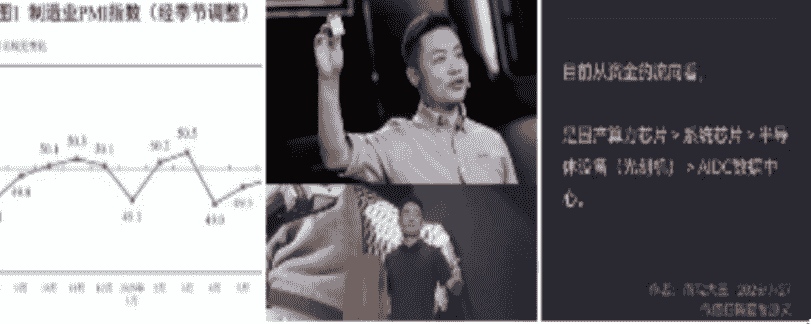

# 南院大王
2025-07-03 11:05:30

## 迎接八月新结构

好端端的机构抱团

碰到大盘调整，H20的后门问题，两边谈判的结果不是非常理想，关键是PMI又跌了，打断反弹势进行调整。

但我们看到了什么，

- 1. 海外算力依然在抱团

PCB，光模块的后排零件等，依然可以补涨，调整并未深竭。

但此时，如果没有筹码再搞搞他们，就不划算了。

有资金进到算力链的低位，液冷电源开始表现了，英维克、麦格米特、高澜、川环、欧陆通、科泰等、老朋友们。

目前看，液冷比电源强。

GB200和300全液冷，也符合产业趋势。

要看海外算力链，可以在调整后再看看液冷电源了，PCB崩溃之后它偶会不会单独行情，要观察，如果行，那就可以走一段。

- 3. 算链有些分化，鼎通历史新高，瑞可补涨，其余几个还有调整，但我们认为还没走完。

国产半导体依然集中在芯片领域，东芯要翻颓的架势，当时世界算力大会主要看个它的图上看，没上车的只能目送。

海外算力要回国产算力，如果这么看，寒王属于低位，有点冷笑话。

- 5. 今天异军突起的是AI应用，其实一直在涨，但因缺乏龙头没有太多关注，拓尔斯，万兴科技，蓝标的图能看，也不用上头。

- 6. 军工依然趋向向上，整体图形没有走坏，不会看图的就属无缘，无人机继续好看。

这是上证的第一次大阴线，如无意外，明天要来修复。

八月，在高低间迎接新王诞生。

市场就是一个机构抱团，我们就看谁在抱团，然后跟上。

收

一路长红、Iwm、沐离、钰锚、王景云、山野村夫、沉静如海、LINKE、Jerry，都是出来的等45人觉得很赞

七月和B宝：我在东芯满腹流油
2025-07-31 15:34

# 知识星球TOP资源分享群

星辰回复七月和B宝：翩倍
2025-07-31 15:37

七月和B宝 回复星：希望
2025-07-31 15:41

让更多人获取高价值信息
让聚焦网付费资源

公众号：知识星球TOP

添加微信免费进群

| 付费文章 | 付费社群 |
| --- | --- |
| 付费课程 | 副业&搞钱 |
| 财经&股市 | 行业报告 |

妞姐：反内接接下来会走出来吗？谢谢
2025-07-31 15:42

叶枫：ai应用的医疗，能看吗？微创这就结束了？
比如卫宁、东华、优威联360！老玩家 商汤

时政·历史·职场·体制·自媒体
学习·军事·软件·影音·社会学

莹：大王再说一下王王吧

南京大王 回复 妞姐：爸，今天还是是因为有人失望了，失望留了分歧的机会来了。
2025-07-31 15:44

和光同学：祢中知道在“边界认知”，要像大盘突破关键压力位那样，一次去尝试，带量突破的那天，就是站在新高度的时刻。
一直在路上。
2025-07-31 15:48

