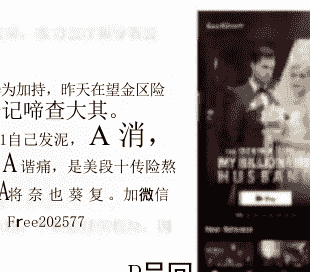
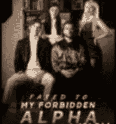

# 南院大王
2025-07-03 15:18

十年后的趋势性关键性问题

反内卷的风，陆续吹到锂电、汽车、风电、猪肉。

旧产能涨了不重要，谁是涨的新产能非常重要。

2015年，过去的产能是煤炭、钢铁、水泥，但萌芽的是光伏、锂电、汽车。

然后他们整整了8年。

2025年，去的光伏、锂电、汽车，那么，谁是新一轮的受益者和新的宁王、迪王们？

看趋势是以下几个:
人工智能、创新药、机器人、新消费、文娱传媒。

上一轮，叫做“战略新兴产业”。

微信号:jntsg8
微信号:jntsg2

这一轮，叫做“新发展格局”。

免费进资料群

你看高层会议后，浙江的表态，
《趋势性关键性重大问题》明牌了。

2015年时，大家看新能车模糊，就像现在人们看AI制药迷模糊。

其他几个产业也一样。不用在意的那点电风扇，看住新的小甜甜。

看，浙江的出海新三样：
网文、网剧、网游。

什么《霸道总裁爱上我》、《开局继承二十亿》、《白精英爱上保洁大妈》、《重生之在纽约当大亨》之类的，老老一样看。

衡阳农村会议的共识，是六大产业：
1. 梧桐红色产值重点产业
2. 加医疗人工智能精准医疗
3. 移动养老服务养老社区
4. 大力制造转型升级
5. 现代手工艺文、网购、网络
6. 科学规划“十五五”

者布局为有的，并无现条款保险公布自己查看。跟学的学已发展。AI、AI错，是美股十分熟热无比。等待也复。加微信FP2023277 看看详情

城址、DZ、上的道菜、菠萝蛋、福、大周-敬真我、Candy、飞雪、花花等50人都觉得很满意。

lesie:求课代表指标
2025-07-03 15:20
向上:求课代表
2025-07-03 15:24
红与蓝：多读几遍。学渣表示。
2025-07-03 15:25 v:tisheng2027
梁丽博:靠力卫宁东华（注：此处可能为OCR识别错码或特定术语）

# 趋势性关键性重大问题是什么？

根据昨天会议透露的信息，是六个方面——

- 1、构建浙江特色现代化产业体系
- 2、加速打造人工智能创新发展高地
- 3、主动融入和服构建新发展格局
- 4、大力推进消费转型升级
- 5、积极推动以网文、网剧、网游为代表的文化“新三样”出海
- 6、科学谋划“十五五”发展

可见，深化研究、深入回答好这几讨论过两家，赛力医疗和睿智医药。

前者有华为加持，昨天在瑞金医院公布一些癌症筛查大模型。

其他的同学们自己发掘，AI制药、AI金融、AI营销，是美股十倍股集中区域，大A将来也要复制的前市场，不要追任可板块。

作者：南院大王
摘录：鉴茶财经

# ReelShort
# ReelShort
# Upcoming Next
Nov 18
Nov 25
Dec 2

# THE DOUBLE LIFE OF MY BILLIONAIRE HUSBAND
# Most Trending

The Double Life of My Billionaire Husband Hidden identity
Sebastian Klein is the bastard son of the lein family. Rumor has, he's a good for nothing loser who just got released...
Play

# Fated to My Forbidden Alpha
# New Release

Selene grew up orphaned and neglected is to turn eighteen and run away.

红与蓝：多读几遍。学渣表示。😅
2025-07-03 15:25

梁朋博：赛力卫宁东华
2025-07-03 15:25

南南大王回复Leslie：那篇二维码一扫不是两个制药，还有老生常谈的港股创新ETF
2025-07-03 15:36

叶枫：格局要大，与时俱进！
2025-07-03 15:40

沧海一栗：大王好，大家好，请问这种网文，非常无脑，为什么很多人喜欢？我从自身看，我以前也看过的爽文，我自己代入感受一下那种虚缈的成就感，但是我知道这一时的自我情绪需求，我也就是暗一眼，最多三天就看的想吐，终归这类属于看不下去，大家都有情绪需求我懂，这种爽文能满足一个假的需求，我觉得正常人最多尝浅尝止，这样会有大流量吗？会有那么多人看？
2025-07-03 15:41

千里江风：文娱传媒看哪个？ETF 吗？
2025-07-03 15:42
