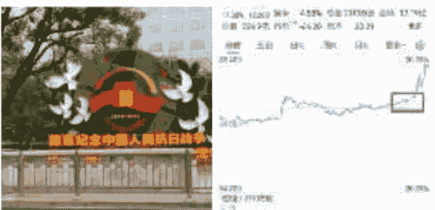
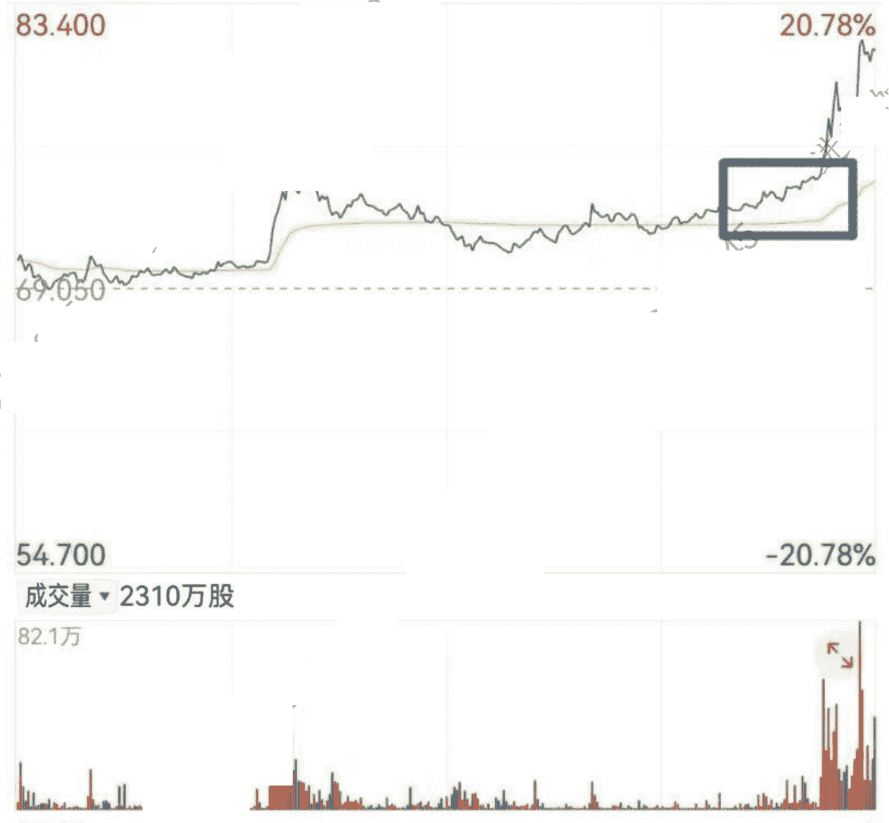

# 南院大王
2025-08-17:16:27

后面的还没进场

同学们热情很高啊，各种问题不停，来看市场是回暖了，

新来的同学们可能不知道的，原则上我们周末谈风花月和人生不聊市场，大多是相通的，生活搞好了，投资才更好。

微信号:jntsg8
微信信号:jntsg2

有一些人非常焦虑你没涨的事情，

免费进资料群

原因很简单，

- 1，要么你不坐在主桌上，搞一体两翼，一体是大金融，两翼（高科技+反内卷，科技>内卷）的主线，搞的是杂毛。

我们讲的时候，你畏高龙头前排，不敢上，觉得后面的有安全感，前排是谁，后排是谁，他们中间怎么切换，前面的多篇文章已经摆开揉碎，有困惑多读几遍自然明白。

昨天跟三大救市主力的某家一个高管聚会，敏感的信息不能提，但有个观点我们是一致的，现在的散户们还没大量进场，他们大量醒过来是4000点的时候。

所以大家有的是时间和机会学习布局，不用那么着急。

既然大家这么爱学习，最后放一个港股在3点后发力的，聪明的同学自然知道映射的是什么板块和哪些人。

收起

## 81.050

| 指标 | 数值 |
| :--- | :--- |
| 今开 | 70.500 |
| 最高 | 83.400 |
| 最低 | 68.850 |
| 涨幅 | 17.38% |
| 换手 | 12.000 |
| 总量 | 4.58% |
| 成交量 | 2310万股 |
| 金额 | 17.19亿 |
| 总值 | 724.9亿 |
| 市盈 | -64.20 |
| 市净 | 2.21 |

更多
分时
日K
周K
月K
更多

83.400
20.78%
69.050
54.700
-20.78%
成交量 2310万股
82.1万
09:30

胡丰展、钱罐、和光同尘、乐山乐水、衍行、辉歌、静心、DrLee、badsohohai、mo等75人觉得很赞

# 南院大王：置顶 主桌逻辑：控制温度，全局一览今天的局面就…n+v:tishen2027

吃相好看：请问大王，港股的特点跟A股一样吗？
2025-08-17:16:35

Jerry:N链链直流电源供应商？
2025-08-17:16:36

胡胡：第三代半导体硅基氮化镓
2025-08-17:16:40

kom:第一张图冲军工。第二张图，英诺赛克供供应商，伟达二供
2025-08-17:16:43

美回回复吃相好看：不一样，港股是T+0，手续费高，每个股票的股数也不一样，有些是100股是一手，有些200的，有的500，1000，2000看公司上市时的规定，只要开通港股通就可以交易
2025-08-17:16:45

Jerry:聪明的同学赶紧出来啊
2025-08-17:16:47

吃相好看回复美美：我的意思是牛市的节奏特点。也是一体两翼吗？
2025-08-17:16:48
