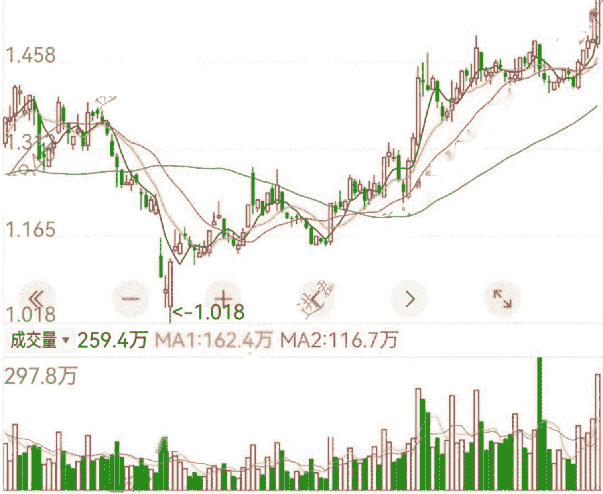

# 南院大王
2025-08-18 08:18

多看评论和问答

新来的同学们要注意和多看问答和评论区，基本都是大家的实战，

每个人都有自己的方法和思路，手上的品种更不一样，

不管你拿准没，同学们问的东西你看一眼，再将结合自身：

她做的好对我有什么启发？

我想怎么学习？

他的难题对我有什么反思？

我怎么规避？

我们在互动中的指引和建议等，很多是“普遍性”的，适合你举一反三，不断的从心得中来，到操作中去，再从操作中出来，到心里中去，往复循环。

比如上周四彩蛋的指南针，不少对有些想买券商的同学怨其不争，讲商IT的，而且专门问答长期保留。

3600之前，银行是调控的主要风向，

3600之后，券商是大盘的主要风向。

做T打野的同学，盯着券商的涨跌操作就就行了。

券商和金融科技抢波段简直玩得飞起。

券商是油车，盘子大启动慢，

券商IT是电车，一脚电门的事。

不会的，我们之前谈的金融科技ETF创造新高。

3600之前，银行是调控的主要风向，

3600之后，券商是大盘的主要风向。

会做T打野的同学，看着券商的涨跌操作就行了。

券商IT和金融科技爆发简直是能得飞起。

券商是油车，盘子大启动慢，

券商IT是电车，一脚电门的事。

不会的，我们之前谈的金融科技ETF创下新高。

还是那句话，不追高，绿盘进。

其他算力，创新药，游戏，芯片等抱团领域的观点不变，

你要体感好，牢记一体两翼，双轮驱动，

市场在轮上上涨，单调就忍妥焦虑。

要问本周有什么策略，两个字。

持有。

当然，你已经错或者八十十九了，如果不动了，可以选择部分止盈。

没有任何一笔赚钱的卖出是错误的。

对于前排和龙头来说，高不是错，业绩不及预期也不是错，涨不动才是错。

只要涨得对，你就赖着它。

# 提问

楚媛
南院大王

大王，请问能点评下东方财富和长电科技吗?都是拿了四五年的票，东方财富一直做T现在盈利45%，长电科技因为是高位拿的，近期刚回本。最近的行情不应该利好券商和半导体芯片吗？不知道要不要再观望一下还是落袋为安，拜谢。

整体都利好，毕竟在低位，有空间。东财是券商IT金融龙头，但是盘子太大，相比南针大智慧之类就慢，追求弹性可以考虑换一部分。至于长电，老渣男了，本身没啥技术含量，加上大基金投的太多没事就减持套人，可趁拉高出手。

# 1.584 今开 1.489 最高 1.605 最低 1.481

5.95% 0.089 总手 259.4万 金额 4.05亿 量比 2.12

实时估值 1.5836 折价率 -0.03% 最新份额 9.90亿

更多跟踪指数 金融科技 3422.03 5.51% 跟踪误差 0.04%

分时 五日 日K 周K 月K 更多

均线 MA5:1.501↑ 10:14 20:1.457↑ 55:1.385↑ DK点 前复权

1.605 1.458 1.165 1.018 <-1.018

成交量 259.4万 MA1:162.4万 MA2:116.7万 297.8万

20250219 0815

大白、lwm、剪行、L.马、孙晓艳、lucky、上冻的菜头、杨志强、一个人溜达、于洋盛89觉得很赞

😊 同学们好老师说的券商it etf是哪个？
2025-08-10 18:08:21
逸飞回复😊 金融科技
2025-08-10 18:08:22

花王【DIK HUN* 回😊百陌：这个自从大王提出的，不断低吸。看完大王，这篇文章，鉴定低吸到4000点
2025-08-10 18:08:29

叶棉：只要在，券商一哥的中报告诉大家费率都能抽到软手，稳赚不赔的生意！券商钱了更要升级算法，装备啊，投资IT升级就是让咱们抽的更快更多a re you ok?
2025-08-10 18:08:46

蜀颜百景：大王好，想向身上持仓的不涨不需要要把把它卖了腾出资金。等待机会呢，比如我手上有（异点天下）以前学价值的时候，老师说是镜头的，还有前天迪了华宝新能，要不要把它卖了腾出资金。
2025-08-10 18:08:49 (注：原文时间戳有误，此处根据逻辑推断)

万然：没有任何一笔赚钱的卖出是错误的。
2025-08-10 18:08:54

奎：大王最后那句话
2025-08-10 18:08:55

lin 回复蜀颜百景：你再好，前排，
2025-08-10 18:09:15

# 知识星球

添加微信: jntsg

| 序号 | 公号/星球/社群 | 原价 | 领域 |
| :--- | :--- | :--- | :--- |
| 1 | 生态木 | 275/年 | 副业、搞钱 |
| 2 | 怂众吃瓜 | 365/年 | 时政、历史 |
| 3 | 创新树青 | 365/年 | 成长、搞钱 |
| 4 | 欧洲靴 | 328/年 | 时政、历史 |
| 5 | 卢克文会 | 699/年 | 体制、社会 |
| 6 | 体内主任 | 599/年 | 职场 |
| 7 | 外局人的视角 | 669/年 | 金融、时政 |
| 8 | 灏异谈 | 4166/年 | 财富、成长 |
| 9 | 守夜人 | 599/年 | 时政、经济 |
| 10 | 江宁知府 | 365/篇 | 时政、国际 |
| 11 | 政堂/顾子明 | 568/年 | 时政、经济 |
| 12 | 唐书院 | 1399/篇 | 金融、财富 |
| 13 | 大树乡谈 | 199/年 | 时政、成长 |
| 14 | 水库欧大 | 10000 | 房产、经济 |
| 15 | 洪灏的宏观策略 | 4376/年 | 经济、搞钱 |
| 16 | 金政通鉴/北海道南山 | 4576/年 | 股票、行研 |
| 17 | 猫留的世界 | 299/年 | 时政、社会 |
| 18 | 飞浅云 | 3600/年 | 股市、经济 |
| 19 | 米联债见闻 | 599/年 | 经济、金融 |
| 20 | 鉴茶财经院 | 330/年 | 房产、股票 |
