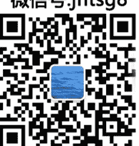
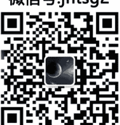
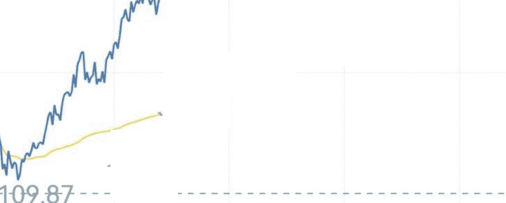
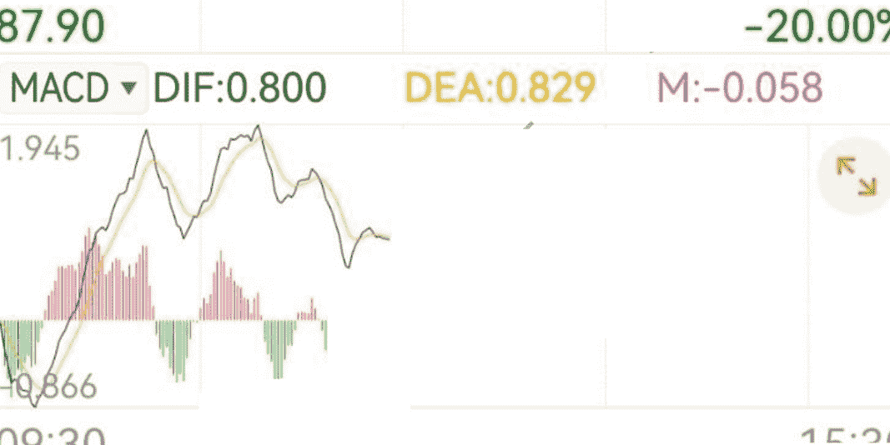

# 南院大王

2025-08-18 11:35

悄悄开个行情

得到了吗？

开心妈妈同学，

苦口婆心的双轮驱动模式，

独步江湖的主筹配栗理论，

只为你，

轻松拿一个涨停，

今天你手里没有涨停或者+8%以下的，简直对不住大王。

出于对宏观、技术、主力、资金的认知，

我们敢指出：

- 液冷电源还要够，
- 东方寒威没涨够，
- 光的几个没释放，
- 英达不止不止一个涨停，
- 慢慢开始看华为，
- 周末还给大家开小灶普及电源HVDC。

微信:jntsg
微信:jntsg

免费资料群

- 周末给大家开小课普及电源HVDC。

今天连选交换机锐捷，后排的科秦都起猛了吧。

当然你要中途下车了，就对不住大大了，配置说了N次。

你再把我早上专门调的券商IT指南针灸袭，那都要对不住文丞了。

人以群群，

咱们圈里，都是富贵商人，要hold住，对标稳稳的小姐们。

最后友情提示，不用单给私信发红包，

星球的打赏随意的即可，纯是为了分享你的喜悦。

以一灯传万灯，以至于众灯皆明。

下午大王要去连轴参加会兼应酬，

今天就不复盘了，同学们各自开香槟吧，

这个量，半场开香槟毫无负担，

中午的嘴角不要翘太高。

低调~

# 131.84 今开 115.14 最高 131.84 最低 110.99

20.00% 21.97 换手 15.62% 总手 93.79万 金额 111.5亿 总值 801.8亿 流值 791.9亿 市盈 144:55 更多

中报预披露: 于2025-08-28披露2025年中报

分时 五日 日K 周期K 月K 更多

131.84 20.00% 千档行行情免费

| 卖5 | -- | -- |
| 卖4 | -- | -- |
| 卖3 | -- | -- |
| 卖2 | -- | -- |
| 卖1 | -- | -- |
| 买1 | 131.84 | 7.2万 |
| 买2 | 131.83 | 19 |
| 买3 | 131.82 | 156 |
| 买4 | 131.81 | 6 |
| 买5 | 131.75 | 10 |

109.87 -20.00%

| 1125 | 131.84 | 24 |
| 1125 | 131.84 | 56 |
| 1125 | 131.84 | 163 |
| 1125 | 131.84 | 68 |
| 1125 | 131.84 | 75 |
| 1125 | 131.84 | 1035 |
| 1125 | 131.84 | 8 |
| 1125 | 131.84 | 33 |
| 1125 | 131.84 | 57 |

MACD DIF:0.800 DEA:0.829 M:-0.058

87.90 1.945 -9.866 09:30

# 南院大王
摘录自：鉴茶财经

电源 (hvdc): 欧陆通，麦格米特，中恒，科泰，禾望等。

之前跟eclan同学谈到川环给英伟达送样，今天开始大资金介入的趋势进一步加强。英维克，麦格米特都是英伟达供应商。

作者：南院大王 2025/8/4
微信扫码查看原文

C 知识星球

# 南院大王
摘录自：鉴茶财经

电源 (hvdc): 欧陆通，麦格米特，中恒，科泰，禾望等。

之前跟eclan同学谈到川环给英伟达送样，今天开始大资金介入的趋势进一步加强。英维克，麦格米特都是英伟达供应商。

作者：南院大王 2025/8/4
微信扫码查看原文

C 知识星球

# 南院大王
摘录自：鉴茶财经

电源 (hvdc): 欧陆通，麦格米特，中恒，科泰，禾望等。

之前跟eclan同学谈到川环给英伟达送样，今天开始大资金介入的趋势进一步加强。英维克，麦格米特都是英伟达供应商。

作者：南院大王 2025/8/4
微信扫码查看原文

C 知识星球

# 南院大王
摘录自：鉴茶财经

电源 (hvdc): 欧陆通，麦格米特，中恒，科泰，禾望等。

之前跟eclan同学谈到川环给英伟达送样，今天开始大资金介入的趋势进一步加强。英维克，麦格米特都是英伟达供应商。

作者：南院大王 2025/8/4
微信扫码查看原文

C 知识星球

# 南院大王
摘录自：鉴茶财经

电源 (hvdc): 欧陆通，麦格米特，中恒，科泰，禾望等。

之前跟eclan同学谈到川环给英伟达送样，今天开始大资金介入的趋势进一步加强。英维克，麦格米特都是英伟达供应商。

作者：南院大王 2025/8/4
微信扫码查看原文

C 知识星球

# 南院大王
摘录自：鉴茶财经

电源 (hvdc): 欧陆通，麦格米特，中恒，科泰，禾望等。

之前跟eclan同学谈到川环给英伟达送样，今天开始大资金介入的趋势进一步加强。英维克，麦格米特都是英伟达供应商。

作者：南院大王 2025/8/4
微信扫码查看原文

C 知识星球

# 南院大王
摘录自：鉴茶财经

电源 (hvdc): 欧陆通，麦格米特，中恒，科泰，禾望等。

之前跟eclan同学谈到川环给英伟达送样，今天开始大资金介入的趋势进一步加强。英维克，麦格米特都是英伟达供应商。

作者：南院大王 2025/8/4
微信扫码查看原文

C 知识星球

# 南院大王
摘录自：鉴茶财经

电源 (hvdc): 欧陆通，麦格米特，中恒，科泰，禾望等。

之前跟eclan同学谈到川环给英伟达送样，今天开始大资金介入的趋势进一步加强。英维克，麦格米特都是英伟达供应商。

作者：南院大王 2025/8/4
微信扫码查看原文

C 知识星球

# 南院大王
摘录自：鉴茶财经

电源 (hvdc): 欧陆通，麦格米特，中恒，科泰，禾望等。

之前跟eclan同学谈到川环给英伟达送样，今天开始大资金介入的趋势进一步加强。英维克，麦格米特都是英伟达供应商。

作者：南院大王 2025/8/4
微信扫码查看原文

C 知识星球

# 南院大王
摘录自：鉴茶财经

电源 (hvdc): 欧陆通，麦格米特，中恒，科泰，禾望等。

之前跟eclan同学谈到川环给英伟达送样，今天开始大资金介入的趋势进一步加强。英维克，麦格米特都是英伟达供应商。

作者：南院大王 2025/8/4
微信扫码查看原文

C 知识星球

# 131.84 今开 115.14 最高 131.84 最低 110.99

20.00% 21.97 换手 15.62% 总手 93.79万 金额 111.5亿 总值 801.8亿 流值 791.9亿 市盈 144:55 更多

中报预披露: 于2025-08-28披露2025年中报

分时 五日 日K 周期K 月K 更多

131.84 20.00% 千档行行情免费

| 卖5 | -- | -- |
| 卖4 | -- | -- |
| 卖3 | -- | -- |
| 卖2 | -- | -- |
| 卖1 | -- | -- |
| 买1 | 131.84 | 7.2万 |
| 买2 | 131.83 | 19 |
| 买3 | 131.82 | 156 |
| 买4 | 131.81 | 6 |
| 买5 | 131.75 | 10 |

109.87 -20.00%

| 1125 | 131.84 | 24 |
| 1125 | 131.84 | 56 |
| 1125 | 131.84 | 163 |
| 1125 | 131.84 | 68 |
| 1125 | 131.84 | 75 |
| 1125 | 131.84 | 1035 |
| 1125 | 131.84 | 8 |
| 1125 | 131.84 | 33 |
| 1125 | 131.84 | 57 |

MACD DIF:0.800 DEA:0.829 M:-0.058

87.90 1.945 -9.866 09:30

# 南院大王
摘录自：鉴茶财经

电源 (hvdc): 欧陆通，麦格米特，中恒，科泰，禾望等。

之前跟eclan同学谈到川环给英伟达送样，今天开始大资金介入的趋势进一步加强。英维克，麦格米特都是英伟达供应商。

作者：南院大王 2025/8/4
微信扫码查看原文

C 知识星球

