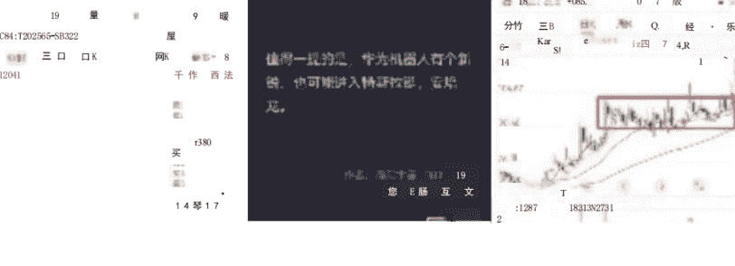
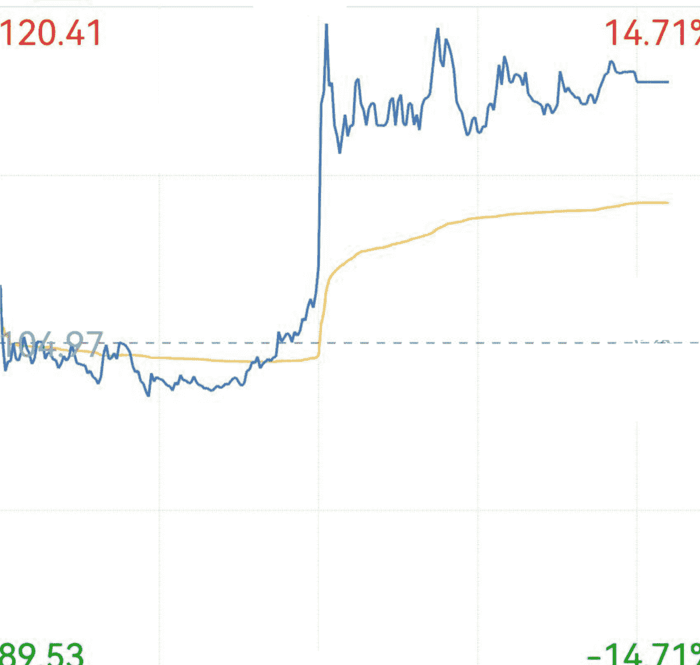
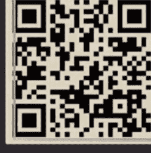
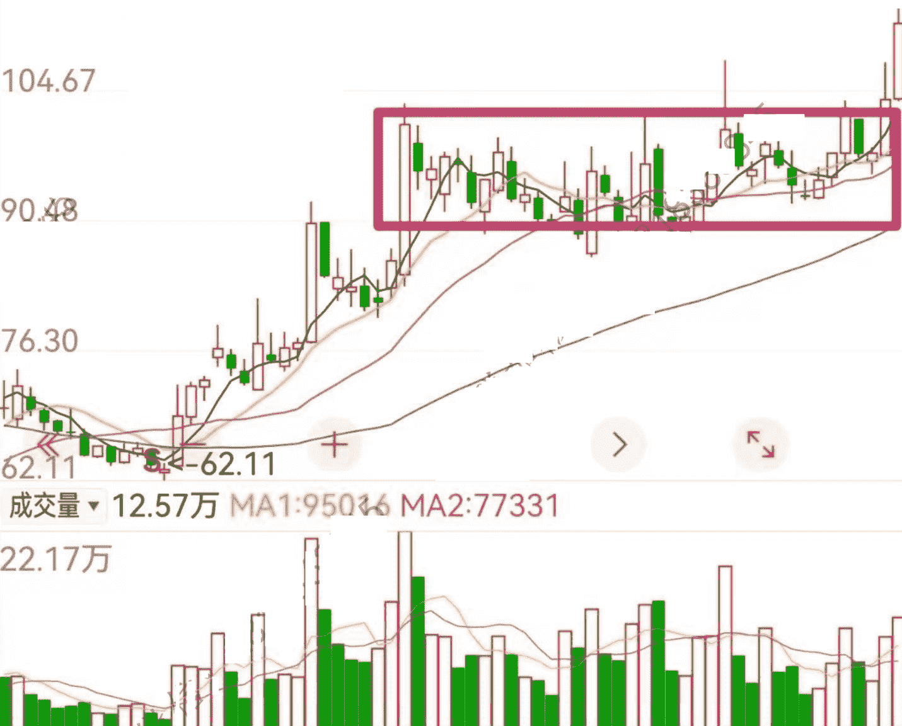

# 南院大王
2025-08-19 15:14

## 预期与抢跑

微信:jntsg8
微信:jntsg2

今天液冷分歧根本不用猜，免费进资料群

本来就高了，再加上英维克的业绩出来，讲不及预期是正常的，之前讲川创环也是，GB300没发货呢。

早上要等订盘看谁能扛，前些几天技术强势的瑞瑞一眼看，懂的能扛，懂的就上车了，不懂的算了。

海外算力链里头，一开始不立预期的光子，然后太辰光也不及预期，根本原因都是产能释放，要三三季度起，所以太辰光不是给你拉起来了吗？还是精准的20日线。

目前的市场，海外算力仍然强，调整是符合预期的正常的，加上军队也要给市场降温，但不断低位。

- 1. 国产算力，尤其是Asic，东达一路发力，源芯补涨，后来大盘不配合。
- 2. 同时抢跑了华为链。

昨天吃饭，好几个人说也看大王的圈子，你说华为，我们先干为敬，哎……华为链也列出来了。高达就是机器人你总懂，我们特意提了，华为和链双打，安培龙。

机器人这几天也在蠢蠢欲动，之前以peek和mim为代表的轻量化基本一段，哪还有机会呢？空心杯电机，代表龙溪、兆威、兆雷、江苏雷、鸣志等。

另外再提一下，艾环、川瑞、强瑞，同时也给华供(仅有限仓和技术的热心），如果没有很大调整更好，会有下一轮。

不要着急，你终能等到自己的机会和补涨，比如光模块的连接，悄悄在落在后走出自己的趋势。

## 收起

自在、飞雪、WYNN、如兰百合、lizhiguo、elsa~专用、0和1、于洋、于六下不去7、杨雄等63人觉得很赞

Jerry: 这里太大了，没抓住主线。
静看花开: 东达、中中天、高达，指的是板块还是什么？没有找到票呢。2023-10-25 13:19
蜗螺: 安培龙是哪个
2023-10-25 13:22
阿秀回复回复看花开:先把大王之王之前的文章都看一遍
2023-10-25 13:25
Jerry 回复蜗螺: 机器人啊，今天公号的彩蛋
2023-10-25 13:29
小于回复蜗螺: 301413

## 117.00 今开 107.59 最高 120.41 最低 102.38

11.46% 12.03 换手 14.93% 总手 78609 金额 8.76亿
总值 115.1亿 流值 61.62亿 市盈 141.30 更多

盘后固定价格: 117.00 量: -- 额: -- 盘后分时

中报预披露: 于2025-08-26披露2025年中报

分时 五日 日K 周K 月K 更多

| 价格 | 比例 | 说明 |
| :--- | :--- | :--- |
| 120.41 | 14.71% | 千档行行情免费送 |
| 卖5 | -- | -- |
| 卖4 | -- | -- |
| 卖3 | -- | -- |
| 卖2 | -- | -- |
| 卖1 | 117.00 | 0 |
| 买1 | 117.00 | 0 |
| 买2 | -- | -- |
| 买3 | -- | -- |
| 买4 | -- | -- |
| 买5 | -- | -- |

| 分时成交 | | |
| :--- | :--- | :--- |
| 14:56 | 117.50↓ | 15 |
| 14:56 | 117.48↓ | 8 |
| 14:56 | 117.50↑ | 1 |

89.53 MACD DIF:0.017 DEA:0.063 M:-0.092 *

# 南院大王

摘录自：鉴茶财经 值得一提的是，华为机器人有个新锐，也可能进入特斯拉链，安培龙。

作者：南院大王2025/8/19 微信扫码查看原文知识星球

## 112.00 今开 103.74 最高 118.85 最低 103.53

7.98% 8.28 换手 18.49%总手 12.57万 金额 14.19亿
总值 145.3亿 流值 76.11亿 市盈 194.24 更多

盘后固定价格:112.00 量:7 额:78400 盘后后分时

中报预披露:于2025-08-27披露2025年中报

+ - 分时 五日 日K 周K 月K 更多

均线 MA5:102.81↑ 10:09.06↑ 20:96.98↑ DK点 前复权

55:90.26↑

118.85 118.85->

104.67
90.48
76.30
62.11

成交量 12.57万 MA1:95036 MA2:77331

22.17万

20250515 20250821

