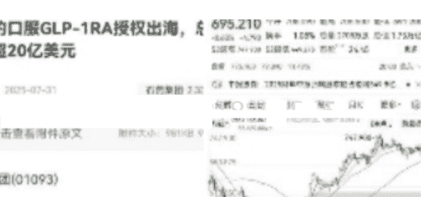
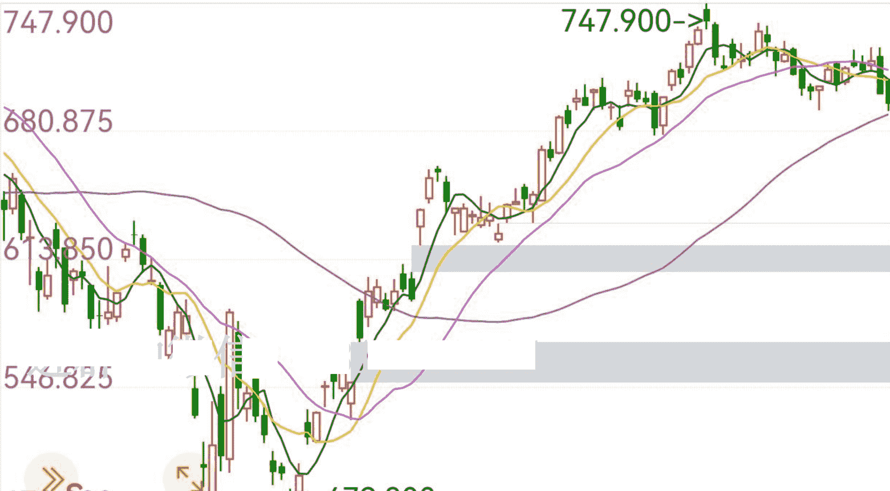

# 最终拼绩

昨天英伟达涨2.14%，涨了多少呢？

涨出来一整个胜宏+旭创+天孚，有机构喊出了看到200美元。

然后Meta和微软业绩双超预期，然后Meta暴涨11.5%，微软暴涨9%，

就是说，AI的投入还要加大，海外算力还能涨。

会元的同学，拿着前面的继续靠，后后的二线PCB，二线模块，整体部件，最好多趁些调整仍然能看，具体的种之之前读过无数次，实在不热你点开板就知道后面是谁。

微信号:jntgs8
微信号:jntgs2

当链接和冷液/电源一直在蓄蓄激动。

免费资料群

你要在海外算力冷静 的时候调整，胜宏或者旭创将来一个放量大涨。

算力链里处于低位的是国产算力，问题是海外太大了，切的不顺畅。

但趋势是必然的，调整ETF就行。除了588200，还有589250，基本都是ASIC，还软硬兼莱有。

回到国内，宁王昨天的中报预期

上半年年营收1780亿，同比+7.27%，净利润305亿，同比+33%

机构一直不相信宁德能搞出高业绩，即使外资也只给出Q2净利152亿元的预测，今晚二季度数据165.6亿，超预期。

今年年底预测宁王利润700-750亿左右，就才16-18pe，相比之下，LG电池500亿。

大赛预测宁德将占30%左右的机器人电池。

张董长长说“破反内卷”，低位权重仍然能看，这几天天涨的不是低位的华化学。

# 请理解这段牛市的核心，抱团

如果你拿的不是机构抱团概念，那日子就会比较难受。

抱团的除了上述的还有创新药，尤其是港股创新药ETF，

今天如果你大幅开或者暴跌，你不要分批上车的机会，如果你相对保守，调到20日线是很好位置。

创新药高，K线很高，但PE不高，中国帮基金经理都是歇斯底里症患者，一年要把你十年的预期涨完。

BD大单不停，创新药不死。

当然搞不好的这个依然还踩不对节奏的，可以拿着一定位跟国家团队抱团保险。

有时候吧，你赚钱和情绪价值能一起，有时候你只需要一个。

收起

道、有、有、蜘蛛、Doctor 李、沫沫、自在、LINKE、珊瑚、沧海一粟、上冻的菜头等53人觉得很赞

查看详情

Jerry: 昨天晚上停牌不是在降温吗?
2025-07-31 08:44

南院大王回复Jerry: 允许抱团，不让飞升
2025-07-31 08:48

涨不停：大王你都这么说了还有人不赚钱，你说该打不

# 公司的口服GLP-1RA授权出海，总金额超20亿美元

研报日期：2025-07-31

石药集团 2.33%

点击查看 附件大小：981KB 9页

# 石药集团(01093)

# 事件

# Meta Platforms Inc-A

META

695.210

今开 708.090 最高 708.500 最低 691.200

-0.68% -4.790 换手 1.08% 总量 2708万股 总值 1.75万亿

52周高 747.900 52周低 449.275 市盈 695.210

-0.68% -4.790 换手 中: 2025财报

# 知识星球付费资源分享

| 序号 | 公号/社群 | 原价 | 领域 |
| :--- | :--- | :--- | :--- |
| 1 | 生态有木 | 265/年 | 副业、搞钱 |
| 2 | 怂容吃瓜群 | 365/年 | 时政、历史 |
| 3 | 骏树风 | 365/年 | 成长、搞钱 |
| 4 | 欧洲金 | 328/年 | 时政、历史 |
| 5 | 卢克文青会 | 699/年 | 社会、社会 |
| 6 | 体制内主任 | 599/年 | 职场 |
| 7 | 外局人的视角 | 669/年 | 金融、时政 |
| 8 | 濑泽异谈 | 416/年 | 财富、成长 |
| 9 | 守夜人总 | 599/年 | 时政、经济 |
| 10 | 江宁诺 | 365/篇 | 时政、国际 |
| 11 | 政堂顾子明 | 568/年 | 时政、经济 |
| 12 | 唐书院 | 1399/篇 | 金融、财富 |
| 13 | 大树乡谈 | 199/年 | 时政、成长 |
| 14 | 水库欧大 | 10000 | 房产、经济 |
| 15 | 洪灏的宏观策略 | 4376/年 | 经济、搞钱 |
| 16 | 金政鉴北海道南山 | 4576/年 | 股票、行研 |
| 17 | 猫留的世界 | 299/年 | 时政、社会 |
| 18 | 飞浅云 | 3600/年 | 股市、经济 |
| 19 | 米联储见闻 | 599/年 | 经济、金融 |
| 20 | 鉴茶财经院 | 330/年 | 房产、股票 |
| 21 | 赢在八小时之外 | 365/年 | 成长、职场 |
