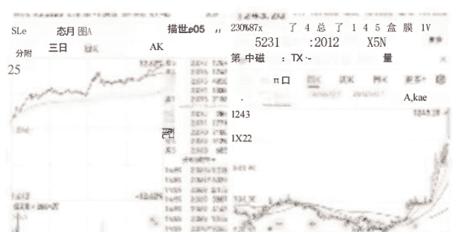

# 本周开启了什么

华田园牛的密码，就是国产芯片。

一个天大落的ASIC，云天，等一票人。

再细一点就是寒钛领的芯原，云天，等后面还有端侧的SoC和MCU。

另一个就是华为链，可是从PCB模块链连接给大家讲了。

你看不是不是一路涨过去的，今天天华为PCB有没有回踩。

ASIC比华略强，当然你可以理解，人家是芯片，异质没上市，再说链为某些已离离赛英达达达了一阵。

现在大家开始在外面说王了，现在回头再说我们要补涨的冷笑笑话如何。

ASIC和它都不明白，你就搞搞搞不懂中国和牛市。

如果不知道ASIC是，去隔壁进阶课堂学，昨天又拉出来大家复习，能能的都做了。

没涨的，是因为我们理解某个执念，因为有紫禁之巅。

看的准，是因为我们把握住了市场的节奏，还有不少主力在看咱们的星球，你怕个屁。

涨的蛋，是因为你太看了当年的那票手和小年轻，他们只会推土机打法。

所以，三浪的券商IT如果你一调整美了，只能对不起丞桓。

新同学进来，

这几天其实两个最基本的就有收获：

一个是技法，高频出现的588200，反复提示，你恰好于15个点。

是个心法，我们说的得感和沉稳心，心一凉的，冷液这不是拉去了吗？

昨天有谁说买入云就被套了，今天就该止盈了，以后别再问为什么又跌了，这种心态适合定投ETF。

你拿的没涨，要么太排后大哥没涨够等轮动，这么简单。

现在你在看600块的寒王，还觉得贵吗？

还是明天幸福那句话的好啊，

反正我也不会折腾，干脆等着数钱好了。

你追，钱就会跑，你等着，钱才来。

汪汪队发了红包，大家可以去消费了，要开心哦！

收起

查看详情

一路阳光(徐)、阿尔尔的神像、满意、城志、大史小粉、征尘、花王【DIK HUN*、河东狮、Will、轻语等157人觉得很赞

水镜：大王，感觉你是生产团队盘手之一
2025-08-22:15:05

大松果：谢谢大王，预祝大家周末未玩开心

## 2.066

今开 1.870 最高 2.079 最低 1.869

11.92% 0.220 总手 2804万 金额 55.321亿 量比 1.77

实时估值 2.0286 折价率 -1.84% 最新份额 169.4亿

跟踪指数 科创芯片 22543.83 10.05% 跟踪误差 0.01%

## 分时 五日 日K 周K 月K 更多

| 价格 | 价格 | 成交 |
| :--- | :--- | :--- |
| 卖5 | 2.077 | 1757 |
| 卖4 | 2.076 | 1746 |
| 卖3 | 2.075 | 4858 |
| 卖2 | 2.074 | 1038 |
| 卖1 | 2.073 | 2138 |
| 买1 | 2.072 | 285 |
| 买2 | 2.071 | 1771 |
| 买3 | 2.070 | 7100 |
| 买4 | 2.069 | 5129 |
| 买5 | 2.068 | 685 |

分时成交：
14:59 2.063↓ 1.2万
14:59 2.069↑ 6025
14:59 2.069 2.1万
14:59 2.069 5129
14:59 2.071 1771
14:59 2.073 2138
14:59 2.074 1038
14:59 2.075 4858
14:59 2.076 1746
14:59 2.077 1757

## 2.066

今开 1.870 最高 2.079 最低 1.869

11.92% 0.220 总手 2804万 金额 55.321亿 量比 1.77

实时估值 2.0286 折价率 -1.84% 最新份额 169.4亿

跟踪指数 科创芯片 22543.83 10.05% 跟踪误差 0.01%

## 分时 五日 日K 周K 月K 更多

| 价格 | 价格 | 成交 |
| :--- | :--- | :--- |
| 卖5 | 2.077 | 1757 |
| 卖4 | 2.076 | 1746 |
| 卖3 | 2.075 | 4858 |
| 卖2 | 2.074 | 1038 |
| 卖1 | 2.073 | 2138 |
| 买1 | 2.072 | 285 |
| 买2 | 2.071 | 1771 |
| 买3 | 2.070 | 7100 |
| 买4 | 2.069 | 5129 |
| 买5 | 2.068 | 685 |

分时成交：
14:59 2.063↓ 1.2万
14:59 2.069↑ 6025
14:59 2.069 2.1万
14:59 2.069 5129
14:59 2.071 1771
14:59 2.073 2138
14:59 2.074 1038
14:59 2.075 4858
14:59 2.076 1746
14:59 2.077 1757

## 2.066

今开 1.870 最高 2.079 最低 1.869

11.92% 0.220 总手 2804万 金额 55.321亿 量比 1.77

实时估值 2.0286 折价率 -1.84% 最新份额 169.4亿

跟踪指数 科创芯片 22543.83 10.05% 跟踪误差 0.01%

## 分时 五日 日K 周K 月K 更多

| 价格 | 价格 | 成交 |
| :--- | :--- | :--- |
| 卖5 | 2.077 | 1757 |
| 卖4 | 2.076 | 1746 |
| 卖3 | 2.075 | 4858 |
| 卖2 | 2.074 | 1038 |
| 卖1 | 2.073 | 2138 |
| 买1 | 2.072 | 285 |
| 买2 | 2.071 | 1771 |
| 买3 | 2.070 | 7100 |
| 买4 | 2.069 | 5129 |
| 买5 | 2.068 | 685 |

分时成交：
14:59 2.063↓ 1.2万
14:59 2.069↑ 6025
14:59 2.069 2.1万
14:59 2.069 5129
14:59 2.071 1771
14:59 2.073 2138
14:59 2.074 1038
14:59 2.075 4858
14:59 2.076 1746
14:59 2.077 1757

## 2.066

今开 1.870 最高 2.079 最低 1.869

11.92% 0.220 总手 2804万 金额 55.321亿 量比 1.77

实时估值 2.0286 折价率 -1.84% 最新份额 169.4亿

跟踪指数 科创芯片 22543.83 10.05% 跟踪误差 0.01%

## 2.066

今开 1.870 最高 2.079 最低 1.869

11.92% 0.220 总手 2804万 金额 55.321亿 量比 1.77

实时估值 2.0286 折价率 -1.84% 最新份额 169.4亿

跟踪指数 科创芯片 22543.83 10.05% 跟踪误差 0.01%

## 2.066

今开 1.870 最高 2.079 最低 1.869

11.92% 0.220 总手 2804万 金额 55.321亿 量比 1.77

实时估值 2.0286 折价率 -1.84% 最新份额 169.4亿

跟踪指数 科创芯片 22543.83 10.05% 跟踪误差 0.01%

## 2.066

今开 1.870 最高 2.079 最低 1.869

11.92% 0.220 总手 2804万 金额 55.321亿 量比 1.77

实时估值 2.0286 折价率 -1.84% 最新份额 169.4亿

跟踪指数 科创芯片 22543.83 10.05% 跟踪误差 0.01%

## 2.066

今开 1.870 最高 2.079 最低 1.869

11.92% 0.220 总手 2804万 金额 55.321亿 量比 1.77

实时估值 2.0286 折价率 -1.84% 最新份额 169.4亿

跟踪指数 科创芯片 22543.83 10.05% 跟踪误差 0.01%

## 2.066

今开 1.870 最高 2.079 最低 1.869

11.92% 0.220 总手 2804万 金额 55.321亿 量比 1.77

实时估值 2.0286 折价率 -1.84% 最新份额 169.4亿

跟踪指数 科创芯片 22543.83 10.05% 跟踪误差 0.01%

## 2.066

今开 1.870 最高 2.079 最低 1.869

11.92% 0.220 总手 2804万 金额 55.321亿 量比 1.77

实时估值 2.0286 折价率 -1.84% 最新份额 169.4亿

跟踪指数 科创芯片 22543.83 10.05% 跟踪误差 0.01%

## 2.066

今开 1.870 最高 2.079 最低 1.869

11.92% 0.220 总手 2804万 金额 55.321亿 量比 1.77

实时估值 2.0286 折价率 -1.84% 最新份额 169.4亿

跟踪指数 科创芯片 22543.83 10.05% 跟踪误差 0.01%

## 2.066

今开 1.870 最高 2.079 最低 1.869

11.92% 0.220 总手 2804万 金额 55.321亿 量比 1.77

实时估值 2.0286 折价率 -1.84% 最新份额 169.4亿

跟踪指数 科创芯片 22543.83 10.05% 跟踪误差 0.01%

## 2.066

今开 1.870 最高 2.079 最低 1.869

11.92% 0.220 总手 2804万 金额 55.321亿 量比 1.77

实时估值 2.0286 折价率 -1.84% 最新份额 169.4亿

跟踪指数 科创芯片 22543.83 10.05% 跟踪误差 0.01%

## 2.066

今开 1.870 最高 2.079 最低 1.869

11.92% 0.220 总手 2804万 金额 55.321亿 量比 1.77

实时估值 2.0286 折价率 -1.84% 最新份额 169.4亿

跟踪指数 科创芯片 22543.83 10.05% 跟踪误差 0.01%

## 2.066

今开 1.870 最高 2.079 最低 1.869

11.92% 0.220 总手 2804万 金额 55.321亿 量比 1.77

实时估值 2.0286 折价率 -1.84% 最新份额 169.4亿

跟踪指数 科创芯片 22543.83 10.05% 跟踪误差 0.01%

## 2.066

今开 1.870 最高 2.079 最低 1.869

11.92% 0.220 总手 2804万 金额 55.321亿 量比 1.77

实时估值 2.0286 折价率 -1.84% 最新份额 169.4亿

跟踪指数 科创芯片 22543.83 10.05% 跟踪误差 0.01%

## 2.066

今开 1.870 最高 2.079 最低 1.869

11.92% 0.220 总手 2804万 金额 55.321亿 量比 1.77

实时估值 2.0286 折价率 -1.84% 最新份额 169.4亿

跟踪指数 科创芯片 22543.83 10.05% 跟踪误差 0.01%

## 2.066

今开 1.870 最高 2.079 最低 1.869

11.92% 0.220 总手 2804万 金额 55.321亿 量比 1.77

实时估值 2.0286 折价率 -1.84% 最新份额 169.4亿

跟踪指数 科创芯片 22543.83 10.05% 跟踪误差 0.01%

## 2.066

今开 1.870 最高 2.079 最低 1.869

11.92% 0.220 总手 2804万 金额 55.321亿 量比 1.77

实时估值 2.0286 折价率 -1.84% 最新份额 169.4亿

跟踪指数 科创芯片 22543.83 10.05% 跟踪误差 0.01%

## 2.066

今开 1.870 最高 2.079 最低 1.869

11.92% 0.220 总手 2804万 金额 55.321亿 量比 1.77

实时估值 2.0286 折价率 -1.84% 最新份额 169.4亿

跟踪指数 科创芯片 22543.83 10.05% 跟踪误差 0.01%

## 2.066

今开 1.870 最高 2.079 最低 1.869

11.92% 0.220 总手 2804万 金额 55.321亿 量比 1.77

实时估值 2.0286 折价率 -1.84% 最新份额 169.4亿

跟踪指数 科创芯片 22543.83 10.05% 跟踪误差 0.01%

## 2.066

今开 1.870 最高 2.079 最低 1.869

11.92% 0.220 总手 2804万 金额 55.321亿 量比 1.77

实时估值 2.0286 折价率 -1.84% 最新份额 169.4亿

跟踪指数 科创芯片 22543.83 10.05% 跟踪误差 0.01%

## 2.066

今开 1.870 最高 2.079 最低 1.869

11.92% 0.220 总手 2804万 金额 55.321亿 量比 1.77

实时估值 2.0286 折价率 -1.84% 最新份额 169.4亿

跟踪指数 科创芯片 22543.83 10.05% 跟踪误差 0.01%

## 2.066

今开 1.870 最高 2.079 最低 1.869

11.92% 0.220 总手 2804万 金额 55.321亿 量比 1.77

实时估值 2.0286 折价率 -1.84% 最新份额 169.4亿

跟踪指数 科创芯片 22543.83 10.05% 跟踪误差 0.01%

## 2.066

今开 1.870 最高 2.079 最低 1.869

11.92% 0.220 总手 2804万 金额 55.321亿 量比 1.77

实时估值 2.0286 折价率 -1.84% 最新份额 169.4亿

跟踪指数 科创芯片 22543.83 10.05% 跟踪误差 0.01%

## 2.066

今开 1.870 最高 2.079 最低 1.869

11.92% 0.220 总手 2804万 金额 55.321亿 量比 1.77

实时估值 2.0286 折价率 -1.84% 最新份额 169.4亿

跟踪指数 科创芯片 22543.83 10.05% 跟踪误差 0.01%

## 2.066

今开 1.870 最高 2.079 最低 1.869

11.92% 0.220 总手 2804万 金额 55.321亿 量比 1.77

实时估值 2.0286 折价率 -1.84% 最新份额 169.4亿

跟踪指数 科创芯片 22543.83 10.05% 跟踪误差 0.01%

## 2.066

今开 1.870 最高 2.079 最低 1.869

11.92% 0.220 总手 2804万 金额 55.321亿 量比 1.77

实时估值 2.0286 折价率 -1.84% 最新份额 169.4亿

跟踪指数 科创芯片 22543.83 10.05% 跟踪误差 0.01%

## 2.066

今开 1.870 最高 2.079 最低 1.869

11.92% 0.220 总手 2804万 金额 55.321亿 量比 1.77

实时估值 2.0286 折价率 -1.84% 最新份额 169.4亿

跟踪指数 科创芯片 22543.83 10.05% 跟踪误差 0.01%

## 2.066

今开 1.870 最高 2.079 最低 1.869

11.92% 0.220 总手 2804万 金额 55.321亿 量比 1.77

实时估值 2.0286 折价率 -1.84% 最新份额 169.4亿

跟踪指数 科创芯片 22543.83 10.05% 跟踪误差 0.01%

## 2.066

今开 1.870 最高 2.079 最低 1.869

11.92% 0.220 总手 2804万 金额 55.321亿 量比 1.77

实时估值 2.0286 折价率 -1.84% 最新份额 169.4亿

跟踪指数 科创芯片 22543.83 10.05% 跟踪误差 0.01%

## 2.066

今开 1.870 最高 2.079 最低 1.869

11.92% 0.220 总手 2804万 金额 55.321亿 量比 1.77

实时估值 2.0286 折价率 -1.84% 最新份额 169.4亿

跟踪指数 科创芯片 22543.83 10.05% 跟踪误差 0.01%

