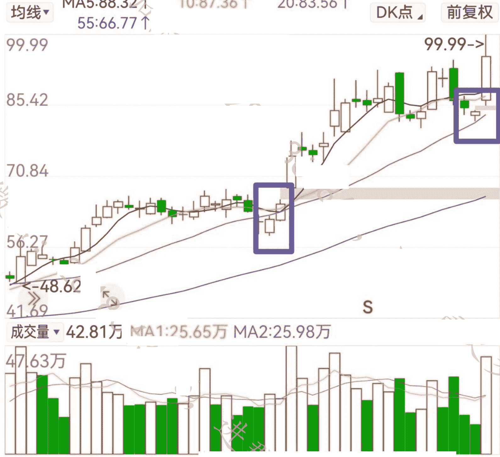
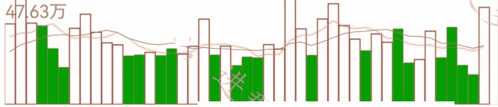
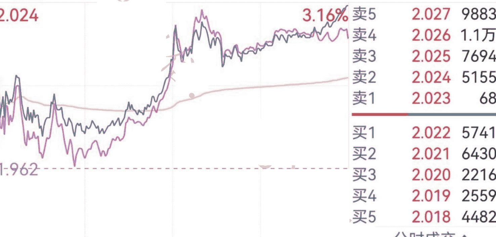
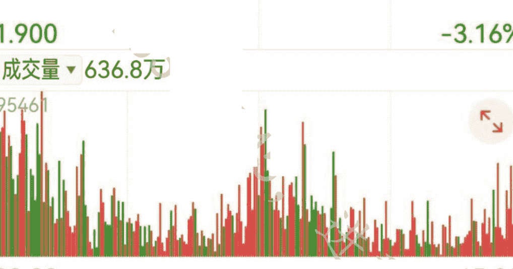

# 南院大王

2025-08-05-15:08

预期的力量

美股危机解除，利好机构抱团，英伟达大，利海外算力。

海外算力中机构抱团相对低位的核心链。

微信信号：jntsg8

微信信号：jntsg2

产业逻辑和切换模式讲了N，绝对核心圈，提了N+1 遍。

免费进资料群

剩余的太沐光瑞可等，中间位置专门提到准兆龙互联。

如果买不了了创业，博博的股东长飞不也挺好？

就是高低切和寻找补涨的魅力。

强势回调基本不过20日线，天孚，博博，港股创新药，反复给你验证。

相信多少同学是快坚持了觉得要卖的，更相信更多是在我们反复提醒下拿住了的。

之前讲的光刻机，几个低位，波长几个也不起来来吗？

念啥终都能成佛。

保险每次-2%左右都是低吸的良机，今天又在新的高路上。

跟着主线的都吃美了吧。

# 95.40 今开 86.49 最高 99.99 最低 85.31

13.44% 11.30 换手 15.92% 总手 42.81万 金额 38.99亿
总值 277.77亿 流值 256.4亿 市盈 77.40 更多

中报预披露：2025-08-28披露2025年中报

分时 五日 日K 周K 月K 更多

MA5:88.32↑ 10:87.36↑ 20:83.56↑ DK点> 前复权

均线▼ 55:66.77↑

99.99 99.99->

85.42

70.84

56.27

-48.62 41.69

S

成交量 42.81万 MA1:25.65万 MA2:25.98万

47.63万

# 2.023

今开 1.970 最高 2.024 最低 1.970

3.11% 0.061 总手 636.8万 金额 12.71亿 量比 0.77

实时估值 2.0106 折价率 -0.62% 最新份额 5.50亿 更多

跟踪指数 恒生创新药指数 3452.33 3.06% 跟踪误差 0.34%>

分时 五日 日K 周K 月K 更多

2.024 3.16% 卖5 2.027 9883

卖4 2.026 1.11

卖3 2.025 7694

卖2 2.024 5155

卖1 2.023 68

买1 2.022 5741

买2 2.021 6430

买3 2.020 2216

买4 2.019 2559

买5 2.018 4482

分时成交 ▲

14:59 2.023↑ 416

14:59 2.023 1360

14:59 2.022↓ 723

14:59 2.023↑ 997

14:59 2.023 946

14:59 2.023 114

14:59 2.023 2890

14:59 2.024↑ 319

14:59 2.023↓ 29

1.900 -3.16%

成交量 ▼ 636.8万

09:30 15:00

五城：星球看少了，今天把创新药卖了一半

2025-08-05 15:16

赵子龙：博创坚持住了，今天吃肉。感谢大王，不断给信心。

2025-08-05 15:18

Jerry 回赵子龙：今天挂涨停板卖卖出

2025-08-05 15:34

西瓜：今天早盘博创和佳光子二选一选了佳光子……

2025-08-05 15:34

L-brave：东芯熄了

2025-08-05 15:36

拉姆：请给我科普一下博创的全称

2025-08-05 15:37

诺寒星子回复五城：我更惨，看了大王的一个回复评论，昨天创新药破了十日线我就走走了，今天的行情错过了

2025-08-05 15:42

阿尔班的回复拉姆：话说苍创。

2025-08-05 15:42

# 知识星球

付费资源
添加微信

微信：jntsg2

| 序号 | 公号/星球 | 原价 | 领域 |
| :--- | :--- | :--- | :--- |
| 1 | 生态有木 | 2765/年 | 副业、搞钱 |
| 2 | 怂众吃瓜 | 365/年 | 时政、历史 |
| 3 | 记忆承载 | 365/年 | 成长、搞钱 |
| 4 | 欧洲金 | 328/年 | 时政、历史 |
| 5 | 卢克文会 | 699/年 | 时政、社会 |
| 6 | 体内主任 | 599/年 | 体制 |
| 7 | 外局人的视角 | 669/年 | 金融、时政 |
| 8 | 濑译异谈 | 4166/年 | 财富、成长 |
| 9 | 守夜人总令 | 599/年 | 时政、经济 |
| 10 | 江宁知府 | 365/年 | 时政、国际 |
| 11 | 政堂/顾子明 | 568/年 | 时政、经济 |
| 12 | 唐书院 | 1399/篇 | 金融、财富 |
| 13 | 大树乡谈 | 199/年 | 时政、成长 |
| 14 | 水库欧大 | 10000 | 房产、经济 |
| 15 | 洪灏的宏观策略 | 4376/年 | 经济、搞钱 |
| 16 | 金政通鉴/北海道山 | 4576/年 | 股票、研行 |
| 17 | 猫留的世界 | 299/年 | 时政、社会 |
| 18 | 飞沫 | 3600/年 | 股市、经济 |
| 19 | 米联储见闻 | 599/年 | 经济、金融 |
| 20 | 鉴茶财经院 | 330/年 | 房产、股票 |
| 21 | 赢在八小时之外 | 365元/年 | 成长、职场 |

+ 图书、报告、课程等各类高价值资源

+   * 免费群 每日分享资源
* VIP群 每日分享所有资源（日均20+），75/年
