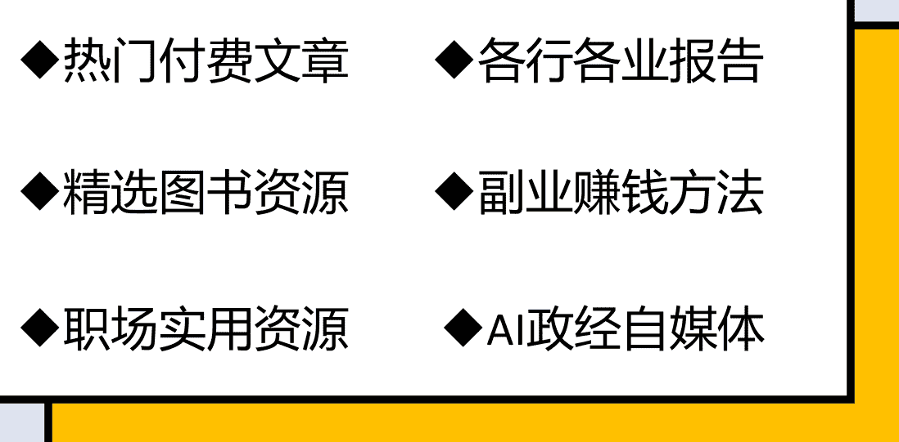

# 鉴茶财富进阶-197课：AMC 划归海内

加微信intsg2，免费进资料分享群

## 外资资产的顶层设计

这几天有两个新闻，一个是财政部下属的三大不良资产管理公司划归中央汇金，二是中证金融也划归汇金。

这意味着，上面已经形形成，由中央汇金主内，中投公司主外的国家资产管理局。

汇金和中投虽是公司，但都是正部级单位。过去，中投负责海外投资和中国的主权基金；汇金负责代表国务院向四大出资，后来又加入了救市和资本市场管理的职能，充当国家队角色。

但股市我们都知道，它是多层次的，信托、券商、银行、保险等都在里头玩，大家都有自己的想法。你只有钱，没有牌照，关键时候卡了脖子下不了场，且缺乏监管手段，看不了后台，就很很容易被种大聪明在里头套利。进群加微信 cp168319 典型的就是姚老板买卖料，大家干睁眼。

而四大AMC公司，不但有广泛的人才，基本上是金融全牌照。

比如说东方资产，就有大连银行、东兴证券、中华联合保险、大业信托等全牌照，甚至还有四大信用评级公司的东方金城。

中证金融公司，代表资本市场的自律监管机构、裁判员，和重要参与者。

它的股东是谁？上交所、深交所、中证登、中国金融期货交易所、上海期货交易所、郑商所、大连商品交易所以及负责私募基金备案的中国证券业协会。

这两项划拨之后，相当于汇金又拿到了广泛的后备资金和牌照，子弹几乎可以源源不断，不用再让我上面抬头，能形成一盘棋的整体合力，又拿到了资本市场的看牌权、裁判权、批判权。一手有钱，一手有法，终于打通了所有堵点，可以深入股市的底层进行真正的“调控”，而不是像过去一样只能做T，拉指数。

汇金对股市的力度只是一个方面，四大AMC的主业，现在基本上是不良的房地产。这意味着上面对地方债和暴雷房，也进行总扎口和通盘考虑。加微信jnts2，免费资料分享群。

这次调整，标志着中国金融监管，从“分业监管”向“功能监管”转型，也就是说，你不能只喊话，关键时候掏出个喇，你得见听效。

以后，证监、财政，只负责政策，具体的事情将由国家队人马在线进行微操。

## 地方债/房产，股市的两个问题，上面决定在25年基本解决，起码把形势扳过来。微信ts52免费资料分享群

你从中学学到了什么？这就是干实事。

以前的发文件，叫做喊话。只是精神，不是措施。

这是动真要稳住资产了。

顺势而为。

这是一轮中期行情的展开

- 日期：250217

## 免费 价值 及时 专注

## 扫码加入 知识星球TOP 免费资源群

- 每日免费获取价值资源
- 可提供各类资源搜索服务

| 热门付费文章 | 各行各业报告 |
| :--- | :--- |
| 精选图书资源 | 副业赚钱方法 |
| 职场实用资源 | AI政经自媒体 |

公众号: 知识星球TOP | 微信号: jntsg8 | 微信号: jntsg22

分享资料仅供个人学习，请及时删除，切勿商用传播
