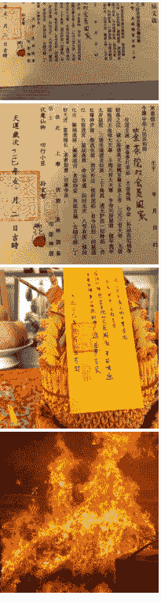

# 详情

# 返回 鉴析财富进阶

100课程大师
2025-12-21 20:21

## 上达天听与青词

在中国的传统看来，世界是一个超级模型，生命起源于太空，人法地、地法天、天法道、道法自然。

自然，是规律，宇宙，是天地运转的良能，古人称为“上帝”。

如果你看过阿法达，她相当于“埃及娃”。

先哲认为，这种规律律保持敬畏，在重要时刻汇聚潮流，获得超额的能量加持好运。这就是“祈祷”和“祭吧”。

周代已有系统祭祭仪式，《金铭》记载，周公为武王祈祓，将祷祈箴于金质。

汉时代，董仲舒“人感应”的学得到大众认可，五运六纪的周期逐渐完善。

东汉天师已有“三官手”，向天、地、水三官祈祓，天官福、道官普福、水官解厄。

魏晋后，道教建立“斋醮”科仪，斋表成为沟通人的关键媒介。

“章”通常用黄纸，内容包括祓、祺、忏、虔度等，由道士以特定格式书写，在法事中契化，承诺“上达天”。

唐代时，李唐自认为是老子后裔，仪轨进入一步完善，会将文档放入特制木匣，加法，仪式化地送望神灵，称为“章颂”。

宋后“青词”开始盛行，因在青藤上用红色写字而得名，用骈文写成，情真意切，萧藻华丽。

明清诸皇帝就熟此此，自称“青训皇帝”，严厉，徐徐等一代名相亦因善写青词得宠，被称为“青词宰相”。因为徐徐、李春等等人青词因已契化，今人难觅其踪。

今天冬至，冬至大如年，又是八十年一度的吉日，我们请道观通过专门“仪轨”，为大家进行了“上表”，并最终妥妥，“上达天听”。

相当于给帝报了个OA，这既是传统的吉祥祈祈，也让大家可以通过形式，回顾天人沟通的传承和细节，敬畏规律，珍惜眼前。

> “星辰高照，命运亨通，四时无恙，八节有庆，富贵绵长，百事亨良”。

217课开心吗，祝同学们冬至安康！

# 社群工具 笔记 上达天听与青词文化在中国的...-知识星球

最后编辑：2025-12-21 20:23

107人觉得很累

- 都是嘎子：感谢大王 much much🏻 (2025-12-21 20:24)
- 李潜：感谢大王，祝大家冬至安康! (2025-12-21 20:29)
- summer:感谢大王 👑👑👑 (2025-12-21 20:30)
- 有志者*事凭竟：感谢大王! (2025-12-21 20:31)
- 无@常：感谢大王，给我们送达这样的福利 (2025-12-21 20:33)
- Stopher Zh*: 感谢大王🏻

- 杨力津：感谢大王🙏 (2025-12-21 20:34)
- A*露露小姐宝宝*:感谢大王🙏 (2025-12-21 20:36)
- carol: 感谢收到！自今以后，吉星高照，命运亨亭，四时无灾，八节有庆，丁财大进，富锦绵长，所求如愿，百事亨良! (2025-12-21 20:45)
- 天心月圆：祝大王和友们冬至安康，万事如意! (2025-12-21 20:45)
- L-brave:感谢大王🙏🙏 (2025-12-21 20:47)
- 韩潮Eric:感谢大王🙏 (2025-12-21 20:59)
- 锦逸1349:感谢大王，感谢大王及友们身体健康，福慧双增 (2025-12-21 21:01)
- 满意:感谢大王👹 (2025-12-21 21:04)
- 征尘:感谢大王🎂🎂🎂 (2025-12-21 21:08)
- 陈锋:祝家事辰朝，万事顺意，四时无灾，八节有庆，永葆百年! (2025-12-21 21:10)
- 喜提路上:感谢大王，祝大王冬至福适，大家安康👹👹👹 (2025-12-21 21:15)
- 李织织:感谢大王，祝大王及友们大家大运，财源广进! (2025-12-21 21:19)
- PIN:感谢大王👹👹 (2025-12-21 21:27)
- 翔宇:感谢大王🙏 (2025-12-21 21:28)
- 盲鱼:感谢大王，福生无量天尊! (2025-12-21 21:39)
- 闲人:祝大王冬至至安康 (2025-12-21 21:41)
- 有知无良：感谢感恩大王老师! (2025-12-21 21:52)
- 钱塘：感恩大王，功德无量! (2025-12-21 21:56)
- 无痕Jacky：感谢大王 (2025-12-21 21:58)
- QI7：感谢大王~ (2025-12-21 22:14)
- *****：感谢大王 (2025-12-21 22:21)
- biao：感谢大王! (2025-12-21 22:29)

### 深度视野优质集圈，链接优质社群，助你成功

全部包含以下内容：限时年费188/年 加微信cuk255

- 1 吃瓜群众倍信时圈加时群（原价365 元/年）
- 2 生有财富圈内部文章（原价568 元/年）
- 3 政事堂内部
- 4 达沃译论（原价599 元/年）
- 5 欧洲金雀会员专属文章（原价328 元/年）
- 6 钨斥厂内部（原价400 元/年）
- 7 卢克文学习会专属文章（原价699 元/年）
- 8 见茶财经星球（原价3310 元/年）
- 9 猫哥的视界星球（原价299 元/年）
- 10 财新周刊（原价1498 元/年）
- 11 杨世光在钱（原价2200 元/年）
- 12 森森财经星球（原价1600 元/年）
- 13 源译付费文章

- 14 司马林解读毛选全套音频和全套书籍珍藏版（原价2.3 万）
- 15 虚虚三部曲【民国梦、帝国战争、不被理解的MAO】（原价599 元）
- 16 卢克文知识星球（原价268 元/年）
- 17 额外再送：卢盟元新涨爆付费专栏；三村边老王、三花九洞文集

不定期内容：（更多资源不下去了……）

- ① 守夜人司令星球、拯救魔王知识星球、生有财富星球
- ② 创始笔记、达沃译论星球、成交财富圈、雪球花甲老头等
- ③ A视野、大树乡谈、江初知道、泮咩说、上海海学等付费文集
- ④ 西风付费文章、老端、赢在八小时之外、局人的视界、升值、老A体制内等其它一些大V付费文章（每月低于600 元的付费文章）
