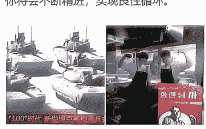

# 100课堂魔法师
2023-09-07 11:49

200课100伯克、男模餐厅和第一餐厅

周末有朋友说地方是个特色餐厅，里面全是男模特给你挣肉，你觉得要不要考虑一下？

大王的回答是：当然不去，想都不想，一定不好吃。

- 1, 任何一个国家、国家、军队、组织、企业、餐厅，资源都是有限的，你把钱砸到男身上，饭菜上的投入就少，能好吗？

这条路早就有人走过了，俏尚当年在北京开了许多奢豪餐厅，一水一米的漂亮脸脸傲着服务，很快就吃不下去了。

餐厅的第一原理就是好吃。

- 2, 马斯克是“第一原理思维”（First Principles Thinking）的著名倡者和实践者。

第一，是回归物质的。从基本的原理和事实出发进行推理，而不是类比、惯例或已有的结论。

a、类比
我妹妹开的奶茶店/医美连锁，我也能赚钱。

b、惯例
我过去在这家餐厅里创造出业绩，我单靠创业也能赚钱。

c、已有结论
人们喜欢美女/帅哥并没有直达本质，美国曾经有Hooters餐厅，核心元素正是充满活力的大胆美女，离时尚开店400家，一度又扩展出了“比基洛航空”，炸了无线的飞机，最后还是聚散。

因为航空的第一原理是方便便宜的客户，而不是顾客负责挣什么。

如果你有客户，有资源，有核心竞争力，哪怕你处于红海的纺织行业，哪怕你只是一个落脚景区到处都不行，你也能，也能赚到。

- 3, 如何践行第一原理？
- 餐厅必须靠帅美女吸引人吗？
- 电动车真的需要吃火锅和衣帽吗？
- 领导需要需要拍马和情绪价值吗？
- 餐厅的本质是提供美味的食物和良好的体验。
- 汽车的本质是可靠有性的交通工具。
- 现在的客户为了体验，你如何把做到最好，就把环境抓搞到极致？

萨利亚的毛利是72%，和传达一样。

- 现在的客户追求性价比和可靠，所以特拉斯拉克model3和model y，颜色很少，流量巨大。进入进群后pep85

营销的第一原理，是推出超级单品，乔布和马斯克深此做到。

这次淘汰的100式坦克，重量很轻，40吨，炮弹才用100mm，只有2个成员，摆履动系统，使用遥控炮，全身光电雷达压制坦克防御不需要120mm，是压制坦克而不是击坦克,

过去坦克防御，是装厚装甲，现在毫无意义，因为无人机和导弹才是坦克的的第一杀手,

坦克的第一原理，是不加厚装甲，而是态势感知，提前索敌发现。

因为大量的光电系统，柴油机是带不了的。要充足动力就需要电池，所以必须用电，这才是能源迭代的根本意义。

你没有知道know-how，电坦克有意义吗？

- 4、日常生活中，我们也要多去寻找第一原理的推演模式

比如，股市的第一原理是价值发现（炒作），有预期了会涨，低估了也会涨，高估了也会跌，预期的了也会跌，股票最终会回归它的合理价值。

龙头股的第一原理是领先。涨的、涨的、慢的、跌的、少的，带动后排起来，如果你不涨，几天很容易就凉了，那就不是你龙头推狗了。

再如此，上班的第一原理是开心，

马可思曾说过，动人的第一需要是，如果你上班不开心，说明你没有创造价值，你没有获得认可，在那里也是混日子。

掌握了第一原理：

工作中，要是把有限的资源花到最有用的地方，持续扩大的“利润产生部门”，尽量缩减的“成本开发部门”。

生活中也是一样的，把精力投入到“愉悦和价值产生部门”，而不是“焦虑和内耗产生部门”，远远离闲闲事，不断实现生活的有序与精简。

深度视野大V文集cuk255 有温度高质量社群cuk255

卡萨：开餐厅，东一定要好玩！

天心聚：劳动人的第一需要，而且一天24小时，上班的时间和睡眠的时间占比最大的，休息最重要。

2025-05-07 12:01

盆范：男模特后的反面，就是“李大想胖”，服务员都是大夫，形象很一般，但是物价备。

2025-05-07 12:09

河东：理想很丰，现在很痛苦，必须有大王带领大家上滑稽才是

2025-05-07 12:25

上的军头：大道至简化方法

2025-05-07 12:33

100面积大师傅：复上的军头：奥莉娜刀刷：如无必要，增增体

2025-05-07 12:41

道：第一原理，不断发现有的生活和熵减

2025-05-07 12:50

想要《天蛋签》里的若凡简直就是转型成功的

2025-05-07 13:41

丽丽而为：抓头可是不是第一原理。开股市，要让投资者割，对不对？

2025-05-07 09:19

升平四闲：做好人，买好饭

胡：上班的第一原理是开心，但很难遇到让自己开心的上上丽
