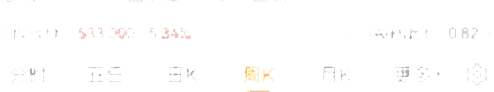

# 100连线实战

人很难选择时机
选股难还是择时难

很多大明白觉得得时机难，
做T技术含量很高，
高抛低吸能赚，
其实实错了，择时基本都是亏的，
你自以为在做T成功，其实实是在好股上而已。
选股比择时难100倍。

这是《如何选择优选股》中，菲普·雪雪教大家的核心思想。

比如今天的茅王，市值再度超越某台，达到1.82万亿。
按照不复权的算法，今天的价格是750，站上了超过2021年的692的700元平台。

那么，这种绩优股什么时候卖呢？
敬请期待书会的《如何选择优选股2》。
先恭喜那些进入了创板50和茅王者国运的。

## A股户与机构持股

| 股东类型 | 人数 | 股本数 | 占比 |
|---|---|---|---|
| 散户 | 2450 | 1174 | 0.01% |
| 游户 | 350 | 714 | 0.01% |
| 机构 | 1200 | 10631 | 0.10% |
| 户户 | 10000 | 50443 | 0.50% |
| 基金 | 800 | 15558 | 0.16% |
| 资管 | 600 | 246583 | 2.47% |
| 量化 | 300 | 208930 | 2.09% |
| 外资 | 200 | 415384 | 4.15% |
| 北向 | 100 | 1476875 | 14.77% |
| 其他 | 500 | 2468000 | 24.67% |

宁德时代
687.60
4.40% 29.00
654.60 692.60 653.60
2.10% 42.90万 291.02

市值 1.82万亿 总市值 21日涨幅14.31%
0.82
MA55 622.47 MA100 563.87 MA250 749.66

# 深度视野优质社群（链接优质社群，助你成功）

全部包含以下内容：限时年费188/年 加微信cuk255

- ① 吃群众倍赔时文加时群对话（原价 365 元/年）
- ② 子明私享汇（含）内部文章（原价 568 元/年）
- ③ 政事室（子明佛）付费内容加送额外子明群群
- ④ 米联锦兜【作者米穗】原价 599 元/年）
- ⑤ 欧洲金雀会员专属文章（原价 328 元/年）
- ⑥ 砖瓦斥内部文档（原价 400 元/年）
- ⑦ 卢克文青读书会专属文章（原价 699 元/年）
- ⑧ 鉴茶财经知识星球（原价 3310 元/年）
- ⑨ 猫哥的视界知识星球文章（原价 299 元/年）
- ⑩ 财财经周【独家新闻】原价 1498 元/年）
- ⑪ 杨世光在金钱圈（原价 2200 元/年）
- ⑫ 蔡森财经知识星球（原价 1600 元/年）
- ⑬ 激源异译付费文章（持续更新）
- ⑭ 司马林解读谋选全套音频和全套书籍无割（原价 2.3 万
- ⑮ 虚彦三部曲【民国梦、帝国争、不被理解的MAO】（原价 599 元）
- ⑑ 卢克文知识星球文章（原价 268 元/年）
- ⑰额外再送：卢祺元新微获付费专栏、三村丰老、三花九树文集
