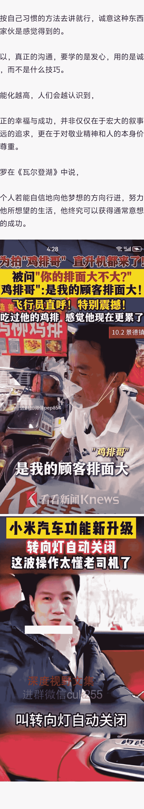

# 从排哥与布鲁斯看鸿问艺术

来自：崔磊的进阶

9月25日布鲁斯做了一个演讲，这次和以往完全不同了，评论区充满了大量的嘲和讽，

因为总是在外界问我有多少影响，我心里其实有多多少还是他，他是怎样的逆天奇但是却没有面地和回答核心的问题，如此，

- 售主联婚礼合同是不是不是霸王条款
- 扣营销是否不是为了装饰远不如乎宣传
- 营销策划是否不是很多不足和问题
- 十万鸿聘到底是不是和学生事故有

沟通的本质原理是什么？

真诚，不是多么高妙的口语和口号的切

对布鲁斯，既然最大的产品已经面了，人们希望看到他是商业的谦逊，而不是反复认真面对，回归技术，难道不是500强最靠谱最应该做的事么？怎么做到客户的意愿暗购

你再去看看排哥，他的特书呢

他的口语和才智鸿不齐，很多都是非常普通的话语。但全鸿红了红是因为在这个流量的时代，真诚是最难得的优质品质。

这次变成成了最重要的。把排哥搞好，是人的本分，让客户价值价值让客户是自己的内心。

所以各位，不要觉得自己不会口才，才不好，拙谦不是，笨蛋，想问如何让口才好，要去学校学看看怎么沟通技巧技。没有所谓的，人越笨越越反应越快，你应该学的东西越多少？请加微你按照自己习惯的方法去练习，诚意这种东西，大家都是觉得好的。所以，真正的正的，要学的是发心的，是用诚意的，不是什么才华。智能化的。真正的收获与运气，并非仅仅在于宏大的叙事和

> 梭罗在《艾尔哲湖》中说,

# 深度视野优质社群（链接优质社群，助你成功）

全部包含以下内容：限时年费188/年 加微信cuk255

- ① 吃瓜群众包帝圈加时群群对话（原价 365 元/年）
- ② 子明私享汇（内部）文章（原价 568 元/年）
- ③ 政事室（子明优）付费内容加送顺子子明群
- ④ 米联锦顶【作者米栖】（原价 599 元/年）
- ⑤ 欧洲金雀会员专属文章（原价 328 元/年）
- ⑥ 砖瓦斥内部文档（原价 400 元/年）
- ⑦ 卢克文青读书会专属文章（原价 699 元/年）
- ⑧ 鉴茶财经知识星球（原价 3310 元/年）
- ⑨ 猫哥的视界知识星球文章（原价 299 元/年）
- ⑩ 财新周【独家新闻】（原价 1498 元/年）
- ⑪ 杨世光在金钱圈（原价 2200 元/年）
- ⑫ 森森财经知识星球（原价 1600 元/年）
- ⑬ 激源异译付费文章（持续更新）
- ⑭ 司马林解读末选全套音频和全套书籍版权无损减（原价 2.3 万）
- ⑮ 虚构三部曲[民国梦、帝国战争、不被理解的 MAO]（原价 599 元）
- ⑱ 卢克知识星球文章（268 元/年）
- ⑰ 额外再送：卢祺元新微爆获付费专栏、三村丰老王、三花九树文集

不定内容：......（更多资源不写下去了......）

- ① 守夜司令知识星球、接换魔王后星球、成术迷论星球、成就财富圈、雪积花甲老头等
- ② 创始笔记星球
- ③ A视野、大树乡谈、江宁后语、咩咩说、上海海家等付费文集
- ④ 西风付费文章、老端、赢在八小时之外、局人的视界、升值、老体制内等等其它一些大V付费文集
