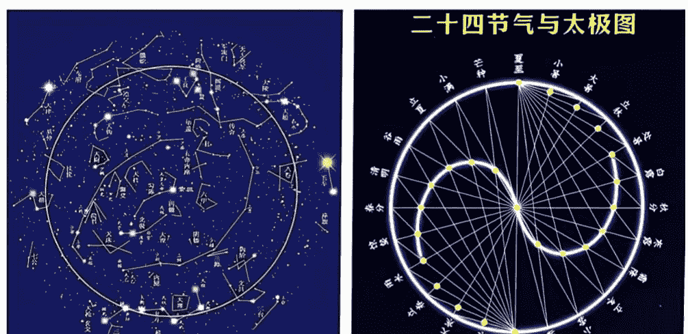

# 鉴茶进阶 251117：教我介绍一个超级模型

在滕王阁背诵《滕王阁序》，可以免门票，“豫章故郡，洪都新府。星分翼翼，接地衡户。禁三江而带五域，控禁刑而引越。物华天宝，龙光射牛斗之墟，人杰地灵，序需下陈蕃之焉。”——王勋《滕王阁序》所谓“星分翼翼”、“龙光射牛斗之墟”，其实就是东方文化里的星域。

中国的易经，中医，命理等字来自于哪里，来自于太空，

- 太极生两仪，生命出现了，
- 八卦，是地球上天、地、雷、风、水、火、山、泽八种自然现象，也是事物的状态，

太极图是什么，是在太空俯瞰地球黄道附近二十八星宿的分布图，由此比参照物来计算日月的运行轨道，指导人们的生产和生活。

它不是平面，它是立体的。

太极图就是超级模型，里面什么没有，算法简单，内涵无穷，不知道现在的 GPT 高到哪哪里去。很多人把八卦当做封迷信，是用自己的局限去解读世界的无限。

还是杨振说的好啊。进群加微信cuk255

这一看就像设计出来的嘛，怎么能偶然呢？

西方其实有人想到这点的，无奈天文学不给力，又缺乏建模能力，只能盲猜生命来自于太空，由“工程师”创造。拍摄了著名电影《普罗米修斯》。

深度视野VIP群 人工追踪50+V 付费进群微信cuk255

图，你以为的太极，实际上的太极图。

深度视野VIP群 人工追踪50+大 付费群加微信cuk255 微信chat5568

# 深度视野优质集群（链接优质社群，助你成功）

全部包含以下内容：限时优惠188/年 加微信cuk255

- ① 吃瓜群众倍帝微信加时群对话（原价 365 元/年）
- ② 子明享汇（内部）文章
- ③ 政事室（顾子明）付费内容加送顾子明群聊
- ④ 米联储【作者米栖】（原价 599 元/年）
- ⑤ 欧洲财富会员专属文章（原价 328 元/年）
- ⑥ 砖瓦石内部文档（原价 400 元/年）
- ⑦ 卢克青读书会专属文章（原价 699 元/年）
- ⑧ 鉴茶财经知识星球（原价 3310 元/年）
- ⑨ 猫哥的视界知识星球文章（原价 299 元/年）
- ⑩ 财经周刊【独家新闻】（原价 1498 元/年）
- ⑪ 杨世光在金钱波（原价 2200 元/年）
- ⑫ 森淼财经知识星球（原价 1600 元/年）
- ⑬ 激源译译付费文章（持续更新）
- ⑭ 司马深度课毛选全套音频和全套书籍珍藏无损级（原价 2.3 万）
- ⑮ 虚构三部曲[民国梦、帝国亡、不被理解的MAO】（原价 599 元）
- ⑯ 卢克文知识星球文章（原价 268 元/年）
- ⑱ 额外再送：刘薛元微博付费专栏、三村丰、老王、三花洞热门文集

不定期内容：......（更多资源将写下去......）

- ① 守夜人知识星球、接魔王后星球、生才有知识星球、
- ② 创始人笔记、达叔浅谈星球、成就财富、雪球花甲老头等
- ③ A视野、大树乡谈、江初你好、咩咩说、上海海家学等付费文集
- ④ 西凤付费文章、老端、赢在八小时之外、局人的视界、升值、老体制内等等其它一些大 V 付费文章

# 深度视野文集
进群微信cuk255

深度视野（付费文集）

# 限时优惠188/年 内部链接连接全网V优质内容
