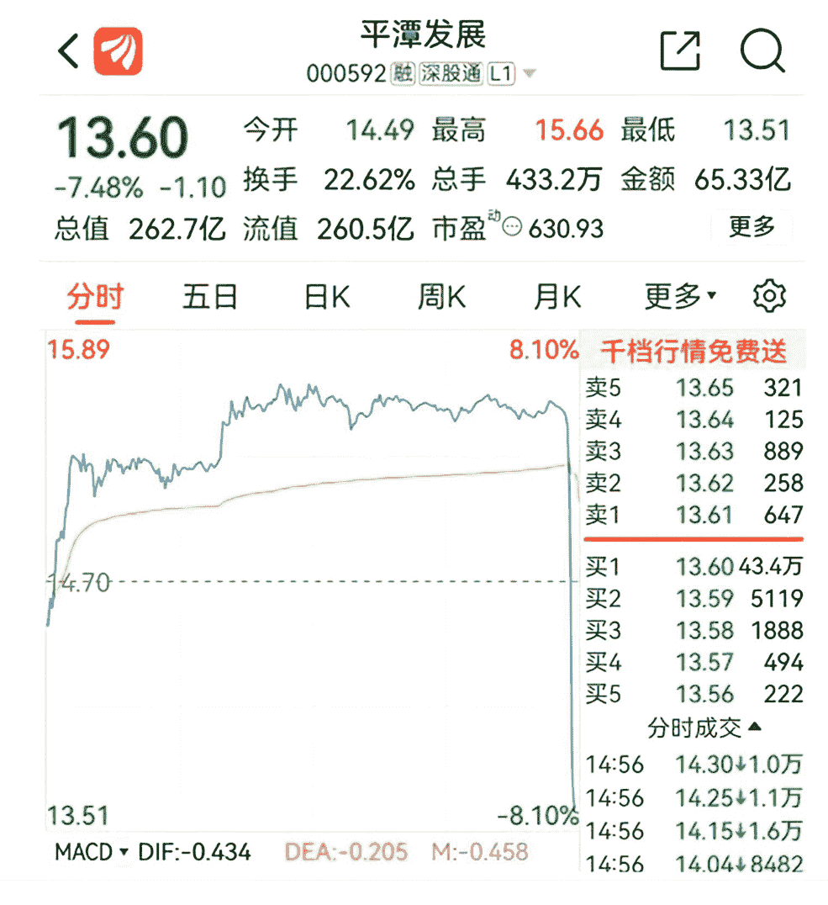

# 鉴茶财富进阶 251219: 戏不好搞

知道跷跷板效应，

市场弱，题材就强，

题材弱，主线就强，

一看缩量，科技跌，买福建的对的，

肯定也能赚，

问题是你不敢重仓，

等赚了三五回，

然后有人又告诉你，

福建会跨越年度的主线，

你终于敢重仓了。

今天继续看着科技弱，大盘缩量，

福建美姿几乎涨停，

结果尾盘直接给你来大跳水，

主打比你跑得快就行了。

下周咋办呢?进群加微信，里面的机构和量化会夺路而逃。

如果更坏的，给你来个地-天-板。

炒股的第一性原理是投资，投资的首要是选好东西。

玻璃渣里可能还藏着几颗糖，你但凡大口吃肯定被砸着。

深度视野VIP群 人工避路50+V 付费群加微信cuk255 微信chsp5568

## 深度优质集圈，链接优质社群，助你成功

全部包含以下内容：限时年费188/年 加微信cuk255

- 1 吃瓜群众倍时圈加时群群（原价 365 元/年）
- 2 子明私享（会）内部文章（原价 568 元/年）
- 3 政事堂（原子明）费内内容再送顺子明群聊
- 4 米联诸间【作者米糕】原价 599 元/年）
- 5 欧洲金准会员专属文章（原价 328 元/年）
- 6 铸五厂内部圈（原价 400 元/年）
- 7 卢克文青读书会专属文章（原价 699 元/年）
- 8 鉴茶财经知识星球（原价 3310 元/年）
- 9 猫哥的视角知识星球（原价 299 元/年）
- 10 财经新周【独家新闻】原价 1498 元/年）
- 11 杨世光在金钱（原价 2200 元/年）
- 12 森财经知识星球（原价 1600 元/年）
- 13 源译译付费文章（持续更新）

## 深度优质文集
进群微信cuk255

- 14 司马林解读毛选全套音频和全书珍藏版无删减（原价 2.3 万）
- 15 虚走三部曲【国梦、帝国争亡、不被理解的 MAO](原价 599 元）
- 16 卢克文知识星球文章（原价 268 元/年）
- 17 额外外再送：卢赣元新浪微博付费专栏、三杭村边老王、三花九汀文集

不定内容：（更多资源将不下了...）

- ① 守夜人司令星球、接魂魔王知识星球、生有财富知识星球、
- ② 创始笔记、达沃译论星球、成付财富圈、雪花甲老头等
- ③ A 视野、大树乡谈、江初号、泮咩说、上海海学等付费文集
- ④ 西风付费文章、老端、赢在八小时之外、局人的视角、升值、老A体制内等其它一些大V付费文章（每月不超过600 元的付费文集

限时年费188/年 低成本链接全网大V优质内容
