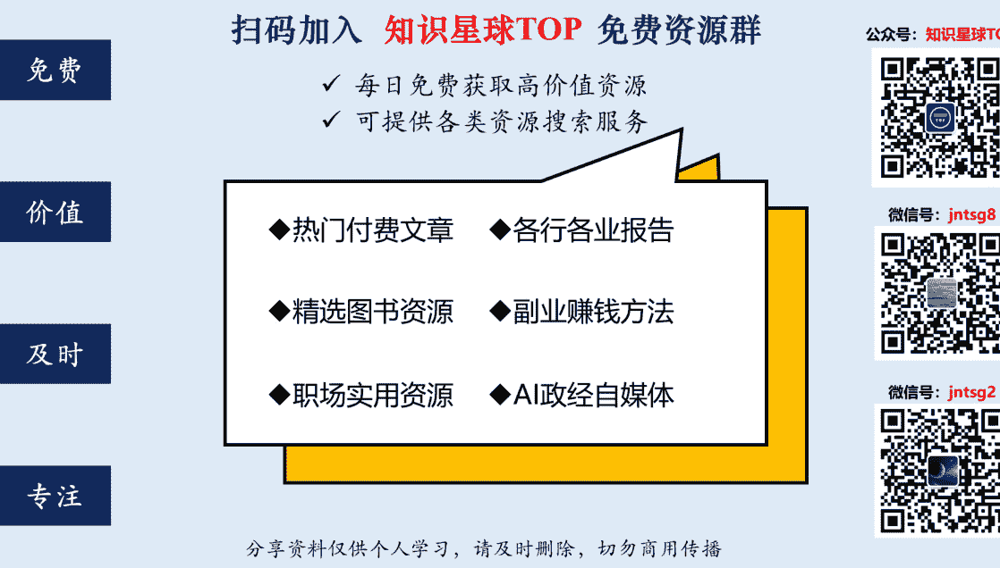

# 鉴定财富进阶 250604：懂王的寒门崛起示

不管大家怎么调优，拼抗，攻击，客观上，懂王家族从寒门移民顶了全世界最有权的家族，说人心如古就好，世道堕落就好，人家一定是有东西做的很对，取得了世俗意义的巨大成功，咱们客观上分析一下他们的建议启发。

微信：jnts8
微信：jnts2

- 1，代际接力。

懂王爷爷开小旅馆，爸爸建廉价房，自己搞高档公寓。
地段上，相当于从廊坊做北京五环，从五环扎根二环，序序渐进，百年质变。

> 一个很多人不想承认的事是，如果你让孩子获得相对高一点的起点，最好是子传业。

原因并不复杂，省去漫长的摸索整合过程，传承到你积累的人脉资源，在你的肩膀基础上前进提升。

懂王高中毕业后，去学电影，好莱坞制片人，家里不同意，毅然回去搞地产。

要代际传承，重要条件之一是生孩子，懂王爷爷3个子女，懂王爸爸5个，懂王5个，总有优秀的能出来。一个不行，还有备胎。王其实就是他哥哥的候选。普通人翻身最有性价比的投资是生娃。

- 2，教育趁早。

很多人不愿意跟孩子沟通自己的工作职业，要对对方专心思学习，怕人家听不懂，想多了。

那些你辛苦掌握的游戏规则和底层逻辑，要及早教给孩子。

弗莱迪在懂王 10 岁时，就开始教他房产和商业等方面的知识技巧，每周五晚，弗莱迪都会带他巡视建筑工地，现场讲解砖墙、建材的标准等等。不能听懂，先记下来再说。这本身能激活大脑，启迪智慧，大道上相通。

- 3，事上磨炼。

培养一个人自主和倔强的精神，最好的办法是让他亲自做事，基层做。

虽然懂王是富代，但老爸专门从 12 岁起，就开始给他找了送报纸的工作，如果下雨，自己开凯迪带他去送。

15 岁时，懂暑假就在父亲工地上搬运建材，薪 3 美元。

有时间有条件，要带孩子去摆摊，送货，做做事情，提早了体会民间疾苦，接接地气，靠自己双手赚钱，知道世界是怎么运转的，不是坏事。

现在有多少大学生毕业了一无所知的，对社会一片空白。

世界上没有随随便便的成功，你看到的每一个巨大成就，背后都是长期积累和门道。

| | | |
|---|---|---|
| 免费 | 知识是TOP 免费资源群 | ✓ 每日免费获取高价值资源 ✓ 可提供各类资源投资服务 |
| 价值 | ◆热门付费文章 ◆各行业报告 | |
| 及时 | ◆精选书籍资源 ◆副业赚钱方法 ◆职实用资源 ◆AI财经自媒体 | |
| 关注 | | |

分享资料仅供个人学习，请及时删除，请勿用于传播

加微信信号jntg2，免费进阶资料群
加微信jnttsg2，免费进阶资料群
