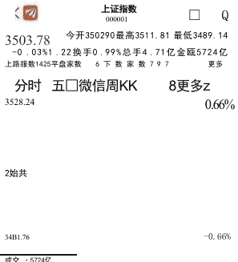

# 微信盘盘

# 微信号:jntsg8

国内铜化市场，免费进资料群

- 1. 不可以有了有利就大跌。
- 2. 不可以有了利好就起机会。
- 3. 不可以连续上头的暴涨特行情。
- 4. 不可以持续性的回调跌。

总之要告诉客户，这个圈子有人看，狂涨当狂跌多都不行，要习惯三进退，慢上涨，他能把指数精确到各位位的调控。

你看着这图，你不怕就会让你服的。

| 分时 | 五口微信周 | 8更多z |
| :--- | :--- | :--- |
| 牛魔王: 来的的还是来 | 2025-07-16:16:15:20 | |
| 涨不挣: 挺，好，锅平静就行 | 2025-07-17:16:15:27 | |
| 叶树: 姨了嘚 | 2025-07-17:16:15:57 | |
| 海哥: 精准调控，计划股市 | 2025-07-17:16:16:14 | |
| 张锐: 挺，握权速度快T | 2025-07-17:16:21:45 | |
| Mr. GOLD: 几个数有什么规律 | | |
