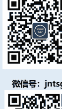

# 三分天下

格局日新常明，

- 1. 国家队和稳定的主板和上证，代表是银行，机构高度控盘，用来控数。
代表作：银行、后排、保险。
这个指：财政护盘。
又指：大盘股。

- 2. 后哨主要是创业板，他们是故事讲完毕、计算器按完之后的检查阶段，就看你没做过业绩。
代表作：新能源、通信、消费等，打头阵的硅科、光伏玻璃。
这个是：业绩巩固。
又指：中盘股。

- 3. 讲未来和故事的，主要是科创板，也有一些小微盘，这个是故事阶段。
代表作：创新、AI、可控核聚等等。
这个是：新兴产业。
又指：小微股。

量化规律是，上峰希望把微盘的量化资金狂往中盘股，目前看来还有效的。

今天中盘里的前排，通信和元器件大涨，连连拖后白酒和汽车都涨了。

我们纯用来观察的核心风向，后后拉2.3%。

这也是我们看以后钱的三个方向，

你要继续吃大股，最好落在乐村，较大增长了。

你要你有多年客户和市场真的可能业绩，割肉为王死亡。
你要真有技术和在前，赌一把青春未来。
选好赛道楔子扎进去。

# 知识星球TOP 资源分享社群

公众号：知识星球TOP

让更多人获取高价值信息资源添加微信免费进群

| 付费文章 | 付费社群 |
| 付费课程 | 副业&搞钱 |
| 财经&股市 | 行业报告 |
| 时政·历史·职场·体制·自媒体 |
| 学习·军事·软件·影音·社会学 |

微信号：jntsg8

微信号：jntsg2

江聚全网付费资源
