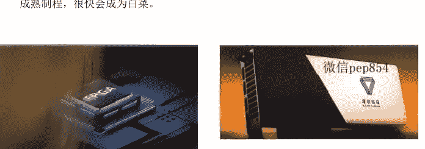

# 100课堂大师
2020810711

重温一下这一课
最近市场开始涨半导体，半导体那么大，什么设备胶水之类的铁的不值，要要也是后排，有想象空间。
国产芯片。

192 课：卡是有的，芯片核心……

> 涨峰谷：大师回复涨峰谷，请问海光市场表现不如寒芯，王莱的原因是什么呢？
02-S • 2021.12.00

> 100课堂大师回复涨峰谷：它是GPU，想要做的事非常全面，起来和见过的慢，弹性不限于干算力的寒芯。
15:73

> 123：大王，每一同一，你提到的东芯后面寒芯连接，寒芯后面是芯原等。想下去，东芯这样的这种调整（结合前2天），对跟以前说的高位锐幅转化的慢；不是一种导致考虑开始加速的信号？当涨回调反弹会有低位。
2025-08-21 15:32

> 相飞田回复123：我今天加东芯五。
2025-08-25 10:01

> 123回复相飞田：你是新建仓还是原来就有底仓？
2025-08-21 19:05

# 100万厂大帅
70 0116.112I

## 192调课卡是有的，芯片分类一览

平时我们经常会听到各种芯片，分别是干什么的？

1. CPU (Central Processing Unit) 是中央处理器，电脑要基于CPU运行的软件和应用软件，配合CPU内部的硬件模块，实现产品的各种功能。
CPU 是大脑和总指挥的，相当于董事长总经理。
美国的代表企业是英特尔，中国的龙芯和海光。

2. GPU (Graphics Processing Unit) 是图形处理器，基于该GPU可运行于各种游戏、图形等，又称图形卡。
最早的CPU可以将图形单元GPU集成，但随着人们对图形和画质的要求越来越，你必须单独处理一个东西来分担压力，成为副总经理。
美国代表企业是英达，中国海光，景芯，摩尔（未上市）。

3. NPU (Neural Processing Unit)，神经网络处理器，芯片是一种特殊的硬件加速器，类似于助理经理。它能帮助GPU高效处理深度学习任务，如图像识别、语言处理、推理训练等。
CPU 处理器，运行app；
GPU 副处理器，渲染、游戏等；
NPU 助理处理器，图像识别、AI 应用等。

4. ASIC (Application-Specific Integrated Circuit) 专用集成芯片。一种为特定应用或用户需求而设计的集成电路。
CPU 和 GPU能不能完成任务，当然能。他们都有算力。
但用这么大的班子解决一个专门问题，比如招聘面试，不是太贵、大材小用不划算？
所以ASIC就是定制芯片，部门经理，要费给你定制，要HR给你HR。ASIC 是为某个特定的功能或应用而设计和制造的。
美国是博通，中国的代表是龙威。

5. FPGA (Field Programmable Gate Array)是可以重新编译内部结构，以达到目的的可编程芯片。

# 知识星球TOP
付费资源共享群

添加微信
免费入群

| 序号 | 公号/星球/社群 | 原价 | 领域 |
|---|---|---|---|
| 1 | 生才财富 | 2765/年 | 副业，搞钱 |
| 2 | 容众吃瓜群 | 365/年 | 时政，历史 |
| 3 | 记忆承载/树持西风 | 365/年 | 成长，搞钱 |
| 4 | 欧洲城堡 | 328/年 | 时政，历史 |
| 5 | 虎文青云会 | 699/年 | 时政，社会 |
| 6 | 体制内主任 | 599/年 | 体制：职场 |
| 7 | 外人的视界 | 669/年 | 金融，时政 |
| 8 | 濑锋奔贷 | 4166/年 | 财富，成长 |
| 9 | 宁波人怂司令 | 599/年 | 时政，经济 |
| 10 | 江宁诸府 | 365/篇 | 时政，国际 |
| 11 | 政事堂/顾子明 | 568/年 | 时政，经济 |
| 12 | 唐诗院 | 1399/篇 | 金融，财富 |
| 13 | 大树义贷 | 199/年 | 时政，成长 |
| 14 | 水沫欧大 | 1000/泛 | 房产，经济 |
| 15 | 洪澜的宏观策略 | 4376/年 | 经济，搞钱 |
| 16 | 金政通/北海南 | 4576/年 | 股票，行研 |
| 17 | 猫哥的世界 | 299/年 | 时政，社会 |
| 18 | 飞龙王 | 3600/年 | 股市，经济 |
| 19 | 米联诸见闻 | 599/年 | 经济，金融 |
| 20 | 鉴茶世财经 | 330/年 | 房产，股票 |
| 21 | 赢在八小时之外 | 365/年 | 成长，职场 |

...
更多资源，不再列举

+书籍、报告、课程等各类高价资源

★免费群 每日分享所有资源（日均20+），75/年
★VIP群 每日分享所有资源

# TOP资源 TOP资源社区

5. FPGA(Field Programmable Gate Array)是可以重新编辑内部结构，以达到目的的可编程芯片。
它像乐高一样，可定制微结构，公司买回去自己调，想做智驾，想做算力做。
美国的代表是特尔，中国的代表是芯科技。

### 6, SoC 芯片,(System on Chip)是系统级芯片，将整个计算系统或电子系统集成到单片芯片上的。
能够在单片上实现之前多个芯片才能完成的系统功能，有很多场景。
比如AI手机领域，它可以集成CPU、GPU、NPU、基带单元、内存、音频处理器、WiFi模块等。
国外的代表是高通、三星、日本瑞萨等，是中国华、瑞芯、瀚澜微、云天、中科源、全志等。
因为汽车的应用很多，不需要7nm、5nm，而是28nm都够，所以SoC很快成为主流制程。

> 叶棉：蔬菜好吗？2025-01-22 10:08
> 叶棉：海外的贵吗？2025-01-22 11:20
> CMG回复叶棉：稀有的情绪，短期看价值和业绩，长期性最好。理解，请仔细看。
> CMG回复叶棉：以后指导的分类法。2025-01-22 10:53
> 隽术：虽然算力是王道但是本体太贵了，链分类法，计算设计；材料；光刻、封装测试……真是清洗了。2025-01-22 07:19
> 涵：关于国内产业反补贴，一段时间以来，政府给予了大量补贴，因此企业获得了公平竞争优势，对国内应当贸易救济。2025-01-22 16:20
> 小叔：大叔，能不能买，等到正月再卖吗？
> 林蕾：靠紫是光微。2025-01-23 02:03
> 记得要自律，这个酷合适。2025-01-25 15:44
> 深入浅出，芯片分类终于好了。

> 天地自留回复而为：我也加了下七个点，看明天，今天调整没放量，应该是正常调整洗盘，顺势洗盘。2025-01-25 05:03
> 少年加油：加仓喽。2025-01-25 00:00

> 调整是好事。

## 100C程大认师-o 05.1
来两张图一下。

> 参与度：相当于2015年的34%，外围的39%...
> 户净流入：相当于2015年的30%，外围的40%...
> 证券净金额：预测价值1.8亿元，环保减少1%...
> 个人投资者：新增96万户，环保增加19%...

> 顺而为回复秦磊：今天走这样我不懂，尾能加了。参考响14、815的走势，希望明天能表现，不及预期就先减仓出来。2025-06-15
> 四轮回回复顺而为：我就是没钱，哈哈。拥有。
> 123：秦磊吗？
> 顺而为回复雪莉宇：不，你有。
> 顺莉宇回复123：对。
> 零莉宇回复顺而为：我只有钱就是对象，她让我坚持。
> 顺而为回复秦莉宇：此处有每个子，坚持不，梗不。

> 小宇回复弗狮子：nDZ50071168
> 狮翔回复小宇：哈哈哈哈。2025-02-25 004

> 谢SS：大部分散户在牛市都是赚不到钱的。16:48
> 苏涵回复苏SS：能够持续伏的散户是极少数，大部分都想赚快钱离去。15:51
> 谢SS回复苏涵：就是说散户改变自己，即使加入了群里是没用的，赚钱永远是少数。2:17:03

# 西部

产户净收入、万吨全A(百吨)

| | 2014/1 | 2015 | 2016 | 2017 | 2018 | 2019 | 2020 | 2021 | 2022/1 | 2023/1 | 2024/1 | 2025/1 |
|---|---|---|---|---|---|---|---|---|---|---|---|---|
| 7000 | | | | | | | | | | | | |
| 6000 | | | | | | | | | | | | |
| 5000 | | | | | | | | | | | | |
| 4000 | | | | | | | | | | | | |
| 3000 | | | | | | | | | | | | |
| 2000 | | | | | | | | | | | | |
| 1000 | | | | | | | | | | | | |

> 参与度：相当于2015年的34%，外围的39%...
> 户净流入：相当于2015年的30%，外围的40%...
> 证券净金额：预测价值1.8亿元，环保减少1%...
> 个人投资者：新增96万户，环保增加19%...

> 顺而为回复秦磊：今天走这样我不懂，尾能加了。参考响14、815的走势，希望明天能表现，不及预期就先减仓出来。2025-06-15
> 四轮回回复顺而为：我就是没钱，哈哈。拥有。
> 123：秦磊吗？
> 顺而为回复雪莉宇：不，你有。
> 顺莉宇回复123：对。
> 零莉宇回复顺而为：我只有钱就是对象，她让我坚持。
> 顺而为回复秦莉宇：此处有每个子，坚持不，梗不。

> 户净收入、万吨全A(百吨)

| | 2014/1 | 2015 | 2016 | 2017 | 2018 | 2019 | 2020 | 2021 | 2022/1 | 2023/1 | 2024/1 | 2025/1 |
|---|---|---|---|---|---|---|---|---|---|---|---|---|
| 7000 | | | | | | | | | | | | |
| 6000 | | | | | | | | | | | | | |
| 5000 | | | | | | | | | | | | | |
| 4000 | | | | | | | | | | | | | |
| 3000 | | | | | | | | | | | | | |
| 2000 | | | | | | | | | | | | | |
| 1000 | | | | | | | | | | | | | |

> 参与度：相当于2015年的34%，外围的39%...
> 户净流入：相当于2015年的30%，外围的40%...
> 证券净金额：预测价值1.8亿元，环保减少1%...
> 个人投资者：新增96万户，环保增加19%...

> 顺而为回复秦磊：今天走这样我不懂，尾能加了。参考响14、815的走势，希望明天能表现，不及预期就先减仓出来。2025-06-15
> 四轮回回复顺而为：我就是没钱，哈哈。拥有。
> 123：秦磊吗？
> 顺而为回复雪莉宇：不，你有。
> 顺莉宇回复123：对。
> 零莉宇回复顺而为：我只有钱就是对象，她让我坚持。

> 户净收入、万吨全A(百吨)
