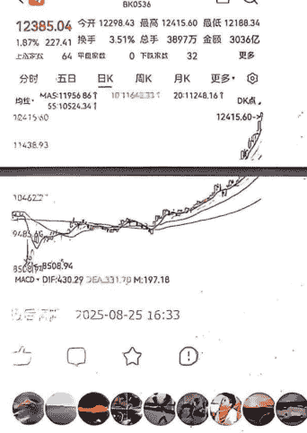
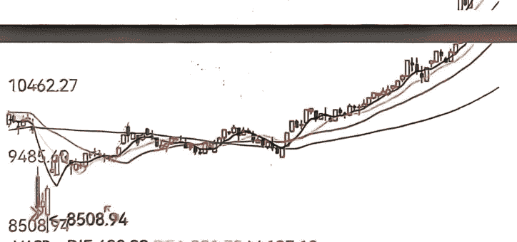
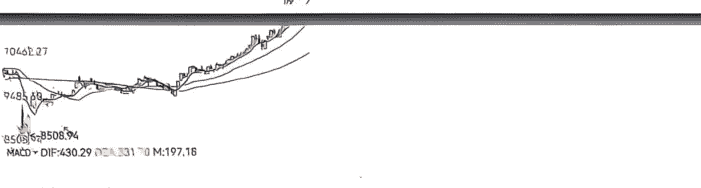

# 微信:jntsg8
# 微信:jntsg9

100亿行大大师
2017-08-25 16:20

免费进资料群

# 洋人进场了-几路资本的买入和基本

以下几路资金的主要方向，不严丝合缝，但整体体符合。

- 1、生产队：主攻在沪深300。还有上证50，科创50。
- 2、两融与公募机构：创业版。现在创业板由三大部分组成：陆胜易中中的力、王子代表的版内卷、东财等金融科技。在易中天头部护团。
- 3、游资与量化：中证2000。因为量化产品的不断发售，有弹药，所以还能加仓。
- 4、新的外资：上证50，创业50。它们基本不会买中国的蓝筹，一向喜欢的大马，核心资产类。要大，比加诸代表的PCB、创旭代表的光模块，宇王代表的电池，阳光代表的光伏、茅五代表的白酒，万华代表的化学，紫金代表的矿业等。

# 后资金会发生什么。

- 1、由于外资和机构的进一步加仓，大头会越涨越猛，集团趋势进一步加强。
- 2、如果游资量化看到小盘市值越来越大了，中小票权重会（目前没有看到这个态势，本身非常重要）。
- 3、上证50，沪深300，尤其是300，是生产队管理员工，要一涨立破300。此时行情的要看慎，它要涨越涨，它要跌越跌。
- 4、更直观的是什么东西呢？基金重仓指数，它涨上去，代表意涨，它跌下来，代表不同意涨。

你要问现在什么情况？
之前说过，周线的主升浪，目前还没有看到问题，不要因日线大惊小怪。
今天的大涨说明了一件什么事？
外资在进场了。

俊勇：这个图：bk0536软件里找不到，

# 基金重仓 ①

BK0536

| 12385.04 今开 12298.43 最高 12415.60 最低 12188.34 |
| 1.87% 227.41 换手 3.51% 总手 3897万 金额 3036亿 |
| 上家数 64 平仓家数 0 下家数 61 更多 |

分群微信pep854
五日 日K 周K 月K 更多
均线 MA:11956.86↑ 10:1643.33↑ 20:11248.16↑ DK点55:10524.34↑
12415.60-11438.93

10462.27
9485.69
8508.57 8508.94
MACD↑ DIF:430.29 DEA:331.70 M:197.18

最后编辑：2025-08-25 16:33

你要问现在什么情况？
之前说过，周线的主升后，目前还没有看到回落，不要因回线大惊心质。
今天的大涨说明了一件什么事？
外资在进场了。

基金经理 (①)
| 12385.04 跌 12298.43 涨 12415.60 跌 12186.34 |
| 1.87% 22.61% 3.51% 涨 38977 跌 30364 |
| 上涨 64 天 0% 下跌 32 更多 |

分: 日 周 周 月 K 更多
MAS:11956.86 10:14237.37 20:11318.61
RSI:50524.34 12415.60-

赵磊 2025-08-25 16:33

悦榜：这个图：bk0536软件里找不到，
2025-08-25 16:33

山野：今天入
2025-08-25 19:45

回复：在东方
2025-08-25 21:57

# TOP级资源 TOP社群

付费资源 免费群

微信: jntsg2

| 序号 | 公号/星球/社群 | 原价 | 领域 |
| :--- | :--- | :--- | :--- |
| 1 | 生态有木 | 2765/年 | 副业、搞钱 |
| 2 | 容宗从群众 | 365/年 | 时政、历史 |
| 3 | 凯文青 | 365/年 | 成长、搞钱 |
| 4 | 欧洲金 | 328/年 | 时政、历史 |
| 5 | 卢克文 | 699/年 | 时政、社会 |
| 6 | 体制内 | 599/年 | 体制；职场 |
| 7 | 外局人的视界 | 669/年 | 金融、职 |
| 8 | 灏异谈 | 4166/年 | 财富、成长 |
| 9 | 守夜人总令 | 599/年 | 时政、经济 |
| 10 | 江宁府 | 365/篇 | 时政、国际 |
| 11 | 政堂/顾子明 | 568/年 | 时政、经济 |
| 12 | 唐书院 | 1399/篇 | 金融、财富 |
| 13 | 大树乡谈 | 199/年 | 时政、成长 |
| 14 | 水库欧大 | 1000远 | 房产、经济 |
| 15 | 洪灏的宏观策略 | 4376/年 | 经济、搞钱 |
| 16 | 金政通鉴/北海道南山 | 4576/年 | 股票、行研 |
| 17 | 猫留的世界 | 299/年 | 时政、社会 |
| 18 | 飞浅云 | 3600/年 | 股市、经济 |
| 19 | 米联储见闻 | 599/年 | 经济、金融 |
| 20 | 鉴茶财经院 | 330/年 | 房产、股票 |
| 21 | 赢在八小时之外 | 365元/年 | 成长、职场 |
| ... | 更多资源，不再列举 | | |

+图书、报告、课程等各类高价值资源

+   * ★ 免费群 每日分享份资源
* ★ VIP群 每日分享所有资源（日均20+），75/年

十五有
