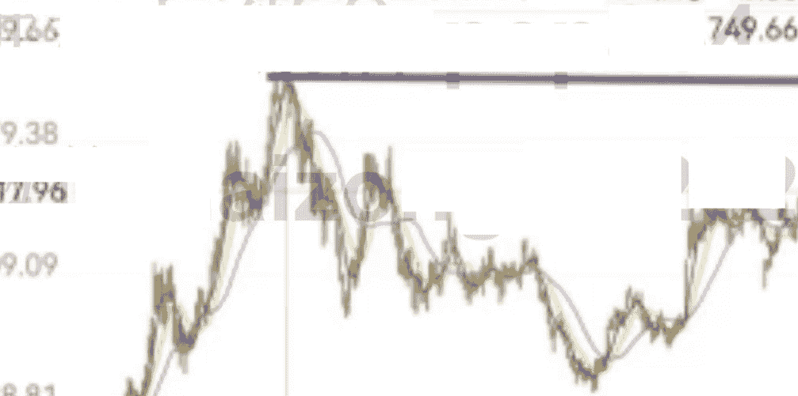

# 100课程大法师

进入：价值财富进阶课

很多聪明人都觉得择时机很重要，做T技术含量很高，高抛低吸能赚钱。

其实错了，择时基本都是错的，你自以为做T成功，其实是在好股上而已。选股比择时难100倍。

这是《如何选择绩优股》中，菲利普·雪教大家的核心思想。

比如今天的宁王，市值再度越亚台，达到1.82万亿。按照不复权的算法，今天的价格是750，站上了超过2021年的692的700元平台。

那么，这种绩优股什么时候买入呢？敬请期待书会的《如何选择绩优股2》。

先恭喜位那些进入了创业板50和宁王诸侯国的。。

| 账户类型 | 净流入量 | 限额调整 | 买入额 | 流出额 |
|---|---|---|---|--|
| 普通户账户 | -2457 | -774 | 1338 | -404 |
| 普通户账户 | -5496 | -3918 | 1511 | -242 |
| 普通户账户 | -6901 | -3055 | 2439 | -1467 |
| 普通户账户 | -30443 | -34683 | 4022 | 1349 |
| 普通户账户 | -345083 | -41584 | 50277 | 22262 |
| 普通户账户 | -11470165 | -1476835 | 291015 | 241431 |
| 总量 | -23408044 | | | |

687.60 今开 654.60 最高 692.60 最低 653.60
4.40% 29.00 换手 2.10% 总量 42.90 万 金额 291.03
